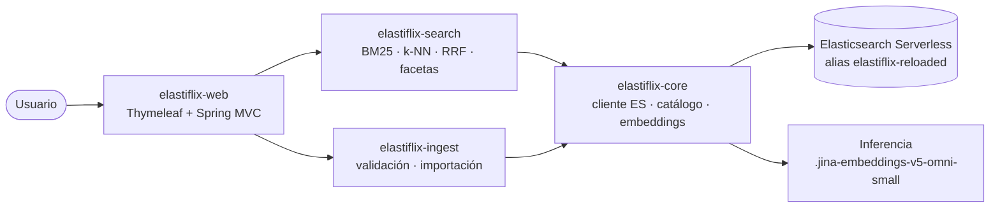

# 🗺️ PLAN DE DESARROLLO — Elastiflix-Movies Java

> **Propósito.** Fuente única de verdad para construir **Elastiflix-Movies Java**, una aplicación web
> que demuestra la búsqueda **full-text (BM25)**, **vectorial (k-NN)** e **híbrida (RRF)** de
> películas sobre un índice de **Elasticsearch Serverless**, y la carga segura de datos.
> Escrito para ser **ejecutado por un agente de IA**: Claude Code, Cursor, Google Antigravity o
> JetBrains Junie.
>
> **Cómo usar este plan (para el agente).**
> 1. **Al iniciar cualquier sesión, aplica el protocolo de reanudación** (§9): el trabajo pudo
>    interrumpirse a mitad de una tarea.
> 2. Lee `AGENTS.md` (Claude Code lo carga desde `CLAUDE.md`) y `docs/convenciones-java.md` completos
>    antes de tocar código.
> 3. **Diseña antes de codificar:** cada fase con código (de la 1 a la 5) empieza por su tarea `.0`
>    (`docs/diseno/<fase>.md`). En las fases con 🔒, **detente** hasta que el usuario apruebe el diseño.
> 4. Ejecuta las **fases en orden** (Fase 0 → Fase 6). No adelantes fases ni tareas.
> 5. Cada tarea tiene rutas, comandos y **criterio de aceptación**. No la marques hecha si el criterio
>    no pasa.
> 6. **Al terminar cada tarea:** actualiza el estado (`progreso/<fase>.md` **y** `progreso/INDICE.md`),
>    haz **un commit** con el código y el estado, con el id como prefijo (`2.3: estrategia full-text`), y
>    **`git push`** al remoto. Así, si se acaban los tokens, otro agente retoma desde lo publicado.
>    Nunca empieces una tarea con cambios sin commit o commits sin push de la anterior.
> 7. Al terminar una fase, corre su **"Verificación de fase"** (no continúes si falla) y **actualiza la
>    documentación del proyecto** (tarea final de cada fase).
> 8. Nunca escribas secretos en el código ni en git. Todo secreto va por `.env`.
> 9. **No agregues funciones que este plan no pide.** Si algo no está definido, pregúntalo al usuario.

## Índice

- [1. Contexto y objetivo](#1-contexto-y-objetivo)
- [2. Arquitectura](#2-arquitectura)
- [3. Stack y versiones](#3-stack-y-versiones)
- [4. Estructura del repositorio](#4-estructura-del-repositorio)
- [5. Contrato de la aplicación web](#5-contrato-de-la-aplicación-web)
- [6. Modelo de datos](#6-modelo-de-datos)
- [7. Convenciones del proyecto](#7-convenciones-del-proyecto)
- [8. Calidad de código](#8-calidad-de-código)
- [9. Estado del trabajo y reanudación](#9-estado-del-trabajo-y-reanudación)
- [Fases](#fases)
  - [Fase 0 — Andamiaje y calidad](#fase-0--andamiaje-y-calidad)
  - [Fase 1 — Núcleo: conexión, catálogo y embeddings 🔒](#fase-1--núcleo-conexión-catálogo-y-embeddings-)
  - [Fase 2 — Búsqueda 🔒](#fase-2--búsqueda-)
  - [Fase 3 — Carga de datos 🔒](#fase-3--carga-de-datos-)
  - [Fase 4 — Interfaz web](#fase-4--interfaz-web)
  - [Fase 5 — Pruebas integrales y smoke test](#fase-5--pruebas-integrales-y-smoke-test)
  - [Fase 6 — Documentación y cierre](#fase-6--documentación-y-cierre)
- [Definición de Hecho (global)](#definición-de-hecho-global)
- [Variables de entorno](#variables-de-entorno-envexample)
- [Referencias](#referencias)

---

## 1. Contexto y objetivo

**Qué es.** Una demo que permite escribir una consulta y comparar cómo responden tres modos de
búsqueda sobre el mismo catálogo de **4 322 películas**, acotar los resultados con filtros dinámicos y
cargar nuevas películas sin dejar nunca el catálogo a medias.

**Qué debe lograr.**

| Capacidad | Resumen |
|---|---|
| 🔤 Full-text (léxica) | `match` sobre `title` **o** `original_title`, o `multi_match` `best_fields` sobre ambos; operador OR/AND; puntuación BM25 |
| 🧭 Vectorial | `knn` sobre `plot_256`, `plot_512` o `plot_1024`; `k` (100) y `num_candidates` (200) ajustables; similitud `(1 + coseno) / 2` |
| 🔀 Híbrida | Retriever `rrf` con el componente full-text y el vectorial; `rank_constant = 60`, `rank_window_size = k`; muestra BM25, k-NN, sus posiciones y la puntuación RRF |
| 🎛️ Filtros | `adult`, `genres`, `release_date` (desde–hasta), `spoken_languages`, `rating`, con conteos calculados sobre los resultados |
| 📄 Paginación | 25 · 50 · 100 por página |
| 📥 Carga de datos | Registro individual (directo al catálogo), `.json` o `.csv` con encabezado (≤ 150 MB, UTF-8); validación completa contra el mapping; vectores siempre generados con el servicio de inferencia; importación en índice temporal, swap atómico de alias y borrado del índice anterior; vuelta atrás si algo falla |
| ℹ️ Acerca de | Documentación de la demo dentro de la aplicación |

**Fuera de alcance** (no implementar sin que el usuario lo pida): autenticación, comparación lado a
lado, subselectores de fusión, antivirus o análisis de malware de archivos (lo hace el proveedor del
servidor de aplicaciones), despliegue en la nube, CI/CD, controles de concurrencia (la demo tiene fines
académicos y demostrativos y la usa una sola persona a la vez).

**Diseño visual aprobado:** los mockups de `design/mockups/` (ver `design/README.md`). La interfaz
real **reproduce fielmente** esos mockups: paleta, tipografías, textos, componentes y comportamiento.
No los rediseñes. **Únicos ajustes de texto autorizados** (decisiones del usuario del 2026-10-17):

| Mockup | Texto actual | Ajuste |
|---|---|---|
| `About.dc.html` › Carga de datos › Vectores | «Si el archivo trae plot_256, plot_512 y plot_1024 válidos, se usan tal cual. Si no, se generan…» | Los tres vectores **siempre** se generan desde `plot` con el servicio de inferencia de Elasticsearch; si el archivo los trae, se ignoran |
| `About.dc.html` › Carga de datos › Índice temporal / Publicación | — | Agregar que, al publicar, el índice anterior se borra |
| `About.dc.html` y `Ingest.dc.html` › reglas de validación | «vectores con 256, 512 y 1024 números» | Quitar los vectores de las reglas de validación |
| `About.dc.html` › Formas de carga › Archivo .csv | «con encabezado» | Aclarar que un CSV sin encabezado se rechaza |
| `Ingest.dc.html` › casilla «La primera fila contiene los nombres de columna» | — | Si se desmarca, el archivo se rechaza con su código `EFX-ING-*` |
| `Ingest.dc.html` › texto de importación | «Los vectores del archivo se usan tal cual.» | «Los vectores de la sinopsis se generan para cada película con el servicio de inferencia de Elasticsearch.» |
| `Ingest.dc.html` › comprobaciones superadas (JSON y CSV) | «Vectores en todos los registros/filas: 256, 512 y 1024 números válidos con norma 1; no hace falta generarlos.» | Se elimina esa comprobación. Si el archivo trae columnas de vector, se agrega la advertencia «El archivo trae plot_256, plot_512 y plot_1024: se ignorarán y se generarán con el servicio de inferencia.» |
| `Ingest.dc.html` › correspondencia de columnas, fila `plot_1024` | «Vector JSON de 1024 números · Asignada» | «Se ignora · se generará desde plot» (y lo mismo para `plot_256` y `plot_512`) |
| `Ingest.dc.html` › ejemplo de error | `plot_512` «Una lista de 384 números» | Los ejemplos de error son solo del escenario de diseño; los errores reales salen de la validación |
| `Ingest.dc.html` › progreso | «índice temporal elastiflix-reloaded-import-[fecha]» | El nombre real del índice temporal: `<alias>-<AAAAMMDD-HHMMSS>` |
| `Ingest.dc.html` › paso 5 «Publicación» y texto de importación | «El alias elastiflix-reloaded pasa al índice nuevo en una sola operación.» | «El alias elastiflix-reloaded pasa al índice nuevo y el índice anterior se borra, en una sola operación.» |
| `Ingest.dc.html` › ayuda del archivo CSV y `About.dc.html` › Archivo .csv | «Las listas, los objetos anidados y los vectores van como JSON dentro de la celda.» | «Las listas y los objetos anidados van como JSON dentro de la celda.» |
| Pie de **todas** las páginas | — | Agregar el aviso de atribución de TMDB, solo texto: «This product uses the TMDB API but is not endorsed or certified by TMDB.» |
| `About.dc.html` › nueva sección final «Créditos» | — | Aviso de atribución de TMDB «This product uses the TMDB API but is not endorsed or certified by TMDB.», debajo su traducción «Este producto usa la API de TMDB, pero no está avalado ni certificado por TMDB.» y un logo **aprobado** de TMDB, menos prominente que el logo de la demo |
| `Main.dc.html` › etiquetas de las sugerencias («OR: 40 resultados», «Titanic: 4.º lugar»…) | — | Se mantienen fijas, tal como en el mockup: describen el catálogo original de 4 322 películas |

## 2. Arquitectura



El diagrama completo, con el flujo numerado de búsqueda (1–7) y de carga (A–G), está en
[`docs/arquitectura.mermaid`](docs/arquitectura.mermaid).

**Notas de implementación**

- **Un solo ejecutable:** `elastiflix-web` (Spring Boot). `core`, `search` e `ingest` son librerías.
- **Alias como punto de lectura:** todas las búsquedas van al alias `elastiflix-reloaded`. El índice
  real se llama `<alias>-<AAAAMMDD-HHMMSS>` (UTC), por ejemplo `elastiflix-reloaded-20261020-153000`. Una importación de archivo escribe en un
  índice nuevo y publica con **una sola llamada atómica a `_aliases`**: `add` del alias al índice nuevo
  y `remove_index` del índice anterior (el anterior se borra; decisión del usuario). El registro
  individual se escribe directamente en el índice vigente a través del alias.
- **Estado actual del clúster:** hoy `elastiflix-reloaded` es un **índice concreto**, no un alias. La
  tarea **1.8** lo migra a alias con el mismo mecanismo (`add` + `remove_index`), sin pedir aprobación
  (decisión del usuario).
- **Por qué borrar el índice anterior es seguro** (validado al redactar el plan; la tarea 1.6 lo
  demuestra en el proyecto real):
  1. `add` + `remove_index` en una sola llamada es atómico: nunca hay un momento sin alias ni con el
     alias apuntando a dos índices.
  2. Solo se ejecuta después de verificar el conteo del índice nuevo; si la verificación falla, se borra
     el temporal y el anterior queda intacto.
  3. La aplicación la usa **una sola persona a la vez** (fines académicos y demostrativos; decisión del
     usuario): no hay búsquedas, registros individuales ni importaciones simultáneas que puedan cruzarse
     con el swap, así que no se agregan controles de concurrencia.
  4. Si el borrado no se completara por un error ajeno, el alias ya apunta al índice nuevo; los índices
     `<alias>-<AAAAMMDD-HHMMSS>` de **ese mismo alias** que no estén detrás de él se limpian al inicio de
     la siguiente importación y se registran en `WARN`. Nunca se borran índices de otro alias (por
     ejemplo, las pruebas con `elastiflix-it-*` no pueden tocar `elastiflix-reloaded-*`).
  5. No queda respaldo del catálogo anterior dentro de Elasticsearch: el respaldo es el archivo de
     exportación del usuario.
- **Serverless:** no hay `_cluster/health`; el indicador de salud consulta el alias y su conteo
  (`_count`). No se configuran shards ni réplicas.
- **Vectores fuera de las respuestas:** las búsquedas excluyen `plot_256`, `plot_512` y `plot_1024`
  de `_source`.
- **Facetas:** en Full-text salen de agregaciones `terms`; en Vectorial e Híbrida se calculan en la
  aplicación sobre los resultados devueltos (hasta `k`), porque en RRF las agregaciones incluirían
  películas que no están en la lista combinada.
- **Híbrida con puntuaciones por componente:** el orden final lo da el retriever `rrf`; para mostrar
  BM25, similitud k-NN y la posición de cada película en su lista, la aplicación ejecuta también los dos
  componentes por separado (mismos filtros, `size = k`) en el mismo `_msearch`.

## 3. Stack y versiones

Versiones verificadas en la web el 2026-10-17.

| Componente | Tecnología | Versión |
|---|---|---|
| Lenguaje | Java (LTS) | **25** |
| Framework | Spring Boot (padre `spring-boot-starter-parent`) | **4.1.1** (Spring Framework ≥ 7.0.9) |
| Build | Maven mediante Maven Wrapper | **3.10.0** |
| Plantillas | Thymeleaf (`spring-boot-starter-thymeleaf`) | **3.1.5** (gestionada por Boot) |
| Cliente de búsqueda | Elasticsearch Java client `co.elastic.clients:elasticsearch-java` | **9.4.5** (gestionada por Boot; sobrescribir `elasticsearch-client.version` a 9.5.4 solo si hace falta) |
| JSON | Jackson 3 (`tools.jackson`), `Jackson3JsonpMapper` | **3.1.5** (gestionada por Boot) |
| Motor | Elasticsearch Serverless | — |
| Modelo de embeddings | `jina-embeddings-v5-omni-small` (endpoint `.jina-embeddings-v5-omni-small`) | 1024 dims nativas |
| Pruebas | JUnit Jupiter 6, AssertJ, Mockito (`spring-boot-starter-test`); MockMvc (`spring-boot-starter-webmvc-test`); Failsafe para `*IT` | gestionadas por Boot |
| Estilo | Checkstyle (`maven-checkstyle-plugin` 3.6.0) | **14.3.0** |
| Análisis estático | PMD (`maven-pmd-plugin` 3.28.0) | **7.28.0** |
| Arquitectura | ArchUnit (`com.tngtech.archunit:archunit-junit6`, por JUnit 6) | **1.5.1** |

- No se usa Spring Data Elasticsearch, Lombok ni Jackson 2 en el código propio (Jackson 2 queda como
  dependencia transitiva, sin uso).
- Zona horaria: **UTC**. Paquete base: `com.bigfito.elastiflix`. `groupId`: `com.bigfito`.

## 4. Estructura del repositorio

```
elastiflix-reloaded/
├── PLAN.md                     ← este plan (fuente única de verdad)
├── AGENTS.md                   ← reglas para agentes (Cursor, Antigravity, Junie, Claude Code)
├── CLAUDE.md                   ← entrada para Claude Code (importa AGENTS.md)
├── README.md
├── .cursor/rules/              ← regla de Cursor para archivos .java
├── .env.example                ← variables de entorno sin valores reales
├── pom.xml                     ← POM padre (packaging pom) · Java 25 · Spring Boot 4.1.1   [Fase 0]
├── mvnw · mvnw.cmd · .mvn/     ← Maven Wrapper 3.10.0                                        [Fase 0]
├── config/
│   ├── checkstyle/checkstyle.xml
│   └── pmd/pmd-ruleset.xml
├── docs/
│   ├── arquitectura.mermaid
│   ├── convenciones-java.md
│   └── diseno/_PLANTILLA.md    ← y un <fase>.md por fase con código
├── design/
│   ├── README.md               ← tokens de diseño y cómo usar los mockups
│   └── mockups/                ← Main · Results · Ingest · About (.dc.html)
├── elasticsearch/
│   ├── elastiflix-reloaded-mapping.json
│   └── fixtures/               ← muestras reales: 4 películas en .json y .csv, vector de consulta
├── progreso/
│   ├── INDICE.md               ← fase actual y próximo paso global
│   └── _PLANTILLA.md           ← estado por fase
├── elastiflix-core/            ← modelo, cliente ES, catálogo (alias, índices), mapping, embeddings  [Fase 1]
├── elastiflix-search/          ← match/multi_match, knn, rrf, filtros, facetas, paginación          [Fase 2]
├── elastiflix-ingest/          ← validación, lectores JSON/CSV, importación por lotes, swap de alias [Fase 3]
└── elastiflix-web/             ← único ejecutable: Spring Boot + Thymeleaf (4 páginas)              [Fases 0 y 4]
```

`progreso/` guarda el **estado del desarrollo**; no tiene relación con ningún estado de la aplicación
(por ejemplo, el estado de un trabajo de importación vive en memoria dentro de `elastiflix-ingest`).

## 5. Contrato de la aplicación web

**Páginas**

| Método y ruta | Página (mockup) | Descripción |
|---|---|---|
| `GET /` | Inicio (`Main.dc.html`) | Caja de búsqueda, selector de modo con sus paneles y sugerencias dinámicas |
| `GET /buscar` | Resultados (`Results.dc.html`) | Resultados paginados, puntuaciones por modo y filtros |
| `GET /cargar` | Cargar datos (`Ingest.dc.html`) | Pestañas Registro individual · Importar .json · Importar .csv |
| `GET /acerca` | Acerca de la demo (`About.dc.html`) | Documentación de la demo |

**Parámetros de `GET /buscar`** (también los usa el formulario de Inicio)

| Parámetro | Valores | Por defecto |
|---|---|---|
| `q` | texto no vacío | — (obligatorio: «Escribe qué película buscas antes de pulsar Buscar.») |
| `modo` | `fulltext` · `vectorial` · `hibrida` | `fulltext` |
| `tipo` | `match` · `multi_match` | `match` |
| `campo` | `title` · `original_title` (solo con `match`) | `title` |
| `operador` | `or` · `and` | `or` |
| `vector` | `plot_256` · `plot_512` · `plot_1024` | `plot_256` |
| `k` | entero ≥ 1 | `100` |
| `candidatos` | entero, `k ≤ candidatos ≤ 10000` | `200` |
| `pagina` | entero ≥ 1 | `1` |
| `tamano` | `25` · `50` · `100` | `25` |
| `adult` | `true` · `false` (repetible) | sin filtro |
| `genero`, `idioma`, `clasificacion` | valores de `genres`, `spoken_languages`, `rating` (repetibles) | sin filtro |
| `desde`, `hasta` | `yyyy-MM-dd`; `desde ≤ hasta` | sin filtro |

**Carga de datos** (respuestas JSON salvo donde se indica)

| Método y ruta | Uso |
|---|---|
| `POST /cargar/registro` | Guarda una película desde el formulario **directamente en el catálogo** (índice vigente a través del alias). Redirige a `/cargar` con el resultado |
| `POST /cargar/archivo` (multipart: `archivo`, `separador`, `encabezado`) | Sube el archivo, repite las comprobaciones de tipo, tamaño y UTF-8 (y, en CSV, que traiga encabezado), y lanza la validación; devuelve `jobId` |
| `GET /cargar/trabajos/{jobId}` | Estado del trabajo: paso del proceso (1–5), conteos, errores (primeros 6), advertencias, comprobaciones, progreso |
| `POST /cargar/trabajos/{jobId}/importar` | Inicia la importación de un archivo ya validado (genera los vectores, escribe en el índice temporal, publica y borra el índice anterior) |
| `POST /cargar/trabajos/{jobId}/cancelar` | Cancela la importación y borra el índice temporal |
| `GET /cargar/trabajos/{jobId}/informe.csv` | Informe completo de errores (CSV UTF-8) |

**Actuator:** `GET /actuator/health` con el componente `elastiflixCatalog` (`alias`, `index`,
`documents`): un `HealthIndicator` de Spring Boot 4 (`org.springframework.boot.health.contributor`)
registrado como bean `elastiflixCatalogHealthIndicator`, con `management.endpoint.health.show-details=always`
(§7). Alimenta el indicador «Conectado · Elasticsearch Serverless» del header y el pie
«Índice: elastiflix-reloaded · 4 322 películas».

**Límites entre módulos** (interfaces que define el diseño de la Fase 1 y consumen las demás):
`CatalogIndex`, `EmbeddingService`, `IndexMapping`, `CatalogStatusService` (en `core`);
`SearchService` (en `search`); `IngestService` (en `ingest`). La web solo conoce estas fachadas y sus
`record` de entrada y salida.

**Pósters:** cada resultado muestra su póster desde el CDN de imágenes de TMDB:
`<ELASTIFLIX_POSTER_BASE_URL><poster_path>` (por defecto `https://image.tmdb.org/t/p/w342`). Si
`poster_path` está vacío o la imagen no carga, se muestra el marcador del mockup.

## 6. Modelo de datos

- **Mapping:** [`elasticsearch/elastiflix-reloaded-mapping.json`](elasticsearch/elastiflix-reloaded-mapping.json)
  (33 campos). Es la referencia para crear índices y para validar cargas. `elastiflix-core` lo empaqueta
  como recurso desde esa misma ruta (sin copiarlo).
- **Campos que usa la demo:**

| Campo | Tipo | Uso |
|---|---|---|
| `id` | keyword | Identificador; es el `_id` del documento |
| `title`, `original_title` | text | Full-text, Híbrida |
| `plot` | text | Sinopsis; origen de los vectores; se muestra recortada a 3 líneas |
| `plot_256`, `plot_512`, `plot_1024` | dense_vector · cosine · `hnsw` (m 16, ef_construction 100) | Vectorial, Híbrida |
| `adult` | boolean | Filtro |
| `genres` | keyword | Filtro |
| `release_date` | date `yyyy-MM-dd` | Filtro (rango) |
| `spoken_languages` | keyword | Filtro |
| `rating` | keyword (`G`, `PG`, `PG-13`, `R`, `NC-17`, `NR`) | Filtro |
| `keywords`, `belongs_to_collection` | nested | Se capturan en la carga |

- **Vectores:** 512 y 256 son los primeros N valores del vector de 1024, renormalizados (L2). Prefijos:
  `Query: ` en consultas (`input_type: search`) y `Document: ` en sinopsis.
- **En cada carga (archivo o registro individual), `plot_256`, `plot_512` y `plot_1024` se llenan en
  tiempo de ejecución** llamando al modelo de embeddings a través del servicio de inferencia de
  Elasticsearch. Los archivos de importación **no necesitan** traer esos campos y el formulario **no los
  captura**. Si un archivo los trae (por ejemplo, una exportación del índice como los fixtures), se
  ignoran con una advertencia y no se validan.
- **Coherencia con el catálogo:** los vectores del catálogo se generaron en una carga previa con el
  mismo modelo y el mismo servicio de inferencia, pero no está documentado con qué `input_type` ni con
  qué prefijo. La tarea **1.9** lo determina midiendo contra los vectores guardados y fija la
  combinación en la configuración (`elastiflix.embedding.*`); las cargas usan exactamente esa
  combinación. Hechos ya comprobados: las consultas con `input_type: search` y prefijo `Query: `
  reproducen el vector de `elasticsearch/fixtures/query-vector-titanic.json`, y `plot_512`/`plot_256`
  del catálogo son el recorte renormalizado de `plot_1024` (verificado en las 4 322 películas de la
  exportación: coseno ≥ 0.9999999 en todas; ninguna película sin vectores ni con `plot` vacío).
- **Formatos de carga** (muestras reales en `elasticsearch/fixtures/`):
  - **JSON:** objeto de exportación `{index, exported_at, document_count, csv_file, load_notes, mapping, documents[]}`,
    un arreglo de películas o NDJSON. Si trae `document_count`, debe coincidir con `documents`.
  - **CSV:** UTF-8 con o sin BOM, separador coma (o `;` / tabulador si el usuario lo elige), **encabezado
    obligatorio** (un CSV sin encabezado se rechaza), fin de línea `\r\n` o `\n`, celdas multilínea
    entre comillas; listas y objetos anidados como JSON dentro de la celda.
  - En ambos formatos puede venir el metadato `_id`; si viene, debe ser igual a `id`. `id` puede llegar
    como número y se guarda como texto.
- **Datos de verificación** (catálogo intacto de 4 322 películas, `k = 100`, `num_candidates = 200`):

| Modo y ajustes | Consulta | Esperado |
|---|---|---|
| `match` · `title` | `dark knight` | OR 40 · AND 3 |
| `match` · `title` | `love story` | OR 65 · AND 1 |
| `match` · `title` | `Kolejne 365 dni` | OR 1 · AND 0 |
| `match` · `original_title` | `el secreto` | OR 16 · AND 1 |
| `match` · `original_title` | `le fabuleux destin` | OR 14 · AND 1 |
| `multi_match` | `heaven cielo` | OR 6 · AND 0 |
| `multi_match` | `next kolejne` | OR 11 · AND 0 |
| `multi_match` | `parasite 기생충` | OR 1 · AND 0 |
| Vectorial | `un barco de lujo choca con un iceberg en su viaje inaugural` | Titanic (`597`): 4.º en `plot_256`, 3.º en `plot_512`, 1.º en `plot_1024` |
| Vectorial | `un joven náufrago comparte un bote salvavidas con un tigre de Bengala en medio del océano` | Life of Pi (`87827`): 10.º · 3.º · 2.º |
| Vectorial | `un robot solitario que limpia la Tierra` | WALL·E (`10681`): 1.º en los tres campos |
| Híbrida · `match` `title` AND | `toy story juguetes que cobran vida` | componente léxico vacío; los `k` resultados vienen del vectorial |

## 7. Convenciones del proyecto

- **Idioma:** interfaz, mensajes, logs, Javadoc y documentación en español; identificadores en inglés.
- **Fechas:** UTC; `release_date` en `yyyy-MM-dd`.
- **Configuración:** el usuario pone sus valores en `.env` (raíz del repo) o en variables de entorno.
  `.env` se importa como archivo de propiedades y **cada propiedad se declara con un marcador
  `${VARIABLE:valor por defecto}`** (las claves en mayúsculas de un archivo importado no se enlazan solas
  a `elastiflix.*`). Configuración de `elastiflix-web/src/main/resources/application.yml`:

  | Propiedad | Valor |
  |---|---|
  | `spring.config.import` | `optional:file:.env[.properties],optional:file:../.env[.properties]` (raíz al ejecutar el jar; carpeta del módulo con `spring-boot:run` y Failsafe) |
  | `elastiflix.elasticsearch.url` | `${ELASTICSEARCH_URL:}` (obligatoria: si está vacía, la aplicación no arranca y muestra `EFX-CFG-001`) |
  | `elastiflix.elasticsearch.api-key` | `${ELASTICSEARCH_API_KEY:}` (obligatoria: `EFX-CFG-002`) |
  | `spring.elasticsearch.uris` | `${elastiflix.elasticsearch.url}` |
  | `spring.elasticsearch.api-key` | `${elastiflix.elasticsearch.api-key}` (propiedad de Spring Boot 4.1.1) |
  | `elastiflix.index.alias` | `${ELASTIFLIX_INDEX_ALIAS:elastiflix-reloaded}` |
  | `elastiflix.inference.id` | `${ELASTIFLIX_INFERENCE_ID:.jina-embeddings-v5-omni-small}` |
  | `elastiflix.ingest.max-file-size` | `${ELASTIFLIX_INGEST_MAX_FILE_SIZE:150MB}` |
  | `elastiflix.ingest.batch-size` | `${ELASTIFLIX_INGEST_BATCH_SIZE:100}` |
  | `elastiflix.poster.base-url` | `${ELASTIFLIX_POSTER_BASE_URL:https://image.tmdb.org/t/p/w342}` |
  | `elastiflix.bootstrap.enabled` | `false` (se activa solo por línea de comandos en la tarea 1.8) |
  | `server.port` | `${SERVER_PORT:8080}` |
  | `spring.servlet.multipart.max-file-size` | `${elastiflix.ingest.max-file-size}` |
  | `spring.servlet.multipart.max-request-size` | `151MB` (el archivo más los campos del formulario) |
  | `server.tomcat.max-swallow-size` | `-1` (para responder con `EFX-ING-*` en lugar de cortar la conexión) |
  | `spring.threads.virtual.enabled` | `true` |
  | `management.endpoints.web.exposure.include` | `health` |
  | `management.endpoint.health.show-details` | `always` |
  | `management.health.elasticsearch.enabled` | `false` (el indicador de Boot usa `_cluster/health`, que Serverless no tiene) |

  Los valores de embeddings de documento (`elastiflix.embedding.*`) **no** van en el YAML: son los
  valores por defecto (`@DefaultValue`) del `record` de propiedades de `elastiflix-core`, fijados por la
  calibración de la tarea 1.9, para que todos los módulos y pruebas usen los mismos.
- **Secretos:** solo en `.env` (excluido por `.gitignore`). Nunca en código, YAML, pruebas, logs ni
  commits.
- **Integración contra Elasticsearch:** las pruebas de lectura usan `elastiflix-reloaded` sin
  modificarlo; las de escritura usan su propio alias `elastiflix-it-<aleatorio>` y lo borran al terminar.
- **Nombres de índice:** siempre derivados del alias configurado: `<alias>-<AAAAMMDD-HHMMSS>` (UTC). Con
  el alias por defecto, `elastiflix-reloaded-20261020-153000`; en una prueba,
  `elastiflix-it-x7k2-20261020-153000`. Nada se nombra con `elastiflix-reloaded` escrito en el código.
- **Textos de la interfaz:** los de los mockups, palabra por palabra, salvo los ajustes autorizados de §1.
- **Git:** un commit **y un push** por tarea, con el estado actualizado; documentación del proyecto
  actualizada al cerrar cada fase.

## 8. Calidad de código

**Convenciones.** [`docs/convenciones-java.md`](docs/convenciones-java.md) es obligatorio y manda sobre
las preferencias por defecto de cualquier herramienta. Es la skill `java-developer` (persona
JavaMentor) aplicada a este proyecto, con umbrales y desviaciones declaradas.

**Diseño antes de codificar.** Cada fase con código empieza por su tarea `.0`. **Compuertas de
aprobación del usuario** (🔒) — el agente se detiene con el estado `esperando aprobación de diseño`:

| Fase | Motivo |
|---|---|
| 🔒 **1** — Núcleo | Define los contratos (`CatalogIndex`, `EmbeddingService`, `IndexMapping`, errores) que usan todas las demás y la migración del índice a alias |
| 🔒 **2** — Búsqueda | Concentra los algoritmos centrales: construcción de `match`/`multi_match`, `knn`, `rrf`, filtros y facetas |
| 🔒 **3** — Carga de datos | Orquestación con índice temporal, swap de alias y vuelta atrás; manejo de archivos de 150 MB |

En las fases 4 y 5 el diseño se escribe y se hace commit, pero no requiere aprobación previa.

**Matriz de dependencias.** ArchUnit (y PMD `JM-DEP-02`) verifican la columna **«No puede depender
de»**: son listas de prohibición. La columna «Uso esperado» es orientativa; cualquier otra librería
gestionada por el POM padre (por ejemplo `jakarta.validation`, `jakarta.json`,
`org.springframework.stereotype`) está permitida mientras no esté prohibida.

| Módulo (paquete) | Uso esperado | No puede depender de |
|---|---|---|
| `elastiflix-core` (`com.bigfito.elastiflix.core..`) | Cliente de Elasticsearch, Jackson 3, SLF4J, Spring sin web | `..search..`, `..ingest..`, `..web..`, `org.springframework.web..`, `org.thymeleaf..` |
| `elastiflix-search` (`com.bigfito.elastiflix.search..`) | `core`, cliente de Elasticsearch, Spring sin web | `..ingest..`, `..web..`, `org.springframework.web..`, `org.thymeleaf..` |
| `elastiflix-ingest` (`com.bigfito.elastiflix.ingest..`) | `core`, cliente de Elasticsearch, Jackson 3, Spring sin web | `..search..`, `..web..`, `org.springframework.web..`, `org.thymeleaf..` |
| `elastiflix-web` (`com.bigfito.elastiflix.web..`) | Fachadas y `record` de `search`, `ingest` y `core` (modelo, errores, estado, propiedades), Spring MVC, Thymeleaf, Actuator | `co.elastic.clients..` |

Además: sin ciclos entre módulos (`slices().matching("com.bigfito.elastiflix.(*)..")`); los
controladores solo en `..web..` y con nombre `*Controller`; ninguna clase usa `System.out`/`System.err`.

**Verificación automática.**

| Comando | Qué ejecuta |
|---|---|
| `./mvnw -q test` | Pruebas unitarias |
| `./mvnw verify` | Unitarias + arquitectura (ArchUnit) + Checkstyle + PMD. Sin red. **Lo corren todas las fases** |
| `./mvnw verify -Pit` | Lo anterior + pruebas de integración (`*IT`) contra Elasticsearch Serverless (requiere `.env`) |

En Windows, ejecuta los comandos en **Git Bash** (`./mvnw`); ver `AGENTS.md`.

**Cierre de fase.** El agente escribe en `progreso/<fase>.md` el **Resumen de diseño** y responde la
**Revisión de convenciones** (lista de `docs/convenciones-java.md` §16). El usuario la confirma al
revisar la fase.

## 9. Estado del trabajo y reanudación

**Archivos.** `progreso/INDICE.md` (fase actual, estado de cada fase y próximo paso global) y
`progreso/<fase>.md` (`0.md` … `6.md`), creado desde `progreso/_PLANTILLA.md` al empezar cada fase.
Se versionan en git; `.gitignore` nunca los excluye.

**Estados de una fase:** `no iniciado` · `en curso` · `esperando aprobación de diseño` · `bloqueado` ·
`en verificación` · `terminado`.

**Disciplina por tarea.**

1. **Al empezar:** marca la tarea `en curso`, escribe tarea actual, subpaso y **próximo paso** como una
   acción concreta que otro agente pueda ejecutar sin contexto, y anota el hash del commit anterior.
2. **Durante:** actualiza subpaso y "Cambios sin commit" tras cada archivo terminado y antes de cada
   comando largo (suite completa, `-Pit`, refactorizaciones amplias).
3. **Al pasar el criterio — siempre, en cada tarea, sin excepción:**
   1. marca la tarea `terminada` con evidencia (comando y resultado) en `progreso/<fase>.md`, vacía
      "Cambios sin commit" y escribe el nuevo **próximo paso**;
   2. actualiza `progreso/INDICE.md` (próximo paso global y fecha UTC);
   3. marca `- [x]` en `PLAN.md`;
   4. haz **un commit** con el código y los archivos de estado: `<id>: <resumen>`;
   5. haz **`git push`** a `origin`. Si el push falla (red o credenciales), anota «push pendiente» en
      "Bloqueos y solicitudes", reintenta al empezar la siguiente tarea y avisa al usuario si sigue fallando.
4. **Nunca** empieces una tarea con cambios sin commit ni con commits sin push de la anterior.
5. **Si te bloqueas:** estado `bloqueado`, descríbelo en "Bloqueos y solicitudes", commit, push y detente.
6. **Al terminar la fase:** última tarea de documentación (actualiza `README.md` y los documentos que
   cambiaron), estado `terminado`, última verificación, resumen de diseño, revisión de convenciones;
   `progreso/INDICE.md` en el mismo commit; push.

**Protocolo de reanudación** (toda sesión, nueva o reanudada, tras `/clear` o compactación):

1. **Ubícate:** rama (`git branch --show-current`) y carpeta.
2. **Lee el estado:** `progreso/INDICE.md` y `progreso/<fase actual>.md`. Si la fase no tiene archivo,
   no ha empezado: créalo desde `progreso/_PLANTILLA.md`.
3. **Revisa git:** `git status -sb` (muestra si hay commits sin push), `git log --oneline -10` y
   `git fetch` para ver si el remoto tiene trabajo de otro agente; si hay commits locales sin push, haz
   push antes de seguir.
4. **Contrasta:**
   - `esperando aprobación de diseño` → no escribas código; pregunta al usuario si aprueba
     `docs/diseno/<fase>.md` y registra la respuesta;
   - cambios sin commit que coinciden con el archivo de estado → continúa sobre ellos;
   - cambios sin commit **no registrados** → no los descartes ni sobrescribas; descríbelos al usuario y
     pregunta;
   - commits posteriores a la última actualización del archivo → reconstruye la tabla de tareas desde
     los mensajes de commit (`<id>: …`) y actualiza el archivo.
5. **Confirma el punto real:** `./mvnw verify` (y las pruebas de la tarea actual).
6. **Registra la reanudación** en "Decisiones": `Sesión reanudada <fecha UTC> con <herramienta>: <punto encontrado>`.
7. **Continúa desde el próximo paso**, sin rehacer tareas terminadas con commit.

---

## FASES

### Fase 0 — Andamiaje y calidad

**Objetivo:** un mono-repo Maven que compila con Java 25, cuyo build falla ante cualquier violación de
estilo, análisis estático o arquitectura, y que ya sabe correr pruebas de integración con `-Pit`.

> La Fase 0 no tiene tarea `.0` de diseño: solo crea andamiaje y configuración, sin lógica de negocio.
> En Windows, ejecuta los comandos en **Git Bash** (ver `AGENTS.md`, "Comandos").

- [x] **0.1** Crea `progreso/0.md` desde `progreso/_PLANTILLA.md`; marca la Fase 0 `en curso` en
  `progreso/INDICE.md`. Comprueba que git no ignora el estado ni versiona secretos, y que
  `.gitattributes` conserva los fixtures byte a byte (en Windows, `core.autocrlf` no debe alterar las
  celdas multilínea del CSV).
  - Criterio: `git check-ignore -q progreso/INDICE.md` devuelve **1** (no ignorado),
    `git check-ignore -q .env` devuelve **0** (ignorado) y
    `git check-attr text elasticsearch/fixtures/movies-sample.csv` muestra `text: unset`.
- [x] **0.2** Genera el Maven Wrapper 3.10.0 en la raíz (no requiere `pom.xml`; sí un Maven local
  ≥ 3.6.3 solo para este paso):
  `mvn -N org.apache.maven.plugins:maven-wrapper-plugin:3.3.4:wrapper -Dmaven=3.10.0`.
  Versiona `mvnw`, `mvnw.cmd` y `.mvn/wrapper/maven-wrapper.properties`, y marca el script como
  ejecutable en git: `git add mvnw && git update-index --chmod=+x mvnw`.
  - Criterio: `./mvnw -v` muestra `Apache Maven 3.10.0` y `Java version: 25`; `git ls-files -s mvnw`
    empieza con `100755`.
- [x] **0.3** Crea el POM padre `pom.xml`: padre `org.springframework.boot:spring-boot-starter-parent:4.1.1`;
  `com.bigfito:elastiflix-reloaded:0.1.0-SNAPSHOT`, `packaging pom`; módulos `elastiflix-core`,
  `elastiflix-search`, `elastiflix-ingest`, `elastiflix-web`; `java.version` 25; propiedades de versión:
  `checkstyle.version` 14.3.0, `maven-checkstyle-plugin.version` 3.6.0, `pmd.version` 7.28.0,
  `maven-pmd-plugin.version` 3.28.0, `archunit.version` 1.5.1; `maven-enforcer-plugin` con
  `requireJavaVersion [25,)` y `requireMavenVersion [3.6.3,)`.
  - Criterio: `./mvnw -q validate` termina en 0.
- [x] **0.4** Crea los cuatro módulos con su `pom.xml` (sin versiones propias; todo gestionado por Boot
  o por el POM padre) y estas dependencias (nombres de starters de Spring Boot 4):

  | Módulo | Dependencias | Pruebas (scope `test`) |
  |---|---|---|
  | `elastiflix-core` | `spring-boot-starter`, `spring-boot-starter-elasticsearch` (cliente `elasticsearch-java` y su autoconfiguración), `spring-boot-starter-validation`, Jackson 3 (`tools.jackson.core:jackson-databind`) | `spring-boot-starter-test` |
  | `elastiflix-search` | `elastiflix-core` | `spring-boot-starter-test` |
  | `elastiflix-ingest` | `elastiflix-core` | `spring-boot-starter-test` |
  | `elastiflix-web` | `elastiflix-core`, `elastiflix-search`, `elastiflix-ingest`, `spring-boot-starter-webmvc`, `spring-boot-starter-thymeleaf`, `spring-boot-starter-actuator`; plugin `spring-boot-maven-plugin` | `spring-boot-starter-test`, `spring-boot-starter-webmvc-test`, `com.tngtech.archunit:archunit-junit6` |

  Agrega un `package-info.java` por paquete base (`com.bigfito.elastiflix.{core,search,ingest,web}`) y
  la clase `com.bigfito.elastiflix.web.ElastiflixApplication` exactamente como el ejemplo de
  `docs/convenciones-java.md` §6 (`scanBasePackages = "com.bigfito.elastiflix"` y
  `@ConfigurationPropertiesScan("com.bigfito.elastiflix")`, para que Spring encuentre los beans de los
  cuatro módulos). Crea `elastiflix-web/src/main/resources/application.yml` con la configuración de §7.
  - Criterio: `./mvnw -q -DskipTests package` termina en 0 y genera
    `elastiflix-web/target/elastiflix-web-0.1.0-SNAPSHOT.jar`.
- [x] **0.5** Configura en el POM padre (`<build><plugins>`, Checkstyle declarado **antes** que PMD,
  ambos ligados a la fase `verify`, con `failOnViolation` y solo sobre `src/main/java`):
  - **Checkstyle:** `maven-checkstyle-plugin` con
    `<configLocation>${maven.multiModuleProjectDirectory}/config/checkstyle/checkstyle.xml</configLocation>`,
    `consoleOutput` y la dependencia `com.puppycrawl.tools:checkstyle:${checkstyle.version}` dentro del
    plugin.
  - **PMD:** `maven-pmd-plugin` con
    `<rulesets><ruleset>${maven.multiModuleProjectDirectory}/config/pmd/pmd-ruleset.xml</ruleset></rulesets>`,
    `targetJdk` 25, `printFailingErrors`, y las dependencias `net.sourceforge.pmd:pmd-core`, `pmd-java`,
    `pmd-javascript` y `pmd-jsp`, todas en `${pmd.version}`, dentro del plugin.
  - Pon la configuración **a nivel de plugin** (no dentro de `<execution>`), para que `checkstyle:check`
    y `pmd:check` la usen también desde la línea de comandos (tarea 0.8).
  - **No modifiques los archivos de `config/`.**
  - Criterio: `./mvnw verify` termina en 0 con 0 violaciones.
- [x] **0.6** Infraestructura de pruebas de integración:
  - Perfil **de Maven** `it` en el POM padre que activa `maven-failsafe-plugin` (goals
    `integration-test` y `verify`, clases `**/*IT.java`). Sin `-Pit`, las `*IT` no corren. «Perfil
    `it`» en este plan siempre significa este perfil de Maven; no hay perfil de Spring `it`.
  - **Solo en `elastiflix-core`, `elastiflix-search` y `elastiflix-ingest`**: una configuración de
    prueba propia en `src/test/java/com/bigfito/elastiflix/<módulo>/TestApplication.java`
    (`@SpringBootConfiguration` + `@EnableAutoConfiguration` + `@ConfigurationPropertiesScan` y
    `@ComponentScan` del paquete del módulo y de `com.bigfito.elastiflix.core`) para usar
    `@SpringBootTest` sin depender de `elastiflix-web`, y `src/test/resources/application.yml` con la
    parte de §7 que necesitan (al menos `spring.config.import`, `elastiflix.elasticsearch.*`,
    `spring.elasticsearch.*`, `elastiflix.index.alias` y `elastiflix.inference.id`). La importación
    `optional:file:../.env[.properties]` encuentra el `.env` de la raíz porque Failsafe y
    `spring-boot:run` trabajan desde la carpeta del módulo.
  - **En `elastiflix-web` no:** sus pruebas usan `ElastiflixApplication` y el `application.yml`
    principal (que ya importa `../.env`). Un segundo `@SpringBootConfiguration` o un `application.yml`
    de prueba en web romperían `@SpringBootTest` / `@WebMvcTest` u ocultarían la configuración real.
  - Las **pruebas unitarias** (`*Test`) no necesitan `.env` ni red: usan JUnit puro o
    `ApplicationContextRunner` (la única que arranca `TestApplication` es la de 1.2, con la URL vacía a
    propósito y sin conectarse); las de web que levantan un contexto (`@WebMvcTest`) pasan valores
    ficticios con `properties = {"elastiflix.elasticsearch.url=http://localhost:9200",
    "elastiflix.elasticsearch.api-key=test"}` y simulan las fachadas. Así `./mvnw verify` corre sin red
    y sin credenciales.
  - `elastiflix-core/src/test/java/com/bigfito/elastiflix/core/EnvironmentIT.java`: arranca el contexto
    de prueba y afirma que `elastiflix.elasticsearch.url` y `elastiflix.elasticsearch.api-key` no están
    vacías (sin imprimir sus valores).
  - Criterio: `./mvnw verify -Pit -pl elastiflix-core -am` muestra `Tests run: 1` en Failsafe para
    `EnvironmentIT` y termina en 0; `./mvnw verify` (sin `-Pit`) no ejecuta ninguna `*IT`.
- [x] **0.7** Pruebas de arquitectura: agrega
  `elastiflix-web/src/test/java/com/bigfito/elastiflix/architecture/ArchitectureTest.java`
  (`archunit-junit6`, porque Spring Boot 4 usa JUnit 6) con las reglas de §8, que son **listas de
  prohibición**, más "sin ciclos entre los módulos" (`slices().matching("com.bigfito.elastiflix.(*)..")`)
  y "los controladores solo en `..web..` y con nombre `*Controller`". Importa las clases de producción
  de los cuatro módulos (`ImportOption.DoNotIncludeTests`). Como en la Fase 0 los paquetes aún están
  vacíos, crea `elastiflix-web/src/test/resources/archunit.properties` con
  `archRule.failOnEmptyShould=false` (decisión registrada en `progreso/0.md`; la tarea 4.7 lo revierte).
  - Criterio: `./mvnw verify` ejecuta `ArchitectureTest` y queda en verde.
- [x] **0.8** **Prueba negativa** de las compuertas, en una rama temporal (nunca hagas push de ella):
  agrega a `web` una clase que importe `co.elastic.clients.elasticsearch.ElasticsearchClient` y use
  `System.out.println`, y ejecuta cada compuerta **por separado** (el build se detiene en la primera
  falla, así que un solo `verify` no muestra las tres):
  ```bash
  ./mvnw -q install -DskipTests -Dcheckstyle.skip -Dpmd.skip
  ./mvnw -pl elastiflix-web checkstyle:check        # debe fallar con JM-LOG-01
  ./mvnw -pl elastiflix-web pmd:check               # debe fallar con JM-DEP-02
  ./mvnw -pl elastiflix-web test -Dtest=ArchitectureTest -Dsurefire.failIfNoSpecifiedTests=false   # debe fallar
  ```
  Registra la salida resumida como evidencia, **revierte**, vuelve a `main` y borra la rama.
  - Criterio: cada uno de los tres comandos falla con su mensaje; tras revertir, `./mvnw verify` vuelve
    a 0 y `git status` queda limpio.
- [x] **0.9** Confirma que `.env.example` contiene todas las variables de la sección
  [Variables de entorno](#variables-de-entorno-envexample) y ningún valor real.
  - Criterio: `grep -E '=.+' .env.example` solo muestra valores por defecto no secretos (alias, endpoint
    de inferencia, tamaños, URL de pósters, puerto).
- [x] **0.10** Documentación de la fase: actualiza `README.md` (tabla «Plan y estado», insignia de fases
  y lo que ya funciona: comandos, capacidades, configuración) y los documentos afectados
  (`docs/arquitectura.mermaid`, `design/README.md`, `.env.example`); registra en `progreso/0.md` qué se
  actualizó.
  - Criterio: en `README.md`, la fila de la Fase 0 dice `✅ terminado`, la insignia dice `fases-1/7` y la
    sección «Puesta en marcha» solo lista comandos que ya se ejecutaron con éxito en esta fase; commit y
    push.

**Verificación de fase 0:**
```bash
./mvnw -v
./mvnw verify
./mvnw verify -Pit -pl elastiflix-core -am
git check-ignore -q progreso/INDICE.md; echo $?   # 1
git check-ignore -q .env; echo $?                 # 0
```
Criterio: Maven 3.10.0 y Java 25; `verify` en verde con 0 violaciones y `ArchitectureTest` en verde;
`EnvironmentIT` en verde con `-Pit`; prueba negativa (0.8) documentada en `progreso/0.md`.

---

### Fase 1 — Núcleo: conexión, catálogo y embeddings 🔒

**Objetivo:** `elastiflix-core` se conecta a Elasticsearch Serverless, conoce el mapping, administra el
alias y sus índices, y genera vectores de consulta y de documento idénticos a los del catálogo.

- [x] **1.0** 🔒 Diseño: `docs/diseno/1.md` desde `docs/diseno/_PLANTILLA.md` (clases, contratos de
  `CatalogIndex`, `EmbeddingService`, `IndexMapping`, `CatalogStatusService`, catálogo de errores,
  configuración, secuencia de la migración a alias, calibración de embeddings). Commit y **detente**
  hasta la aprobación del usuario.
- [x] **1.1** Catálogo de errores en `core/.../core/error/`: `ErrorCode` y la jerarquía de
  `ElastiflixException` (`docs/convenciones-java.md` §7).
  - Criterio: pruebas unitarias verifican el formato `<código> · <qué pasó>. Causa probable: … Acción
    sugerida: …` y que los códigos son únicos.
- [x] **1.2** Configuración tipada (`record` con `@ConfigurationProperties` + `@Validated`) para todas
  las propiedades `elastiflix.*` de §7: `elasticsearch.url`, `elasticsearch.api-key`, `index.alias`,
  `inference.id`, `ingest.max-file-size`, `ingest.batch-size`, `poster.base-url`, `bootstrap.enabled` y
  `embedding.*` (valores por defecto provisionales `document-input-type: ingest` y
  `document-prefix: "Document: "`, que la tarea 1.9 confirma o reemplaza). Un `EnvironmentPostProcessor`
  de core (registrado en `META-INF/spring.factories` con la clave de la interfaz en Spring Boot 4,
  `org.springframework.boot.EnvironmentPostProcessor`; verifícala en la documentación de 4.1.1) comprueba **antes de crear cualquier bean**, incluido
  el cliente de Elasticsearch, que `elastiflix.elasticsearch.url` y `elastiflix.elasticsearch.api-key` no
  estén vacías y, si lo están, lanza `ConfigurationException` con `EFX-CFG-001` (URL) o `EFX-CFG-002`
  (API key); un `FailureAnalyzer` la muestra con su acción sugerida, sin valores.
  - Criterio: prueba unitaria que arranca `SpringApplication` con `TestApplication` de core,
    `web-application-type=none` y `elastiflix.elasticsearch.url` vacía: no arranca, no intenta conectarse
    y el análisis de la falla contiene `EFX-CFG-001` y «Revisa ELASTICSEARCH_URL»; lo mismo con la API key
    vacía y `EFX-CFG-002`.
- [x] **1.3** `ElasticsearchClient` con la **autoconfiguración de Spring Boot 4.1.1**
  (`spring-boot-starter-elasticsearch`: cliente sobre `Rest5Client`, `spring.elasticsearch.uris` y
  `spring.elasticsearch.api-key` de §7, `Jackson3JsonpMapper`). Personalizaciones solo con
  `Rest5ClientBuilderCustomizer`. El indicador de salud de Boot queda desactivado
  (`management.health.elasticsearch.enabled=false`).
  - Criterio: prueba con `ApplicationContextRunner` confirma que el mapper del cliente es
    `Jackson3JsonpMapper`; `ElasticsearchClientIT` (`-Pit`) ejecuta `info()` sin error.
- [x] **1.4** Modelo de dominio en `core/.../core/model/`: `Movie` (los 33 campos del mapping),
  `MovieCollection`, `MovieKeyword`; serialización con Jackson 3 (`snake_case`), `release_date` como
  `LocalDate`, vectores como `float[]`; los campos opcionales pueden faltar o venir en `null` (en la
  exportación real faltan o son `null`, por ejemplo, `rating`, `poster_path` y `user_score`); el metadato
  `_id` no es campo del modelo.
  - Criterio: `MovieJsonTest` lee las 4 películas de `elasticsearch/fixtures/movies-sample.json` (las
    pruebas leen los fixtures desde `../elasticsearch/fixtures/`, relativo a la carpeta del módulo), las
    vuelve a escribir y obtiene los mismos valores (incluida `belongs_to_collection` de `345887`).
- [x] **1.5** `IndexMapping`: carga `elasticsearch/elastiflix-reloaded-mapping.json` como recurso del
  jar (en el `pom.xml` de core, un `<resource>` adicional con `<directory>${project.basedir}/../elasticsearch</directory>`,
  `<includes>` solo de ese archivo y `<targetPath>elasticsearch</targetPath>`, sin copiarlo; al declarar
  `<resources>` hay que **volver a declarar `src/main/resources`**, o core pierde sus propios recursos,
  como `META-INF/spring.factories`) y expone el tipo de cada campo, los
  subcampos de los `nested` y las dimensiones de los vectores.
  - Criterio: prueba unitaria verifica 33 campos, `release_date` con formato `yyyy-MM-dd` y
    `plot_512` con 512 dimensiones.
- [x] **1.6** `CatalogIndex` (gateway): resolver el índice detrás del alias, crear un índice con el
  mapping, `_reindex` de un índice a otro, `refresh`, `_count`, publicar (en una sola llamada a
  `_aliases`: `add` del alias al índice nuevo y `remove_index` del anterior), borrar índice, comprobar si
  un nombre es alias o índice, listar índices `<alias>-*`, y leer documentos **con** sus vectores (en
  Serverless los `dense_vector` se excluyen de `_source` por defecto: usa `"_source": {"exclude_vectors": false}`).
  - Criterio: `CatalogIndexIT` crea `elastiflix-it-<aleatorio>-a` con el mapping y las 4 películas del
    fixture, lo reindexa a `-b` y, en **una sola llamada** a `_aliases`, publica un alias de prueba en `-b`
    con `add` y borra `-a` con `remove_index`; verifica que el alias apunta solo a `-b`, que `-a` ya no
    existe, que el conteo se conserva y que los vectores leídos de `-b` tienen coseno ≥ 0.9999 con los del
    fixture (el reindex los conserva). Borra todo al terminar, aun si la prueba falla. (Confirma en el
    proyecto Serverless real el mecanismo que usan 1.8 y 3.6.)
- [x] **1.7** `CatalogStatusService`: devuelve alias, índice vigente, conteo y estado (conectado / sin
  conexión) con el código de error correspondiente. Funciona tanto si `elastiflix-reloaded` todavía es
  un índice concreto (antes de 1.8) como si ya es alias.
  - Criterio: `CatalogStatusServiceIT` devuelve `documents = 4322` para `elastiflix-reloaded`.
- [x] **1.8** Migración del índice concreto a alias (`CatalogBootstrap`), idempotente, que corre con
  `elastiflix.bootstrap.enabled=true` (no requiere aprobación previa del usuario; decisión del 2026-10-17):
  1. Si `elastiflix-reloaded` ya es alias → no hace nada y lo registra.
  2. Si es índice concreto → crea `<alias>-<AAAAMMDD-HHMMSS>` con el mapping, reindexa y verifica que
     el conteo coincida. Si no coincide, borra el índice nuevo y se detiene con su código.
  3. En una sola llamada a `_aliases`: `add` del alias al índice nuevo y `remove_index` del índice
     original.
  4. Al terminar, cierra el contexto de Spring y la aplicación sale con código 0 (o distinto de 0 si
     falló), para que el comando no quede esperando.
  - Ejecución real (desde la raíz, en Git Bash):
    ```bash
    ./mvnw -q install -DskipTests
    ./mvnw -pl elastiflix-web spring-boot:run "-Dspring-boot.run.arguments=--elastiflix.bootstrap.enabled=true --spring.main.web-application-type=none"
    ```
  - Criterio: `CatalogBootstrapTest` (con dobles) cubre los tres caminos, incluido el conteo que no
    coincide; después de la ejecución real, agrega a `CatalogStatusServiceIT` la aserción de que
    `elastiflix-reloaded` es un alias que apunta a `elastiflix-reloaded-…` con 4 322 documentos (hasta 1.7
    solo se comprobaba el conteo); una segunda ejecución termina en 0 sin cambiar nada.
- [x] **1.9** `EmbeddingService` (`InferenceEmbeddingService`) sobre `_inference` con el endpoint de
  `ELASTIFLIX_INFERENCE_ID`, en lotes; `VectorProjector` recorta a 512 y 256 y renormaliza. Consultas:
  `input_type: search` y prefijo `Query: `. Documentos: la combinación que determine la calibración:
  1. **Calibración** (`DocumentEmbeddingCalibrationIT`): para las películas `597`, `27205`, `10681`,
     `345887` y `134`, lee `plot` y `plot_1024` del catálogo (con `exclude_vectors: false`) y genera el vector de `plot` con cada
     combinación: `input_type` ∈ {`ingest`, `search`, sin `input_type`} × prefijo ∈ {`Document: `,
     sin prefijo}. Calcula el coseno contra `plot_1024` y registra la tabla completa en
     `docs/diseno/1.md` y en `progreso/1.md`.
  2. Fija como valores por defecto (`@DefaultValue`) del `record` de propiedades
     (`elastiflix.embedding.document-input-type` y `elastiflix.embedding.document-prefix`) la combinación
     con coseno ≥ 0.999 en las cinco películas.
  3. Si ninguna llega a 0.999, marca la tarea `bloqueado` con la tabla y pregunta al usuario: sin esa
     coherencia, las películas cargadas quedarían mal ubicadas en la búsqueda vectorial.
  - Criterio: `VectorProjectorTest` (norma 1 ± 1e-6; el recorte de un `plot_1024` del fixture
    reproduce su `plot_512` y `plot_256` con coseno ≥ 0.9999); `EmbeddingServiceIT`: el vector de
    consulta generado y el de `elasticsearch/fixtures/query-vector-titanic.json` tienen coseno ≥ 0.999,
    y con la combinación fijada, los vectores de documento regenerados para las cinco películas tienen
    coseno ≥ 0.999 con su `plot_1024` y ≥ 0.995 con su `plot_512` y su `plot_256`.
- [x] **1.10** Documentación de la fase: actualiza `README.md` (tabla «Plan y estado», insignia de
  fases y lo que ya funciona: comandos, capacidades, configuración) y los documentos afectados
  (`docs/arquitectura.mermaid`, `design/README.md`, `.env.example`); registra en `progreso/1.md` qué se
  actualizó.
  - Criterio: en `README.md`, la fila de la Fase 1 dice `✅ terminado`, la insignia dice `fases-2/7`
    y «Puesta en marcha» solo lista comandos que ya se ejecutaron con éxito; commit y push.

**Verificación de fase 1:**
```bash
./mvnw verify
./mvnw verify -Pit -pl elastiflix-core -am
```
Criterio: todas las pruebas en verde; alias `elastiflix-reloaded` operativo con 4 322 documentos;
0 violaciones; arquitectura en verde; resumen de diseño y revisión de convenciones en `progreso/1.md`.

---

### Fase 2 — Búsqueda 🔒

**Objetivo:** `elastiflix-search` ejecuta los tres modos con filtros, facetas, paginación y
puntuaciones, y reproduce los datos de verificación de §6.

- [x] **2.0** 🔒 Diseño: `docs/diseno/2.md` (estrategias por modo, construcción de peticiones,
  `_msearch` de la híbrida, cálculo de facetas, paginación, estados vacíos). Commit y **detente** hasta
  la aprobación del usuario.
- [x] **2.1** Modelo de entrada en `search/.../search/query/`: `SearchQuery` con texto, modo y ajustes
  (`FullTextSettings`, `KnnSettings`), filtros, página y tamaño; validación con códigos `EFX-SRCH-*`:
  texto vacío, `k < 1`, `num_candidates < k` o `> 10000`, `campo` con `multi_match`, `tamano` fuera de
  {25, 50, 100}, `desde > hasta`, full-text con `from + size > 10000`.
  - Criterio: una prueba unitaria por regla, que verifica el código `EFX-SRCH-*`. Cuando el mockup tiene
    un mensaje para esa regla, el «qué pasó» del código es ese texto (por ejemplo «num_candidates debe ser
    mayor o igual que k»): la interfaz lo muestra junto al campo, tal como en el mockup, y el código
    completo va al log y a la página de error (tarea 4.6).
- [x] **2.2** `SearchFilters` → cláusulas de filtro: entre filtros distintos AND; dentro de un filtro OR
  (`terms`); `release_date` como `range` con `gte`/`lte`; `adult` booleano.
  - Criterio: pruebas unitarias comparan el JSON generado con el esperado para cada filtro y su
    combinación.
- [x] **2.3** Estrategia Full-text: `match` (campo elegido, operador) o `multi_match` `best_fields`
  sobre `title` y `original_title` (operador); filtros en contexto `filter`; `from`/`size`;
  `track_total_hits: true`; agregaciones `terms` de `genres`, `spoken_languages`, `rating` y `adult` con
  `size: 100` (el catálogo tiene 19 géneros, 64 idiomas y 6 clasificaciones; la interfaz muestra los
  primeros y «Ver todos») y `min`/`max` de `release_date`; `_source` sin vectores.
  - Criterio: prueba unitaria del JSON de la petición; `FullTextSearchIT` reproduce las 8 filas
    full-text de §6 (totales exactos).
- [x] **2.4** Estrategia Vectorial: vector de la consulta (`EmbeddingService`) recortado a las
  dimensiones del campo; retriever `knn` con `field`, `k`, `num_candidates` y `filter`; `size = k`;
  facetas y paginación sobre los `k` resultados.
  - Criterio: `VectorSearchIT` reproduce las 3 filas vectoriales de §6; sin filtros devuelve exactamente
    `k` resultados; toda similitud está en (0, 1].
- [x] **2.5** Estrategia Híbrida: `_msearch` con (a) retriever `rrf` (`standard` con la consulta
  full-text + `knn`), `rank_constant: 60`, `rank_window_size: k`, `filter` del `rrf`, `size = k`;
  (b) componente full-text solo; (c) componente k-NN solo, ambos con los mismos filtros y `size = k`.
  Las tres búsquedas llevan el mismo valor de `preference` para que lean las mismas réplicas.
  Cada resultado lleva BM25 y similitud (si aparece en esa lista), su posición en cada lista y la
  puntuación RRF.
  - Criterio: `HybridSearchIT`: para cada resultado, `RRF = Σ 1 / (60 + posición)` con tolerancia 1e-6
    respecto a la puntuación de Elasticsearch; la fila híbrida de §6 se cumple.
- [x] **2.6** `FacetCalculator`: conteos por valor (orden: conteo desc, luego etiqueta), valores
  seleccionados siempre visibles aunque tengan 0, rango de fechas de los resultados; desde agregaciones
  (Full-text) o desde los resultados (Vectorial e Híbrida).
  - Criterio: pruebas unitarias con listas de resultados construidas a mano.
- [x] **2.7** Paginación: página, total de páginas, rango («1–25 de 100»), límites por modo (Full-text
  hasta 10 000; Vectorial e Híbrida hasta `k`).
  - Criterio: pruebas unitarias de bordes (última página parcial, `k` no múltiplo del tamaño).
- [x] **2.8** `SearchService` (fachada): elige la estrategia, mide el tiempo, registra en `INFO` (modo,
  total, ms), devuelve `SearchResult` (resultados de la página, total, facetas, paginación, descripción
  de ajustes) y distingue los estados vacíos «sin resultados» y «sin resultados con estos filtros»
  (este último confirma con un conteo sin filtros).
  - Criterio: pruebas unitarias con estrategias simuladas cubren los tres modos y los dos estados vacíos.
- [x] **2.9** Documentación de la fase: actualiza `README.md` (tabla «Plan y estado», insignia de
  fases y lo que ya funciona: comandos, capacidades, configuración) y los documentos afectados
  (`docs/arquitectura.mermaid`, `design/README.md`, `.env.example`); registra en `progreso/2.md` qué se
  actualizó.
  - Criterio: en `README.md`, la fila de la Fase 2 dice `✅ terminado`, la insignia dice `fases-3/7`
    y «Puesta en marcha» solo lista comandos que ya se ejecutaron con éxito; commit y push.

**Verificación de fase 2:**
```bash
./mvnw verify
./mvnw verify -Pit -pl elastiflix-search -am
```
Criterio: todos los datos de verificación de §6 se cumplen; 0 violaciones; arquitectura en verde;
resumen de diseño y revisión de convenciones en `progreso/2.md`.

---

### Fase 3 — Carga de datos 🔒

**Objetivo:** `elastiflix-ingest` valida archivos completos contra el mapping y los importa sin dejar
nunca el catálogo a medias.

- [x] **3.0** 🔒 Diseño: `docs/diseno/3.md` (lectura en streaming de 150 MB, dos pasadas validación →
  importación, estado del trabajo, cancelación, swap y vuelta atrás). Commit y **detente** hasta la
  aprobación del usuario. El diseño aplica estas **decisiones del usuario** (2026-10-17):
  - el índice anterior **se borra** al publicar (`add` + `remove_index` en una sola llamada; ver §2);
  - el registro individual se escribe **directamente en el catálogo**;
  - un solo usuario a la vez: **sin controles de concurrencia** entre búsquedas, registros e importaciones;
  - un CSV **sin encabezado se rechaza**;
  - `plot_256`, `plot_512` y `plot_1024` **siempre** se generan en tiempo de ejecución con el servicio de
    inferencia; los vectores que traiga el archivo se ignoran.
- [x] **3.1** Comprobaciones del archivo (las mismas que hace el navegador, repetidas en el servidor):
  solo `.json`/`.csv`, sin dobles extensiones, máximo 150 MB, contenido UTF-8 válido (con o sin BOM).
  Límites de multipart y de Tomcat según §7 (`max-file-size` 150 MB, `max-request-size` 151 MB,
  `max-swallow-size` -1), para que un archivo de más de 150 MB reciba su `EFX-ING-*` y no un corte de
  conexión.
  - Criterio: pruebas unitarias aceptan `elastiflix-reloaded.json`, `peliculas_2026.csv` y rechazan
    `peliculas.txt`, `peliculas`, `peliculas.csv.exe`, `peliculas.exe.csv`, `peliculas.json.csv`, un
    archivo de 150 MB + 1 byte y uno con bytes no UTF-8, cada uno con su código `EFX-ING-*`.
- [x] **3.2** `JsonMovieReader`: objeto de exportación, arreglo o NDJSON, en streaming con Jackson 3;
  verifica `document_count` si viene.
  - Criterio: lee las 4 películas de `elasticsearch/fixtures/movies-sample.json` y las mismas
    convertidas a arreglo y a NDJSON en las pruebas.
- [x] **3.3** `CsvMovieReader`: BOM opcional, separador elegido (coma por defecto, `;`, tabulador),
  **encabezado obligatorio**, celdas multilínea entre comillas, JSON dentro de celdas; tabla de
  correspondencia columna → campo (columnas desconocidas = error). Columnas válidas: los campos del
  mapping, el metadato `_id` y las columnas `plot_256`, `plot_512` y `plot_1024` (que se ignoran con
  advertencia). Se rechaza (`EFX-ING-*`) si la casilla de encabezado viene desmarcada o si la primera
  fila no son nombres de columna válidos (debe incluir `id`, `title` y `plot`).
  - Criterio: lee `elasticsearch/fixtures/movies-sample.csv` (con `_id` y columnas de vector) con 0
    errores y, entre sus advertencias, la de vectores ignorados, y produce los mismos valores que el JSON para las 4
    películas; el mismo archivo sin su primera fila se rechaza con su código; una columna `director` se
    rechaza como columna desconocida.
- [x] **3.4** `MappingValidator`: cada campo existe y tiene su tipo (`keyword` texto o lista de textos,
  `text`, `boolean`, `integer`/`long`, `float`, `date` `yyyy-MM-dd` estricto, `nested` con sus
  subcampos); `id`, `title` y `plot` obligatorios; los demás campos pueden faltar o venir en `null`
  (se guardan sin valor); `id` no se repite; `_id` igual a `id`. Los campos
  `plot_256`, `plot_512` y `plot_1024` **no se validan**: si vienen, se ignoran. Advertencias que no
  detienen: valores vacíos dentro de listas (se omiten), textos vacíos (se guardan sin valor), vectores
  del archivo ignorados («se generarán con el servicio de inferencia»). Cuenta cuántos `id` ya existen en el catálogo (reemplazarán).
  Informe completo exportable a CSV (registro, id, campo, recibido, esperado).
  - Criterio: pruebas con variantes inválidas de los fixtures (creadas en `src/test/resources`) producen
    exactamente los errores esperados; los fixtures válidos producen 0 errores.
- [x] **3.5** Vectores: para **cada** registro (archivo o formulario), `plot_1024` se genera desde
  `plot` con `EmbeddingService` (servicio de inferencia de Elasticsearch, con el `input_type` y el
  prefijo calibrados en 1.9), en lotes, y `plot_512` y `plot_256` se derivan con `VectorProjector`. Los vectores del archivo se
  descartan. Si la inferencia falla, la importación se detiene con `EFX-EMB-*` y se aplica la vuelta
  atrás. El progreso informa los registros vectorizados.
  - Criterio: prueba unitaria con `EmbeddingService` simulado verifica que se llama para todos los
    registros, incluso los que traen vectores, y que un fallo detiene la importación sin publicar.
- [x] **3.6** `ImportJob`: crea `<alias>-<AAAAMMDD-HHMMSS>` con el mapping, copia el
  índice vigente (`_reindex`), escribe en lotes de 100 (`_id` = `id`, reemplaza si existe), revisa
  cada respuesta `bulk`, `refresh`, verifica el conteo esperado (anterior + nuevos) y publica en **una
  sola llamada** a `_aliases`: `add` del alias al índice nuevo y `remove_index` del índice anterior.
  Ante un lote rechazado, un conteo que no cuadra, un fallo de inferencia o una cancelación: borra el
  índice temporal y deja el alias y el índice anterior intactos. Al iniciar, limpia (con `WARN`) los
  índices huérfanos **de su propio alias**: los que cumplen exactamente `<alias>-<AAAAMMDD-HHMMSS>` y no
  están detrás del alias. Nunca toca índices con otro prefijo. Publica el progreso por el listener (paso
  1–5 del mockup, lote actual, registros vectorizados y escritos).
  - Criterio: pruebas unitarias con `CatalogIndex` simulado cubren éxito (el anterior se borra en la
    misma llamada del swap), lote rechazado, conteo que no cuadra, fallo de inferencia, cancelación y
    limpieza de huérfanos; la limpieza con el alias `elastiflix-it-x7k2` nunca borra
    `elastiflix-reloaded-20261020-153000` ni el índice detrás de su alias.
- [x] **3.7** Registro individual: valida los campos del formulario (`id`, `title` y `plot`
  obligatorios) con el mismo `MappingValidator`, genera los vectores y lo escribe **directamente en el
  catálogo** (a través del alias, `_id` = `id`, reemplaza si existe) con `refresh=wait_for` para que se
  vea en la siguiente búsqueda.
  - Criterio: prueba unitaria del flujo completo con dobles (la prueba contra Elasticsearch está en
    3.8).
- [x] **3.8** `IngestService` (fachada) y pruebas de integración. `IngestIT` usa su propio alias
  `elastiflix-it-<aleatorio>` (configurado como `elastiflix.index.alias` de la prueba):
  1. **Preparación:** crea `<alias>-<marca de tiempo>` con el mapping, carga las 4 películas de
     `movies-sample.json` **con** sus vectores y apunta el alias a ese índice. Guarda el orden de esas 4
     películas en una búsqueda vectorial (`plot_1024`) con la consulta de Titanic.
  2. **Importación:** importa un archivo generado en la prueba a partir de `movies-sample.json` **sin**
     campos de vector, con el `title` de `597` modificado y una quinta película (copia de `10681` con
     `id` `990000001`). Verifica: conteo 5, título reemplazado, alias en el índice nuevo, índice anterior
     borrado, y vectores regenerados con coseno ≥ 0.999 con los del fixture para `plot_1024` y ≥ 0.995
     para `plot_512` y `plot_256`; la misma búsqueda vectorial devuelve las 4 películas originales en el
     mismo orden relativo que en la preparación.
  3. **Registro individual:** guarda una película con `IngestService` y la encuentra por `id` en una
     búsqueda inmediata.
  4. **Cancelación:** otra prueba cancela a mitad y verifica que el alias no cambió, el índice anterior
     sigue y el temporal no existe.
  Todas borran sus índices y su alias al terminar, pasen o fallen.
  - Criterio: `./mvnw verify -Pit -pl elastiflix-ingest -am` en verde; **ninguna** prueba toca
    `elastiflix-reloaded`.
- [x] **3.9** Documentación de la fase: actualiza `README.md` (tabla «Plan y estado», insignia de
  fases y lo que ya funciona: comandos, capacidades, configuración) y los documentos afectados
  (`docs/arquitectura.mermaid`, `design/README.md`, `.env.example`); registra en `progreso/3.md` qué se
  actualizó.
  - Criterio: en `README.md`, la fila de la Fase 3 dice `✅ terminado`, la insignia dice `fases-4/7`
    y «Puesta en marcha» solo lista comandos que ya se ejecutaron con éxito; commit y push.

**Verificación de fase 3:**
```bash
./mvnw verify
./mvnw verify -Pit -pl elastiflix-ingest -am
```
Criterio: validación todo-o-nada demostrada; vuelta atrás demostrada; 0 violaciones; arquitectura en
verde; resumen de diseño y revisión de convenciones en `progreso/3.md`.

---

### Fase 4 — Interfaz web

**Objetivo:** las cuatro páginas de los mockups, servidas por Thymeleaf, cableadas a las fachadas.

- [x] **4.0** Diseño: `docs/diseno/4.md` (plantillas y fragmentos, controladores, modelo de cada vista,
  JavaScript mínimo, CSS con los tokens de `design/README.md`). Commit antes del código. Los pósters se
  cargan del CDN de TMDB (decisión del usuario; ver §5) y la atribución de TMDB va en el pie y en
  «Acerca de» (ver §1).
- [x] **4.1** Layout común: `templates/fragments/` (franja pastel, header con logo, navegación Buscar ·
  Cargar datos · Acerca de la demo y estado de conexión; pie con alias y conteo), CSS con los tokens y
  las fuentes Bricolage Grotesque, IBM Plex Sans e IBM Plex Mono; aviso de atribución de TMDB en el pie
  (solo texto). `CatalogHealthIndicator` (`elastiflixCatalog`) en Actuator.
  - Criterio: `GET /actuator/health` → `UP` con `alias`, `index` y `documents`; el header muestra
    «Conectado · Elasticsearch Serverless» y el pie «Índice: elastiflix-reloaded · 4 322 películas» y
    «This product uses the TMDB API but is not endorsed or certified by TMDB.» en todas las páginas.
- [x] **4.2** Inicio (`GET /`): caja de búsqueda con su validación, selector de modo y paneles
  (Full-text: tipo de consulta, campo solo con `match`, operador y textos de ayuda; Vectorial: campo de
  vector con sus dimensiones, `k` y `num_candidates` con sus validaciones; Híbrida: ambos y la
  explicación RRF), y las **sugerencias dinámicas por modo y ajustes** exactamente como en
  `Main.dc.html` (textos, emojis y etiquetas fijas; ver §1).
  - Criterio: pruebas MockMvc verifican los textos clave y que cada sugerencia lleva a `/buscar` con
    los parámetros de su modo.
- [x] **4.3** Resultados (`GET /buscar`): caja de consulta, chip del modo y ajustes con «Cambiar
  ajustes», tarjetas de resultado (posición, póster de TMDB con `alt` = título y marcador si falta,
  título, original_title · fecha · duración · géneros,
  sinopsis en 3 líneas, calificación y votos, panel de puntuación por modo), selector 25 · 50 · 100,
  paginación Anterior · números · Siguiente, filtros con conteos («Ver todos», «Tienes cambios sin
  aplicar», APLICAR, Limpiar, rango de fechas de los resultados), estados vacíos y leyenda por modo.
  Cambiar el tamaño o aplicar filtros vuelve a la página 1.
  - Criterio: pruebas MockMvc para los tres modos, los dos estados vacíos y un error de validación
    (`candidatos < k`) mostrado con su código.
- [x] **4.4** Cargar datos (`GET /cargar` y endpoints de §5): pestañas, formulario completo del mockup,
  zona de arrastre con las comprobaciones del navegador, opciones de CSV, proceso en 5 pasos, tarjetas
  de conteo, tabla de errores (6 primeros + descarga del informe), comprobaciones superadas,
  advertencias, botón de importar, progreso y cancelación (consulta periódica del estado del trabajo),
  con los ajustes de texto autorizados en §1 (casilla de encabezado, vectores fuera de las reglas).
  - Criterio: pruebas MockMvc del flujo validar → importar → estado → cancelar con `IngestService`
    simulado; un archivo `.txt` se rechaza con su código.
- [x] **4.5** Acerca de (`GET /acerca`): contenido de `About.dc.html` (tres modos, BM25, k-NN, tabla de
  precisión por dimensión, RRF, resultados y filtros, carga de datos, catálogo) con alias y conteo
  reales, los enlaces a la documentación oficial y los ajustes de texto autorizados en §1 (vectores
  siempre generados, borrado del índice anterior, CSV con encabezado obligatorio) y la sección
  «Créditos» con la atribución de TMDB y uno de sus logos aprobados (descargado de
  https://www.themoviedb.org/about/logos-attribution sin modificar color, proporción ni orientación,
  guardado en `elastiflix-web/src/main/resources/static/img/tmdb/`, más pequeño que el logo de la demo).
  - Criterio: prueba MockMvc verifica las secciones, la tabla de precisión y la sección «Créditos».
- [x] **4.6** Errores: `@ControllerAdvice` muestra una página con el código `EFX-*` y el mensaje del
  catálogo; 404 propio con navegación.
  - Criterio: pruebas MockMvc para `ElastiflixException` y ruta inexistente.
- [x] **4.7** Ya hay clases en los cuatro módulos: borra
  `elastiflix-web/src/test/resources/archunit.properties` (vuelve `archRule.failOnEmptyShould=true`) para
  que una regla con un patrón de paquete mal escrito no pase en silencio.
  - Criterio: `./mvnw verify` sigue en verde con `ArchitectureTest` y sin `archunit.properties`.
- [ ] **4.8** Documentación de la fase: actualiza `README.md` (tabla «Plan y estado», insignia de
  fases y lo que ya funciona: comandos, capacidades, configuración) y los documentos afectados
  (`docs/arquitectura.mermaid`, `design/README.md`, `.env.example`); registra en `progreso/4.md` qué se
  actualizó.
  - Criterio: en `README.md`, la fila de la Fase 4 dice `✅ terminado`, la insignia dice `fases-5/7`
    y «Puesta en marcha» solo lista comandos que ya se ejecutaron con éxito; commit y push.

**Verificación de fase 4:**
```bash
./mvnw verify
./mvnw -q install -DskipTests && ./mvnw -pl elastiflix-web spring-boot:run   # abrir http://localhost:8080
```
Criterio: las cuatro páginas reproducen los mockups (compara con `design/mockups/` y con el canvas de
diseño); el usuario confirma la fidelidad visual con capturas de las cuatro páginas; 0 violaciones;
arquitectura en verde; resumen de diseño y revisión de convenciones en `progreso/4.md`.

---

### Fase 5 — Pruebas integrales y smoke test

**Objetivo:** demostrar de punta a punta, contra el clúster real, que la aplicación cumple el plan.

- [ ] **5.0** Diseño: `docs/diseno/5.md` (alcance del smoke test, datos y limpieza). Commit antes del
  código.
- [ ] **5.1** `SmokeIT` en `web` (`@SpringBootTest(webEnvironment = RANDOM_PORT)`, corre con `-Pit`):
  `GET /actuator/health` `UP` con 4 322 documentos; `GET /`, `/acerca`, `/cargar` responden 200; una
  búsqueda por modo con una sugerencia del mockup devuelve resultados; subir
  `elasticsearch/fixtures/movies-sample.csv` deja el paso 4 en «listo para empezar» con 0 errores y la
  advertencia de vectores ignorados (no importa).
  - Criterio: `./mvnw verify -Pit` en verde.
- [ ] **5.2** Revisión de cobertura funcional: tabla en `progreso/5.md` que enlaza cada capacidad de §1
  y cada fila de datos de verificación de §6 con la prueba que la cubre.
  - Criterio: ninguna capacidad sin prueba.
- [ ] **5.3** Documentación de la fase: actualiza `README.md` (tabla «Plan y estado», insignia de fases,
  cómo correr las pruebas de integración y el smoke test) y los documentos afectados; registra en
  `progreso/5.md` qué se actualizó.
  - Criterio: en `README.md`, la fila de la Fase 5 dice `✅ terminado`, la insignia dice `fases-6/7`
    y «Puesta en marcha» solo lista comandos que ya se ejecutaron con éxito; commit y push.

**Verificación de fase 5:**
```bash
./mvnw verify -Pit
```
Criterio: todas las pruebas (unitarias, arquitectura, integración y smoke) en verde; 0 violaciones;
resumen de diseño y revisión de convenciones en `progreso/5.md`.

---

### Fase 6 — Documentación y cierre

**Objetivo:** dejar el proyecto listo para que cualquier persona lo ejecute y lo entienda.

- [ ] **6.1** Actualiza `README.md` con los comandos reales verificados (compilar, configurar `.env`,
  migrar a alias, arrancar, pruebas) y una captura de cada página en `docs/capturas/`.
  - Criterio: en una carpeta temporal, `git clone` del repo, copia de `.env`, y solo los comandos de
    «Puesta en marcha» del README: `./mvnw verify` termina en 0 y la aplicación arranca y responde 200 en
    `http://localhost:8080/`.
- [ ] **6.2** Recorre la [Definición de Hecho](#definición-de-hecho-global) y marca cada punto con su
  evidencia en `progreso/6.md`.
  - Criterio: todos los puntos marcados.
- [ ] **6.3** Cierra `progreso/INDICE.md` (todas las fases `terminado`), deja en `README.md` la
  insignia `fases-7/7` y la de estado en `terminado`, y pide al usuario la revisión final.
  - Criterio: `git status -sb` limpio, sin commits pendientes de push, y todo en `origin/main`.

**Verificación de fase 6:**
```bash
./mvnw verify -Pit
git status
```
Criterio: Definición de Hecho completa.

---

## Definición de Hecho (global)

- [ ] Los tres modos de búsqueda, los filtros, la paginación y la carga de datos funcionan como describe
  §1 y los mockups.
- [ ] Todos los datos de verificación de §6 pasan en las pruebas de integración.
- [ ] `elastiflix-reloaded` es un alias; una carga publica con swap atómico y borra el índice anterior;
  una falla deja el catálogo intacto (demostrado en pruebas).
- [ ] `./mvnw verify -Pit` en verde: unitarias, arquitectura, integración y smoke.
- [ ] 0 violaciones de Checkstyle y PMD; ArchUnit en verde; supresiones justificadas y registradas.
- [ ] Cada fase con código tiene su diseño (aprobado en las fases 🔒), su resumen de diseño y su revisión
  de convenciones.
- [ ] Ningún secreto en el repositorio: estos dos comandos no devuelven nada:
  `git grep -n -i -P "api[_-]?key\s*[:=]\s*[\"']?[A-Za-z0-9_=+/-]{16,}"` y
  `git grep -n -i -P "\.es\.[a-z0-9-]+\.(gcp|aws|azure)\.elastic\.cloud"`.
- [ ] `README.md` actualizado al cierre de cada fase y con los comandos reales.
- [ ] Cada tarea tiene su commit `<id>: …` publicado en `origin/main`, con su estado actualizado.
- [ ] Todos los archivos de `progreso/` en `terminado`, sin cambios sin commit, e `INDICE.md` con todas
  las fases cerradas.

## Variables de entorno (`.env.example`)

```dotenv
# Elasticsearch Serverless (obligatorias; el usuario las provee)
ELASTICSEARCH_URL=
ELASTICSEARCH_API_KEY=

# Catálogo y modelo
ELASTIFLIX_INDEX_ALIAS=elastiflix-reloaded
ELASTIFLIX_INFERENCE_ID=.jina-embeddings-v5-omni-small

# Carga de datos
ELASTIFLIX_INGEST_MAX_FILE_SIZE=150MB
ELASTIFLIX_INGEST_BATCH_SIZE=100

# Pósters (CDN de imágenes de TMDB)
ELASTIFLIX_POSTER_BASE_URL=https://image.tmdb.org/t/p/w342

# Servidor web
SERVER_PORT=8080
```

## Referencias

- Mockups aprobados: `design/mockups/` y el canvas de diseño (enlace en `design/README.md`).
- Elasticsearch: [match](https://www.elastic.co/docs/reference/query-languages/query-dsl/query-dsl-match-query) ·
  [multi_match](https://www.elastic.co/docs/reference/query-languages/query-dsl/query-dsl-multi-match-query) ·
  [kNN retriever](https://www.elastic.co/docs/reference/elasticsearch/rest-apis/retrievers/knn-retriever) ·
  [RRF retriever](https://www.elastic.co/docs/reference/elasticsearch/rest-apis/retrievers/rrf-retriever) ·
  [filtered kNN](https://www.elastic.co/docs/solutions/search/vector/knn/filtered-knn-search) ·
  [dense_vector](https://www.elastic.co/docs/reference/elasticsearch/mapping-reference/dense-vector) ·
  [alias](https://www.elastic.co/docs/manage-data/data-store/aliases) ·
  [paginación](https://www.elastic.co/docs/reference/elasticsearch/rest-apis/paginate-search-results)
- Modelo: [jina-embeddings-v5-omni-small](https://huggingface.co/jinaai/jina-embeddings-v5-omni-small)
