<div align="center">

# 🎬 Elastiflix-Movies Java

*(repo: elastiflix-reloaded, the current Elastiflix demo)*

**Search movies by keywords, by meaning, or by both, and compare how each mode responds.**

A web demo of **full-text (BM25)**, **vector (k-NN)**, and **hybrid (RRF)** search over a movie catalog in
**Elasticsearch Serverless**, with a Spanish and English interface.


[Español](README.md) · **English**

</div>

---

## 🗂️ Elastiflix family

**elastiflix-reloaded** is the current Elastiflix demo.

- **[elastiflix-reloaded](https://github.com/bigfito/elastiflix-reloaded)**: the current demo (Java 25, Spring Boot 4.1, Elasticsearch Serverless; full-text, k-NN and hybrid RRF search, with built-in data loading).
- [elastiflix-java](https://github.com/bigfito/elastiflix-java): previous version, which compares six search modes (ELSER, E5, reranking).
- [elastiflix-loader-java](https://github.com/bigfito/elastiflix-loader-java): bulk loader for the `elastiflix-movies` index that `elastiflix-java` uses.
- Inspired by Elastic's original demo [elastic/Elastiflix](https://github.com/elastic/Elastiflix) (forked at [bigfito/elastiflix](https://github.com/bigfito/elastiflix)).

## 🎯 Goal

Elastiflix-Movies Java is an academic demo that puts the three ways of searching in Elasticsearch side by side:

- **Full-text:** finds the movies whose title contains your words.
- **Vector:** finds the movies whose plot *means* something similar to what you describe, even if it shares no
  words with it.
- **Hybrid:** combines both lists into one.

Every result shows where its score comes from, so you can see why a movie ranks first in one mode and lower in
another. The app also lets you **load and validate** movies (one at a time or from `.json` and `.csv` files) and
generates the vector of each plot with the Elasticsearch inference service.

> [!NOTE]
> **A project for academic and demonstration purposes only.** It does not seek or intend any commercial profit. The
> movie information belongs to its sources, [TMDB](https://www.themoviedb.org/) and [Wikipedia](https://www.wikipedia.org/); see
> [Credits and terms of use](#-credits-and-terms-of-use).

## 📚 Contents

- [🗂️ Elastiflix family](#-elastiflix-family)
- [✨ What you can do](#-what-you-can-do)
- [🚀 Getting started, end to end](#-getting-started-end-to-end)
- [🔎 The three search modes](#-the-three-search-modes)
- [🎛️ Results, filters, and pagination](#️-results-filters-and-pagination)
- [📥 Loading data](#-loading-data)
- [⚙️ Configuration](#️-configuration)
- [🧪 Tests](#-tests)
- [☁️ Deployment on Google Cloud](#️-deployment-on-google-cloud)
- [🩺 Troubleshooting](#-troubleshooting)
- [🏗️ Architecture](#️-architecture)
- [📁 Repository layout](#-repository-layout)
- [🧰 Stack](#-stack)
- [✅ Code quality](#-code-quality)
- [📸 Screenshots](#-screenshots)
- [📖 Documentation](#-documentation)
- [🙏 Credits and terms of use](#-credits-and-terms-of-use)

---

## ✨ What you can do

| | Page | What it offers |
|---|---|---|
| 🏠 | **Home** `GET /` | Type a query, pick the mode and its settings, or try a suggestion |
| 📋 | **Results** `GET /buscar` | Scores for each mode, filters with counts, pages of 25 · 50 · 100 |
| 🎬 | **Detail** `GET /pelicula/{id}` | Full movie record, amounts in USD, and a way back to the results with the search intact |
| 📥 | **Load data** `GET /cargar` | A single record or `.json` / `.csv` files, validated against the mapping; append and bulk modes |
| ℹ️ | **About the demo** `GET /acerca` | How each mode works, the measured precision, every catalog field, and the credits |

The whole interface is in **Spanish and English**: an «ES · EN» switch in the header, the `?lang=en` parameter,
and the `elastiflix-lang` cookie. The footer shows the current index and how many movies it holds.

---

## 🚀 Getting started, end to end

When you finish these steps, the app will be running at http://localhost:8080 with your own catalog in your
Elasticsearch project, and you will have run a search in each mode.

### 1. Requirements

| You need | For |
|---|---|
| ☕ **JDK 25** | Building and running. You don't need Maven: the repository ships the Maven Wrapper (`./mvnw`) |
| 🐙 **Git** | Cloning the repository. On **Windows**, use **Git Bash** for every command in this guide |
| ☁️ **An [Elastic Cloud](https://cloud.elastic.co/) account** | Creating an **Elasticsearch Serverless** project |
| 🌐 A browser | Using the app |
| 🟢 Node.js 20 or later *(optional)* | Only for the browser tests |

### 2. Create the Serverless project and an API key

1. In Elastic Cloud, create an **Elasticsearch Serverless** project (any region).
2. Copy the project's **Elasticsearch endpoint**. It looks like
   `https://<project>.es.<region>.<provider>.elastic.cloud`.
3. Create an **API key** in the project's API keys section. An unrestricted key works. If you prefer to limit it,
   these are the privileges the app uses:

   ```json
   {
     "elastiflix": {
       "cluster": ["monitor", "monitor_inference", "cancel_task"],
       "indices": [
         {
           "names": ["elastiflix-*"],
           "privileges": ["create_index", "delete_index", "read", "write", "view_index_metadata", "manage"]
         }
       ]
     }
   }
   ```

   `manage` moves the catalog alias; `monitor_inference` requests vectors; `monitor` and `cancel_task` are only
   needed by the migration command in the optional step. Official guide:
   [Elasticsearch API keys](https://www.elastic.co/docs/deploy-manage/api-keys/elasticsearch-api-keys).

### 3. Clone the repository and configure `.env`

```bash
git clone https://github.com/bigfito/elastiflix-reloaded.git
cd elastiflix-reloaded
cp .env.example .env
```

Open `.env` and fill in the two required variables:

```dotenv
ELASTICSEARCH_URL=https://<project>.es.<region>.<provider>.elastic.cloud
ELASTICSEARCH_API_KEY=<your-api-key>
```

Everything else already has a default (see [Configuration](#️-configuration)). `.env` is in `.gitignore`: it is
never committed.

> [!IMPORTANT]
> Run every command **from the repository root**: the app reads `.env` from the folder it runs in.

### 4. Check the connection and the embedding model

Vector search uses the `.jina-embeddings-v5-omni-small` endpoint of the Elastic inference service. Check that your
project responds and that the endpoint exists:

```bash
set -a; . ./.env; set +a      # exports the .env variables to this terminal (only for the curl calls)

curl -sS -H "Authorization: ApiKey $ELASTICSEARCH_API_KEY" "$ELASTICSEARCH_URL"

curl -sS -H "Authorization: ApiKey $ELASTICSEARCH_API_KEY" \
  "$ELASTICSEARCH_URL/_inference/embedding/.jina-embeddings-v5-omni-small"
```

The first call returns the project information. The second one describes an `embedding` endpoint; if it answers
`resource_not_found_exception`, your project doesn't have that model, and vector search and data loads won't work.
Reference: [Get inference](https://www.elastic.co/docs/api/doc/elasticsearch/operation/operation-inference-get).

### 5. Build and verify

```bash
./mvnw verify
```

It compiles, runs the unit and architecture tests, and checks the style with Checkstyle and PMD. It needs no network
and no Elasticsearch. It must end with `BUILD SUCCESS`.

### 6. Start the app

```bash
./mvnw spring-boot:run
```

Open http://localhost:8080. With a new project, the header says **«Conectado · el catálogo todavía no existe»**
(«Connected · the catalog doesn't exist yet» in English): the connection works and there are no movies yet.

Other ways to start it:

```bash
./mvnw -q package -DskipTests
java -jar target/elastiflix-reloaded-0.1.0-SNAPSHOT.jar      # same result, from the jar
```

- **IntelliJ IDEA:** open the root folder as a Maven project and run
  `com.bigfito.elastiflix.ElastiflixApplication` with the repository root as the working directory.
- **Another port:** `SERVER_PORT=8090 ./mvnw spring-boot:run`.
- **Stop it:** `Ctrl+C` in the terminal.

### 7. Create the catalog with the first load

The catalog is the `elastiflix-reloaded` alias (configurable), which points to an
`elastiflix-reloaded-<YYYYMMDD-HHMMSS>` index. **The first load creates it**, with the repository's mapping.

1. Go to **Load data** (http://localhost:8080/cargar?lang=en) and open the **Import .json** tab.
2. The «Load mode» card already has **bulk** selected; append is disabled while there is no catalog.
3. Pick `elasticsearch/fixtures/movies-sample.json`: four real movies (Titanic, Inception, WALL·E, and The
   Equalizer 2).
4. Click **Validate file**. When validation finishes, click **Replace the catalog with 4 records**.
5. When step 5, «Publication», is completed, reload the page: the footer shows the new index and **4 movies**.

To get the **full 6,899-movie catalog**, use the files in [`data/`](data/README.md#english): load
`elastiflix-reloaded_01.json` in **bulk** and then `_02` to `_07` in **append** (or the same ones in `.csv`). Each part
is under 5 MB and also works on its own, in bulk, as a smaller catalog of about 985 movies.

You can also create the catalog by saving a movie in the **Single record** tab (`id`, `title`, and `plot` are
required). To load your own catalog, prepare a `.json` or `.csv` file as described in [Loading data](#-loading-data);
«About» › «The catalog» lists every field and whether it is required.

### 8. Search

On **Home**, try:

| Mode | Type | What to expect |
|---|---|---|
| Full-text | `titanic` | A keyword match on the title |
| Vector | `a ship that sinks in the ocean` | Titanic first, even though no word matches the title |
| Hybrid | `dreams within dreams` | Inception first; every card shows BM25, k-NN, RRF, and its position in each list |

Click a movie title to see its detail, and switch to **ES** in the header to see the Spanish interface. With only
four movies, any vector search returns all four in some order: what matters is the order and the scores.

### 9. Optional: turn a concrete index into an alias

If your project already has a **concrete index** named `elastiflix-reloaded` (not an alias), the app won't load
data into it. This command copies it to `elastiflix-reloaded-<YYYYMMDD-HHMMSS>` and, in a single call, deletes the
concrete index and creates the alias. It exits on its own:

```bash
./mvnw spring-boot:run "-Dspring-boot.run.arguments=--elastiflix.bootstrap.enabled=true --spring.main.web-application-type=none"
```

If the name is already an alias, it creates and deletes nothing: the log says which index it points to and the
process exits with code 0. If the name doesn't exist, it stops without creating anything: in that case, the first
load creates the catalog (step 7).

---

## 🔎 The three search modes

### 🔤 Full-text (lexical) · BM25

Matches terms in the titles (`title`, `original_title`) or in the plot (`plot`), all `text`. Plots are in English:
with `plot`, a query in Spanish finds almost no matches.

| Setting | Options |
|---|---|
| Query type | `match` (one field: `title`, `original_title`, **or** `plot`) · `multi-match` (`best_fields` over both titles) |
| Operator | `OR` (one word is enough; default) · `AND` (all words; with `multi-match`, in the same field) |

> [!TIP]
> **BM25** is Elasticsearch's default scoring algorithm: it favors terms that are rare in the catalog;
> `k1 = 1.2` limits how much repeating a term adds and `b = 0.75` adjusts for the field length.

### 🧭 Vector · k-NN

Your query is turned into a vector with **jina-embeddings-v5-omni-small**, and Elasticsearch returns the movies
whose plot (`plot`) has the closest vector, using an **HNSW** graph.

| Field | Dimensions | Source |
|---|---|---|
| `plot_256` | 256 | First values of the 1024 vector, renormalized (Matryoshka) |
| `plot_512` | 512 | First values of the 1024 vector, renormalized (Matryoshka) |
| `plot_1024` | 1024 | The model's full vector |

| Setting | Default | Rule |
|---|---|---|
| `k` | 100 | Results returned by the vector search |
| `num_candidates` | 200 | `k ≤ num_candidates ≤ 10,000` |

The three fields share the same configuration (`hnsw`, `m = 16`, `ef_construction = 100`, `cosine`, float without
quantization): the only difference is the number of dimensions. **Measured precision** with the
[relevance harness](eval/README.md#-relevance-harness): 40 queries in Spanish and English, with graded judgments, on the
6,899-movie catalog.

| Field | 🥇 Correct in 1st place | Top 5 | Top 10 | MRR@10 | nDCG@10 |
|---|---|---|---|---|---|
| `plot_256` | 15 of 40 (38%) | 26 | 31 | 0.614 | 0.605 |
| `plot_512` | 22 of 40 (55%) | 30 | 37 | 0.766 | 0.741 |
| `plot_1024` | 27 of 40 (68%) | 38 | 38 | 0.846 | 0.817 |

> 1024 dimensions puts the correct movie in the top 5 for 38 of 40 queries; 512 comes close at half the size, and 256
> clearly loses precision.

Queries are embedded with `input_type: search` and the `Query: ` prefix; plots, with `input_type: ingest` and no
prefix.

### 🔀 Hybrid · RRF

The `rrf` retriever combines the full-text component (`standard`) and the vector one (`knn`) by the **position** of
each movie in each list, not by its score, because BM25 and similarity scores are on different scales.

| Parameter | Value |
|---|---|
| `rank_constant` | 60 (Elasticsearch default) |
| `rank_window_size` | equal to `k` (set by the app) |

Every result shows its BM25 score, its k-NN similarity, its position in each list, and the RRF score:
`Σ 1 / (60 + position)`.

### 📏 Which mode to use, according to the harness

nDCG@10 from the [relevance harness](eval/README.md#-relevance-harness): 40 queries with graded judgments, where 1
means the best movies ended up at the top.

| Configuration | Total | es · plot | en · plot | es · title | en · title |
|---|---|---|---|---|---|
| `bm25_title` | 0.113 | 0.000 | 0.000 | 0.000 | **0.904** |
| `bm25_plot` | 0.430 | 0.075 | 0.823 | 0.000 | 0.745 |
| `knn_plot_1024` | **0.817** | **0.854** | 0.721 | **0.977** | 0.835 |
| `rrf_title_knn1024` | 0.474 | 0.549 | 0.192 | 0.746 | 0.823 |
| `rrf_plot_knn1024` | 0.709 | 0.549 | **0.888** | 0.580 | 0.782 |

- **Plots are in English.** BM25 on `plot` does very well with English descriptions (0.823, more than vector search)
  and finds almost nothing in Spanish (0.075). Vector search is multilingual and responds the same in both languages.
- **BM25 on the title is useful for searching by title in English**, and for nothing else: with plot descriptions it
  doesn't find the movie, and in hybrid search its list pushes the vector list down.
- **Hybrid with `plot`** is the best with English descriptions (0.888) and clearly beats hybrid with `title` (0.709
  versus 0.474), but with Spanish queries it falls below vector search alone.
- Overall, vector search with `plot_1024` is the most even option.

## 🎛️ Results, filters, and pagination

| | Full-text | Vector | Hybrid |
|---|---|---|---|
| **Score** | BM25 (no fixed scale) | `(1 + cosine) / 2`, between 0 and 1 | BM25 + k-NN + RRF |
| **Max results** | 10,000 (`index.max_result_window`) | `k` | `rank_window_size` (= `k`) |
| **Filters in Elasticsearch** | `filter` context | `filter` of the `knn` retriever | `filter` of the `rrf` retriever |
| **Filter counts** | `terms` aggregations | computed in the app | computed in the app |

- **Filters:** `adult`, `genres`, `release_date` (from–to), `spoken_languages`, `rating`. Different filters must all
  match; within one filter, one value is enough. They apply with **APPLY**.
- **Dynamic values:** each filter only shows the values present in the results, with their count.
- **No results:** the page suggests adjustments for the mode, or removing filters if they emptied the list.
- **Posters:** loaded from the TMDB image CDN using `poster_path`.
- **Detail:** opened from a result, it keeps the search in the URL to go back to it. A direct link without a search
  answers 400 (`EFX-SRCH-012`), and an `id` that doesn't exist, 404.

## 📥 Loading data

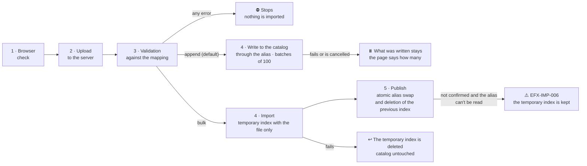

A file is loaded in one of two modes, chosen on the «Load mode» card:

- **Append** (default, deletes nothing): movies are added to the current index through the alias, in batches of 100
  and without a temporary index. An `id` that already exists is replaced; before starting, the page says how many
  will be replaced. If a batch is rejected (`EFX-IMP-008`) or the load is cancelled (`EFX-IMP-009`), what was already
  written stays and the page says how many movies were added.
- **Bulk** (replaces the catalog): movies are written to a new temporary index that holds **only** the file's movies;
  on publishing, the alias moves to that index in a single operation and the previous index is deleted. The page
  warns how many movies the catalog being deleted has. If anything fails before publishing, the catalog is left as
  it was.
- **No catalog yet:** bulk and the single record create the index with the mapping and the alias; append stays
  blocked (`EFX-IMP-010`) until the catalog exists.

A catalog larger than 25 MB is loaded with one bulk (the first file) and several appends. That is how the full
catalog in [`data/`](data/README.md#english), split into 7 parts, is loaded.

| Form | Format |
|---|---|
| ✍️ Single record | A form with the mapping's fields (`id`, `title`, and `plot` required); written **directly to the catalog** |
| 🧾 `.json` | An index export (an object with `documents` and, optionally, `mapping` and `document_count`), an array of movies, or NDJSON |
| 📊 `.csv` | UTF-8 with or without BOM, comma, semicolon, or tab separator, **header required**; lists and nested objects as JSON in the cell |

- **Required fields:** in both formats and both modes, `id`, `title`, and `plot` with a value (in `.csv`, as header
  columns); everything else is optional. «About» › «The catalog» covers it field by field, and the full mapping is in
  [`elasticsearch/elastiflix-reloaded-mapping.json`](elasticsearch/elastiflix-reloaded-mapping.json).
- **Before uploading:** only `.json` or `.csv`, no double extensions, at most **25 MB** (a fixed limit), UTF-8.
- **Against the mapping:** the whole file is checked, all or nothing. If something doesn't match, each error is shown
  (record, `id`, field, received value, what the mapping expects), and the report can be downloaded as CSV.
- **Vectors:** `plot_256`, `plot_512`, and `plot_1024` are **always** generated from `plot` with the inference
  service. If the file includes them, they are ignored with a warning; the form doesn't ask for them.
- **Single user:** the demo is meant for one person at a time; it has no concurrency controls.

## ⚙️ Configuration

Everything is configured in `.env` (or with environment variables, which take precedence). `.env.example` has the
full list:

| Variable | Default | What it controls |
|---|---|---|
| `ELASTICSEARCH_URL` | — (required) | The Serverless project's Elasticsearch endpoint. Without it, the app won't start (`EFX-CFG-001`) |
| `ELASTICSEARCH_API_KEY` | — (required) | The project's API key. Without it, the app won't start (`EFX-CFG-002`) |
| `ELASTIFLIX_INDEX_ALIAS` | `elastiflix-reloaded` | Catalog alias. Indexes are named `<alias>-<YYYYMMDD-HHMMSS>` |
| `ELASTIFLIX_INFERENCE_ID` | `.jina-embeddings-v5-omni-small` | Inference endpoint that generates the vectors |
| `ELASTIFLIX_INGEST_BATCH_SIZE` | `100` | Movies per batch when loading a file |
| `ELASTIFLIX_POSTER_BASE_URL` | `https://image.tmdb.org/t/p/w342` | Prefix of the poster images |
| `SERVER_PORT` | `8080` | The app's port |

The catalog status (alias, current index, and count) is also available at `GET /actuator/health`.

## 🧪 Tests

| Command | What it runs | Needs |
|---|---|---|
| `./mvnw verify` | Unit and architecture (ArchUnit) tests, Checkstyle, and PMD | Nothing else |
| `./mvnw verify -Pit` | The above plus the integration tests and the smoke test | `.env` and the Serverless project |
| `./mvnw verify -Pit -Dit.test=RelevanceIT` | Only the [relevance harness](eval/README.md#-relevance-harness): `_rank_eval` of the 10 configurations against `eval/judgments.jsonl`, with the minimums in `eval/thresholds.json` as the gate | `.env` and the reference catalog |
| `npm test` in `src/test/browser` | Tests of the pages' JavaScript with Playwright | The running app and Node.js; see [its README](src/test/browser/README.md) (in Spanish) |

- Integration tests that **write** use their own `elastiflix-it-<random>` aliases and delete them when they finish;
  they never touch the catalog.
- Tests that **read** the catalog are designed for the 6,899-movie reference catalog used to measure precision.
  With another catalog, the ones that compare counts and positions are skipped and some may fail, because they look
  for specific movies (for example, `597`, Titanic).

## ☁️ Deployment on Google Cloud

The production demo answers at **https://elastiflix.bigfito.cloud** and **https://elastiflix.bigfito.dev**. Every push to
`main` rebuilds and redeploys it with no manual steps:

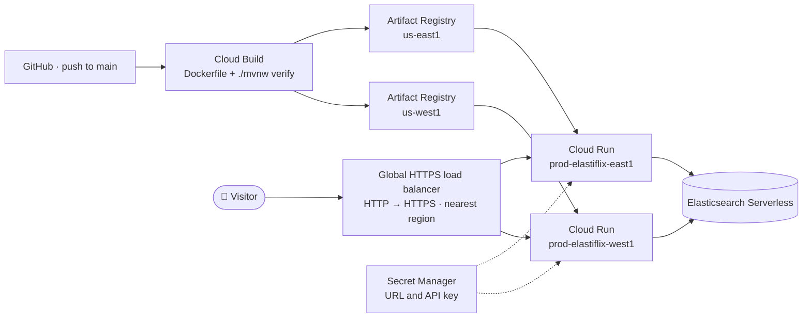

The detail of each piece (pipeline steps, NEGs, certificate, host rules) is in
[`docs/despliegue.mermaid`](docs/despliegue.mermaid) (in Spanish).

| Piece | Detail |
|---|---|
| [`Dockerfile`](Dockerfile) | Two stages: builds with JDK 25 and runs `./mvnw verify` (if it fails, there is no image); the final image holds only the Java 25 JRE and the jar, with an unprivileged user |
| [`.dockerignore`](.dockerignore) | An allowlist: `.env`, `target/`, and `data/` never get into the image |
| [`cloudbuild.yaml`](cloudbuild.yaml) | Builds once, tags with the short commit, pushes to `prod-elastiflix-us-east1` and `prod-elastiflix-us-west1`, and deploys both services in parallel |
| Cloud Run | `prod-elastiflix-east1` and `prod-elastiflix-west1`: 1 vCPU, 1 GiB, 0 to 3 instances, CPU allocated outside requests (imports run in the background), session affinity, and traffic only from the load balancer |
| Credentials | `ELASTICSEARCH_URL` and `ELASTICSEARCH_API_KEY` come from Secret Manager (`elastiflix-elasticsearch-url`, `elastiflix-elasticsearch-api-key`) |
| Load balancer | Global, with serverless NEGs in both regions: each visitor reaches the nearest region. HTTP redirects to HTTPS |

To try the image on your machine, with the credentials in your `.env`:

```bash
docker build -t elastiflix .
docker run --rm -p 8080:8080 --env-file .env elastiflix
```

## 🩺 Troubleshooting

| Symptom | Likely cause | What to do |
|---|---|---|
| Doesn't start, with `EFX-CFG-001` or `EFX-CFG-002` | `ELASTICSEARCH_URL` or `ELASTICSEARCH_API_KEY` is missing | Check `.env` and start from the repository root |
| Header «Disconnected · EFX-ES-001» | Wrong URL or API key, or the project isn't responding | Repeat the `curl` calls from step 4 |
| Header «Connected · the catalog doesn't exist yet» | The alias doesn't exist | Do the first load (step 7) |
| Append rejected with `EFX-IMP-010` | There is no catalog yet | Load in bulk mode first, or save a single record |
| Vector search or loads fail when requesting vectors | The inference endpoint doesn't exist in the project | Check the endpoint (step 4) or set `ELASTIFLIX_INFERENCE_ID` |
| Load rejected with `EFX-IMP-004` | The catalog name is a concrete index, not an alias | Turn it into an alias (step 9) |
| `Port 8080 was already in use` | Another process uses the port | Use `SERVER_PORT=8090` |
| IntelliJ: `ClassNotFoundException` on startup | Incomplete incremental build after `./mvnw clean` | **Build › Rebuild Project** |
| Commands fail on Windows | `cmd` or PowerShell don't understand `./mvnw`, `set -a`, or `cp` | Use **Git Bash** |

Every app error has an `EFX-<AREA>-<NNN>` code and explains what happened, the likely cause, and what to do.

## 🏗️ Architecture

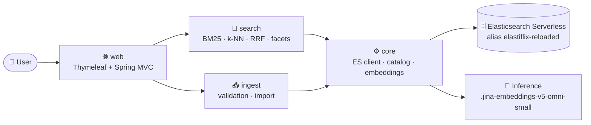

It is a single Spring Boot application in a single Maven module. `core`, `search`, `ingest`, and `web` are packages
of `com.bigfito.elastiflix`; `ArchitectureTest` (ArchUnit) checks that each one only uses what it should, as the
arrows show. The full diagram, with the numbered search, detail, and load flows, is in
[`docs/arquitectura.mermaid`](docs/arquitectura.mermaid) (in Spanish).

- **Always read through the alias.** A bulk load publishes the new index with a single atomic `_aliases` call
  (`add` to the new one and `remove_index` of the previous one), so there is never a moment without a catalog.
- **No `_cluster/health`** on Serverless: the health indicator queries the alias and its count.
- **Vectors kept out of responses:** searches exclude `plot_256`, `plot_512`, and `plot_1024` from `_source`.
- **Facets:** in Full-text they come from `terms` aggregations; in Vector and Hybrid they are computed in the app over
  the returned results.

## 📁 Repository layout

```
elastiflix-reloaded/
├── 📄 README.md · README.en.md
├── 📄 LICENSE                               MIT: the code only, not the movie data
├── 📦 pom.xml · mvnw · mvnw.cmd · .mvn/     Maven build (single module)
├── 🐳 Dockerfile · .dockerignore · cloudbuild.yaml   image and Cloud Build pipeline
├── 🔑 .env.example                          environment variables (copy it as .env)
├── ☕ src/main/java/com/bigfito/elastiflix/
│   ├── ElastiflixApplication.java          entry point
│   ├── ⚙️  core/                            model · ES client · aliases and indexes · embeddings · errors
│   ├── 🔎 search/                          match / multi_match · knn · rrf · filters · facets
│   ├── 📥 ingest/                          validation · JSON/CSV readers · import
│   └── 🌐 web/                             controllers and 5 Thymeleaf pages in Spanish and English
├── 🖼️  src/main/resources/                  application.yml · templates · static files · ES/EN messages
├── 🧪 src/test/                            java/ (same packages) · resources/ · browser/ (Playwright)
├── 🎯 eval/                                queries, judgments, and minimums of the relevance harness
├── 🎞️  data/                               full 6,899-movie catalog in 7 parts (.json and .csv)
├── 🗄️  elasticsearch/                       index mapping and sample movies (.json and .csv)
├── 🧹 config/                              Checkstyle and PMD rules
├── 📚 docs/                                code conventions · architecture · deployment · screenshots
└── 🎨 design/                              mockups and design tokens
```

The source code, its comments, and the logs are written in Spanish; identifiers are in English.

## 🧰 Stack

| | Component | Version |
|---|---|---|
| ☕ | Java (LTS) | 25 |
| 🍃 | Spring Boot | 4.1.2 |
| 📦 | Maven (Maven Wrapper) | 3.10.0 |
| 🖼️ | Thymeleaf | 3.1.5 |
| 🔍 | Elasticsearch Java client | 9.4.8 (managed by Spring Boot) |
| 🧩 | Jackson 3 (`Jackson3JsonpMapper`) | 3.1.7 |
| 🧠 | jina-embeddings-v5-omni-small | endpoint `.jina-embeddings-v5-omni-small` |
| 🧹 | Checkstyle · PMD · ArchUnit (`archunit-junit6`) | 14.3.0 · 7.28.0 · 1.5.1 |

No Spring Data Elasticsearch and no Lombok: the app uses the Elasticsearch Java client directly to control the
retrievers (`knn`, `rrf`), the aliases, and inference.

## ✅ Code quality

`./mvnw verify` fails on the first violation:

| Tool | Checks |
|---|---|
| Checkstyle 14.3.0 | Method size and complexity, naming, Javadoc, empty `catch` blocks, `System.out`, field injection, literal secrets |
| PMD 7.28.0 | Cognitive complexity, god classes, generic exceptions, unused code |
| ArchUnit 1.5.1 | Dependencies between the `core`, `search`, `ingest`, and `web` packages; Spring MVC and Servlet only in `web`; the web layer doesn't use the Elasticsearch client |

The style and design rules (Java 25 used with restraint, SOLID, short methods, errors with `EFX-*` codes, SLF4J
logging, Javadoc) are in [`docs/convenciones-java.md`](docs/convenciones-java.md) (in Spanish).

**Security.** The demo has no authentication and no CSRF protection: this is intentional, since there is no session
to protect and one person uses it at a time. Secrets go in `.env` on your machine and in Secret Manager on Cloud
Run; never in the code, the YAML, the tests, the image, or the logs.

## 📸 Screenshots

Full pages with the app connected to a 6,899-movie catalog, in Spanish and English (1440 px window).

| Page | Español | English |
|---|---|---|
| Home `GET /` | 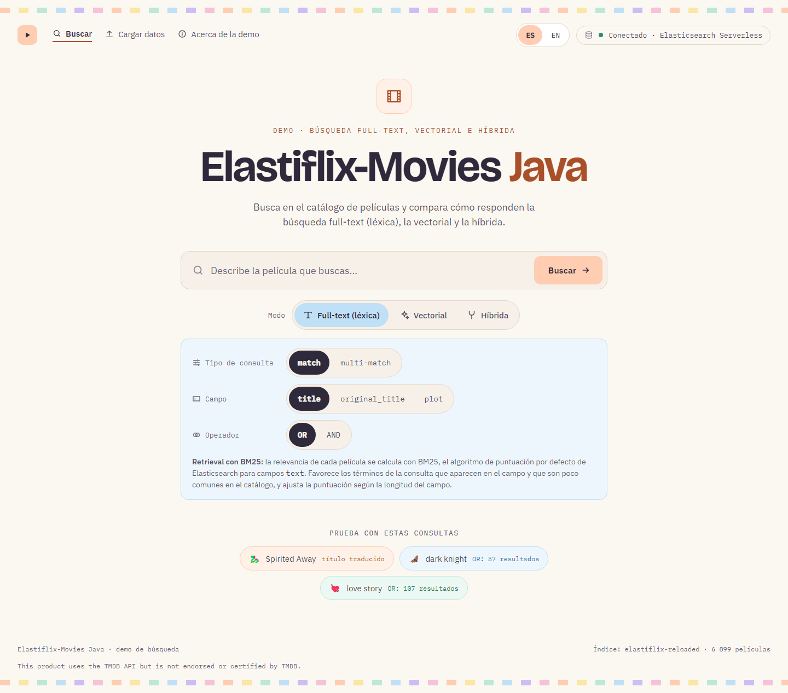 | 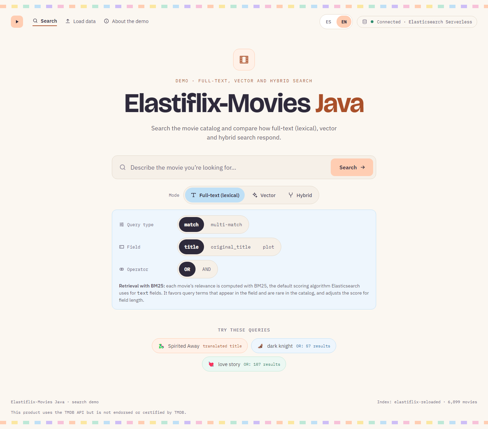 |
| Results · Full-text | 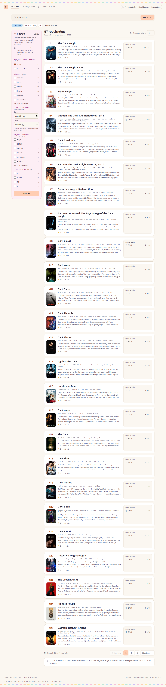 | 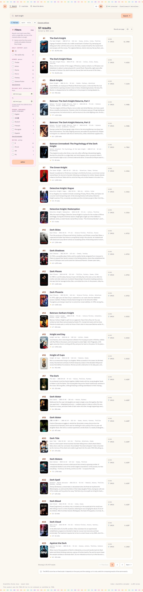 |
| Results · Vector | 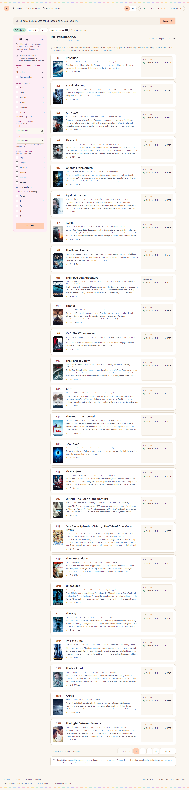 | 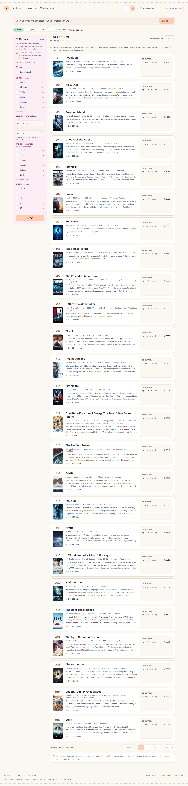 |
| Results · Hybrid | 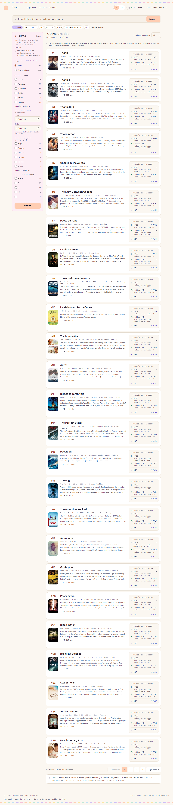 | 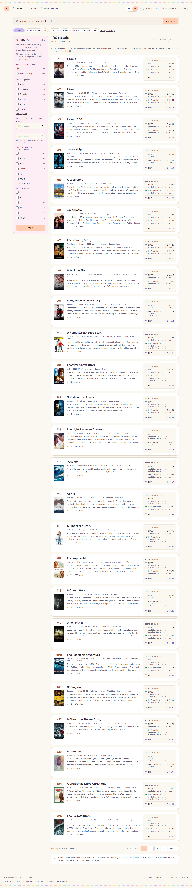 |
| Movie detail `GET /pelicula/{id}` | 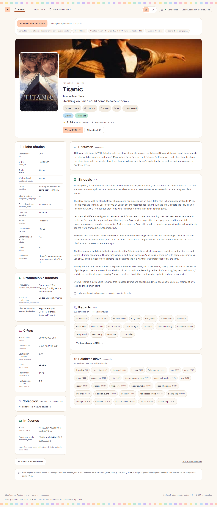 | 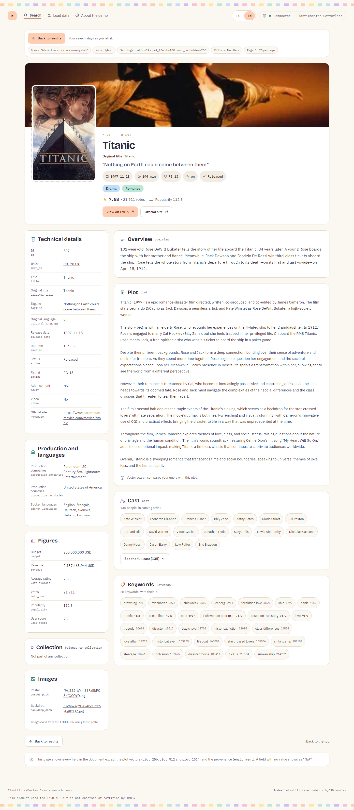 |
| Detail without a search (`EFX-SRCH-012`) | 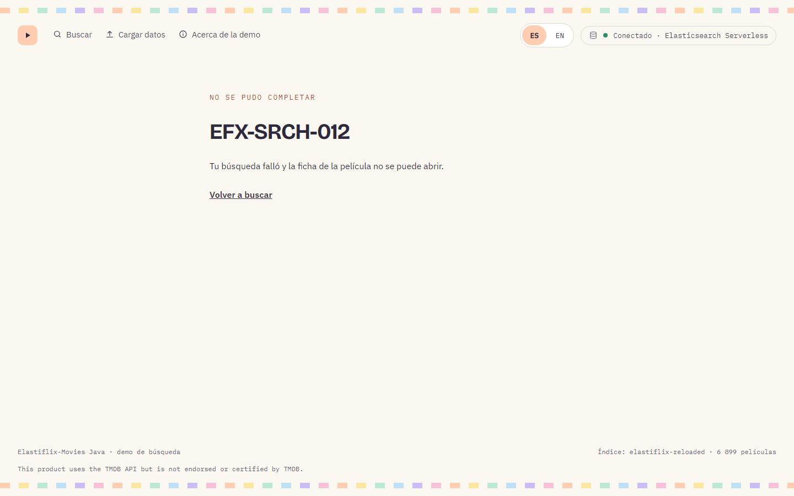 |  |
| Load data · Single record | 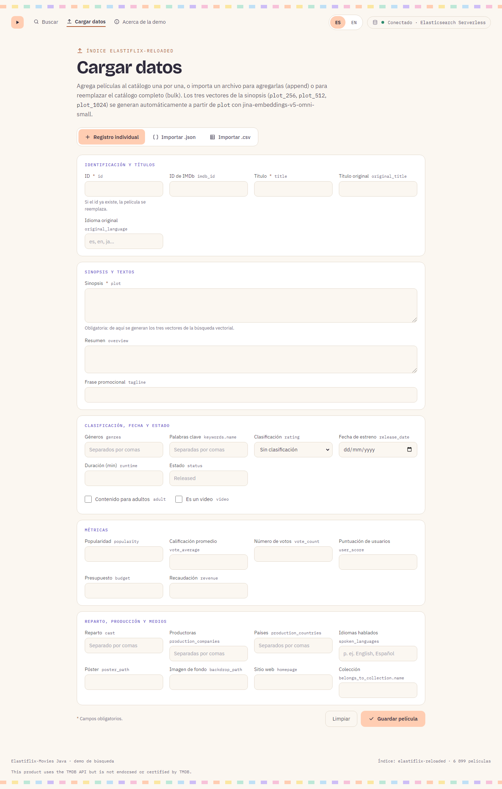 | 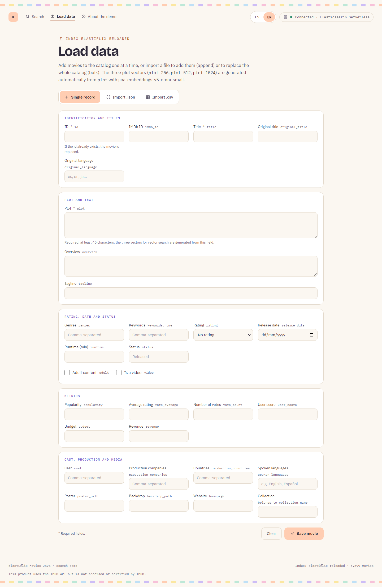 |
| Load data · Valid CSV, ready to import | 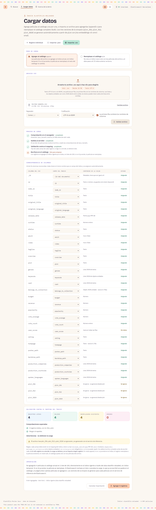 | 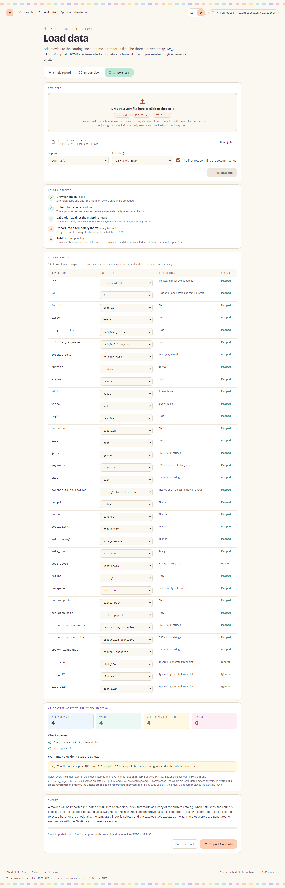 |
| Load data · CSV that doesn't match the mapping | 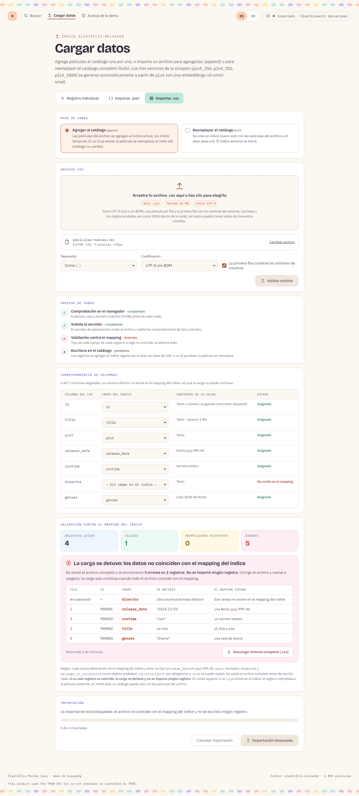 | 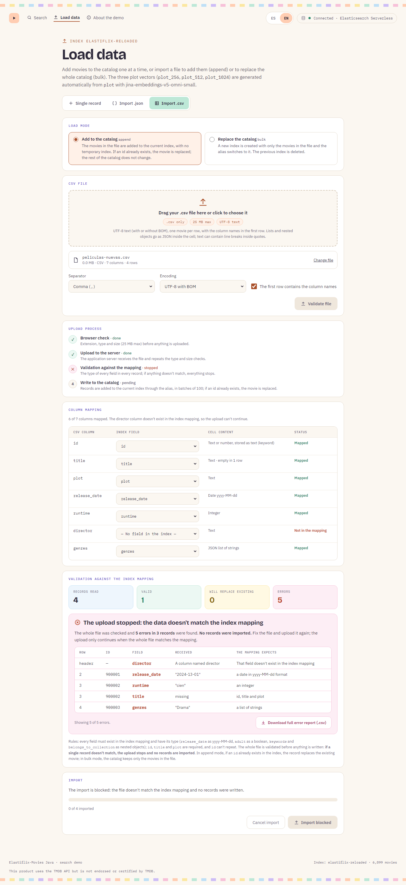 |
| About `GET /acerca` |  | 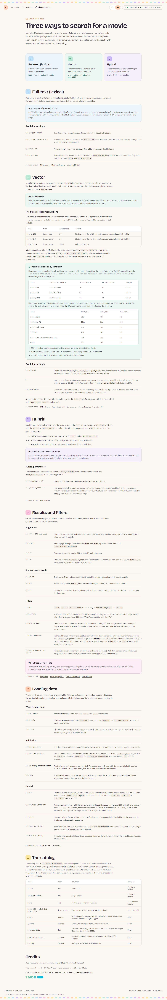 |
| Unknown route | 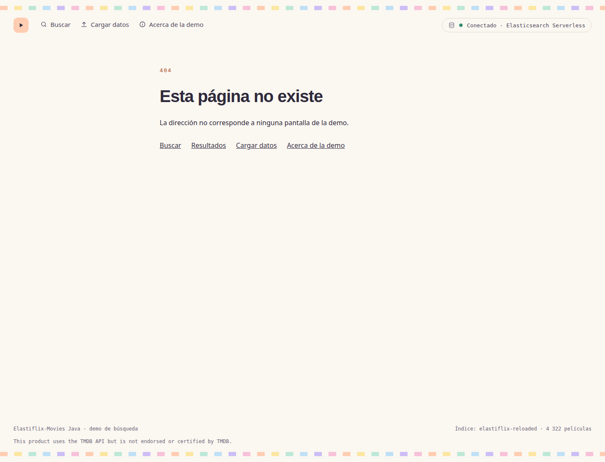 | 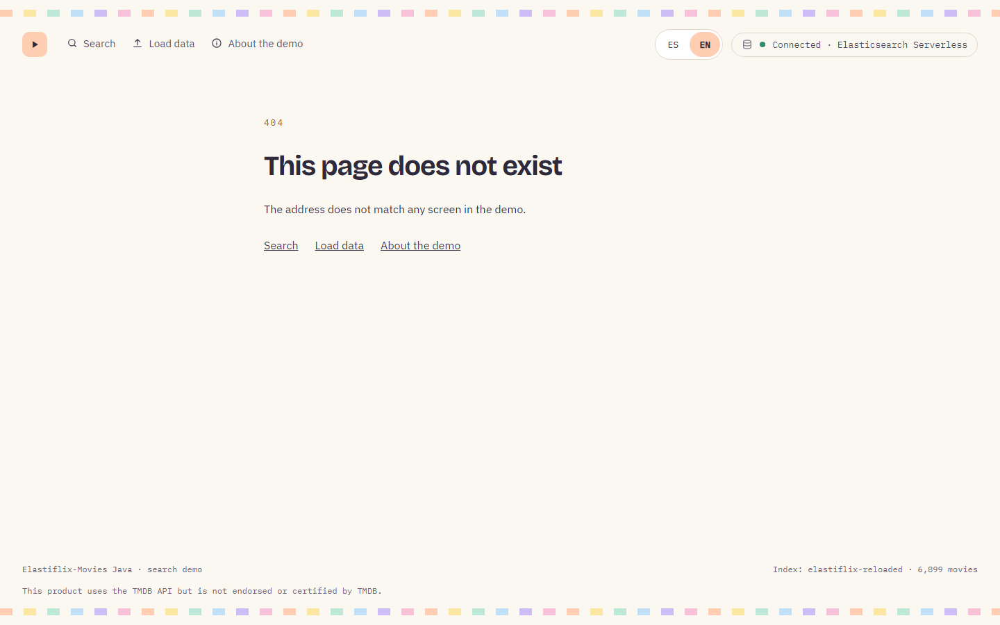 |

## 📖 Documentation

| Document | Purpose |
|---|---|
| 🏗️ [`docs/arquitectura.mermaid`](docs/arquitectura.mermaid) | Architecture and the numbered search, detail, and load flows (in Spanish) |
| ☁️ [`docs/despliegue.mermaid`](docs/despliegue.mermaid) | Cloud Build pipeline, the two Cloud Run regions, and the load balancer (in Spanish) |
| 📐 [`docs/convenciones-java.md`](docs/convenciones-java.md) | How the code is written and what the build checks (in Spanish) |
| 🗄️ [`elasticsearch/elastiflix-reloaded-mapping.json`](elasticsearch/elastiflix-reloaded-mapping.json) | Index mapping (33 fields) |
| 🎯 [`eval/README.md`](eval/README.md#-relevance-harness) | Relevance harness: queries, rating scale, metrics, and how to run it |
| 🎞️ [`data/README.md`](data/README.md#english) | The full catalog in 7 parts: how to load it and its format |
| 🎬 [`elasticsearch/fixtures/`](elasticsearch/fixtures/) | Four sample movies in `.json` and `.csv`, and a query vector |
| 🎨 [`design/README.md`](design/README.md) | Page mockups and design tokens (in Spanish) |
| 🧪 [`src/test/browser/README.md`](src/test/browser/README.md) | Browser tests (in Spanish) |
| 📸 [`docs/capturas/`](docs/capturas/) | Page screenshots |
| ⚖️ [`LICENSE`](LICENSE) | MIT license for the code. It does not cover the TMDB or Wikipedia data |

**Elasticsearch references:**
[match](https://www.elastic.co/docs/reference/query-languages/query-dsl/query-dsl-match-query) ·
[multi_match](https://www.elastic.co/docs/reference/query-languages/query-dsl/query-dsl-multi-match-query) ·
[kNN retriever](https://www.elastic.co/docs/reference/elasticsearch/rest-apis/retrievers/knn-retriever) ·
[RRF retriever](https://www.elastic.co/docs/reference/elasticsearch/rest-apis/retrievers/rrf-retriever) ·
[dense_vector](https://www.elastic.co/docs/reference/elasticsearch/mapping-reference/dense-vector) ·
[alias](https://www.elastic.co/docs/manage-data/data-store/aliases)

## 🙏 Credits and terms of use

**Academic and demonstration purposes.** Elastiflix-Movies Java is an academic project that demonstrates full-text,
vector, and hybrid search techniques. It is not a commercial product: it is not sold, it shows no advertising, and in
no way does it intend to make a commercial profit from itself or from the information it uses.

**License.** The code is published under the [MIT License](LICENSE). MIT covers the code only, not the movie data,
which keeps the license of its sources (TMDB and Wikipedia, CC BY-SA 4.0).

**Information credits.** Credit for the movie information goes to:

- **[TMDB](https://www.themoviedb.org/)** (The Movie Database): movie data and posters.
  *This product uses the TMDB API but is not endorsed or certified by TMDB.* The attribution also appears in the footer of
  every page and in «About the demo» › «Credits and terms of use», which also carries the academic-purpose notice.
- **[Wikipedia](https://www.wikipedia.org/)**: movie texts. Wikipedia content is published under the
  [Creative Commons Attribution-ShareAlike 4.0](https://creativecommons.org/licenses/by-sa/4.0/) license.

Names, trademarks, posters, and texts belong to their respective owners. This project is not affiliated with or
endorsed by TMDB or Wikipedia.

---

<div align="center">

Made with ☕ and 🍿

</div>
