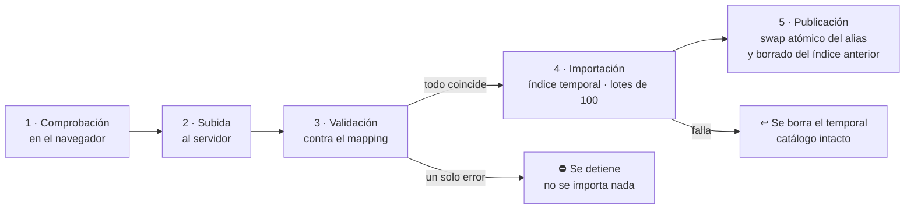
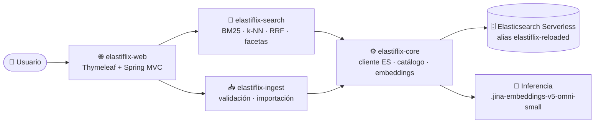

<div align="center">

# 🎬 Elastiflix-Movies Java

**Busca películas por palabras, por significado o combinando ambos — y compara cómo responde cada modo.**

Demo de búsqueda **full-text (BM25)**, **vectorial (k-NN)** e **híbrida (RRF)** sobre un catálogo de
**4 322 películas** en **Elasticsearch Serverless**.


</div>

> [!NOTE]
> 🚧 **Estado actual:** requerimientos, mockups y plan de implementación listos. El código se construye
> siguiendo [`PLAN.md`](PLAN.md) fase por fase; el avance real está en
> [`progreso/INDICE.md`](progreso/INDICE.md).

---

## 📚 Contenido

- [✨ Qué hace](#-qué-hace)
- [🔎 Los tres modos de búsqueda](#-los-tres-modos-de-búsqueda)
- [🎛️ Resultados, filtros y paginación](#️-resultados-filtros-y-paginación)
- [📥 Carga de datos](#-carga-de-datos)
- [🏗️ Arquitectura](#️-arquitectura)
- [🧰 Stack](#-stack)
- [📁 Estructura del repositorio](#-estructura-del-repositorio)
- [🚀 Puesta en marcha](#-puesta-en-marcha)
- [🤖 Desarrollo con agentes de IA](#-desarrollo-con-agentes-de-ia)
- [🗺️ Plan y estado](#️-plan-y-estado)
- [✅ Calidad de código](#-calidad-de-código)
- [🎨 Diseño](#-diseño)
- [📖 Documentación](#-documentación)

---

## ✨ Qué hace

| | Capacidad | Detalle |
|---|---|---|
| 🔤 | **Full-text (léxica)** | Encuentra películas cuyo título contiene las palabras de tu consulta |
| 🧭 | **Vectorial** | Encuentra películas cuya sinopsis se parece en significado a lo que describes |
| 🔀 | **Híbrida** | Ejecuta las dos búsquedas y combina sus resultados en una sola lista |
| 🎛️ | **Filtros dinámicos** | Adultos, géneros, fecha de estreno, idiomas y clasificación, con conteos |
| 📄 | **Paginación** | 25 · 50 · 100 resultados por página |
| 📥 | **Carga de datos** | Registro individual o archivos `.json` / `.csv`, validados contra el mapping |
| ℹ️ | **Acerca de la demo** | Explicación de cada modo dentro de la aplicación |

## 🔎 Los tres modos de búsqueda

### 🔤 Full-text (léxica) · BM25

Busca coincidencias de términos en `title` y `original_title` (ambos `text`).

| Ajuste | Opciones |
|---|---|
| Tipo de consulta | `match` (un campo: `title` **o** `original_title`) · `multi-match` (`best_fields` sobre los dos) |
| Operador | `OR` (basta una palabra; por defecto) · `AND` (todas; con `multi-match`, en un mismo campo) |

> [!TIP]
> **BM25** es el algoritmo de puntuación por defecto de Elasticsearch: favorece los términos poco comunes
> en el catálogo; `k1 = 1.2` limita cuánto suma repetir un término y `b = 0.75` ajusta por la longitud
> del campo.

### 🧭 Vectorial · k-NN

Tu consulta se convierte en un vector con **jina-embeddings-v5-omni-small** y Elasticsearch devuelve
las películas cuya sinopsis (`plot`) tiene el vector más cercano, con un grafo **HNSW**.

| Campo | Dimensiones | Origen |
|---|---|---|
| `plot_256` | 256 | Primeros valores del vector de 1024, renormalizados (Matryoshka) |
| `plot_512` | 512 | Primeros valores del vector de 1024, renormalizados (Matryoshka) |
| `plot_1024` | 1024 | Vector completo del modelo |

| Ajuste | Por defecto | Regla |
|---|---|---|
| `k` | 100 | Resultados que devuelve la búsqueda vectorial |
| `num_candidates` | 200 | `k ≤ num_candidates ≤ 10 000` |

Los tres campos usan la misma configuración (`hnsw`, `m = 16`, `ef_construction = 100`, `cosine`, float
sin cuantización): la única diferencia es el número de dimensiones. **Precisión medida** con 32
descripciones de trama:

| Campo | 🥇 Correcta en 1.er lugar | Top 5 | Top 10 | MRR@10 |
|---|---|---|---|---|
| `plot_256` | 22 de 32 (69 %) | 29 | 30 | 0.774 |
| `plot_512` | 25 de 32 (78 %) | 31 | 32 | 0.853 |
| `plot_1024` | 26 de 32 (81 %) | 31 | 31 | 0.880 |

> 512 dimensiones queda muy cerca de 1024 con la mitad del tamaño; 256 pierde precisión de forma clara.

### 🔀 Híbrida · RRF

El retriever `rrf` combina el componente full-text (`standard`) y el vectorial (`knn`) según la
**posición** de cada película en cada lista — no según su puntuación, porque las escalas de BM25 y de
la similitud no son comparables.

| Parámetro | Valor |
|---|---|
| `rank_constant` | 60 (por defecto de Elasticsearch) |
| `rank_window_size` | igual a `k` (lo fija la aplicación) |

Cada resultado muestra su puntuación BM25, su similitud k-NN, su posición en cada lista y la puntuación
RRF: `Σ 1 / (60 + posición)`.

## 🎛️ Resultados, filtros y paginación

| | Full-text | Vectorial | Híbrida |
|---|---|---|---|
| **Puntuación** | BM25 (sin escala fija) | `(1 + coseno) / 2`, entre 0 y 1 | BM25 + k-NN + RRF |
| **Máximo de resultados** | 10 000 (`index.max_result_window`) | `k` | `rank_window_size` (= `k`) |
| **Filtros en Elasticsearch** | contexto `filter` | `filter` del retriever `knn` | `filter` del retriever `rrf` |
| **Conteos de filtros** | agregaciones `terms` | calculados en la aplicación | calculados en la aplicación |

- **Filtros:** `adult`, `genres`, `release_date` (desde–hasta), `spoken_languages`, `rating`. Entre
  filtros distintos se cumplen todos; dentro de uno basta con un valor. Se aplican con **APLICAR**.
- **Valores dinámicos:** cada filtro muestra solo los valores presentes en los resultados, con su conteo.
- **Sin resultados:** la página sugiere ajustes según el modo, o quitar filtros si estos vaciaron la
  lista.
- **Pósters:** se cargan del CDN de imágenes de TMDB a partir de `poster_path`.

## 📥 Carga de datos



| Forma | Formato |
|---|---|
| ✍️ Registro individual | Formulario con los campos del mapping (`id`, `title` y `plot` obligatorios); se escribe **directamente en el catálogo** |
| 🧾 `.json` | Exportación del índice (`documents`, `mapping`, `document_count`), arreglo de películas o NDJSON |
| 📊 `.csv` | UTF-8 con o sin BOM, coma, **encabezado obligatorio** (sin encabezado se rechaza); listas y anidados como JSON en la celda |

- **Antes de subir:** solo `.json` o `.csv`, sin dobles extensiones, máximo **150 MB**, UTF-8.
- **Contra el mapping:** se revisa el archivo completo; si algo no coincide, se muestra cada error
  (registro, `id`, campo, valor recibido, lo que espera el mapping) y se puede descargar el informe.
- **Vectores:** `plot_256`, `plot_512` y `plot_1024` **siempre** se generan en tiempo de ejecución desde
  `plot`, con el modelo de embeddings a través del servicio de inferencia de Elasticsearch; si el archivo
  los trae, se ignoran.
- **Publicación:** en una sola operación, el alias `elastiflix-reloaded` pasa al índice nuevo y el
  índice anterior se borra; si algo falla antes, el catálogo queda exactamente como estaba.
- **Una carga a la vez:** mientras se importa un archivo, el registro individual espera a que termine.

## 🏗️ Arquitectura



Diagrama completo con los flujos numerados: [`docs/arquitectura.mermaid`](docs/arquitectura.mermaid).

## 🧰 Stack

| | Componente | Versión |
|---|---|---|
| ☕ | Java (LTS) | 25 |
| 🍃 | Spring Boot | 4.1.1 |
| 📦 | Maven (Maven Wrapper) | 3.10.0 |
| 🖼️ | Thymeleaf | 3.1.5 |
| 🔍 | Cliente Java de Elasticsearch | 9.4.5 (gestionado por Spring Boot) |
| 🧩 | Jackson 3 (`Jackson3JsonpMapper`) | 3.1.5 |
| 🧠 | jina-embeddings-v5-omni-small | endpoint `.jina-embeddings-v5-omni-small` |
| 🧹 | Checkstyle · PMD · ArchUnit | 14.3.0 · 7.28.0 · 1.5.1 |

## 📁 Estructura del repositorio

```
elastiflix-reloaded/
├── 📄 PLAN.md · AGENTS.md · CLAUDE.md · README.md
├── 📦 pom.xml · mvnw · .mvn/            (Fase 0)
├── ⚙️  elastiflix-core/                  modelo · cliente ES · alias e índices · embeddings
├── 🔎 elastiflix-search/                match / multi_match · knn · rrf · filtros · facetas
├── 📥 elastiflix-ingest/                validación · lectores JSON/CSV · importación · swap de alias
├── 🌐 elastiflix-web/                   único ejecutable · 4 páginas Thymeleaf
├── 🧹 config/                           Checkstyle y PMD (congelados)
├── 📚 docs/                             convenciones · arquitectura · diseños por fase
├── 🎨 design/                           mockups aprobados y tokens de diseño
├── 🗄️  elasticsearch/                    mapping del índice y fixtures reales
├── 📍 progreso/                         estado del desarrollo para retomar sesiones
└── 🖱️  .cursor/rules/                    regla de Cursor para archivos Java
```

## 🚀 Puesta en marcha

> [!IMPORTANT]
> Estos comandos estarán disponibles al terminar la Fase 0 (compilación) y la Fase 4 (aplicación).
> La Fase 6 los vuelve a verificar y actualiza esta sección.

**Prerrequisitos**

- ☕ JDK 25 · 🐙 Git · 📦 Maven ≥ 3.6.3 solo para generar el wrapper la primera vez
- 🔑 Un proyecto **Elasticsearch Serverless** con el índice `elastiflix-reloaded` y una API key

**Configuración**

```bash
cp .env.example .env          # completa ELASTICSEARCH_URL y ELASTICSEARCH_API_KEY
```

> [!WARNING]
> `.env` nunca se sube a git. Ningún secreto va en el código, en YAML ni en los commits.

**Comandos**

```bash
./mvnw verify                                   # pruebas unitarias + arquitectura + estilo + análisis
./mvnw verify -Pit                              # + integración contra Elasticsearch (usa .env)
./mvnw -q install -DskipTests
./mvnw -pl elastiflix-web spring-boot:run       # 👉 http://localhost:8080
```

En Windows usa `mvnw.cmd`.

## 🤖 Desarrollo con agentes de IA

El plan está preparado para que **cualquiera de estos agentes** lo ejecute o lo retome donde otro lo dejó:

| Herramienta | Qué lee | Archivo en este repo |
|---|---|---|
| 🟠 **Claude Code** | `CLAUDE.md`, que importa `AGENTS.md` | `CLAUDE.md` → `@AGENTS.md` |
| 🟣 **Cursor** | `AGENTS.md` en la raíz + reglas `.mdc` | `AGENTS.md`, `.cursor/rules/elastiflix-java.mdc` |
| 🔵 **Google Antigravity** | `AGENTS.md` en la raíz (máx. 12 000 caracteres) | `AGENTS.md` |
| 🟢 **JetBrains Junie** | `AGENTS.md` en la raíz | `AGENTS.md` |

### ▶️ Para empezar

Abre la carpeta del repositorio en tu herramienta y pide:

> Lee `PLAN.md`, `AGENTS.md` y `docs/convenciones-java.md`, aplica el protocolo de reanudación y
> ejecuta las fases en orden desde la Fase 0.

### 🔁 Si una sesión se interrumpe

Sin tokens, contexto lleno, herramienta cerrada o cambio de agente — no se pierde el avance: al terminar
**cada tarea** el agente actualiza `progreso/`, hace un commit y lo publica con `git push`. Al cerrar
cada fase actualiza también esta documentación. Pide:

> Retoma el trabajo: aplica el protocolo de reanudación de `AGENTS.md` y continúa desde el próximo
> paso registrado en tu archivo de `progreso/`.

### 🔒 Aprobar o pedir cambios a un diseño

Las fases 1, 2 y 3 se detienen en `esperando aprobación de diseño`. Responde con una de estas frases:

> ✅ Apruebo el diseño de la Fase N tal como está. Regístralo en `progreso/N.md` y continúa.

> ✏️ No apruebo el diseño de la Fase N. Cambia lo siguiente: … Actualiza `docs/diseno/N.md` y vuelve a
> pedirme aprobación.

## 🗺️ Plan y estado

| Fase | Nombre | 🔒 Aprobación de diseño | Estado |
|---|---|---|---|
| 0 | 🏗️ Andamiaje y calidad | — | ⏳ no iniciado |
| 1 | ⚙️ Núcleo: conexión, catálogo y embeddings | 🔒 | ⏳ no iniciado |
| 2 | 🔎 Búsqueda | 🔒 | ⏳ no iniciado |
| 3 | 📥 Carga de datos | 🔒 | ⏳ no iniciado |
| 4 | 🌐 Interfaz web | — | ⏳ no iniciado |
| 5 | 🧪 Pruebas integrales y smoke test | — | ⏳ no iniciado |
| 6 | 📚 Documentación y cierre | — | ⏳ no iniciado |

El estado vigente siempre es el de [`progreso/INDICE.md`](progreso/INDICE.md); esta tabla se actualiza
al cerrar cada fase.

## ✅ Calidad de código

- 📐 **Convenciones:** [`docs/convenciones-java.md`](docs/convenciones-java.md) (estilo JavaMentor:
  Java 25 con mesura, SOLID, métodos cortos, errores con códigos `EFX-*`, logging SLF4J, Javadoc).
- 📝 **Diseño antes de codificar:** cada fase con código empieza por `docs/diseno/<fase>.md`.
- 🤖 **Verificación automática** en `./mvnw verify`:

| Herramienta | Revisa |
|---|---|
| Checkstyle 14.3.0 | Tamaño y complejidad de métodos, nombres, Javadoc, `catch` vacíos, `System.out`, inyección por campo, secretos literales |
| PMD 7.28.0 | Complejidad cognitiva, clases dios, excepciones genéricas, código sin uso |
| ArchUnit 1.5.1 | Matriz de dependencias entre módulos; la web no usa el cliente de Elasticsearch |

## 🎨 Diseño

Pantallas aprobadas en [`design/mockups/`](design/mockups/) con su paleta pastel multitono y
tipografías **Bricolage Grotesque**, **IBM Plex Sans** e **IBM Plex Mono**. Tokens y guía en
[`design/README.md`](design/README.md).

| 🏠 Inicio | 📋 Resultados | 📥 Cargar datos | ℹ️ Acerca de |
|---|---|---|---|
| Búsqueda, modos y sugerencias | Puntuaciones, filtros y paginación | Formulario, archivos y validación | Documentación de la demo |

## 📖 Documentación

| Documento | Para qué |
|---|---|
| 🗺️ [`PLAN.md`](PLAN.md) | Plan de implementación por fases (fuente única de verdad) |
| 🤖 [`AGENTS.md`](AGENTS.md) · [`CLAUDE.md`](CLAUDE.md) | Reglas para los agentes de IA |
| 📍 [`progreso/INDICE.md`](progreso/INDICE.md) | Estado actual y próximo paso |
| 📐 [`docs/convenciones-java.md`](docs/convenciones-java.md) | Cómo se escribe el código |
| 🏗️ [`docs/arquitectura.mermaid`](docs/arquitectura.mermaid) | Arquitectura y flujos |
| 🗄️ [`elasticsearch/elastiflix-reloaded-mapping.json`](elasticsearch/elastiflix-reloaded-mapping.json) | Mapping del índice |
| 🎨 [`design/README.md`](design/README.md) | Mockups y tokens de diseño |

**Referencias de Elasticsearch:**
[match](https://www.elastic.co/docs/reference/query-languages/query-dsl/query-dsl-match-query) ·
[multi_match](https://www.elastic.co/docs/reference/query-languages/query-dsl/query-dsl-multi-match-query) ·
[kNN retriever](https://www.elastic.co/docs/reference/elasticsearch/rest-apis/retrievers/knn-retriever) ·
[RRF retriever](https://www.elastic.co/docs/reference/elasticsearch/rest-apis/retrievers/rrf-retriever) ·
[dense_vector](https://www.elastic.co/docs/reference/elasticsearch/mapping-reference/dense-vector) ·
[alias](https://www.elastic.co/docs/manage-data/data-store/aliases)

---

<div align="center">

🔒 Repositorio privado · Hecho con ☕ y 🍿

</div>
