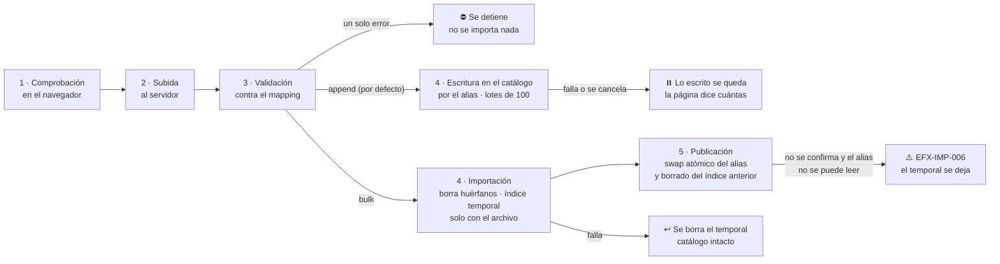
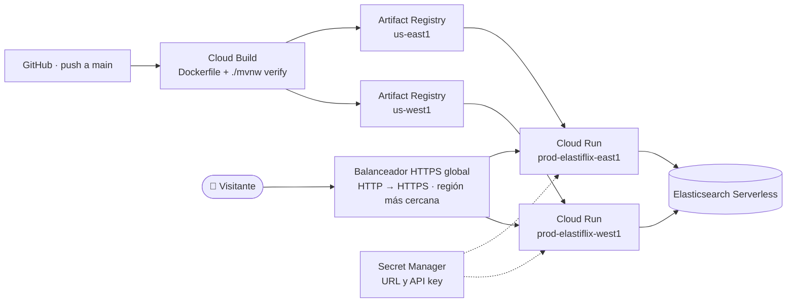
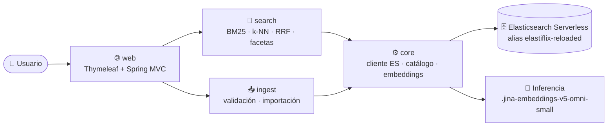

<div align="center">

# 🎬 Elastiflix-Movies Java

*(repo: elastiflix-reloaded, la versión vigente de la familia Elastiflix)*

**Busca películas por palabras, por significado o combinando ambos, y compara cómo responde cada modo.**

Demo web de búsqueda **full-text (BM25)**, **vectorial (k-NN)** e **híbrida (RRF)** sobre un catálogo de películas en
**Elasticsearch Serverless**, con interfaz en español e inglés.


**Español** · [English](README.en.md)

</div>

---

## 🗂️ Familia Elastiflix

**elastiflix-reloaded** es la demo vigente de Elastiflix.

- **[elastiflix-reloaded](https://github.com/bigfito/elastiflix-reloaded)**: la demo vigente (Java 25, Spring Boot 4.1, Elasticsearch Serverless; búsqueda full-text, k-NN e híbrida con RRF, y carga de datos incluida).
- [elastiflix-java](https://github.com/bigfito/elastiflix-java): versión anterior, que compara seis modos de búsqueda (ELSER, E5, reranking).
- [elastiflix-loader-java](https://github.com/bigfito/elastiflix-loader-java): cargador masivo del índice `elastiflix-movies` que usa `elastiflix-java`.
- Inspirada en la demo original de Elastic, [elastic/Elastiflix](https://github.com/elastic/Elastiflix) (fork en [bigfito/elastiflix](https://github.com/bigfito/elastiflix)).

## 🎯 Objetivo

Elastiflix-Movies Java es una demo académica que pone lado a lado las tres formas de buscar en Elasticsearch:

- **Full-text:** encuentra las películas cuyo título o sinopsis contiene tus palabras.
- **Vectorial:** encuentra las películas cuya sinopsis *significa* algo parecido a lo que describes, aunque no comparta
  ninguna palabra.
- **Híbrida:** combina las dos listas en una sola.

Cada resultado muestra de dónde sale su puntuación, así que puedes ver por qué una película aparece primero en un
modo y más abajo en otro. La aplicación también deja **cargar y validar** películas (una por una o desde archivos
`.json` y `.csv`) y genera los vectores de cada sinopsis con el servicio de inferencia de Elasticsearch.

> [!NOTE]
> **Proyecto con fines exclusivamente académicos y demostrativos.** No persigue ni pretende obtener ningún lucro
> comercial. La información de las películas pertenece a sus fuentes, [TMDB](https://www.themoviedb.org/) y
> [Wikipedia](https://en.wikipedia.org/); ver [Créditos y aviso de uso](#-créditos-y-aviso-de-uso).

## 📚 Contenido

- [🗂️ Familia Elastiflix](#-familia-elastiflix)
- [✨ Qué puedes hacer](#-qué-puedes-hacer)
- [🚀 Guía de inicio, de principio a fin](#-guía-de-inicio-de-principio-a-fin)
- [🔎 Los tres modos de búsqueda](#-los-tres-modos-de-búsqueda)
- [🎛️ Resultados, filtros y paginación](#️-resultados-filtros-y-paginación)
- [📥 Carga de datos](#-carga-de-datos)
- [🧼 Procedencia del catálogo](#-procedencia-del-catálogo)
- [⚙️ Configuración](#️-configuración)
- [🧪 Pruebas](#-pruebas)
- [☁️ Despliegue en Google Cloud](#️-despliegue-en-google-cloud)
- [🩺 Solución de problemas](#-solución-de-problemas)
- [🏗️ Arquitectura](#️-arquitectura)
- [📁 Estructura del repositorio](#-estructura-del-repositorio)
- [🧰 Stack](#-stack)
- [✅ Calidad de código](#-calidad-de-código)
- [📸 Capturas](#-capturas)
- [📖 Documentación](#-documentación)
- [🙏 Créditos y aviso de uso](#-créditos-y-aviso-de-uso)

---

## ✨ Qué puedes hacer

| | Página | Qué ofrece |
|---|---|---|
| 🏠 | **Inicio** `GET /` | Escribir una búsqueda, elegir el modo y sus ajustes, o probar una sugerencia |
| 📋 | **Resultados** `GET /buscar` | Puntuaciones de cada modo, filtros con conteos, paginación de 25 · 50 · 100 |
| 🎬 | **Detalle** `GET /pelicula/{id}` | Ficha técnica completa, cifras en USD y regreso a los resultados con la búsqueda intacta |
| 📥 | **Cargar datos** `GET /cargar` | Registro individual o archivos `.json` / `.csv`, validados contra el mapping; modos append y bulk |
| ℹ️ | **Acerca de** `GET /acerca` | Cómo funciona cada modo, los resultados y filtros, cómo se cargan y validan los datos, la precisión medida, todos los campos del catálogo y los créditos |

Toda la interfaz está en **español e inglés**: selector «ES · EN» en el encabezado, parámetro `?lang=en` y cookie
`elastiflix-lang`. El pie muestra el índice vigente y cuántas películas tiene.

---

## 🚀 Guía de inicio, de principio a fin

Al terminar estos pasos tendrás la aplicación en http://localhost:8080 con un catálogo propio en tu proyecto de
Elasticsearch, y habrás hecho una búsqueda en cada modo.

### 1. Requisitos

| Necesitas | Para qué |
|---|---|
| ☕ **JDK 25** | Compilar y ejecutar. Maven no hace falta: el repositorio trae el Maven Wrapper (`./mvnw`) |
| 🐙 **Git** | Clonar el repositorio. En **Windows**, usa **Git Bash** para todos los comandos de esta guía |
| ☁️ **Una cuenta de [Elastic Cloud](https://cloud.elastic.co/)** | Crear un proyecto **Elasticsearch Serverless** |
| 🌐 Un navegador | Usar la aplicación |
| 🟢 Node.js 20 o más *(opcional)* | Solo para las pruebas de navegador |

### 2. Crea el proyecto Serverless y una API key

1. En Elastic Cloud, crea un proyecto **Elasticsearch Serverless** (cualquier región).
2. Copia el **endpoint de Elasticsearch** del proyecto. Tiene la forma
   `https://<proyecto>.es.<región>.<proveedor>.elastic.cloud`.
3. Crea una **API key** en la sección de API keys del proyecto. Sin restricciones funciona. Si prefieres limitarla,
   estos son los privilegios que usa la aplicación:

   ```json
   {
     "elastiflix": {
       "cluster": ["monitor", "monitor_inference", "cancel_task"],
       "indices": [
         {
           "names": ["elastiflix-*"],
           "privileges": ["create_index", "delete_index", "read", "write", "view_index_metadata", "manage"]
         }
       ]
     }
   }
   ```

   `manage` sirve para mover el alias del catálogo; `monitor_inference`, para pedir vectores; `monitor` y
   `cancel_task`, solo para el comando de migración del paso opcional. Guía oficial:
   [claves de API de Elasticsearch](https://www.elastic.co/docs/deploy-manage/api-keys/elasticsearch-api-keys).

### 3. Clona el repositorio y configura `.env`

```bash
git clone https://github.com/bigfito/elastiflix-reloaded.git
cd elastiflix-reloaded
cp .env.example .env
```

Abre `.env` y completa las dos variables obligatorias:

```dotenv
ELASTICSEARCH_URL=https://<proyecto>.es.<región>.<proveedor>.elastic.cloud
ELASTICSEARCH_API_KEY=<tu-api-key>
```

El resto ya trae valores por defecto (ver [Configuración](#️-configuración)). `.env` está en `.gitignore`: nunca
se sube al repositorio.

> [!IMPORTANT]
> Ejecuta todos los comandos **desde la raíz del repositorio**: la aplicación lee `.env` de la carpeta donde se
> ejecuta.

### 4. Comprueba la conexión y el modelo de embeddings

La búsqueda vectorial usa el endpoint de inferencia `.jina-embeddings-v5-omni-small` del servicio de inferencia de
Elastic. Comprueba que tu proyecto responde y que el endpoint existe:

```bash
set -a; . ./.env; set +a      # exporta las variables de .env a esta terminal (solo para los curl)

curl -sS -H "Authorization: ApiKey $ELASTICSEARCH_API_KEY" "$ELASTICSEARCH_URL"

curl -sS -H "Authorization: ApiKey $ELASTICSEARCH_API_KEY" \
  "$ELASTICSEARCH_URL/_inference/embedding/.jina-embeddings-v5-omni-small"
```

La primera llamada devuelve la información del proyecto. La segunda describe un endpoint de tipo `embedding`; si
responde `resource_not_found_exception`, tu proyecto no tiene ese modelo y la búsqueda vectorial y las cargas no
funcionarán. Referencia: [Get inference](https://www.elastic.co/docs/api/doc/elasticsearch/operation/operation-inference-get).

### 5. Compila y verifica

```bash
./mvnw verify
```

Compila, corre las pruebas unitarias y las de arquitectura, y revisa el estilo con Checkstyle y PMD. No necesita
red ni Elasticsearch. Debe terminar con `BUILD SUCCESS`.

### 6. Arranca la aplicación

```bash
./mvnw spring-boot:run
```

Abre http://localhost:8080. Con un proyecto nuevo, el encabezado dice **«Conectado · el catálogo todavía no
existe»**: la conexión funciona y falta cargar películas.

Otras formas de arrancarla:

```bash
./mvnw -q package -DskipTests
java -jar target/elastiflix-reloaded-0.1.0-SNAPSHOT.jar      # el mismo resultado, desde el jar
```

- **IntelliJ IDEA:** abre la carpeta raíz como proyecto Maven y ejecuta
  `com.bigfito.elastiflix.ElastiflixApplication` con la raíz del repositorio como directorio de trabajo.
- **Otro puerto:** `SERVER_PORT=8090 ./mvnw spring-boot:run`.
- **Detenerla:** `Ctrl+C` en la terminal.

### 7. Crea el catálogo con la primera carga

El catálogo es el alias `elastiflix-reloaded` (configurable), que apunta a un índice
`elastiflix-reloaded-<AAAAMMDD-HHMMSS>`. **La primera carga lo crea**, con el mapping del repositorio. El mapping es
estricto (`"dynamic": "strict"`): Elasticsearch rechaza un documento con un campo que no declara, y la validación de
la carga ya rechaza ese archivo antes de escribir (`EFX-ING-007`). Rige para los índices que se crean desde esta
versión.

1. Ve a **Cargar datos** (http://localhost:8080/cargar) y abre la pestaña **Importar .json**.
2. La tarjeta «Modo de carga» ya trae **bulk** marcado; append está deshabilitado mientras no haya catálogo.
3. Elige `elasticsearch/fixtures/movies-sample.json`: cuatro películas reales (Titanic, Inception, WALL·E y The
   Equalizer 2).
4. Pulsa **Validar archivo**. Cuando la validación termine, pulsa **Reemplazar el catálogo con 4 registros**.
5. Cuando el paso 5, «Publicación», quede completado, recarga la página: el pie muestra el índice nuevo y
   **4 películas**.

Para tener el **catálogo completo de 6 899 películas**, usa los archivos de [`data/`](data/README.md): carga
`elastiflix-reloaded_01.json` en **bulk** y después `_02` a `_07` en **append** (o los mismos en `.csv`). Cada parte
pesa menos de 5 MB y también sirve sola, en bulk, como un catálogo más chico de unas 985 películas.

También puedes crear el catálogo guardando una película en la pestaña **Registro individual** (`id`, `title` y
`plot` son obligatorios). Para cargar tu propio catálogo, prepara un `.json` o un `.csv` como se explica en
[Carga de datos](#-carga-de-datos); «Acerca de» › «El catálogo» lista cada campo y si es obligatorio.

### 8. Busca

En **Inicio**, prueba:

| Modo | Escribe | Qué esperar |
|---|---|---|
| Full-text | `titanic` | Coincidencia por palabra en el título |
| Vectorial | `un barco que se hunde en el océano` | Titanic primero, aunque ninguna palabra coincida con el título |
| Híbrida | `sueños dentro de sueños` | Inception primero; cada tarjeta muestra BM25, k-NN, RRF y su posición en cada lista |

Pulsa el título de una película para ver su detalle, y cambia a **EN** en el encabezado para ver la interfaz en
inglés. Con solo cuatro películas, cualquier búsqueda vectorial devuelve las cuatro en algún orden: el interés está en
el orden y en las puntuaciones.

### 9. Opcional: convierte un índice concreto en alias

Si tu proyecto ya tiene un **índice concreto** llamado `elastiflix-reloaded` (no un alias), la aplicación no lo
usa para cargar. Este comando lo copia a `elastiflix-reloaded-<AAAAMMDD-HHMMSS>` y, en una sola llamada, borra el
índice concreto y crea el alias. El índice nuevo usa el mapping estricto: si el índice concreto tiene campos que el
mapping no declara, la copia falla con `EFX-ES-006` y el índice concreto queda igual. Termina solo:

```bash
./mvnw spring-boot:run "-Dspring-boot.run.arguments=--elastiflix.bootstrap.enabled=true --spring.main.web-application-type=none"
```

Si el nombre ya es un alias, no crea ni borra nada: el log dice a qué índice apunta y el proceso termina con código 0.
Si el nombre no existe, se detiene sin crear nada: en ese caso, el catálogo lo crea la primera carga (paso 7).

---

## 🔎 Los tres modos de búsqueda

### 🔤 Full-text (léxica) · BM25

Busca coincidencias de términos en los títulos (`title`, `original_title`) o en la sinopsis (`plot`), todos `text`.
Las sinopsis están en inglés: con `plot`, una consulta en español casi no encuentra coincidencias. `plot` y `overview`
usan el analizador `english` (raíces y palabras vacías en inglés: «dreams» encuentra «dream»); los títulos, el estándar.

| Ajuste | Opciones |
|---|---|
| Tipo de consulta | `match` (un campo: `title`, `original_title` **o** `plot`) · `multi-match` (`best_fields` sobre los dos títulos) |
| Operador | `OR` (basta una palabra; por defecto) · `AND` (todas; con `multi-match`, en un mismo campo) |

> [!TIP]
> **BM25** es el algoritmo de puntuación por defecto de Elasticsearch: favorece los términos poco comunes
> en el catálogo; `k1 = 1.2` limita cuánto suma repetir un término y `b = 0.75` ajusta por la longitud
> del campo.

### 🧭 Vectorial · k-NN

Tu consulta se convierte en un vector con **jina-embeddings-v5-omni-small** y Elasticsearch devuelve
las películas cuya sinopsis (`plot`) tiene el vector más cercano, con un grafo **HNSW**.

| Campo | Dimensiones | Origen |
|---|---|---|
| `plot_256` | 256 | Primeros valores del vector de 1024, renormalizados (Matryoshka) |
| `plot_512` | 512 | Primeros valores del vector de 1024, renormalizados (Matryoshka) |
| `plot_1024` | 1024 | Vector completo del modelo |

| Ajuste | Por defecto | Regla |
|---|---|---|
| `k` | 100 | Resultados que devuelve la búsqueda vectorial |
| `num_candidates` | 200 | `k ≤ num_candidates ≤ 10 000` |

Los tres campos usan la misma configuración (`hnsw`, `m = 16`, `ef_construction = 100`, `cosine`, float
sin cuantización): la única diferencia es el número de dimensiones. **Precisión medida** con el
[harness de relevancia](eval/README.md): 40 consultas en español e inglés, con juicios graduados, sobre el catálogo de
6 899 películas.

| Campo | 🥇 Correcta en 1.er lugar | Top 5 | Top 10 | MRR@10 | nDCG@10 |
|---|---|---|---|---|---|
| `plot_256` | 20 de 40 (50 %) | 32 | 34 | 0.671 | 0.622 |
| `plot_512` | 23 de 40 (58 %) | 35 | 39 | 0.744 | 0.708 |
| `plot_1024` | 25 de 40 (63 %) | 37 | 39 | 0.784 | 0.745 |

> Medición M4 (13 nov 2026) sobre el catálogo actual de `data/`. 1024 dimensiones pone la película correcta entre las
> 5 primeras en 37 de 40 consultas; 512 lo hace en 35 y 256 en 32.

Las consultas se vectorizan con `input_type: search` y el prefijo `Query: `; las sinopsis, con `input_type: ingest`
y sin prefijo.

### 🔀 Híbrida · RRF

El retriever `rrf` combina el componente full-text (`standard`) y el vectorial (`knn`) según la
**posición** de cada película en cada lista, no según su puntuación, porque las escalas de BM25 y de
la similitud no son comparables.

| Parámetro | Valor |
|---|---|
| `rank_constant` | 60 (por defecto de Elasticsearch) |
| `rank_window_size` | igual a `k` (lo fija la aplicación) |

Cada resultado muestra su puntuación BM25, su similitud k-NN, su posición en cada lista y la puntuación
RRF: `Σ 1 / (60 + posición)`.

### 📏 Qué modo conviene, según el harness

nDCG@10 del [harness de relevancia](eval/README.md): 40 consultas con juicios graduados, donde 1 significa que las
mejores películas quedaron arriba.

| Configuración | Total | es · trama | en · trama | es · título | en · título |
|---|---|---|---|---|---|
| `bm25_title` | 0.113 | 0.000 | 0.000 | 0.000 | **0.904** |
| `bm25_plot` | 0.305 | 0.002 | 0.601 | 0.000 | 0.630 |
| `knn_plot_1024` | **0.745** | **0.734** | **0.784** | 0.602 | 0.804 |
| `rrf_title_knn1024` | 0.486 | 0.459 | 0.377 | 0.453 | **0.925** |
| `rrf_plot_knn1024` | 0.564 | 0.401 | 0.738 | 0.345 | 0.747 |

Medición M4 (13 nov 2026), sobre el catálogo actual de `data/`.

- **Las sinopsis están en inglés, pero ya no son un resumen.** Las consultas de trama describen la película en
  abstracto y las tramas de Wikipedia narran con los nombres de los personajes. Por eso `bm25_plot` bajó de 0.423
  a 0.296: unas 1 400 sinopsis anteriores eran ensayos generados por un modelo, y las consultas de evaluación se
  escribieron con ese vocabulario (ver [eval/README.md](eval/README.md)). `plot` y `overview` usan ahora el analizador `english`, con
  raíces («dreams» encuentra «dream»), y `bm25_plot` sube a 0.305: 0.601 con consultas en inglés.
- **La vectorial es la más pareja.** `knn_plot_1024` encuentra la película en los dos idiomas (0.734 en español y 0.784
  en inglés). `rrf_plot_knn1024` arrastra la lista de BM25 sobre la sinopsis (0.564). La híbrida por defecto, que
  mezcla el título, queda en 0.425 (`rrf_title_knn256`). Los mínimos de `eval/thresholds.json` son esta medición menos
  0.05.
- **BM25 sobre el título sirve para buscar por título en inglés** (0.904) y para nada más.

## 🎛️ Resultados, filtros y paginación

| | Full-text | Vectorial | Híbrida |
|---|---|---|---|
| **Puntuación** | BM25 (sin escala fija) | `(1 + coseno) / 2`, entre 0 y 1 | BM25 + k-NN + RRF |
| **Máximo de resultados** | 10 000 (`index.max_result_window`) | `k` | `rank_window_size` (= `k`) |
| **Filtros en Elasticsearch** | contexto `filter` | `filter` del retriever `knn` | `filter` del retriever `rrf` |
| **Conteos de filtros** | agregaciones `terms` | calculados en la aplicación | calculados en la aplicación |

- **Filtros:** `adult`, `genres`, `release_date` (desde–hasta), `spoken_languages`, `rating`. Entre
  filtros distintos se cumplen todos; dentro de uno basta con un valor. Se aplican con **APLICAR**. Ninguna película
  del catálogo de `data/` es para adultos; el filtro `adult` se mantiene para los catálogos que cargue un usuario.
- **Valores dinámicos:** cada filtro muestra solo los valores presentes en los resultados, con su conteo.
- **Sin resultados:** la página sugiere ajustes según el modo, o quitar filtros si estos vaciaron la
  lista.
- **Pósters:** se cargan del CDN de imágenes de TMDB a partir de `poster_path`.
- **Detalle:** se abre desde un resultado y conserva la búsqueda en la URL para volver a ella. Un enlace directo
  sin búsqueda responde 400 (`EFX-SRCH-012`) y un `id` que no existe, 404.

## 📥 Carga de datos



Un archivo se carga en uno de dos modos, que se elige en la tarjeta «Modo de carga»:

- **Append** (por defecto, no borra nada): las películas se agregan al índice vigente por el alias, en lotes de 100 y
  sin índice temporal. Un `id` que ya existe se reemplaza; antes de empezar, la página dice cuántas se reemplazarán.
  Si un lote se rechaza (`EFX-IMP-008`) o la carga se cancela (`EFX-IMP-009`), lo ya escrito se queda y la página
  dice cuántas se agregaron.
- **Bulk** (reemplaza el catálogo): las películas se escriben en un índice temporal nuevo que tiene **solo** las del
  archivo; al publicar, el alias pasa a ese índice en una sola operación y el índice anterior se borra. Antes de importar,
  la carga también borra los índices `<alias>-<AAAAMMDD-HHMMSS>` que no son el vigente (restos de cargas anteriores);
  un índice que tiene otro alias nunca se borra. La página
  avisa cuántas películas tiene el catálogo que se borra. Si algo falla antes de publicar, el catálogo queda como
  estaba.
- **Sin catálogo:** bulk y el registro individual crean el índice con el mapping y el alias; append queda bloqueado
  (`EFX-IMP-010`) hasta que el catálogo exista.

Un catálogo de más de 25 MB se carga con un bulk (el primer archivo) y varios append. Así se carga el catálogo
completo que trae [`data/`](data/README.md), repartido en 7 partes.

| Forma | Formato |
|---|---|
| ✍️ Registro individual | Formulario con los campos del mapping (`id`, `title` y `plot` obligatorios, `plot` de al menos 40 caracteres); se revisa con las mismas reglas que un archivo y se escribe **directamente en el catálogo** |
| 🧾 `.json` | Exportación del índice (objeto con `documents` y, opcionalmente, `mapping` y `document_count`), arreglo de películas o NDJSON |
| 📊 `.csv` | UTF-8 con o sin BOM, separador coma, punto y coma o tabulador, **encabezado obligatorio**; listas, objetos anidados y `enrichment` como JSON en la celda |

- **Campos obligatorios:** en los dos formatos y en los dos modos, `id`, `title` y `plot` con valor (en `.csv`, como
  columnas del encabezado); el resto es opcional. «Acerca de» › «El catálogo» lo dice campo por campo, y el mapping
  completo está en [`elasticsearch/elastiflix-reloaded-mapping.json`](elasticsearch/elastiflix-reloaded-mapping.json).
- **Antes de subir:** solo `.json` o `.csv`, sin dobles extensiones, máximo **25 MB** (tope fijo), UTF-8.
- **Contra el mapping:** se revisa el archivo completo, todo o nada. Si algo no coincide, se muestra cada error
  (registro, `id`, campo, valor recibido, lo que espera el mapping) y se puede descargar el informe en CSV.
- **Ceros y listas:** un `0` en `budget`, `revenue`, `runtime`, `vote_average` o `vote_count` se guarda sin valor
  (`EFX-ING-023`): en este catálogo el cero significa desconocido. Un texto opcional vacío también se guarda sin
  valor (`EFX-ING-022`) y un hueco en una lista se omite (`EFX-ING-021`). Un texto repetido en `genres`, `cast`,
  `production_companies`, `production_countries` o `spoken_languages`, o una palabra clave con el mismo `id`, se
  omite y se conserva la primera aparición (`EFX-ING-024`).
- **Texto:** al validar, un texto, un ítem de una lista de textos, el nombre de una palabra clave o de una
  colección y una etiqueta de `enrichment` se recortan, el espacio duro (U+00A0) pasa a espacio, los espacios
  repetidos quedan en uno (los saltos de línea no se tocan) y el resultado se guarda en NFC. Si el valor cambia, se avisa (`EFX-ING-029`) y se conserva el texto ya normalizado. Si al
  recortar queda vacío, sigue la regla de vacíos y esta advertencia no se suma. El `id` no se toca: un espacio
  en él forma parte del identificador.
- **Sinopsis:** un `plot` que es un marcador (por ejemplo `[No information found]` o `[No match found]`), que abre
  con una negativa del asistente («I don't have information», «Please provide») o que tiene menos de 40
  caracteres rechaza el archivo, o el registro individual (`EFX-ING-025`). Esas negativas solo cuentan al inicio:
  un personaje puede decirlas dentro de la trama. Restos de un modelo de lenguaje (por ejemplo «I couldn't find»,
  «find any information», «knowledge cutoff», «is a 2004 film, not 2005», «please provide more information» o
  «here's a summary»), markdown y una aclaración «, not Nombre» justo después de «directed by» o «produced by»
  se avisan y no detienen la carga (`EFX-ING-026`). Una disculpa entre comillas («I'm sorry») es diálogo y no se
  avisa. Una sinopsis repetida dentro del mismo archivo también se avisa (`EFX-ING-027`). Un ensayo de temas (por
  ejemplo «main themes», «the main theme of», «at its core», «explores the theme of», «delves into the
  complexities», «one of the primary themes» o un encabezado «Themes:») también se avisa (`EFX-ING-028`). «the
  complexities of their relationships» y «delves into the struggle» no entran: son prosa de una trama. Son
  advertencias porque un error rechazaría el archivo entero. El catálogo de [`data/`](data/README.md) no trae las
  fórmulas que rechazan la carga, no conserva esas frases de ensayo y no comparte sinopsis.
- **Vectores:** `plot_256`, `plot_512` y `plot_1024` **siempre** se generan desde `plot` con el servicio de
  inferencia. Si el archivo los trae, se ignoran con una advertencia; el formulario no los pide.
- **Procedencia:** `enrichment` es opcional (`null` o ausente también vale). Si viene, es un objeto cuyas claves
  son las 21 que el mapping declara dentro de `enrichment` (por ejemplo `plot`, `budget` o `poster_path`) y cuyos
  valores son textos keyword con la fuente de ese dato. Una clave desconocida
  rechaza el archivo (`EFX-ING-007`); un valor que no es texto, también (`EFX-ING-012`); un texto en blanco se
  omite con la advertencia `EFX-ING-022`. En CSV va como JSON compacto en la columna `enrichment`, igual que los
  demás objetos; una celda vacía es null. El formulario de registro individual no lo pide.
- **Un solo usuario:** la demo está pensada para una persona a la vez; no tiene controles de concurrencia.

## 🧼 Procedencia del catálogo

El catálogo de [`data/`](data/README.md) pasó por una ronda de calidad en noviembre de 2026. Unas 1 400 sinopsis eran
texto generado por un modelo y unas 3 700 abrían con la ficha enciclopédica de la película en lugar de la trama.
Ninguna se reescribió: cada cambio copió, con código, el texto de una fuente verificable.

| Origen de `plot` | Etiqueta `enrichment.plot` | Películas |
|---|---|---|
| Sección de trama de Wikipedia en inglés (artículo hallado por `imdb_id` → Wikidata → enwiki) | `wikipedia_plot_2026-11-12` · `wikipedia_plot_2026-11-13` | 5 403 |
| Overview de TMDB | `tmdb_overview` | 1 065 |
| Sin fuente verificable: queda el texto anterior | `unverified` | 429 |
| Otros | `tmdb_metadata_summary` · `tmdb_overview_translated:zh-CN` | 2 |

- El artículo y la revisión de cada sinopsis de Wikipedia están en
  [`data-quality/fuentes/plot-fuentes.tsv`](data-quality/fuentes/plot-fuentes.tsv) (ver
  [Créditos](#-créditos-y-aviso-de-uso)).
- La ronda amplió las reglas de carga sobre la sinopsis (`EFX-ING-025`, `026` y `028`) y agregó la normalización de
  textos (`EFX-ING-029`). El catálogo de `data/` carga sin advertencias, y `ShippedCatalogValidationTest` lo comprueba
  en cada `./mvnw verify`.
- Qué se corrigió, cómo se midió (M0 a M4) y qué quedó abierto está en
  [`data-quality/APRENDIZAJES.md`](data-quality/APRENDIZAJES.md). El diagrama
  [`docs/operacion-catalogo.mermaid`](docs/operacion-catalogo.mermaid) muestra el ciclo: cambios en `data/`, staging,
  medición, publicación por alias, vuelta atrás y limpieza.
- **Índice vigente.** El alias `elastiflix-reloaded` apunta a `elastiflix-dq-staging-20261113-220031`: se publicó
  moviendo el alias al índice de staging donde se midió, sin recargar. Hasta el 2026-11-20 se conservan dos índices
  anteriores para volver atrás, y una carga bulk en producción los borraría (ver
  [`data/README.md`](data/README.md#índice-vigente-en-producción)).

## ⚙️ Configuración

Todo se configura en `.env` (o con variables de entorno, que tienen prioridad). `.env.example` trae la lista
completa:

| Variable | Por defecto | Qué controla |
|---|---|---|
| `ELASTICSEARCH_URL` | — (obligatoria) | Endpoint de Elasticsearch del proyecto Serverless. Sin ella, la aplicación no arranca (`EFX-CFG-001`) |
| `ELASTICSEARCH_API_KEY` | — (obligatoria) | API key del proyecto. Sin ella, la aplicación no arranca (`EFX-CFG-002`) |
| `ELASTIFLIX_INDEX_ALIAS` | `elastiflix-reloaded` | Alias del catálogo. Los índices se llaman `<alias>-<AAAAMMDD-HHMMSS>` |
| `ELASTIFLIX_INFERENCE_ID` | `.jina-embeddings-v5-omni-small` | Endpoint de inferencia que genera los vectores |
| `ELASTIFLIX_INGEST_BATCH_SIZE` | `100` | Películas por lote al cargar un archivo |
| `ELASTIFLIX_POSTER_BASE_URL` | `https://image.tmdb.org/t/p/w342` | Prefijo de las imágenes de los pósters |
| `SERVER_PORT` | `8080` | Puerto de la aplicación |

El estado del catálogo (alias, índice vigente y conteo) también está en `GET /actuator/health`.

## 🧪 Pruebas

| Comando | Qué corre | Necesita |
|---|---|---|
| `./mvnw verify` | Pruebas unitarias, de arquitectura (ArchUnit), Checkstyle y PMD | Nada más |
| `./mvnw verify -Pit` | Lo anterior más las pruebas de integración y el smoke test | `.env` y el proyecto Serverless |
| `./mvnw verify -Pit -Dit.test=RelevanceIT` | Solo el [harness de relevancia](eval/README.md): `_rank_eval` de las 10 configuraciones contra `eval/judgments.jsonl`, con los mínimos de `eval/thresholds.json` como gate | `.env` y el catálogo de referencia |
| `npm test` en `src/test/browser` | Pruebas del JavaScript de las páginas con Playwright | La aplicación en marcha y Node.js; ver [su README](src/test/browser/README.md) |

- `./mvnw verify` también carga las 14 partes de `data/` con el validador (`ShippedCatalogValidationTest`): deben pasar
  sin errores ni advertencias, así que una regla de carga nueva que avise sobre `data/` rompe el build.
- Las pruebas de integración que **escriben** usan alias propios `elastiflix-it-<aleatorio>` y los borran al
  terminar; nunca tocan el catálogo.
- Las que **leen** el catálogo están pensadas para el catálogo de referencia de 6 899 películas con el que se midió la
  precisión. Con otro catálogo, las que comparan conteos y posiciones se omiten y algunas pueden fallar, porque
  buscan películas concretas (por ejemplo, la `597`, Titanic).

## ☁️ Despliegue en Google Cloud

La demo en producción responde en **https://elastiflix.bigfito.cloud** y **https://elastiflix.bigfito.dev**. Cada push a
`main` la vuelve a construir y desplegar sin pasos manuales:



El detalle de cada pieza (pasos del pipeline, NEG, certificado, reglas de host) está en
[`docs/despliegue.mermaid`](docs/despliegue.mermaid).

| Pieza | Detalle |
|---|---|
| [`Dockerfile`](Dockerfile) | Dos etapas: compila con JDK 25 y corre `./mvnw verify` (si falla, no hay imagen); la imagen final lleva solo el JRE 25 y el jar, con un usuario sin privilegios |
| [`.dockerignore`](.dockerignore) | Lista de permitidos: `.env` y `target/` quedan fuera. `data/` entra en la etapa de compilación para las pruebas del catálogo y no se copia a la imagen final |
| [`cloudbuild.yaml`](cloudbuild.yaml) | Construye una vez, etiqueta con el commit corto, publica en `prod-elastiflix-us-east1` y `prod-elastiflix-us-west1`, y despliega los dos servicios en paralelo |
| Cloud Run | `prod-elastiflix-east1` y `prod-elastiflix-west1`: 1 vCPU, 1 GiB, de 0 a 3 instancias, CPU asignada fuera de las peticiones (las importaciones corren en segundo plano), afinidad de sesión y tráfico solo desde el balanceador |
| Credenciales | `ELASTICSEARCH_URL` y `ELASTICSEARCH_API_KEY` vienen de Secret Manager (`elastiflix-elasticsearch-url`, `elastiflix-elasticsearch-api-key`) |
| Balanceador | Global, con NEG serverless en las dos regiones: cada visitante llega a la región más cercana. HTTP redirige a HTTPS |

Para probar la imagen en tu máquina, con las credenciales de tu `.env`:

```bash
docker build -t elastiflix .
docker run --rm -p 8080:8080 --env-file .env elastiflix
```

## 🩺 Solución de problemas

| Síntoma | Causa probable | Qué hacer |
|---|---|---|
| No arranca con `EFX-CFG-001` o `EFX-CFG-002` | Falta `ELASTICSEARCH_URL` o `ELASTICSEARCH_API_KEY` | Revisa `.env` y arranca desde la raíz del repositorio |
| Encabezado «Sin conexión · EFX-ES-001» | URL o API key incorrectas, o el proyecto no responde | Repite los `curl` del paso 4 |
| Encabezado «Conectado · el catálogo todavía no existe» | El alias no existe | Haz la primera carga (paso 7) |
| Append rechazado con `EFX-IMP-010` | Todavía no hay catálogo | Carga primero en modo bulk o guarda un registro individual |
| La búsqueda vectorial o la carga fallan al pedir vectores | El endpoint de inferencia no existe en el proyecto | Comprueba el endpoint (paso 4) o ajusta `ELASTIFLIX_INFERENCE_ID` |
| Carga rechazada con `EFX-IMP-004` | El nombre del catálogo es un índice concreto, no un alias | Conviértelo en alias (paso 9) |
| `Port 8080 was already in use` | Otro proceso usa el puerto | Usa `SERVER_PORT=8090` |
| IntelliJ: `ClassNotFoundException` al arrancar | Compilación incremental incompleta tras un `./mvnw clean` | **Build › Rebuild Project** |
| Comandos que fallan en Windows | `cmd` o PowerShell no entienden `./mvnw`, `set -a` ni `cp` | Usa **Git Bash** |

Cada error de la aplicación tiene un código `EFX-<ÁREA>-<NNN>` y explica qué pasó, la causa probable y qué hacer.

## 🏗️ Arquitectura



Es una sola aplicación Spring Boot en un solo módulo de Maven. `core`, `search`, `ingest` y `web` son paquetes de
`com.bigfito.elastiflix`; `ArchitectureTest` (ArchUnit) comprueba que cada uno use solo lo que le toca, como indican
las flechas. El diagrama completo, con los flujos numerados de búsqueda, detalle y carga, está en
[`docs/arquitectura.mermaid`](docs/arquitectura.mermaid).

- **Lectura siempre por el alias.** Una carga bulk publica el índice nuevo con una sola llamada atómica a
  `_aliases` (`add` al nuevo y `remove_index` del anterior), así que nunca hay un momento sin catálogo.
- **Sin `_cluster/health`** en Serverless: el indicador de salud consulta el alias y su conteo.
- **Vectores fuera de las respuestas:** las búsquedas excluyen `plot_256`, `plot_512` y `plot_1024` de `_source`.
- **Facetas:** en Full-text salen de agregaciones `terms`; en Vectorial e Híbrida se calculan en la aplicación sobre
  los resultados devueltos.

## 📁 Estructura del repositorio

```
elastiflix-reloaded/
├── 📄 README.md · README.en.md
├── 📄 LICENSE                               MIT: solo el código, no los datos de películas
├── 📦 pom.xml · mvnw · mvnw.cmd · .mvn/     build de Maven (un solo módulo)
├── 🐳 Dockerfile · .dockerignore · cloudbuild.yaml   imagen y pipeline de Cloud Build
├── 🔑 .env.example                          variables de entorno (cópialo como .env)
├── ☕ src/main/java/com/bigfito/elastiflix/
│   ├── ElastiflixApplication.java          punto de entrada
│   ├── ⚙️  core/                            modelo · cliente ES · alias e índices · embeddings · errores
│   ├── 🔎 search/                          match / multi_match · knn · rrf · filtros · facetas
│   ├── 📥 ingest/                          validación · lectores JSON/CSV · importación
│   └── 🌐 web/                             controladores y 5 páginas Thymeleaf en español e inglés
├── 🖼️  src/main/resources/                  application.yml · plantillas · estáticos · mensajes ES/EN
├── 🧪 src/test/                            java/ (mismos paquetes) · resources/ · browser/ (Playwright)
├── 🎯 eval/                                consultas, juicios y mínimos del harness de relevancia
├── 🎞️  data/                               catálogo completo de 6 899 películas en 7 partes (.json y .csv)
├── 🧼 data-quality/                       ronda 4 de calidad del catálogo: fuente de cada sinopsis, cambios, informes
├── 🗄️  elasticsearch/                       mapping del índice y películas de ejemplo (.json y .csv)
├── 🧹 config/                              reglas de Checkstyle y PMD
├── 📚 docs/                                convenciones de código · arquitectura · despliegue · capturas
└── 🎨 design/                              mockups y tokens de diseño
```

## 🧰 Stack

| | Componente | Versión |
|---|---|---|
| ☕ | Java (LTS) | 25 |
| 🍃 | Spring Boot | 4.1.2 |
| 📦 | Maven (Maven Wrapper) | 3.10.0 |
| 🖼️ | Thymeleaf | 3.1.5 |
| 🔍 | Cliente Java de Elasticsearch | 9.4.8 (gestionado por Spring Boot) |
| 🧩 | Jackson 3 (`Jackson3JsonpMapper`) | 3.1.7 |
| 🧠 | jina-embeddings-v5-omni-small | endpoint `.jina-embeddings-v5-omni-small` |
| 🧹 | Checkstyle · PMD · ArchUnit (`archunit-junit6`) | 14.3.0 · 7.28.0 · 1.5.1 |

Sin Spring Data Elasticsearch ni Lombok: la aplicación usa directamente el cliente Java de Elasticsearch para
controlar los retrievers (`knn`, `rrf`), los alias y la inferencia.

## ✅ Calidad de código

`./mvnw verify` falla ante la primera violación:

| Herramienta | Revisa |
|---|---|
| Checkstyle 14.3.0 | Tamaño y complejidad de métodos, nombres, Javadoc, `catch` vacíos, `System.out`, inyección por campo, secretos literales |
| PMD 7.28.0 | Complejidad cognitiva, clases dios, excepciones genéricas, código sin uso |
| ArchUnit 1.5.1 | Dependencias entre los paquetes `core`, `search`, `ingest` y `web`; Spring MVC y Servlet solo en `web`; la web no usa el cliente de Elasticsearch |

Las reglas de estilo y diseño (Java 25 con mesura, SOLID, métodos cortos, errores con códigos `EFX-*`, logging con
SLF4J, Javadoc) están en [`docs/convenciones-java.md`](docs/convenciones-java.md).

**Seguridad.** La demo no tiene autenticación ni protección CSRF: es intencional, porque no hay sesión que proteger y
la usa una persona a la vez. Los secretos van en `.env` en tu máquina y en Secret Manager en Cloud Run; nunca en el
código, el YAML, las pruebas, la imagen ni los logs.

## 📸 Capturas

Páginas completas con la aplicación conectada a un catálogo de 6 899 películas, en español e inglés (ventana de
1440 px).

| Página | Español | English |
|---|---|---|
| Inicio `GET /` |  |  |
| Resultados · Full-text |  |  |
| Resultados · Vectorial |  |  |
| Resultados · Híbrida |  |  |
| Detalle de película `GET /pelicula/{id}` |  |  |
| Detalle sin búsqueda (`EFX-SRCH-012`) |  |  |
| Cargar datos · Registro individual |  |  |
| Cargar datos · CSV válido, listo para importar |  |  |
| Cargar datos · CSV que no coincide con el mapping |  |  |
| Acerca de `GET /acerca` |  |  |
| Ruta desconocida |  |  |

## 📖 Documentación

| Documento | Para qué |
|---|---|
| 🏗️ [`docs/arquitectura.mermaid`](docs/arquitectura.mermaid) | Arquitectura y flujos numerados de búsqueda, detalle y carga |
| ☁️ [`docs/despliegue.mermaid`](docs/despliegue.mermaid) | Pipeline de Cloud Build, las dos regiones de Cloud Run y el balanceador |
| 🔁 [`docs/operacion-catalogo.mermaid`](docs/operacion-catalogo.mermaid) | Operación del catálogo: ronda de calidad, staging, medición, publicación por alias y vuelta atrás |
| 📐 [`docs/convenciones-java.md`](docs/convenciones-java.md) | Cómo está escrito el código y qué verifica el build |
| 🗄️ [`elasticsearch/elastiflix-reloaded-mapping.json`](elasticsearch/elastiflix-reloaded-mapping.json) | Mapping del índice: 34 campos, estricto (`dynamic: strict`), analizador `english` en `plot` y `overview` |
| 🎯 [`eval/README.md`](eval/README.md) | Harness de relevancia: consultas, escala de juicios, métricas y cómo correrlo |
| 🎞️ [`data/README.md`](data/README.md) | Catálogo completo en 7 partes: cómo cargarlo y su formato |
| 🧼 [`data-quality/APRENDIZAJES.md`](data-quality/APRENDIZAJES.md) | Ronda 4 de calidad del catálogo (noviembre de 2026): qué se corrigió, con qué fuentes y qué quedó abierto |
| 📜 [`data-quality/fuentes/plot-fuentes.tsv`](data-quality/fuentes/plot-fuentes.tsv) | Artículo y revisión de Wikipedia de cada sinopsis |
| 🎬 [`elasticsearch/fixtures/`](elasticsearch/fixtures/) | Cuatro películas de ejemplo en `.json` y `.csv`, y un vector de consulta |
| 🎨 [`design/README.md`](design/README.md) | Mockups de las páginas y tokens de diseño |
| 🧪 [`src/test/browser/README.md`](src/test/browser/README.md) | Pruebas de navegador |
| 📸 [`docs/capturas/`](docs/capturas/) | Capturas de las páginas |
| ⚖️ [`LICENSE`](LICENSE) | Licencia MIT del código. No cubre los datos de TMDB ni de Wikipedia |

**Referencias de Elasticsearch:**
[match](https://www.elastic.co/docs/reference/query-languages/query-dsl/query-dsl-match-query) ·
[multi_match](https://www.elastic.co/docs/reference/query-languages/query-dsl/query-dsl-multi-match-query) ·
[kNN retriever](https://www.elastic.co/docs/reference/elasticsearch/rest-apis/retrievers/knn-retriever) ·
[RRF retriever](https://www.elastic.co/docs/reference/elasticsearch/rest-apis/retrievers/rrf-retriever) ·
[dense_vector](https://www.elastic.co/docs/reference/elasticsearch/mapping-reference/dense-vector) ·
[alias](https://www.elastic.co/docs/manage-data/data-store/aliases)

## 🙏 Créditos y aviso de uso

**Fines académicos y demostrativos.** Elastiflix-Movies Java es un proyecto académico que demuestra técnicas de
búsqueda full-text, vectorial e híbrida. No es un producto comercial: no se vende, no muestra publicidad y de ninguna
manera pretende obtener un lucro comercial con él ni con la información que usa.

**Licencia.** El código se publica bajo licencia [MIT](LICENSE); esa licencia cubre solo el código, no los datos de
películas, que conservan la licencia de sus fuentes (TMDB, con sus términos de uso; Wikipedia, CC BY-SA 4.0).

**Créditos de la información.** Los créditos de la información de las películas corresponden a:

- **[TMDB](https://www.themoviedb.org/)** (The Movie Database): datos de las películas y pósters.
  *This product uses the TMDB API but is not endorsed or certified by TMDB.* La atribución también aparece en el pie de
  cada página y en «Acerca de» › «Créditos y aviso de uso», que también trae el aviso de fines académicos.
- **[Wikipedia en inglés](https://en.wikipedia.org/)**: sinopsis de las películas cuya etiqueta `enrichment.plot` es
  `wikipedia_plot_AAAA-MM-DD`. Son extractos de la sección de trama, de 3 000 caracteres como máximo y con los
  espacios normalizados; el artículo y la revisión de cada una están en
  [`data-quality/fuentes/plot-fuentes.tsv`](data-quality/fuentes/plot-fuentes.tsv) (cada revisión se abre en
  `https://en.wikipedia.org/w/index.php?oldid=<revid>`). Las demás sinopsis son el overview de TMDB
  (`tmdb_overview`) o de origen sin verificar (`unverified`); ver [Procedencia del catálogo](#-procedencia-del-catálogo). El contenido de
  Wikipedia se publica bajo la licencia
  [Creative Commons Atribución-CompartirIgual 4.0](https://creativecommons.org/licenses/by-sa/4.0/deed.es).

Los nombres, marcas, pósters y textos pertenecen a sus respectivos titulares. Este proyecto no está afiliado ni
avalado por TMDB ni por Wikipedia.

---

<div align="center">

Hecho con ☕ y 🍿

</div>
