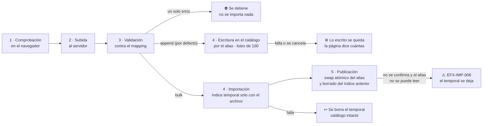

<div align="center">

# 🎬 Elastiflix-Movies Java

**Busca películas por palabras, por significado o combinando ambos — y compara cómo responde cada modo.**

Demo de búsqueda **full-text (BM25)**, **vectorial (k-NN)** e **híbrida (RRF)** sobre el alias
`elastiflix-reloaded` de **Elasticsearch Serverless**. El índice y el conteo vigentes están en
[`progreso/INDICE.md`](progreso/INDICE.md) › «Catálogo vigente».


</div>

> [!NOTE]
> ✅ **Estado actual:** las fases 0 a 8 están en `main`, incluidos el detalle de película (fase 7) y la interfaz
> en español e inglés (fase 8), y la revisión 4 que las corrigió (PR #25 y #26). La fase 9 (Requerimiento 3:
> archivos de hasta 25 MB) también está en `main` (PR #27). La fase 10 (Requerimiento 4: carga en modo
> append o bulk) también está en `main` (PR #28). La fase 11 (Requerimiento 5: índice y catálogo completo en
> «Acerca de») también está en `main` (PR #29). La fase 12 (Requerimiento 6: campos obligatorios de cada formato
> en «Acerca de») también está en `main` (PR #30). La fase 13 (Requerimiento 7: la primera carga crea el
> catálogo) también está en `main` (PR #31). El
> estado y el próximo paso están en [`progreso/INDICE.md`](progreso/INDICE.md), junto con el índice y el conteo
> vigentes del alias `elastiflix-reloaded` («Catálogo vigente»).

---

## 📚 Contenido

- [✨ Qué hace](#-qué-hace)
- [🔎 Los tres modos de búsqueda](#-los-tres-modos-de-búsqueda)
- [🎛️ Resultados, filtros y paginación](#️-resultados-filtros-y-paginación)
- [📥 Carga de datos](#-carga-de-datos)
- [🏗️ Arquitectura](#️-arquitectura)
- [🧰 Stack](#-stack)
- [📁 Estructura del repositorio](#-estructura-del-repositorio)
- [🚀 Puesta en marcha](#-puesta-en-marcha)
- [🔐 Seguridad y secretos](#-seguridad-y-secretos)
- [🤖 Desarrollo con agentes de IA](#-desarrollo-con-agentes-de-ia)
- [🗺️ Plan y estado](#️-plan-y-estado)
- [✅ Calidad de código](#-calidad-de-código)
- [🎨 Diseño](#-diseño)
- [📸 Capturas](#-capturas)
- [📖 Documentación](#-documentación)

---

## ✨ Qué hace

| | Capacidad | Detalle |
|---|---|---|
| 🔤 | **Full-text (léxica)** | Encuentra películas cuyo título contiene las palabras de tu consulta |
| 🧭 | **Vectorial** | Encuentra películas cuya sinopsis se parece en significado a lo que describes |
| 🔀 | **Híbrida** | Ejecuta las dos búsquedas y combina sus resultados en una sola lista |
| 🎬 | **Detalle de película** | Ficha técnica completa por ID (`/pelicula/{id}`), cifras USD y regreso a los resultados |
| 🌐 | **Bilingüe (ES · EN)** | Interfaz completa en español e inglés con selector en el encabezado y cookie de preferencia |
| 🎛️ | **Filtros dinámicos** | Adultos, géneros, fecha de estreno, idiomas y clasificación, con conteos |
| 📄 | **Paginación** | 25 · 50 · 100 resultados por página |
| 📥 | **Carga de datos** | Registro individual o archivos `.json` / `.csv`, validados contra el mapping; la primera carga crea el catálogo |
| ℹ️ | **Acerca de la demo** | Explicación de cada modo dentro de la aplicación, con un índice fijo y el catálogo completo |

## 🔎 Los tres modos de búsqueda

### 🔤 Full-text (léxica) · BM25

Busca coincidencias de términos en `title` y `original_title` (ambos `text`).

| Ajuste | Opciones |
|---|---|
| Tipo de consulta | `match` (un campo: `title` **o** `original_title`) · `multi-match` (`best_fields` sobre los dos) |
| Operador | `OR` (basta una palabra; por defecto) · `AND` (todas; con `multi-match`, en un mismo campo) |

> [!TIP]
> **BM25** es el algoritmo de puntuación por defecto de Elasticsearch: favorece los términos poco comunes
> en el catálogo; `k1 = 1.2` limita cuánto suma repetir un término y `b = 0.75` ajusta por la longitud
> del campo.

### 🧭 Vectorial · k-NN

Tu consulta se convierte en un vector con **jina-embeddings-v5-omni-small** y Elasticsearch devuelve
las películas cuya sinopsis (`plot`) tiene el vector más cercano, con un grafo **HNSW**.

| Campo | Dimensiones | Origen |
|---|---|---|
| `plot_256` | 256 | Primeros valores del vector de 1024, renormalizados (Matryoshka) |
| `plot_512` | 512 | Primeros valores del vector de 1024, renormalizados (Matryoshka) |
| `plot_1024` | 1024 | Vector completo del modelo |

| Ajuste | Por defecto | Regla |
|---|---|---|
| `k` | 100 | Resultados que devuelve la búsqueda vectorial |
| `num_candidates` | 200 | `k ≤ num_candidates ≤ 10 000` |

Los tres campos usan la misma configuración (`hnsw`, `m = 16`, `ef_construction = 100`, `cosine`, float
sin cuantización): la única diferencia es el número de dimensiones. **Precisión medida** con 32
descripciones de trama:

| Campo | 🥇 Correcta en 1.er lugar | Top 5 | Top 10 | MRR@10 |
|---|---|---|---|---|
| `plot_256` | 22 de 32 (69 %) | 29 | 30 | 0.774 |
| `plot_512` | 25 de 32 (78 %) | 31 | 32 | 0.853 |
| `plot_1024` | 26 de 32 (81 %) | 31 | 31 | 0.880 |

> 512 dimensiones queda muy cerca de 1024 con la mitad del tamaño; 256 pierde precisión de forma clara.

### 🔀 Híbrida · RRF

El retriever `rrf` combina el componente full-text (`standard`) y el vectorial (`knn`) según la
**posición** de cada película en cada lista — no según su puntuación, porque las escalas de BM25 y de
la similitud no son comparables.

| Parámetro | Valor |
|---|---|
| `rank_constant` | 60 (por defecto de Elasticsearch) |
| `rank_window_size` | igual a `k` (lo fija la aplicación) |

Cada resultado muestra su puntuación BM25, su similitud k-NN, su posición en cada lista y la puntuación
RRF: `Σ 1 / (60 + posición)`.

## 🎛️ Resultados, filtros y paginación

| | Full-text | Vectorial | Híbrida |
|---|---|---|---|
| **Puntuación** | BM25 (sin escala fija) | `(1 + coseno) / 2`, entre 0 y 1 | BM25 + k-NN + RRF |
| **Máximo de resultados** | 10 000 (`index.max_result_window`) | `k` | `rank_window_size` (= `k`) |
| **Filtros en Elasticsearch** | contexto `filter` | `filter` del retriever `knn` | `filter` del retriever `rrf` |
| **Conteos de filtros** | agregaciones `terms` | calculados en la aplicación | calculados en la aplicación |

- **Filtros:** `adult`, `genres`, `release_date` (desde–hasta), `spoken_languages`, `rating`. Entre
  filtros distintos se cumplen todos; dentro de uno basta con un valor. Se aplican con **APLICAR**.
- **Valores dinámicos:** cada filtro muestra solo los valores presentes en los resultados, con su conteo.
- **Sin resultados:** la página sugiere ajustes según el modo, o quitar filtros si estos vaciaron la
  lista.
- **Pósters:** se cargan del CDN de imágenes de TMDB a partir de `poster_path`. La atribución de TMDB
  aparece en el pie de cada página y en la sección «Créditos» de «Acerca de».

## 📥 Carga de datos



Un archivo se carga en uno de dos modos (Requerimiento 4, fase 10), que se elige en la tarjeta «Modo de carga»:

- **Append** (por defecto, no borra nada): las películas se agregan al índice vigente por el alias, en lotes de 100 y
  sin índice temporal. Un `id` que ya existe se reemplaza; antes de empezar, la página dice cuántas se reemplazarán.
  Si un lote se rechaza (`EFX-IMP-008`) o la carga se cancela (`EFX-IMP-009`), lo ya escrito se queda y la página
  dice cuántas se agregaron. El trabajo termina en `agregado`.
- **Bulk** (reemplaza el catálogo): las películas se escriben en un índice temporal nuevo que tiene **solo** las del
  archivo (el catálogo actual ya no se copia); al publicar, el catálogo queda con ellas y el índice anterior se
  borra. La página avisa cuántas películas tiene el catálogo que se borra. El trabajo termina en `publicado`.

Un catálogo de más de 25 MB se carga con un bulk (el primer archivo) y varios append.

| Forma | Formato |
|---|---|
| ✍️ Registro individual | Formulario con los campos del mapping (`id`, `title` y `plot` obligatorios); se escribe **directamente en el catálogo** |
| 🧾 `.json` | Exportación del índice (`documents`, `mapping`, `document_count`), arreglo de películas o NDJSON |
| 📊 `.csv` | UTF-8 con o sin BOM, coma, **encabezado obligatorio** (sin encabezado se rechaza); listas y anidados como JSON en la celda |

- **Campos obligatorios:** en los dos formatos y en los dos modos, `id`, `title` y `plot` con valor (en `.csv`, como
  columnas del encabezado); el resto es opcional. «Acerca de» › «El catálogo» lo dice campo por campo.
- **Antes de subir:** solo `.json` o `.csv`, sin dobles extensiones, máximo **25 MB**, UTF-8. El tope es fijo
  (Requerimiento 3): no hay variable para cambiarlo, y una `ELASTIFLIX_INGEST_MAX_FILE_SIZE` que siga en un `.env`
  viejo se ignora. Un catálogo más grande se parte en archivos de hasta 25 MB.
- **Contra el mapping:** se revisa el archivo completo; si algo no coincide, se muestra cada error
  (registro, `id`, campo, valor recibido, lo que espera el mapping) y se puede descargar el informe. La página
  da el total real de errores; el informe descargable trae como mucho los primeros 10 000.
- **Vectores:** `plot_256`, `plot_512` y `plot_1024` **siempre** se generan en tiempo de ejecución desde
  `plot`, con el modelo de embeddings a través del servicio de inferencia de Elasticsearch, con la misma
  configuración que produjo los vectores del catálogo (calibrada en la tarea 1.9). Los archivos no los
  traen y el formulario no los captura.
- **Publicación (bulk):** en una sola operación, el alias `elastiflix-reloaded` pasa al índice nuevo y el
  índice anterior se borra; si algo falla antes, el catálogo queda exactamente como estaba.
- **Un solo usuario:** la demo tiene fines académicos y demostrativos y la usa una persona a la vez.

## 🏗️ Arquitectura


Diagrama completo con los flujos numerados: [`docs/arquitectura.mermaid`](docs/arquitectura.mermaid).

## 🧰 Stack

| | Componente | Versión |
|---|---|---|
| ☕ | Java (LTS) | 25 |
| 🍃 | Spring Boot | 4.1.1 |
| 📦 | Maven (Maven Wrapper) | 3.10.0 |
| 🖼️ | Thymeleaf | 3.1.5 |
| 🔍 | Cliente Java de Elasticsearch | 9.4.5 (gestionado por Spring Boot) |
| 🧩 | Jackson 3 (`Jackson3JsonpMapper`) | 3.1.5 |
| 🧠 | jina-embeddings-v5-omni-small | endpoint `.jina-embeddings-v5-omni-small` |
| 🧹 | Checkstyle · PMD · ArchUnit (`archunit-junit6`) | 14.3.0 · 7.28.0 · 1.5.1 |

## 📁 Estructura del repositorio

```
elastiflix-reloaded/
├── 📄 PLAN.md · AGENTS.md · CLAUDE.md · README.md
├── 📦 pom.xml · mvnw · .mvn/            build de Maven
├── ⚙️  elastiflix-core/                  modelo · cliente ES · alias e índices · embeddings
├── 🔎 elastiflix-search/                match / multi_match · knn · rrf · filtros · facetas
├── 📥 elastiflix-ingest/                validación · lectores JSON/CSV · importación · swap de alias
├── 🌐 elastiflix-web/                   único ejecutable · 5 páginas Thymeleaf en español e inglés
├── 🧹 config/                           Checkstyle y PMD (congelados)
├── 📚 docs/                             convenciones · arquitectura · diseños por fase · glosario EN · revisiones · capturas
├── 🎨 design/                           mockups aprobados y tokens de diseño
├── 🗄️  elasticsearch/                    mapping del índice y fixtures reales
├── 📍 progreso/                         estado del desarrollo para retomar sesiones
└── 🖱️  .cursor/rules/                    regla de Cursor para archivos Java
```

## 🚀 Puesta en marcha

> [!IMPORTANT]
> Los **Comandos** se probaron en un `git clone` limpio, con `.env`, sobre un proyecto que ya tenía el
> catálogo. La primera carga de «Preparar el catálogo» se probó el 2026-10-22 contra un alias `elastiflix-it-…` que
> no existía: un registro individual y un archivo en bulk crearon cada uno el índice con el mapping y el alias, y
> append quedó bloqueado. La migración de un índice concreto sigue la documentación de Elasticsearch y el código de
> la tarea 1.8, pero no se ha probado en un proyecto vacío.

**Prerrequisitos**

- ☕ JDK 25 · 🐙 Git (en Windows, con **Git Bash**). El Maven Wrapper ya está en el repositorio
  (`./mvnw`); no hace falta instalar Maven para compilar.
- 🔑 Un proyecto **Elasticsearch Serverless** y una API key con los privilegios que se listan en
  «Datos y proyecto Serverless».
- 🎬 Para llenar un catálogo nuevo: un archivo `.json` o `.csv` de películas. El archivo de exportación
  del catálogo no está versionado; el respaldo lo guarda quien exportó el índice (PLAN §2, nota 5).

**Configuración**

```bash
cp .env.example .env          # completa ELASTICSEARCH_URL y ELASTICSEARCH_API_KEY
set -a; . ./.env; set +a      # exporta las variables a esta terminal para los curl de abajo
```

La aplicación lee `.env` por su cuenta al arrancar; exportar las variables solo hace falta para los `curl`.

> [!WARNING]
> `.env` nunca se sube a git. Ningún secreto va en el código, en YAML ni en los commits.

**Datos y proyecto Serverless**

- El alias, el índice concreto y el conteo vigentes están en
  [`progreso/INDICE.md`](progreso/INDICE.md) › «Catálogo vigente».
- La API key necesita:
  - en los índices `elastiflix-*`: `create_index`, `delete_index`, `read`, `write`,
    `view_index_metadata` y `manage` (este último, para `_aliases`);
  - en el clúster: `monitor` para leer el avance de `_reindex` en `_tasks/<id>`, `cancel_task` para
    cancelar una copia en curso y `monitor_inference` para pedir vectores a `_inference`.

  Serverless reconoce esos nombres (comprobado con `_security/user/_has_privileges`). Las pruebas usaron
  una clave con más privilegios, así que este mínimo no se ha probado por separado. Cómo se declaran:
  [claves de API de Elasticsearch](https://www.elastic.co/docs/deploy-manage/api-keys/elasticsearch-api-keys).
- El endpoint de inferencia `.jina-embeddings-v5-omni-small` tiene que existir. El id sale de
  `ELASTIFLIX_INFERENCE_ID` en `.env`, con el mismo valor por defecto en
  [`application.yml`](elastiflix-web/src/main/resources/application.yml). Comprobarlo:

  ```bash
  curl -sS -H "Authorization: ApiKey $ELASTICSEARCH_API_KEY" \
    "$ELASTICSEARCH_URL/_inference/embedding/.jina-embeddings-v5-omni-small"
  ```

  El modelo es de tipo `embedding`. El cliente Java pide los vectores con `TaskType.Embedding`.
  `text_embedding` no es el tipo de este endpoint. La referencia de esa API está en la
  [operación Get inference](https://www.elastic.co/docs/api/doc/elasticsearch/operation/operation-inference-get).
- Las pruebas de integración leen del alias las películas `597`, `27205`, `10681`, `345887`, `134` y
  `87827`. Las que comprueban los totales de PLAN §6 se omiten si `_count` no es 6 899.

**Preparar el catálogo** (solo si el proyecto no tiene `elastiflix-reloaded`)

La primera carga crea el catálogo (Requerimiento 7, fase 13). En un proyecto vacío:

1. Arrancar la aplicación (`./mvnw -pl elastiflix-web spring-boot:run`) y abrir http://localhost:8080/cargar. La
   cabecera dice «Conectado · el catálogo todavía no existe» y la página avisa que la primera carga lo crea.
2. Importar el archivo de películas en modo **bulk** desde «Importar .json» o «Importar .csv» (la tarjeta «Modo de
   carga» ya trae bulk marcado y append deshabilitado), o guardar un **registro individual**. Los dos crean
   `elastiflix-reloaded-<AAAAMMDD-HHMMSS>` con el mapping del repositorio y le ponen el alias `elastiflix-reloaded`
   con `_aliases`. Los vectores de la sinopsis se generan con el servicio de inferencia.
3. Desde ahí, append agrega películas al catálogo. Antes de que exista, append se rechaza con `EFX-IMP-010`.

Si el proyecto tiene un **índice concreto** llamado `elastiflix-reloaded` (de antes de la tarea 1.8), hay que
convertirlo en alias. El comando copia el índice a `elastiflix-reloaded-<AAAAMMDD-HHMMSS>` y, en una sola llamada,
borra el índice concreto y crea el alias. Termina por sí solo:

```bash
./mvnw -q install -DskipTests
./mvnw -pl elastiflix-web spring-boot:run "-Dspring-boot.run.arguments=--elastiflix.bootstrap.enabled=true --spring.main.web-application-type=none"
```

Si el nombre ya es un alias, el comando no crea ni borra índices: el log dice a cuál apunta y el proceso termina
con código 0. Si el nombre no existe, la migración se detiene sin crear nada: el catálogo lo crea la primera carga.

**Comandos**

```bash
./mvnw -v                                        # Maven 3.10.0 y Java 25
./mvnw -q validate                               # enforcer de Java y Maven
./mvnw -q -DskipTests package                    # jar de elastiflix-web
./mvnw verify                                    # unitarias, ArchUnit, Checkstyle y PMD
./mvnw verify -Pit                               # lo anterior más integración y smoke (requiere .env)
# Pruebas de navegador del JavaScript (Node.js y Chromium; fuera de verify):
# ver elastiflix-web/src/test/browser/README.md
./mvnw -q install -DskipTests                    # instala los módulos para spring-boot:run
./mvnw -pl elastiflix-web spring-boot:run "-Dspring-boot.run.arguments=--elastiflix.bootstrap.enabled=true --spring.main.web-application-type=none"
./mvnw -pl elastiflix-web spring-boot:run        # http://localhost:8080
```

El penúltimo comando es la conversión a alias de «Preparar el catálogo»: si el nombre ya es un alias, no
crea ni borra índices. `spring-boot:run` solo lee el catálogo por el alias.

**Desde IntelliJ IDEA:** abre la carpeta raíz como proyecto Maven y ejecuta `ElastiflixApplication` (módulo
`elastiflix-web`); lee el `.env` de la raíz con cualquiera de los dos directorios de trabajo, la raíz o
`elastiflix-web`. IntelliJ compila en las mismas carpetas `target/classes` que Maven: después de un
`./mvnw clean …`, haz **Build › Rebuild Project** antes de ejecutar. Si no, su compilación incremental puede dejar
un módulo sin clases y el arranque falla con `ClassNotFoundException` (por ejemplo,
`ElasticsearchCredentialsEnvironmentPostProcessor`).

Las capturas de la aplicación en marcha están en [docs/capturas/](docs/capturas/).

**Qué incluye**

- Conexión al proyecto Serverless con la URL y la API key de `.env`, y estado del catálogo (alias, índice
  vigente y conteo) en el pie y en `GET /actuator/health`.
- Vectores de consulta (`search`, prefijo `Query: `) y de sinopsis (`ingest`, sin prefijo); los de 512 y 256
  dimensiones salen de recortar el de 1024 y renormalizarlo.
- Búsqueda de solo lectura sobre el alias en los tres modos, con filtros, facetas, paginación y los dos
  estados vacíos.
- Carga de un `.json` o un `.csv`: comprobación de nombre, tamaño y UTF-8, validación todo o nada contra el
  mapping e informe de errores descargable. Si el archivo trae vectores, se ignoran y se generan de nuevo.
- Carga en dos modos: append (por defecto) agrega por el alias en lotes de 100 y deja lo escrito si para; bulk
  escribe solo el archivo en un índice temporal y publica en una sola llamada (el índice anterior se borra); si
  falla o se cancela, el catálogo queda como estaba.
- Registro individual directo al alias, visible en la búsqueda siguiente.
- Cinco páginas: Inicio (tres modos y sugerencias), Resultados, Detalle de película, Cargar datos y Acerca de
  (tabla de precisión, créditos de TMDB, un índice fijo a la izquierda que marca la sección que se lee y, en «El
  catálogo», todas las propiedades del mapping por grupo, con su tipo, contenido, uso y si un `.json` o un `.csv`
  tiene que traerlas para cargarse).
- Detalle de película en `/pelicula/{id}`: todos los campos del documento salvo los vectores, cifras en USD,
  «N/A» en los campos vacíos y regreso a los resultados con la búsqueda intacta. Sin una búsqueda válida
  responde 400 con `EFX-SRCH-012`; un `id` que no existe, 404; si Elasticsearch falla, la página de error
  `EFX-*`. Los ids con `/` o fuera de ASCII viajan codificados en un solo segmento (`/pelicula/a%2Fb`).
- Interfaz en español e inglés: selector «ES · EN» en el header, parámetro `lang` y cookie `elastiflix-lang`;
  español por defecto. Los textos están en `messages_es.properties` y `messages_en.properties`; los logs
  siguen en español.
- Página de error con el código `EFX-*` y un 404 con navegación.
- Smoke de punta a punta en `./mvnw verify -Pit`: salud de la aplicación, Inicio, Acerca de y Cargar datos,
  una búsqueda por modo, el detalle de Titanic abierto desde una búsqueda (en español y en inglés), las páginas
  con `lang=en` y la validación de `elasticsearch/fixtures/movies-sample.csv` sin importar. El catálogo queda
  igual antes y después.

`elastiflix.embedding.document-input-type` y `elastiflix.embedding.document-prefix` no están en el
YAML: sus valores por defecto están en `@DefaultValue` (`ingest` y cadena vacía). El alias y el id
de inferencia salen de `application.yml` (valores por defecto) o de `.env`
(`ELASTIFLIX_INDEX_ALIAS`, `ELASTIFLIX_INFERENCE_ID`). `.env.example` deja vacías la URL y la API
key y trae los valores por defecto del resto (alias, inferencia, lote de carga, pósters y puerto).

En Windows, ejecuta estos comandos en **Git Bash** (ver `AGENTS.md` › Comandos).

## 🔐 Seguridad y secretos

- La demo no tiene autenticación: es intencional y queda fuera de alcance.
- Los POST no tienen protección CSRF, porque no hay sesión que proteger y la usa una sola persona.
- Los secretos van solo en `.env` (ver `.env.example`). Nunca se escriben en el código, el YAML, las
  pruebas ni los logs.

## 🤖 Desarrollo con agentes de IA

El proyecto está preparado para que **cualquiera de estos agentes** trabaje en él o retome lo que otro dejó:

| Herramienta | Qué lee | Archivo en este repo |
|---|---|---|
| 🟣 **Cursor** *(programó las fases 0 a 6)* | `AGENTS.md` en la raíz + reglas `.mdc` | `AGENTS.md`, `.cursor/rules/elastiflix-java.mdc` |
| 🟠 **Claude Code** *(revisiones 3 y 4)* | `CLAUDE.md`, que importa `AGENTS.md` | `CLAUDE.md` → `@AGENTS.md` |
| 🔵 **Google Antigravity** *(programó las fases 7 y 8)* | `AGENTS.md` en la raíz (máx. 12 000 caracteres) | `AGENTS.md` |
| 🟢 **JetBrains Junie** | `AGENTS.md` en la raíz | `AGENTS.md` |

### ▶️ Para empezar

Las nueve fases del plan (0 a 8) ya están en `main`, así que la orden de arranque original («Apruebo el plan…
ejecuta las fases en orden desde la Fase 0») ya no aplica. El trabajo pendiente, si lo hay, está en
«Punto de reanudación» de [`progreso/INDICE.md`](progreso/INDICE.md). Varios agentes pueden trabajar a la
vez si cada uno toma una parte con archivos propios, su rama y su worktree, y la integra con un PR hacia
`main`.

### 🔁 Si una sesión se interrumpe

Si se acaban los tokens, se llena el contexto, se cierra la herramienta o cambia el agente, no se pierde el
avance: al terminar
**cada tarea** el agente actualiza `progreso/`, hace un commit y lo publica con `git push`. Al cerrar
cada fase actualiza también esta documentación. Pide:

> Retoma el trabajo: aplica el protocolo de reanudación de `AGENTS.md` y continúa desde el próximo
> paso registrado en tu archivo de `progreso/`.

### 🔒 Aprobar o pedir cambios a un diseño

Las fases con 🔒 (1, 2, 3 y 7) se detienen en `esperando aprobación de diseño`. Responde con una de estas frases:

> ✅ Apruebo el diseño de la Fase N tal como está. Regístralo en `progreso/N.md` y continúa.

> ✏️ No apruebo el diseño de la Fase N. Cambia lo siguiente: … Actualiza `docs/diseno/N.md` y vuelve a
> pedirme aprobación.

## 🗺️ Plan y estado

| Fase | Nombre | 🔒 Aprobación de diseño | Estado |
|---|---|---|---|
| 0 | 🏗️ Andamiaje y calidad | — | ✅ terminado |
| 1 | ⚙️ Núcleo: conexión, catálogo y embeddings | 🔒 | ✅ terminado |
| 2 | 🔎 Búsqueda | 🔒 | ✅ terminado |
| 3 | 📥 Carga de datos | 🔒 | ✅ terminado |
| 4 | 🌐 Interfaz web | — | ✅ terminado |
| 5 | 🧪 Pruebas integrales y smoke test | — | ✅ terminado |
| 6 | 📚 Documentación y cierre | — | ✅ terminado |
| 7 | 🎬 Detalle de película | 🔒 | ✅ terminado |
| 8 | 🌐 Interfaz en español e inglés (i18n) | — | ✅ terminado |

El estado vigente siempre es el de [`progreso/INDICE.md`](progreso/INDICE.md); esta tabla se actualiza
al cerrar cada fase.

## ✅ Calidad de código

- 📐 **Convenciones:** [`docs/convenciones-java.md`](docs/convenciones-java.md) (estilo JavaMentor:
  Java 25 con mesura, SOLID, métodos cortos, errores con códigos `EFX-*`, logging SLF4J, Javadoc).
- 📝 **Diseño antes de codificar:** cada fase con código empieza por `docs/diseno/<fase>.md`.
- 🤖 **Verificación automática** en `./mvnw verify`:

| Herramienta | Revisa |
|---|---|
| Checkstyle 14.3.0 | Tamaño y complejidad de métodos, nombres, Javadoc, `catch` vacíos, `System.out`, inyección por campo, secretos literales |
| PMD 7.28.0 | Complejidad cognitiva, clases dios, excepciones genéricas, código sin uso |
| ArchUnit 1.5.1 | Matriz de dependencias entre módulos; la web no usa el cliente de Elasticsearch |

## 🎨 Diseño

Pantallas aprobadas en [`design/mockups/`](design/mockups/) con su paleta pastel multitono y
tipografías **Bricolage Grotesque**, **IBM Plex Sans** e **IBM Plex Mono**. Tokens y guía en
[`design/README.md`](design/README.md).

| 🏠 Inicio | 📋 Resultados | 🎬 Detalle | 📥 Cargar datos | ℹ️ Acerca de |
|---|---|---|---|---|
| Búsqueda, modos y sugerencias | Puntuaciones, filtros y paginación | Ficha completa y regreso a la búsqueda | Formulario, archivos y validación | Documentación de la demo |

Cada pantalla tiene su versión en inglés (`<Página>-en.dc.html`); la traducción sigue
[`docs/i18n/glosario-en.md`](docs/i18n/glosario-en.md).

## 📸 Capturas

Capturas de página completa con la aplicación conectada al catálogo real (6 899 películas), en español y en
inglés; el pie muestra su conteo. Se tomaron el 2026-10-21 en la revisión 4 (ventana de 1440 px, Chromium con
Playwright 1.49.1); Adolfo las aprobó el 2026-10-21. Las tres de «Cargar datos» (en los dos idiomas) se volvieron
a tomar el 2026-10-21 al cerrar la fase 10, con la tarjeta «Modo de carga» en append y los textos de los dos
modos; Adolfo aprobó esas seis el mismo día. Las dos de «Acerca de» también se volvieron a tomar ese día, con la
sección «Carga de datos» en los dos modos, y Adolfo también las aprobó; después se reemplazaron, a pedido suyo,
por las mismas con la frase corregida de «El catálogo». La fase 11 las volvió a tomar con el índice y el
catálogo completo, y Adolfo las aprobó. La fase 12 las volvió a tomar con las columnas de obligatorios en `.json` y
`.csv`, y Adolfo también las aprobó. La comparación anterior con los mockups está en
[`progreso/4.md`](progreso/4.md).

| Página | Español | English |
|---|---|---|
| Inicio `GET /` |  |  |
| Resultados · Full-text |  |  |
| Resultados · Vectorial |  |  |
| Resultados · Híbrida |  |  |
| Detalle de película `GET /pelicula/{id}` |  |  |
| Detalle sin búsqueda (`EFX-SRCH-012`) |  |  |
| Cargar datos · Registro individual |  |  |
| Cargar datos · CSV válido, listo para importar |  |  |
| Cargar datos · CSV que no coincide con el mapping |  |  |
| Acerca de `GET /acerca` |  |  |
| Ruta desconocida |  |  |

## 📖 Documentación

| Documento | Para qué |
|---|---|
| 🗺️ [`PLAN.md`](PLAN.md) | Plan de implementación por fases (fuente única de verdad) |
| 🤖 [`AGENTS.md`](AGENTS.md) · [`CLAUDE.md`](CLAUDE.md) | Reglas para los agentes de IA |
| 📍 [`progreso/INDICE.md`](progreso/INDICE.md) | Estado actual y próximo paso |
| 📐 [`docs/convenciones-java.md`](docs/convenciones-java.md) | Cómo se escribe el código |
| 🏗️ [`docs/arquitectura.mermaid`](docs/arquitectura.mermaid) | Arquitectura y flujos |
| ⚙️ [`docs/diseno/1.md`](docs/diseno/1.md) | Diseño aprobado del núcleo y tabla de calibración |
| 🔎 [`docs/diseno/2.md`](docs/diseno/2.md) | Diseño aprobado de la búsqueda |
| 📥 [`docs/diseno/3.md`](docs/diseno/3.md) | Diseño aprobado de la carga |
| 🌐 [`docs/diseno/4.md`](docs/diseno/4.md) | Diseño de la interfaz web |
| 🧪 [`docs/diseno/5.md`](docs/diseno/5.md) | Diseño del smoke test |
| 🎬 [`docs/diseno/7.md`](docs/diseno/7.md) | Diseño aprobado del detalle de película |
| 🌐 [`docs/diseno/8.md`](docs/diseno/8.md) | Diseño de la interfaz en español e inglés |
| 🔤 [`docs/i18n/glosario-en.md`](docs/i18n/glosario-en.md) | Glosario ES → EN, tono y formatos en inglés |
| 🔍 [`docs/revisiones/`](docs/revisiones/) | Listas de correcciones de las revisiones 2, 3 y 4 |
| 📸 [`docs/capturas/`](docs/capturas/) | Capturas de las páginas |
| 🗄️ [`elasticsearch/elastiflix-reloaded-mapping.json`](elasticsearch/elastiflix-reloaded-mapping.json) | Mapping del índice |
| 🎨 [`design/README.md`](design/README.md) | Mockups y tokens de diseño |

**Referencias de Elasticsearch:**
[match](https://www.elastic.co/docs/reference/query-languages/query-dsl/query-dsl-match-query) ·
[multi_match](https://www.elastic.co/docs/reference/query-languages/query-dsl/query-dsl-multi-match-query) ·
[kNN retriever](https://www.elastic.co/docs/reference/elasticsearch/rest-apis/retrievers/knn-retriever) ·
[RRF retriever](https://www.elastic.co/docs/reference/elasticsearch/rest-apis/retrievers/rrf-retriever) ·
[dense_vector](https://www.elastic.co/docs/reference/elasticsearch/mapping-reference/dense-vector) ·
[alias](https://www.elastic.co/docs/manage-data/data-store/aliases)

---

<div align="center">

🔒 Repositorio privado · Hecho con ☕ y 🍿

</div>
