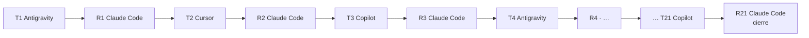
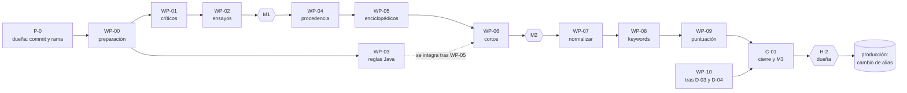

# 🧭 Plan de calidad del catálogo · ronda 4

Plan de ejecución de las 10 recomendaciones del [informe de calidad](informe/informe-calidad.html) del índice
`elastiflix-reloaded`, en el mismo orden del informe. Lo ejecuta un equipo de agentes bajo la supervisión de una
persona, la **dueña del proyecto**: **Google Antigravity, Cursor y GitHub Copilot ejecutan** por turnos, repartidos
por igual, y **Claude Code revisa y corrige** después de cada turno.

- **Antes de tocar nada**, lee [`AGENTS.md`](AGENTS.md): equipo, reglas de seguridad, worktree y protocolo de turno.
- **El estado vive en [`BITACORA.md`](BITACORA.md)**, en la rama de integración `dq/ronda-4`. Este plan es la
  especificación y no se marca: si cambia, el cambio se anota como decisión en la bitácora.
- Cada paquete de trabajo (**WP**) es una tarjeta autocontenida. Un agente con poco contexto puede leer solo
  `AGENTS.md`, la tarjeta de su WP y `bitacora/WP-XX.md`.

## Índice

| WP | Recomendación del informe | Roles | Depende de | Turnos |
|---|---|---|---|---|
| [WP-00](#wp-00--preparación-del-equipo) | (preparación: herramientas, línea base y staging) | DATOS · EVAL | Precondición P-0 | 1, 2, 3 |
| [WP-01](#wp-01--reemplazar-respuestas-de-asistente-y-datos-inventados) | 1 · Las 2 respuestas de asistente y los 11 casos verificados de datos inventados (13 películas, entre ellas `1450`) | DATOS | WP-00 | 4 |
| [WP-02](#wp-02--reescribir-los-ensayos-generados) | 2 · Reescribir los ensayos: 1 402 películas (las 1 408 del informe, más las 6 correcciones de año, menos las que ya están en WP-01) | DATOS · EVAL | WP-01 | 4, 5, 6, 7 |
| [WP-03](#wp-03--ampliar-las-reglas-de-advertencia) | 3 · Ampliar las reglas `EFX-ING-025`, `026` y `028` | JAVA | Se escribe tras WP-00 · se integra tras WP-05 | 8, 13 |
| [WP-04](#wp-04--etiquetar-el-origen-de-todas-las-sinopsis) | 4 · Etiquetar el origen de todas las sinopsis | DATOS · JAVA · DOCS | WP-02 | 9 |
| [WP-05](#wp-05--limpiar-el-plot-enciclopédico) | 5 · Limpiar el plot enciclopédico | DATOS | WP-04 | 10, 11, 12 |
| [WP-06](#wp-06--completar-las-sinopsis-cortas) | 6 · Completar las sinopsis cortas | DATOS · EVAL | WP-05 | 13, 14 |
| [WP-07](#wp-07--normalizar-al-cargar) | 7 · Normalizar al cargar (texto y vocabularios) | DATOS · JAVA | WP-06 | 14, 15 |
| [WP-08](#wp-08--corregir-palabras-clave-y-colecciones) | 8 · Corregir palabras clave y colecciones | DATOS | WP-07 | 16 |
| [WP-09](#wp-09--una-sola-puntuación-y-montos-imposibles) | 9 · Una sola puntuación y montos imposibles | DATOS · DOCS | WP-08 · decisión D-02 | 17 |
| [WP-10](#wp-10--opcional-dynamic-strict-y-filtro-adult) | 10 · Opcional: `dynamic: strict` y filtro `adult` | JAVA · DOCS | Decisiones D-03 y D-04 | 18 |
| [C-01](#c-01--cierre-medición-publicación-y-documentación) | (cierre: medición, publicación y documentación) | EVAL · DOCS | WP-01…WP-10 | 19, 20, 21 |

Los turnos van **en serie**, en el orden fijo del equipo, así que nunca hay dos agentes cambiando `data/` a la vez.
WP-03 es el único que vive en su propia rama (`dq/wp-03-reglas-plot`): se escribe en el turno 8 y se integra en
`dq/ronda-4` en el turno 13, cuando `data/` ya no tiene los textos que sus reglas nuevas avisarían.

## Reparto y turnos

Cada fila es un **turno de ejecución**, seguido siempre de su **revisión** por Claude Code (R-NN). El orden es fijo:
Antigravity → Claude Code → Cursor → Claude Code → GitHub Copilot → Claude Code, y vuelta a empezar. Las tareas se
cortaron para que cada ejecutor tenga **7 turnos, 2 de ellos grandes**, y una mezcla parecida de datos, código,
medición y documentación.

| Turno | Ejecutor | Tareas | Peso | Necesita de la dueña |
|---|---|---|---|---|
| 1 | Google Antigravity | WP-00 T-01 a T-04: entorno, `catalogo.py` con round-trip exacto, formato de lote, `aplicar_cambios.py` | Grande | — |
| 2 | Cursor | WP-00 T-05 y T-09: `wiki_plot.py` y `proponer_trama.py` | Grande | — |
| 3 | GitHub Copilot | WP-00 T-06, T-07, T-08 y T-10: `cargar.py`, M0, staging y `publicar.py` (probado con alias de ensayo) | Grande | **H-1** antes de T-08 |
| 4 | Google Antigravity | WP-01 completo y WP-02 `lote-001` (las 13 de prioridad y 87 más) | Mediano | — |
| 5 | Cursor | WP-02 lotes `002` a `006` | Mediano | — |
| 6 | GitHub Copilot | WP-02 lotes `007` a `011` | Mediano | — |
| 7 | Google Antigravity | WP-02 lotes `012` a `015`, T-04, T-05 y T-06 (**M1**) | Mediano | — · **hito A** en su revisión |
| 8 | Cursor | WP-03 T-01, T-02 y T-04, en `dq/wp-03-reglas-plot` | Grande | — |
| 9 | GitHub Copilot | WP-04 completo | Mediano | — |
| 10 | Google Antigravity | WP-05 T-01 (`limpiar_enciclopedico.py`) y lotes `001` a `010` | Mediano | — |
| 11 | Cursor | WP-05 lotes `011` a `025` | Mediano | — |
| 12 | GitHub Copilot | WP-05 lotes `026` a `039`, T-03 y T-05 | Mediano | — |
| 13 | Google Antigravity | WP-03 T-03 (integración en `dq/ronda-4`) y WP-06 T-01 y T-02 | Mediano | — |
| 14 | Cursor | WP-06 T-03 (**M2**) y WP-07 parte A | Mediano | — · **hito B** en su revisión |
| 15 | GitHub Copilot | WP-07 parte B (`EFX-ING-029` en Java) | Grande | — |
| 16 | Google Antigravity | WP-08 completo | Mediano | — |
| 17 | Cursor | WP-09 completo | Mediano | **D-02** |
| 18 | GitHub Copilot | WP-10 completo | Mediano | **D-03** y **D-04** |
| 19 | Google Antigravity | C-01 T-01 a T-03: M3, informe v2, pruebas de integración y umbrales | Grande | — |
| 20 | Cursor | C-01 T-04 y T-05: documentación y hito C | Mediano | — · **hito C** en su revisión |
| 21 | GitHub Copilot | C-01 T-06 a T-08: H-2, publicación, medición en producción y limpieza a los 7 días | Mediano | **H-2** |

| Ejecutor | Turnos | Grandes | Qué le toca, en resumen |
|---|---|---|---|
| Google Antigravity | 1, 4, 7, 10, 13, 16, 19 | 1, 19 | Base de datos del plan, cierre de WP-02 y M1, arranque de WP-05, integración de WP-03, palabras clave, M3 |
| Cursor | 2, 5, 8, 11, 14, 17, 20 | 2, 8 | Wikipedia, reglas Java de WP-03, M2, puntuación, documentación final |
| GitHub Copilot | 3, 6, 9, 12, 15, 18, 21 | 3, 15 | Staging y publicación, procedencia, cierre de WP-05, normalización Java, mapping, publicación final |

Los turnos de Copilot 3 y 21 son los que dependen de aprobaciones (H-1 y H-2) y tocan staging y producción; los de
Antigravity 1 y 19 abren y cierran la base técnica; los de Cursor 2 y 8 llevan la parte de Wikipedia y de Java.

**Reglas del reparto.**

- Un turno no se adelanta ni se salta. Si un turno se cierra `INCOMPLETO`, Claude Code termina lo que sea corrección
  en su revisión; el resto pasa como primera tarea del siguiente turno del **mismo** ejecutor, anotado como decisión.
- Si un ejecutor termina un WP de varios turnos antes de lo previsto (por ejemplo, porque `proponer_trama.py` deja
  muchas películas «sin fuente» y sobran lotes), el turno siguiente empieza con la tarea siguiente del plan, sin
  cambiar de ejecutor.
- El turno 21 hace T-06 y T-07 y queda `EN ESPERA` hasta cumplir los 7 días de T-08. R-21 revisa la publicación;
  cuando Copilot cierra T-08, Claude Code hace la revisión final R-21b, con la retrospectiva del equipo.
- Las decisiones D-02, D-03 y D-04 conviene contestarlas al principio: el memo de WP-09 se puede leer en el plan, y
  así los turnos 17 y 18 no esperan.





---

## Hechos del proyecto que todo agente debe conocer

| Hecho | Consecuencia para el trabajo |
|---|---|
| El índice vivo es idéntico, campo por campo, a `data/elastiflix-reloaded_0{1..7}.json` y `.csv` | **Toda corrección se hace en `data/`**, nunca escribiendo directo en Elasticsearch |
| Cada parte existe en `.json` y `.csv` con el mismo contenido | Las dos se escriben juntas con `catalogo.py` (WP-00); nunca se edita una a mano |
| `ShippedCatalogValidationTest` exige que las 14 partes carguen **sin errores ni advertencias**, que JSON y CSV coincidan, 6 899 películas y `enrichment` en todas menos `751432` | Si una regla nueva avisa sobre `data/`, primero se limpia `data/`; si cambia el número de etiquetas, la prueba cambia **en el mismo commit** |
| Los vectores `plot_256/512/1024` se generan desde `plot` al cargar | Cambiar `plot` cambia la búsqueda vectorial: hay mediciones M1, M2 y M3 |
| `RelevanceIT` usa el alias de `ELASTIFLIX_INDEX_ALIAS` y los mínimos de `eval/thresholds.json`; escribe `target/eval/report.md` | **Si el alias no tiene exactamente 6 899 películas, la prueba se omite y el build sale en verde.** Una medición vale solo si `report.md` se reescribió en esa corrida |
| La demo pública lee el alias `elastiflix-reloaded` del mismo proyecto Serverless, y el `.env` apunta a ese alias | Toda instancia que levante un agente lleva `ELASTIFLIX_INDEX_ALIAS=elastiflix-dq-staging` explícito. Producción solo cambia en C-01, con H-2 |
| Una carga bulk de la aplicación borra el índice anterior del alias (`OrphanCleaner`) | Por eso producción **no** se recarga por partes: se publica cambiando el alias al índice de staging, con vuelta atrás (C-01) |
| La aplicación de la dueña del proyecto lee plantillas de `target/classes` del checkout principal | Los agentes trabajan en un **worktree aparte** (`AGENTS.md` §4) con su propio `target/`. Nunca `./mvnw clean` ni borrar `target/` |
| La ronda 3 cambió 1 641 sinopsis por el overview de TMDB, y `plot_1024` bajó de nDCG@10 0.817 a 0.742 | Volver a la trama real debería recuperar precisión, pero hay que medirlo |
| Un push a `main` dispara Cloud Build y despliega la demo | Se trabaja solo en local, en el worktree de `dq/ronda-4` (decisión P-04). A `main` solo llegan los hitos, que integra la dueña del proyecto (`AGENTS.md` §6) |

## Norma de sinopsis (NS)

Rige en WP-01, 02, 05 y 06. Es la regla que más importa: **el defecto que se corrige es texto escrito por un
modelo, así que ningún agente escribe sinopsis.**

| Regla | Contenido |
|---|---|
| **NS-1 · Fuente** | **(a)** La sección de trama del artículo de Wikipedia en inglés (`Plot`, `Synopsis`, `Plot summary`, `Story`, `Premise`). **(b)** Solo en WP-01 y WP-02, donde el texto actual no sirve: si no hay (a), el `overview` de TMDB que ya trae el documento, con 40 caracteres o más, y etiqueta `tmdb_overview`. **(c)** Si no hay ninguna, el `plot` se queda como está y la película queda «sin fuente» en `cambios/WP-XX/estado.tsv` |
| **NS-2 · Sin redacción** | Prohibido redactar, resumir, traducir, parafrasear o «mejorar» una sinopsis, con un modelo o a mano. El agente escribe **código** que copia texto. Transformaciones permitidas: quitar referencias (`[1]`, `[a]`, `[citation needed]`), notas y marcado; unir espacios; recortar según NS-3; y, solo en WP-05, quitar párrafos completos con `limpiar_enciclopedico.py` |
| **NS-3 · Largo** | De 40 a **3 000** caracteres (decisión D-01, valor por defecto). Si la fuente es más larga, se corta en el último fin de oración (`.`, `!`, `?`) antes del límite |
| **NS-4 · Identidad** | El artículo se encuentra por `imdb_id` → Wikidata (propiedad P345) → enlace `enwiki`. Sin `imdb_id` o sin resultado: búsqueda por título, aceptada solo si el año coincide ±1 **y** aparecen en el artículo al menos 2 nombres de `cast` |
| **NS-5 · Procedencia** | `enrichment.plot` = `wikipedia_plot_AAAA-MM-DD` (fecha de descarga) o `tmdb_overview`. Cada sinopsis de Wikipedia se agrega a `data-quality/fuentes/plot-fuentes.tsv` (`id`, título del artículo, `revid`, fecha): es la atribución que pide CC BY-SA |
| **NS-6 · Alcance** | Solo cambian `plot` y `enrichment.plot`. `overview` no se toca |
| **NS-7 · Red** | `User-Agent: elastiflix-data-quality/1.0 (<contacto>) python-urllib`, con el contacto (correo o URL completa) que decida la dueña del proyecto en **D-05**, guardado como `DQ_WIKI_CONTACTO` en `.env` y nunca en git. Wikimedia limita a **10 peticiones por minuto** a quien no se identifica y a 200 a quien da un contacto: con contacto, 1 petición por segundo; sin contacto, una cada 6,5 s. Un 429 o 503 respeta `Retry-After`. SPARQL en lotes de 200 ids; respuestas guardadas en `data-quality/work/cache/` (cambio de R-02) |

## Flujo de un cambio de datos

Todos los WP de datos siguen el mismo ciclo. El ejecutor hace los pasos 1 a 4 en su turno; Claude Code hace el 5 en
la revisión.

1. **Proponer.** Un script escribe `data-quality/cambios/WP-XX/lote-NNN.jsonl` y agrega una fila por película a
   `cambios/WP-XX/estado.tsv` (`id`, `lote`, `resultado`: `propuesto`, `sin fuente` u `omitido`, y `motivo`).
   No toca `data/`. Lotes de **100 películas** como máximo, salvo los **lotes mecánicos** de WP-04 T-01 y WP-07
   parte A, que pueden ser de cualquier tamaño.
2. **Aplicar.** `python data-quality/scripts/aplicar_cambios.py data-quality/cambios/WP-XX/lote-NNN.jsonl`
   escribe `data/` (JSON y CSV). Es idempotente y rechaza el lote entero si un valor «antes» ya no coincide.
   `estado.tsv` pasa a `aplicado`.
3. **Validar.** `./mvnw -q test "-Dtest=ShippedCatalogValidationTest"` en verde, y el indicador del WP con
   `python data-quality/scripts/analizar.py --etiqueta wp-XX --desde-data`.
4. **Registrar.** Commit del lote, de `estado.tsv`, de `data/` y del diario juntos en `dq/ronda-4`.
5. **Revisar (Claude Code, en R-NN).** Muestra de 10 líneas al azar por lote (20 en un lote mecánico) contra la
   fuente. Una línea mal no se edita en su lote: se corrige con un **lote de corrección** nuevo (número siguiente,
   `motivo: "corrección R-NN"`), y su película queda marcada `corregido` en `estado.tsv`.

**Reanudar** es leer `cambios/WP-XX/estado.tsv`: se sigue con las películas del alcance que todavía no tienen fila.

---

## WP-00 · Preparación del equipo

**Objetivo.** Herramientas comunes, línea base y staging, para que cada WP siguiente sea mecánico y verificable.

**Turnos:** 1 (Antigravity: T-01 a T-04), 2 (Cursor: T-05 y T-09) y 3 (Copilot: T-06, T-07, T-08 y T-10) · **Aprobación humana:** H-1 antes de T-08

**Lee primero:** `data/README.md`, `src/test/java/com/bigfito/elastiflix/ingest/job/ShippedCatalogValidationTest.java`,
`src/main/java/com/bigfito/elastiflix/web/ingest/IngestJobController.java`, `eval/README.md`.

| Tarea | Qué hacer | Hecho cuando |
|---|---|---|
| T-01 · Entorno | En el worktree (`AGENTS.md` §4): `./mvnw -v` (Java 25), Python 3.11+ con `numpy`, `.env` copiado (sin imprimir valores), `./mvnw verify` | `./mvnw verify` en BUILD SUCCESS; versiones anotadas |
| T-02 · `catalogo.py` | `cargar() -> dict[id, doc]` con las 7 partes en orden; `guardar(docs)` reescribe las 7 `.json` (sangría de 1 espacio, mismas claves de cabecera, `document_count` recalculado, `exported_at` sin cambiar) y sus `.csv` (BOM UTF-8, `\r\n`, coma, mismo orden de columnas, listas y objetos como JSON compacto, `enrichment` con las claves en el orden del mapping). Y `sha(valor)`: SHA-256 de `json.dumps(valor, ensure_ascii=False, separators=(',', ':'), sort_keys=True)`, donde un campo ausente vale `null` | `python data-quality/scripts/catalogo.py --verificar` reescribe las 14 partes en `work/roundtrip/` y salen **byte a byte iguales** a `data/` |
| T-03 · Formato de lote | Cada línea de `lote-NNN.jsonl`: `{"wp","lote","id","campo","antes_sha256","nuevo","fuente","motivo","agente","fecha"}`. `campo` admite rutas como `enrichment.plot`; `antes_sha256 = catalogo.sha(valor actual)`; `nuevo` es el valor final (`null` borra) | Formato en el encabezado de `aplicar_cambios.py` |
| T-04 · `aplicar_cambios.py` | Aplica lotes con `catalogo.py`; todo o nada por lote; si el valor actual ya es `nuevo`, cuenta como aplicado; `--simular` solo informa; actualiza `estado.tsv` | En `work/`: un lote de ejemplo se aplica, la segunda pasada no cambia nada y un `antes_sha256` alterado rechaza el lote |
| T-05 · `wiki_plot.py` | NS-1(a), NS-3, NS-4 y NS-7: `buscar(ids) -> {id: artículo}` por SPARQL (`?item wdt:P345 ?imdb` y su `schema:about` en `en.wikipedia.org`); `trama(artículo) -> (texto, revid)` con `action=query&prop=extracts\|revisions&explaintext=1&rvprop=ids`, cortando desde el encabezado `== Plot ==` (o sinónimo) hasta el siguiente `== … ==` | `597` (Titanic) da una trama que empieza con la búsqueda del tesoro de 1996, sin `[n]` y de 3 000 caracteres o menos |
| T-06 · `cargar.py` | Ver especificación abajo | Ensayo completo en staging (T-08) sin intervención manual |
| T-07 · Línea base M0 | Medición de solo lectura sobre producción: `./mvnw verify -Pit "-Dit.test=RelevanceIT"`. Copiar de `target/eval/report.md` el nDCG@10 y el MRR@10 de las 10 configuraciones a «Métricas» en `BITACORA.md`. El análisis M0 ya existe en `hallazgos/salidas/m0/` | Tabla M0 completa y fecha de `report.md` de esta corrida |
| T-08 · Staging | Con H-1 aprobada: levantar la app con `ELASTIFLIX_INDEX_ALIAS=elastiflix-dq-staging` y `SERVER_PORT=8081`; cargar `_01` en bulk y `_02`…`_07` en append con `cargar.py`; medir con el harness sobre staging; registrar la línea «Staging» de la bitácora | Staging con 6 899 películas y métricas iguales a M0 (±0.02, por el k-NN aproximado) |
| T-09 · `proponer_trama.py` | `--wp WP-02 --lista hallazgos/listas/wp02-ensayos.tsv [--prioridad …tsv] --tam 100`: toma las siguientes películas del alcance sin fila en `estado.tsv`, aplica NS con `wiki_plot.py` y escribe el lote siguiente y sus filas. `--solo-si-mas-largo` para WP-06 | Un lote de prueba de 5 películas en `work/` |
| T-10 · `publicar.py` | Ver especificación abajo. Se prueba con alias de ensayo (`elastiflix-dq-staging-prueba-a/b`), nunca con producción | Ensayo de cambio y de vuelta atrás con alias de ensayo |

**Especificación de `cargar.py`.**

- Argumentos: `--base http://localhost:8081`, `--alias` (obligatorio, sin valor por defecto), `--modo bulk|append`
  y uno o varios archivos. Usa las partes `.json` (sin `encabezado`); si recibe un `.csv`, envía `encabezado=true`
  y `separador=,`.
- Antes de subir, `GET /actuator/health`. El alias está en `components.elastiflixCatalog.details.alias`. La
  respuesta puede ser 503 (`DOWN`) si el alias todavía no existe; aun así se lee el alias de ahí.
- Se detiene si el alias de la instancia no es `--alias` o si es `elastiflix-reloaded`. `cargar.py` **nunca**
  carga producción.
- Flujo: `POST /cargar/archivo` (multipart `archivo`, `modo`) devuelve `jobId`; consulta
  `GET /cargar/trabajos/{jobId}` cada 5 s hasta `job.status = valido`; `POST /cargar/trabajos/{jobId}/importar`; espera
  `publicado` (bulk) o `agregado` (append). Termina con error en `invalido`, `fallido` o `cancelado`, y si pasan
  10 minutos de validación o 90 de importación sin terminar.
- Al final escribe en la consola el alias, el índice, el conteo y el commit de `data/` cargado, para copiarlos a la
  línea «Staging» de la bitácora.

**Especificación de `publicar.py`.**

- Exige `es.aprobada("H-2")`. Sin la aprobación, termina sin hacer nada.
- Comprueba que el índice detrás de `elastiflix-dq-staging` tenga 6 899 películas, que su mapping coincida con
  `elasticsearch/elastiflix-reloaded-mapping.json` (salvo `element_type: bfloat16`) y que los tres vectores estén en
  todas.
- En **una** llamada atómica `POST /_aliases`: quita `elastiflix-reloaded` del índice actual, se lo pone al índice
  de staging y le quita a ese índice el alias `elastiflix-dq-staging`, para que una carga posterior en staging no
  escriba en producción.
- Escribe el nombre del índice anterior, que no se borra, en la consola y en la bitácora.
- `--revertir <índice anterior>` deshace el cambio con la misma llamada atómica en sentido inverso.
- `--borrar-anterior <índice>` borra el índice anterior. Exige H-2 y que ningún alias apunte a ese índice. Es la única
  forma prevista de borrar un índice que no sea de staging.

**Riesgos.** El CSV tiene detalles finos (números como `20000000.0`, celdas vacías para `null`, orden de claves).
Si el round-trip de T-02 no sale igual, **no se avanza**.

---

## WP-01 · Reemplazar respuestas de asistente y datos inventados

**Recomendación 1.** Reemplazar las 2 respuestas de asistente (`671`, `799546`) y corregir los 11 casos verificados
de datos inventados, entre ellos `1450`.

**Rol:** DATOS · **Turno:** 4 (Antigravity) · **Alcance:** [`hallazgos/listas/wp01-plots-criticos.tsv`](hallazgos/listas/wp01-plots-criticos.tsv) (13 películas, un lote)

| Tarea | Qué hacer | Hecho cuando |
|---|---|---|
| T-01 | `python data-quality/scripts/proponer_trama.py --wp WP-01 --lista data-quality/hallazgos/listas/wp01-plots-criticos.tsv` | Lote `lote-001` con las 13 o con las faltantes en «sin fuente» |
| T-02 | Claude Code, en R-04, lee las 13 completas contra Wikipedia y contra `cast`: el reparto que nombra la trama tiene que estar en `cast` | Las 13 con veredicto en `bitacora/WP-01.md` |
| T-03 | Aplicar, validar y registrar (flujo, pasos 3 a 5) | `ShippedCatalogValidationTest` en verde |

**Atención.** `1450` (*Blood: The Last Vampire*, 2009) es la versión live-action: su artículo es distinto al del
anime `919`. `242828` (*When Marnie Was There*) tiene una interpretación errónea, no un nombre equivocado: hay que
leer la trama nueva completa.

---

## WP-02 · Reescribir los ensayos generados

**Recomendación 2.** Reemplazar los ensayos temáticos con la trama real y etiquetar su origen.

**Rol:** DATOS y EVAL · **Turnos:** 4 a 7 (lote `001` en el 4, `002`–`006` en el 5, `007`–`011` en el 6, `012`–`015`, T-04, T-05 y T-06 en el 7) · **Alcance:** [`wp02-ensayos.tsv`](hallazgos/listas/wp02-ensayos.tsv) (1 402) ·
**Primero:** [`wp02-prioridad.tsv`](hallazgos/listas/wp02-prioridad.tsv) (13: correcciones de año y objetivos del harness)

| Tarea | Qué hacer | Hecho cuando |
|---|---|---|
| T-01 | `python data-quality/scripts/proponer_trama.py --wp WP-02 --lista data-quality/hallazgos/listas/wp02-ensayos.tsv --prioridad data-quality/hallazgos/listas/wp02-prioridad.tsv --tam 100`, un lote por vez. Con poco contexto, un lote por sesión | `estado.tsv` con fila para las 1 402 |
| T-02 | Claude Code, en cada revisión, muestrea 10 por lote: artículo correcto (NS-4), trama y no ensayo, sin `[n]`, largo NS-3 | Veredicto por lote |
| T-03 | Aplicar y validar cada lote revisado | `ShippedCatalogValidationTest` en verde tras cada lote |
| T-04 | Las películas de [`wp02-revisar-reparto.tsv`](hallazgos/listas/wp02-revisar-reparto.tsv) que estén en este alcance: tras el reemplazo, ¿la trama nombra a alguien que no está en `cast`? | Cada una resuelta o anotada como falso positivo |
| T-05 · indicador | `python data-quality/scripts/analizar.py --etiqueta wp-02 --desde-data`. En `llm.txt`, «con >=2» | 50 o menos; las que queden son «sin fuente» y están listadas |
| T-06 · **M1** | Recargar staging (`cargar.py`: bulk `_01`, append `_02`…`_07`), harness y `analizar.py --etiqueta m1` con `ELASTIFLIX_INDEX_ALIAS=elastiflix-dq-staging` | Tabla M1 en la bitácora; resumen del **hito A** (`AGENTS.md` §6) |

**Criterio de parada en M1.** Si alguna métrica `knn_*` o `rrf_plot_*` baja más de **0.05** de nDCG@10 frente a M0,
se detiene el plan y se abre un bloqueo para la dueña del proyecto. Una subida no detiene nada.

---

## WP-03 · Ampliar las reglas de advertencia

**Recomendación 3.** Que una carga detecte lo que encontró el informe.

**Rol:** JAVA · **Turnos:** 8 (Cursor: T-01, T-02 y T-04) y 13 (Antigravity: T-03) · **Rama:** `dq/wp-03-reglas-plot`, en su propio worktree (`AGENTS.md` §4) ·
**Se integra en `dq/ronda-4`:** después de WP-05, porque las reglas nuevas también avisan sobre plots del alcance de
WP-05 («At its core» en 60, «explores the theme(s) of» en 25, «Here's a…» en 3)

**Lee primero:** `docs/convenciones-java.md` (§7 Errores, §10 Pruebas, §16 Lista de revisión),
`src/main/java/com/bigfito/elastiflix/ingest/mapping/PlotChecks.java`, `SuspectPlotTest.java`, `EssayPlotTest.java`.

Patrones nuevos (Java, sin distinguir mayúsculas):

```text
EFX-ING-025 · error · anclados al inicio del texto, tras quitar espacios:
  (?i)^\[?\s*no match found\s*\]?
  (?i)^(?:i don'?t|i do not) have (?:any )?information\b
  (?i)^please provide\b

EFX-ING-026 · advertencia · en cualquier parte:
  (?i)\b(?:is|was) an? \d{4} film, not \d{4}\b
  (?i)\bplease provide more information\b
  (?i)\bhere'?s a (?:summary|plot|detailed)\b

EFX-ING-028 · advertencia · en cualquier parte:
  (?i)\bat its core\b
  (?i)\bexplores? the themes? of\b
  (?i)\bdelves? into the complexit(?:y|ies)\b
  (?i)\bone of the (?:primary|central|main) themes\b
```

| Tarea | Qué hacer | Hecho cuando |
|---|---|---|
| T-01 | Patrones en `PlotChecks`, con su Javadoc. Los de 025 van anclados: un personaje puede decir «I don't have information» dentro de una trama | Compila |
| T-02 | Pruebas positivas con los textos reales (`671`, `799546`, `12703`, `621707`) y **negativas** con los falsos positivos encontrados: «unable to find work» (`212778`), «is not a real princess» (`36736`), «there is no record of a woman» (`111083`), «Unable to find steady work» (`167073`) | Pruebas en verde; ningún negativo dispara |
| T-03 | Turno 13, ya terminado WP-05: `git merge dq/ronda-4` en la rama y `./mvnw -q test "-Dtest=ShippedCatalogValidationTest"`. Cada advertencia se lleva a DATOS como lote nuevo de WP-05 (WP-05 se reabre si ya cerró), o se ajusta el patrón si es un falso positivo | Prueba en verde sin bajar la exigencia de cero advertencias; `git merge --no-ff dq/wp-03-reglas-plot` en `dq/ronda-4` |
| T-04 | Documentación en español e inglés: viñeta «Sinopsis» de «Carga de datos» en `README.md` y `README.en.md`; tabla de códigos de `docs/convenciones-java.md`; y `messages_es/en.properties` si sus textos nombran ejemplos | `./mvnw verify` en verde |

---

## WP-04 · Etiquetar el origen de todas las sinopsis

**Recomendación 4.** Que el crédito «textos de Wikipedia» sea verificable y que se pueda filtrar por calidad.

**Rol:** DATOS (T-01), JAVA (T-02) y DOCS (T-03) · **Turno:** 9 (Copilot)

**Vocabulario de `enrichment.plot`** (se documenta tal cual):

| Valor | Significa |
|---|---|
| `wikipedia_plot_AAAA-MM-DD` | Sección de trama de Wikipedia descargada esa fecha (WP-01, 02, 05, 06) |
| `tmdb_overview` | Overview de TMDB (ya existe) |
| `tmdb_overview_translated:<idioma>` · `tmdb_metadata_summary` | Existentes, en 1 película cada uno; se conservan |
| `unverified` | Origen desconocido; WP-05 lo resuelve donde haya fuente |

| Tarea | Qué hacer | Hecho cuando |
|---|---|---|
| T-01 | Un lote mecánico con `enrichment.plot = "unverified"` para toda película sin etiqueta de `plot`, incluida `751432` (hoy sin `enrichment`) | 0 películas sin `enrichment.plot` (`analizar.py --desde-data`) |
| T-02 | **En el mismo commit que aplica T-01:** `ShippedCatalogValidationTest` con `WITH_TAGS = 6_899`, sin el caso especial de `751432` y con su Javadoc al día | Prueba en verde en ese commit |
| T-03 | Vocabulario en `data/README.md` (es/en); `about.catalog.f.enrichment.plot` y `about.credits.wikipedia` en `messages_es/en.properties`: el crédito dice que las sinopsis vienen de Wikipedia o de TMDB, según `enrichment.plot` | `./mvnw verify` en verde; Claude Code revisa los textos |

---

## WP-05 · Limpiar el plot enciclopédico

**Recomendación 5.** Que el vector represente la trama, no la ficha, la taquilla ni la crítica.

**Rol:** DATOS · **Turnos:** 10 (Antigravity: T-01 y lotes `001`–`010`), 11 (Cursor: lotes `011`–`025`) y 12 (Copilot: lotes `026`–`039`, T-03 y T-05) · **Alcance:** [`wp05-enciclopedicos.tsv`](hallazgos/listas/wp05-enciclopedicos.tsv) (3 862) ·
**Con más cuidado:** [`wp05-una-firma.tsv`](hallazgos/listas/wp05-una-firma.tsv) (799)

**Orden por película:** (1) trama de Wikipedia según NS, si existe; (2) si no, `limpiar_enciclopedico.py`; (3) si
la limpieza deja menos de 400 caracteres, no se cambia nada y queda «sin fuente». WP-05 no usa el overview de TMDB.

| Tarea | Qué hacer | Hecho cuando |
|---|---|---|
| T-01 | `limpiar_enciclopedico.py`: función `limpiar(texto) -> texto \| None` y CLI `--wp WP-05 --ids <tsv>` que escribe lotes como `proponer_trama.py`. Quita el **primer párrafo** si es la ficha (`^…\bis an? (\d{4} )?…(film\|movie\|documentary\|anime)\b`) y quita **párrafos completos** que contengan `box office`, `grossed`, `Rotten Tomatoes`, `received (mixed\|positive\|negative) reviews` o `premiered at`. Nunca corta dentro de un párrafo. La etiqueta sigue en `unverified` | Prueba con 5 plots reales en `work/`; Claude Code la repite en R-10 |
| T-02 | Lotes de 100 con el orden de arriba (`proponer_trama.py --wp WP-05 …` y, para los «sin trama», `limpiar_enciclopedico.py`) | `estado.tsv` con fila para las 3 862 |
| T-03 | Cerrar lo que quede de `wp02-revisar-reparto.tsv` | Lista cerrada en la bitácora |
| T-04 | Revisión, aplicación y validación por lote, como en WP-02 | `ShippedCatalogValidationTest` en verde |
| T-05 · indicador | `analizar.py --etiqueta wp-05 --desde-data`, en `plots.txt` | «producción/recepción» < 300 (hoy 1 549) y «ficha inicial» < 500 (hoy 3 734) |

Al revisar el turno 12, Claude Code deja en «Próximo paso» la integración de WP-03 (WP-03 T-03) como primera tarea del turno 13.

---

## WP-06 · Completar las sinopsis cortas

**Recomendación 6.** Más contexto para los vectores, empezando por las de menos de 100 caracteres.

**Rol:** DATOS y EVAL · **Turnos:** 13 (Antigravity: T-01 y T-02) y 14 (Cursor: T-03) · **Alcance:** [`wp06-cortos.tsv`](hallazgos/listas/wp06-cortos.tsv) (686, de la más corta a la más larga)

| Tarea | Qué hacer | Hecho cuando |
|---|---|---|
| T-01 | `proponer_trama.py --wp WP-06 --lista data-quality/hallazgos/listas/wp06-cortos.tsv --solo-si-mas-largo`: solo NS-1(a); se reemplaza si la trama nueva es más larga | Lotes propuestos, revisados y aplicados |
| T-02 | Las que no tengan trama siguen con el overview de TMDB: quedan «sin fuente» en `estado.tsv` | Lista «sin fuente» en `bitacora/WP-06.md` |
| T-03 · **M2** | Integrar WP-03 si está listo; recargar staging; harness y `analizar.py --etiqueta m2` sobre staging. Criterio de parada de M1, frente a M1 | Tabla M2; resumen del **hito B** |

---

## WP-07 · Normalizar al cargar

**Recomendación 7.** Limpiar los datos y que la carga normalice el texto de aquí en adelante.

**Rol:** DATOS (parte A) y JAVA (parte B) · **Turnos:** 14 (Cursor: parte A) y 15 (Copilot: parte B) · **Alcance:** [`wp07-higiene.tsv`](hallazgos/listas/wp07-higiene.tsv) (91) y [`wp07-ruso-p-latina.tsv`](hallazgos/listas/wp07-ruso-p-latina.tsv) (214)

**Parte A · datos** (primero, para que la parte B no avise sobre `data/`), como lote mecánico:

| Corrección | Dónde |
|---|---|
| `strip`, NFC y espacio duro (U+00A0) → espacio | Todo texto de `cast`, `keywords.name`, `title`, `original_title`, `overview`, `plot`, `tagline`, `production_companies` |
| `&amp;` → `&` | `9779` (`overview` y `plot`) y `72391` (`overview`) |
| `?????` → `ಕನ್ನಡ` | `spoken_languages` de `564147` y `587412` |
| La P latina (U+0050) de «Pусский» → la Р cirílica (U+0420) | `spoken_languages` de las 214. Antes, buscar `усский` en `src/`; hoy ningún archivo lo contiene |
| `United States` → `United States of America` | `production_countries` de `218` |
| Quitar `No Language` cuando hay otros idiomas | `785545` y `46247` |
| **Se documenta y no se cambia** | `original_language = cn` (código propio de TMDB para cantonés, 27 películas), los 140 nombres de reparto casi iguales y las 17 compañías casi iguales: sin un id de persona o de compañía no hay forma segura de fusionarlos |

**Parte B · Java.** Normalizar `strip`, NFC y U+00A0 en los textos y listas de texto al validar (`ScalarValues`,
`TextListValues` o el punto que indique `MappingValidator`), con una advertencia nueva **`EFX-ING-029`** cuando un
valor cambia (hoy el último código de carga es `EFX-ING-028`). Incluye `ErrorCode`, `messages_es/en.properties`,
pruebas, la viñeta correspondiente de «Carga de datos» en `README.md` y `README.en.md`, y la tabla de códigos de
`docs/convenciones-java.md`.

| Tarea | Hecho cuando |
|---|---|
| T-01 · Parte A | `analizar.py --etiqueta wp-07 --desde-data`, en `deep.txt`: 0 en «espacio en extremos», «nbsp/zwsp», «no NFC» y «entidad HTML» |
| T-02 · Parte B | `./mvnw verify` en verde, incluida `ShippedCatalogValidationTest` sin advertencias |

---

## WP-08 · Corregir palabras clave y colecciones

**Recomendación 8.** Ids de palabras clave que pertenecen a otra palabra, y colecciones partidas.

**Rol:** DATOS · **Turno:** 16 (Antigravity) · **Alcance:** [`wp08-palabras-clave.tsv`](hallazgos/listas/wp08-palabras-clave.tsv) (17) y [`wp08-colecciones.tsv`](hallazgos/listas/wp08-colecciones.tsv) (2)

**Política para cada palabra clave en conflicto**, en este orden:

1. Si la página pública de TMDB de la película (`https://www.themoviedb.org/movie/<id>/keywords`) está accesible,
   se copian sus palabras clave con sus ids.
2. Si no, y el nombre tiene un id mayoritario en el catálogo (por ejemplo «virtual reality» → `4563`), se usa ese id.
3. Si no, la palabra clave se quita.

| Tarea | Qué hacer | Hecho cuando |
|---|---|---|
| T-01 | Política sobre las 17; en `603` (*The Matrix*) y `196` (*Back to the Future Part III*) comprobar además que cada palabra sea de la película («time travel», «fictional war» y «dystopia» no son de *The Matrix*) | `analizar.py --etiqueta wp-08 --desde-data`, en `deep.txt`: «keyword id con varios nombres» sin `12377`, `303361` ni `208349` |
| T-02 | Colecciones: comprobar en TMDB si `68555` (*Death Note Relight 2*) y `543583` (*Cinderella and the Secret Prince*) pertenecen a otra colección. Hipótesis del informe: `543583` es otra franquicia con el mismo nombre de colección; si se confirma, no se cambia | Decisión anotada por película |
| T-03 | Los ids duplicados legítimos de TMDB («horror», «thriller», «comedy» con dos ids) se documentan en `data/README.md` | Nota en la documentación |

---

## WP-09 · Una sola puntuación y montos imposibles

**Recomendación 9.** Decidir qué puntuación muestra la demo y corregir 2 montos.

**Rol:** DATOS y DOCS · **Turno:** 17 (Cursor) · **Decide:** la dueña del proyecto (D-02)

**Hechos para el memo.** La tarjeta de resultados muestra `vote_average`; el detalle muestra `vote_average` y
`user_score` (`MovieDetailTables`). `user_score` viene de TMDB del 22-oct-2026 en 6 886 películas;
`vote_average` es de una descarga anterior sin fecha. 254 difieren en 0.5 o más y 81 en 1.0 o más
([`wp09-puntuaciones.tsv`](hallazgos/listas/wp09-puntuaciones.tsv)), casi siempre con menos de 20 votos.

| Opción | Efecto |
|---|---|
| **A** (recomendada) · Mantener las dos y rotularlas | El detalle dice «TMDB, octubre de 2026» junto a `user_score`; solo textos y documentación |
| B · `vote_average := user_score` | Una sola cifra, pero `vote_count` queda de otra fecha |
| C · Quitar `user_score` | Menos datos; cambia mapping, detalle, «Acerca de» y pruebas |

| Tarea | Qué hacer | Hecho cuando |
|---|---|---|
| T-01 | Si D-02 no está contestada: memo de una página en `bitacora/WP-09.md` con estos hechos y opciones, enlazado desde D-02, y se pasa a T-03 mientras tanto | D-02 contestada en la bitácora |
| T-02 | Implementar la opción elegida | `./mvnw verify` en verde |
| T-03 | Montos de [`wp09-montos.tsv`](hallazgos/listas/wp09-montos.tsv): `694919` `revenue` 618 y `42360` `budget` 10 540. Si la ficha de Wikipedia da el monto, se usa con `enrichment.<campo> = wikipedia_infobox`; si no, `null` y se quita la etiqueta | Lote aplicado |

---

## WP-10 · Opcional: `dynamic: strict` y filtro `adult`

**Recomendación 10.** Cambios menores. **No empieza hasta que D-03 y D-04 estén contestadas** en la bitácora; los
valores «por defecto» de la tabla son solo la recomendación para la dueña del proyecto.

**Rol:** JAVA y DOCS · **Turno:** 18 (Copilot), en `dq/ronda-4`

| Decisión | Pregunta | Recomendación |
|---|---|---|
| D-03 | ¿`"dynamic": "strict"` en `elasticsearch/elastiflix-reloaded-mapping.json`? | Sí: solo afecta a índices nuevos, y `MappingValidator` ya rechaza campos desconocidos al cargar |
| D-04 | ¿Quitar el filtro `adult`? | No: un catálogo cargado por un usuario sí puede tenerlo. Documentar que el catálogo de `data/` no tiene contenido adulto |

| Tarea | Hecho cuando |
|---|---|
| T-01 · D-03 | Mapping actualizado; `FieldRulesMappingTest`, `IndexMapping` y la prueba de `web/about/CatalogFields` en verde; README es/en al día |
| T-02 · D-04 | Documentación (o el cambio de filtro, según la decisión) con `./mvnw verify` en verde |

---

## C-01 · Cierre: medición, publicación y documentación

**Objetivo.** Medir, dejar el repo coherente con el catálogo nuevo y publicarlo con aprobación y vuelta atrás.

**Rol:** EVAL y DOCS · **Turnos:** 19 (Antigravity: T-01 a T-03), 20 (Cursor: T-04 y T-05) y 21 (Copilot: T-06 a T-08) · **Aprobación humana:** H-2

| Tarea | Qué hacer | Hecho cuando |
|---|---|---|
| T-01 · M3 | Integrar WP-03 y WP-10 en `dq/ronda-4`. Levantar staging **compilado desde `dq/ronda-4`** (para que la normalización de WP-07 y el mapping de WP-10 apliquen) y hacer una recarga completa: bulk `_01`, append `_02`…`_07`. Harness | Tabla M3; línea «Staging» con el commit de la app y de `data/` |
| T-02 · Informe v2 | `ELASTIFLIX_INDEX_ALIAS=elastiflix-dq-staging python data-quality/scripts/analizar.py --etiqueta m3` e `informe/informe-calidad-v2.html` con antes (`salidas/m0/`) y después (`salidas/m3/`) por hallazgo | Informe v2 en el repo; indicadores de la bitácora completos |
| T-03 · Pruebas | `./mvnw verify -Pit` contra staging; actualizar conteos y posiciones medidas (`FullTextSearchIT`, `VectorSearchIT`, `HomePageTest`, sugerencias de Inicio) y `eval/thresholds.json`: **mínimo = medición − 0.05, redondeado hacia abajo a 2 decimales**, como hoy (0.742 → 0.69) | `./mvnw verify -Pit` en verde contra staging |
| T-04 · Documentación | Tablas de precisión de `README.md` y `README.en.md`, «Acerca de» (`messages_es/en.properties`), `eval/README.md` y tamaños de `data/README.md` | Claude Code confirma que toda cifra citada coincide con M3 |
| T-05 · Hito C | Borrador del resumen del hito C en el diario del plan; Claude Code lo cierra en R-20. La dueña del proyecto integra `dq/ronda-4` en `main` y decide cuándo hace push. El cambio de alias de T-07 no depende del despliegue, pero los cambios visibles (por ejemplo, el rótulo de WP-09) solo llegan a la demo cuando ella despliega | `dq/ronda-4` integrada en `main` |
| T-06 · **H-2** | Pedir a la dueña del proyecto la aprobación con: resumen M0 → M3; el método (cambio atómico de alias, sin ventana con el catálogo a medias); la vuelta atrás (`publicar.py --revertir`); y que el índice anterior se guarda 7 días | Fila H-2 en APROBADA con fecha y el texto literal de la respuesta |
| T-07 · Publicar | `python data-quality/scripts/publicar.py`; luego harness sobre producción (alias por defecto) | Producción = M3 (±0.02). Si no, `publicar.py --revertir` y bloqueo |
| T-08 · Limpieza | A los 7 días sin incidentes, borrar el índice anterior de producción (incluido en H-2). Anotar en `data/README.md` que el índice vigente se llama `elastiflix-dq-staging-<fecha>` y que la siguiente carga bulk de producción no lo borrará sola (`OrphanCleaner` solo borra `elastiflix-reloaded-<fecha>`) | Bitácora cerrada, todos los WP en HECHA y retrospectiva escrita |

**Capturas.** Las capturas de README y «Acerca de» con cifras se rehacen solo si la dueña del proyecto lo pide en
H-2.
