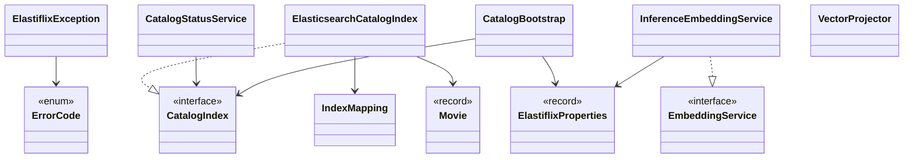
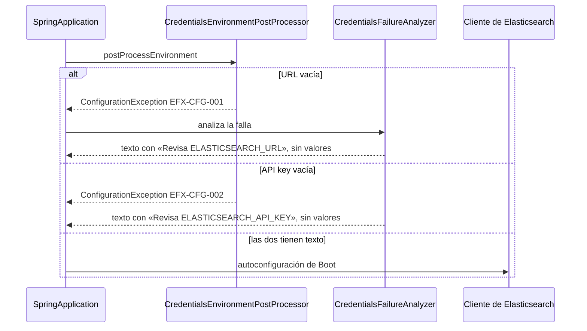
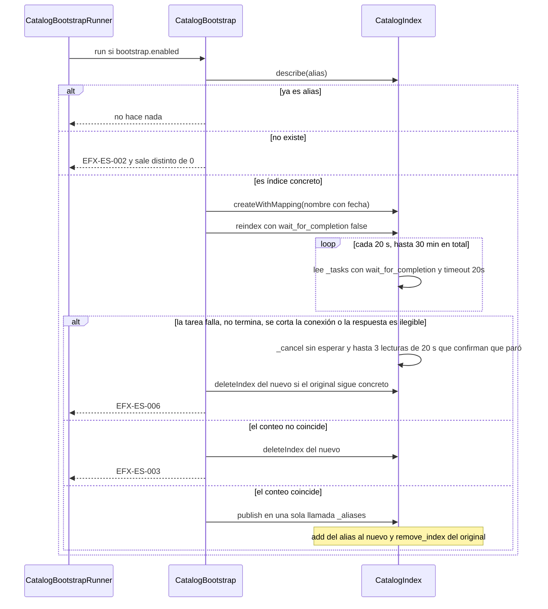

# Diseño — 1: Núcleo, conexión, catálogo y embeddings

> Resultado de la tarea `1.0`. Se hace commit **antes** de escribir código de producción. Sigue
> `docs/convenciones-java.md`. Todo el código de esta fase vive en `elastiflix-core`.

## Estado de aprobación

- **Requiere aprobación del usuario:** sí (Fase 1, compuerta 🔒 de `PLAN.md` §8)
- **Estado:** aprobado
- **Aprobación:** Adolfo, 2026-10-18. Aprobó este diseño y los cinco supuestos tal cual.

## Propósito

`elastiflix-core` se conecta a Elasticsearch Serverless, conoce el mapping de las 33 campos, administra
el alias del catálogo y genera vectores de consulta y de documento. Las fases de búsqueda y de carga
usarán estos contratos y no hablarán con el cliente de Elasticsearch por su cuenta, salvo que su propio
diseño lo diga.

La migración del índice concreto `elastiflix-reloaded` a un alias (tarea 1.8) ya está autorizada: no
pide otra aprobación el día que se ejecute. Esa migración dejó
`elastiflix-reloaded-20261018-003535` con 4 322 documentos. El 2026-10-18 05:49 UTC una importación
aprobada lo reemplazó por `elastiflix-reloaded-20261018-054429`, con 6 899.
`CatalogStatusServiceIT` lee `_count` y exige que el servicio devuelva ese conteo. Las pruebas
afirman los 6 899 documentos y los valores de §6; se omiten con `assumeTrue` si el conteo cambió.

## Requerimientos cubiertos

| Tarea de `PLAN.md` | Referencia | Cómo la cubre este diseño |
|---|---|---|
| 1.1 | `docs/convenciones-java.md` §7 | `ErrorCode` y la jerarquía `ElastiflixException` en `core.error` |
| 1.2 | `PLAN.md` §7 | `ElastiflixProperties`, el `EnvironmentPostProcessor` y el `FailureAnalyzer` |
| 1.3 | Autoconfiguración de Spring Boot 4.1.1 | Cliente de Boot, `Jackson3JsonpMapper` y salud de Boot apagada |
| 1.4 | Mapping y fixtures | `Movie`, `MovieCollection`, `MovieKeyword` |
| 1.5 | `elasticsearch/elastiflix-reloaded-mapping.json` | `IndexMapping` empaquetado como recurso del jar |
| 1.6 | Gateway del catálogo | `CatalogIndex` y `ElasticsearchCatalogIndex` |
| 1.7 | Estado del catálogo | `CatalogStatusService` |
| 1.8 | Migración a alias | `CatalogBootstrap` y `CatalogBootstrapRunner` |
| 1.9 | Calibración de documentos | `EmbeddingService`, `VectorProjector` y la tabla vacía de más abajo |

La tarea 1.10 (documentación de cierre) no cambia estas clases.

## Dudas y supuestos

No hay preguntas abiertas. Estos supuestos se pueden cambiar al aprobar el diseño; no bloquean la fase.

1. **Lotes de inferencia de 16 textos.** El plan pide lotes y no fija el tamaño. `EMBEDDING_BATCH_SIZE`
   es 16, constante de `InferenceEmbeddingService`, no una propiedad nueva. Si el endpoint rechaza el
   lote, la tarea 1.9 lo baja y lo anota en Decisiones.
2. **Si el nombre configurado no existe, la migración se detiene.** No crea un catálogo vacío. El
   índice concreto de 4 322 películas tiene que estar ya en el proyecto.
3. **`belongs_to_collection` es un objeto o `null`**, como en el fixture (la película `345887` trae
   objeto; las otras tres, `null`). Un arreglo se deja para la Fase 3.
4. **Los códigos de búsqueda y de carga no nacieron en esta fase.** La jerarquía de §7 sí. Cada fase
   posterior agregó sus constantes al mismo `enum`. Hoy `ErrorCode` es la lista completa: no hay
   códigos `EFX-WEB`. Las tablas de `docs/diseno/2.md` y `docs/diseno/3.md` copian esos textos.
5. **La calibración ya midió la combinación de documento.** Quedó `input_type=ingest` y prefijo vacío
   en `@DefaultValue`. `Document: ` se midió y no llegó a coseno 0.999: la tabla de abajo lo conserva
   como fila histórica, no como valor elegido. El supuesto aprobado, antes de medir, dejaba ese prefijo
   de forma provisional. Las consultas usan `input_type=search` y el prefijo `Query: `.

## Diagrama de clases



`search` e `ingest` dependerán de `CatalogIndex`, `EmbeddingService`, `IndexMapping` y
`CatalogStatusService`. No dependen de `ElasticsearchCatalogIndex` ni del cliente.

## Secuencia o flujo

### Arranque: credenciales antes que el cliente



La URL se comprueba primero. Si las dos están vacías, el código que se ve es `EFX-CFG-001`.

### Migración del índice concreto a alias (tarea 1.8)



`ReindexTasks` pide la copia con `wait_for_completion: false` y después espera la tarea en un
**bucle** de lecturas `_tasks/<id>?wait_for_completion=true&timeout=20s`. Cada lectura queda por
debajo del `spring.elasticsearch.socket-timeout` del cliente, que no se cambia y vale 30 s por
defecto en Spring Boot 4.1.1. El plazo total es de **30 minutos**, medido con el `Clock` inyectado.
No usa `Thread.sleep`: la espera del servidor hace de pausa.

- `completed=false` o un error `timeout_exception` en una lectura: la tarea sigue corriendo y se
  vuelve a leer.
- Al terminar, se revisan `error`, `failures` y `timed_out` del cuerpo de la tarea. Con cualquiera
  de los tres: `EFX-ES-006`.
- Sin id de tarea en la respuesta de `_reindex`: `EFX-ES-006`. La copia no se da por terminada.
- Si vence el plazo (`EFX-ES-006`), se corta la conexión (`IOException`, `EFX-ES-001`), llega otro
  error del servidor, la respuesta de `_tasks` es ilegible (`JsonpMappingException`) o `stop` dice sí
  (`EFX-IMP-003`, la persona canceló la importación), `ReindexTasks` cancela la tarea **antes** de
  lanzar: `POST _tasks/<id>/_cancel?wait_for_completion=false` (esperar en esa llamada podría pasar del
  socket-timeout) y después hasta 3 lecturas `_tasks/<id>?wait_for_completion=true&timeout=20s` que
  confirman que paró. Es un intento: si falla o no se confirma, deja un `WARN` con el id de la tarea y
  sigue. Así quien borra después el índice de destino no compite con el reindex, que de otro modo
  volvería a crear el índice con mapping dinámico.
- Un `failures: null` en el cuerpo de la tarea cuenta como «sin fallas» (revisión 3, T-01).

Un alias con varios índices se detiene antes, con `EFX-ES-005`.

Si `publish` lanza, `describe` mira el nombre, igual que la importación. Alias en el índice nuevo:
ya quedó publicado y no se borra. Si `_aliases` respondió 4xx y el nombre sigue siendo un índice
concreto: se borra el nuevo y la migración responde `EFX-ES-004`. Corte, timeout, 5xx, `describe`
ilegible o alias fuera del índice nuevo: se deja ese índice y la respuesta es `EFX-IMP-006`. Una segunda ejecución, ya con alias, termina
sin cambios. Si el servidor web está encendido, el runner ni migra ni cierra el cliente: responde
`EFX-CFG-004`. El comando de abajo lleva `web-application-type=none`.

El comando de la tarea 1.8 usa `--spring.main.web-application-type=none`. Al terminar el runner, Boot
cierra el contexto. Si hay excepción, `ElastiflixExitCodeMapper` (`ExitCodeExceptionMapper`) devuelve
1. No se llama a `System.exit` ni se escribe en `System.out`.

### Calibración de embeddings (tarea 1.9)

Para las películas `597`, `27205`, `10681`, `345887` y `134`, se lee `plot` y `plot_1024` del alias
(con `exclude_vectors: false`). Se genera el vector de `plot` con las seis combinaciones
`input_type` ∈ {`ingest`, `search`, ausente} × prefijo ∈ {`Document: `, sin prefijo}. El coseno se
anota en la tabla de más abajo. La combinación que llegue a 0.999 en las cinco pasa a
`@DefaultValue`. Si ninguna llega, la tarea queda `bloqueado` y se pregunta al usuario.

## Responsabilidades

| Clase | Responsabilidad en una frase | Contrato |
|---|---|---|
| `ErrorCode` | Guarda código, qué pasó, causa probable y acción sugerida | enum de §7 |
| `ElastiflixException` | Base de todas las fallas de la demo, con su `ErrorCode` | extiende `RuntimeException` |
| `ConfigurationException` | Falla de arranque por configuración | extiende `ElastiflixException` |
| `ElasticsearchAccessException` | Falla al hablar con el catálogo | extiende `ElastiflixException` |
| `EmbeddingException` | Falla al generar o recortar un vector | extiende `ElastiflixException` |
| `SearchValidationException` | Reservada para la Fase 2 | extiende `ElastiflixException` |
| `IngestValidationException` | Reservada para la Fase 3 | extiende `ElastiflixException` |
| `ImportException` | Reservada para la Fase 3 | extiende `ElastiflixException` |
| `ElastiflixProperties` | Agrupa `elastiflix.*` en records anidados | `@ConfigurationProperties` |
| `ElasticsearchCredentialsEnvironmentPostProcessor` | Corta el arranque si faltan URL o API key | `EnvironmentPostProcessor` |
| `ElasticsearchCredentialsFailureAnalyzer` | Muestra la acción sugerida sin valores | `AbstractFailureAnalyzer` |
| `ElastiflixExitCodeMapper` | Convierte `ElastiflixException` en código de salida 1 | `ExitCodeExceptionMapper` |
| `MovieJsonMapper` | Construye el `JsonMapper` de películas | método de fábrica |
| `ElasticsearchJsonConfig` | Publica ese mapper como `JsonpMapper` del cliente | `@Configuration` |
| `Movie` | Una película con los 33 campos del mapping | record |
| `MovieCollection` | La colección anidada (`id`, `name`, rutas) | record |
| `MovieKeyword` | Una palabra clave anidada (`id`, `name`) | record |
| `IndexMapping` | Lee el mapping del jar y responde tipo, formato y dimensiones | `@Component` |
| `FieldMapping` | Un campo o un subcampo | record |
| `CatalogName` | Alias con un índice, índice concreto, ausente, o alias con varios índices | sealed |
| `CatalogIndex` | Operaciones del catálogo, sin detalles del cliente | interfaz |
| `ElasticsearchCatalogIndex` | Traduce `CatalogIndex` al cliente Java 9 | gateway |
| `IndexNames` | Arma y reconoce `<alias>-<AAAAMMDD-HHMMSS>` en UTC | clase pequeña, recibe `Clock` |
| `CatalogStatus` | Alias, índice vigente, conteo, conectado y código | record |
| `CatalogStatusService` | Calcula el estado, sirva el nombre de alias o de índice | `@Service` |
| `CatalogBootstrap` | Los tres caminos de la migración | `@Component` |
| `CatalogBootstrapRunner` | La ejecuta solo si `bootstrap.enabled` | `ApplicationRunner` |
| `EmbeddingService` | Vector de consulta y vectores de documento ya calibrados | interfaz |
| `InferenceEmbeddingService` | Llama a `_inference` en lotes de 16 | gateway |
| `VectorProjector` | Recorta a 512 o 256 y renormaliza con L2 | clase pequeña |
| `CosineSimilarity` | Coseno entre dos `float[]`, para las pruebas de vectores | clase pequeña |
| `Thousands` | Agrupa los miles con espacio («6 899») para las cifras visibles de los cuatro módulos | clase de utilidad (revisión 3) |

### Paquetes

| Paquete | Frase del `package-info` |
|---|---|
| `core.error` | Códigos y excepciones de la demo. |
| `core.config` | Propiedades, credenciales de arranque y código de salida. |
| `core.client` | JSON de películas para el cliente de Elasticsearch. |
| `core.model` | Película y sus objetos anidados. |
| `core.mapping` | Lectura del mapping empaquetado. |
| `core.catalog` | Alias, índices y migración. |
| `core.embedding` | Vectores de consulta y de sinopsis. |
| `core.text` | Textos compartidos por los módulos, como el agrupado de miles de las cifras visibles (revisión 3). |

### Configuración

Un solo tipo, `ElastiflixProperties`, con records anidados para que un junior lea cada grupo aparte:

| Record anidado | Propiedades | Si el grupo falta en el entorno de prueba |
|---|---|---|
| `Elasticsearch` | `url`, `apiKey` | Siguen vacías y las corta el post-processor |
| `Index` | `alias` | `elastiflix-reloaded` |
| `Inference` | `id` | `.jina-embeddings-v5-omni-small` |
| `Ingest` | `maxFileSize` (`DataSize`), `batchSize` | `150MB`, `100` |
| `Poster` | `baseUrl` | `https://image.tmdb.org/t/p/w342` |
| `Bootstrap` | `enabled` | `false` |
| `Embedding` | `documentInputType`, `documentPrefix` | `ingest` y sin prefijo |

`index.alias` e `inference.id` llevan `@NotBlank` y sus grupos `@Valid`. La URL no: la rechaza vacía el
post-procesador (`EFX-CFG-001`) y los contextos de prueba enlazan las propiedades sin ella. Los grupos
`Elasticsearch` y `Bootstrap` no se leen desde Java y se conservan a propósito: el cliente usa
`spring.elasticsearch.*` y el grupo enmascara la API key en `toString`; `bootstrap.enabled` lo lee
`@ConditionalOnProperty` (revisión 3, T-25).

El constructor compacto rellena un grupo `null` con ese valor. Así el `application.yml` de prueba de
core, que hoy solo declara Elasticsearch, alias e inferencia, sigue arrancando. Los de documento
**no** se copian al YAML: viven en `@DefaultValue`, como pide el plan. El YAML de la web no se toca
en esta fase.

`ElasticsearchCredentialsEnvironmentPostProcessor` se registra en
`elastiflix-core/src/main/resources/META-INF/spring.factories` con la clave que usa Boot 4.1.1
(comprobada en `SpringFactoriesEnvironmentPostProcessorsFactory`):

```properties
org.springframework.boot.EnvironmentPostProcessor=\
com.bigfito.elastiflix.core.config.ElasticsearchCredentialsEnvironmentPostProcessor
```

El analizador va en el mismo archivo, clave `org.springframework.boot.diagnostics.FailureAnalyzer`.
El texto que muestra es `errorCode.userMessage()`. No imprime la URL ni la API key.

Al declarar `<resources>` en el POM de core para copiar el mapping, se vuelve a declarar
`src/main/resources`. Si no, se pierde `spring.factories`.

### Cliente de Elasticsearch

No se declara un `@Bean` de `ElasticsearchClient`. Lo crea `spring-boot-starter-elasticsearch` con
`spring.elasticsearch.uris`, `spring.elasticsearch.api-key` y `Rest5Client`. En esta fase no hace
falta un `Rest5ClientBuilderCustomizer`: la URL y la API key ya viajan por la autoconfiguración.

Boot 4.1.1 crea un `Jackson3JsonpMapper` vacío si nadie publicó un `JsonpMapper` y la clase
`tools.jackson.databind.json.JsonMapper` está en el classpath. Ese mapper vacío no entiende
`snake_case` ni `LocalDate`. Por eso `ElasticsearchJsonConfig` publica un `JsonpMapper` propio,
construido con `MovieJsonMapper`. Boot no crea el suyo (`ConditionalOnMissingBean`). El
`Rest5ClientBuilderCustomizer` no puede cambiar el mapper JSON; por eso esta personalización es un
bean y no un customizer del cliente HTTP.

`management.health.elasticsearch.enabled` ya está en `false` en el YAML de la web. No se enciende.

### Película

`Movie` es un record de 33 componentes. Jackson 3 usa `SNAKE_CASE`. `_id` se ignora
(`ignoreUnknown`). `id` puede llegar como número (en el fixture es `597`) y se guarda como texto.
`release_date` es `LocalDate` con formato `yyyy-MM-dd`. Los vectores son `float[]`. El resto de los
números del mapping `float` son `Double`, porque el fixture manda enteros en `budget` y `revenue`.
Los enteros de `runtime` y `vote_count` son `Integer`. Las listas son `List<String>` o
`List<MovieKeyword>`. Todo componente puede ser `null`.

| JSON | Java |
|---|---|
| `id`, `imdb_id`, `title`, `original_title`, `original_language`, `status`, `tagline`, `overview`, `plot`, `rating`, `homepage`, `poster_path`, `backdrop_path` | `String` |
| `release_date` | `LocalDate` |
| `runtime`, `vote_count` | `Integer` |
| `adult`, `video` | `Boolean` |
| `budget`, `revenue`, `popularity`, `vote_average`, `user_score` | `Double` |
| `genres`, `cast`, `production_companies`, `production_countries`, `spoken_languages` | `List<String>` |
| `keywords` | `List<MovieKeyword>` |
| `belongs_to_collection` | `MovieCollection` |
| `plot_256`, `plot_512`, `plot_1024` | `float[]` |

`MovieKeyword` e `id` de `MovieCollection` son `Long` (el mapping dice `long`). El `equals` del
record no compara el contenido de un `float[]`. `MovieJsonTest` compara campo a campo, y los
vectores con `Arrays.equals`.

### Mapping

`IndexMapping` lee `classpath:elasticsearch/elastiflix-reloaded-mapping.json`. Expone los 33 campos
de primer nivel, el formato de `release_date` y las dimensiones de `plot_256`, `plot_512` y
`plot_1024`. De los `nested`, expone los subcampos (`belongs_to_collection`: `backdrop_path`, `id`,
`name`, `poster_path`; `keywords`: `id`, `name`). Si el recurso no está en el jar, lanza
`ConfigurationException` con `EFX-CFG-003` al crear el bean.

### CatalogIndex

| Método | Qué hace |
|---|---|
| `describe(name)` | Dice si el nombre es alias de un índice, índice concreto, no existe, o alias de varios |
| `createWithMapping(indexName)` | Crea el índice con el JSON de `IndexMapping` |
| `reindex(source, target, stop)` | `_reindex` y espera a que termine; si no termina, cancela la tarea antes de lanzar |
| `refresh(name)` | `refresh` para que el conteo siguiente vea los documentos |
| `count(name)` | `_count` |
| `publish(alias, newIndex, previousIndex)` | Una sola llamada `_aliases`: `add` y `remove_index` |
| `deleteIndex(indexName)` | Borra un índice que esta demo creó |
| `listOwnedIndexes(alias)` | Nombres que cumplen `<alias>-<AAAAMMDD-HHMMSS>` |
| `readWithVectors(name, ids)` | Esos `_id`, con `"_source": {"exclude_vectors": false}` |
| `readAllWithVectors(name, limit)` | Como la anterior, con `match_all` y tope. La prueba de 4 películas usa un tope chico |

Diez métodos, por debajo del límite de 20. Ninguno recibe más de 5 parámetros.

`describe` no lanza si el nombre no existe: devuelve `CatalogName.Missing`. Quien migra o pide el
estado decide el código. Un alias con más de un índice es `CatalogName.Ambiguous` y
`CatalogStatusService` lo traduce a `EFX-ES-005`.

Las excepciones del cliente se envuelven en `ElasticsearchAccessException` y se conserva la causa.
No se captura `Exception`.

La Fase 3 añadirá en esta misma interfaz la escritura de documentos y la limpieza de huérfanos. Esas
operaciones no se declaran ahora.

### Estado

`CatalogStatusService.status()` llama a `describe` y a `count`.

| `CatalogName` | `connected` | `documentCount` | `errorCode` |
|---|---|---|---|
| `Alias` o `ConcreteIndex` y el conteo responde | `true` | el conteo | `null` |
| `Missing` | `false` | `null` | `EFX-ES-002` |
| `Ambiguous` | `false` | `null` | `EFX-ES-005` |
| El cliente no responde | `false` | `null` | `EFX-ES-001` |

Así funciona antes y después de la tarea 1.8. El indicador HTTP `elastiflixCatalog` es de la Fase 4;
esta fase solo le deja el record.

### Nombres de índice

`IndexNames.timestamped(alias, clock)` usa `DateTimeFormatter` de `uuuuMMdd-HHmmss` en UTC. Ejemplo
con el alias por defecto: `elastiflix-reloaded-20261020-153000`. El código de producción no escribe
el literal `elastiflix-reloaded`; sale de `ElastiflixProperties`. `isOwnedBy` solo acepta ese patrón,
para que una limpieza futura no borre índices ajenos.

### Embeddings

`embedQuery(text)` manda el `input_type` y el prefijo de consulta de `ElastiflixProperties.Embedding`
(`search` y `Query: `, con espacio). El texto
de `elasticsearch/fixtures/query-vector-titanic.json` es «un barco de lujo choca con un iceberg en su
viaje inaugural».

`embedDocuments(texts)` parte la lista en lotes de 16 y usa `documentInputType` y `documentPrefix`.
Quien llama pasa la sinopsis cruda, sin prefijo. El servicio lo agrega. Devuelve vectores de 1024.
`VectorProjector.project(source, 512)` y `project(source, 256)` se quedan los primeros N valores y
los dividen por su norma L2. Si la norma es 0 o el modelo no devolvió 1024 números, `EFX-EMB-002`.

`embedForCalibration(text, inputType, prefix)` es de paquete, no de la interfaz. Solo lo usa
`DocumentEmbeddingCalibrationIT`. `inputType` o `prefix` nulos significan «no enviar ese dato».

### Tabla de calibración (la completa la tarea 1.9)

Coseno contra `plot_1024`, medido el 2026-10-18 contra el alias del catálogo. Seis decimales.

| `input_type` | Prefijo | `597` | `27205` | `10681` | `345887` | `134` | ¿Sirve? |
|---|---|---|---|---|---|---|---|
| `ingest` | `Document: ` | 0.996852 | 0.993057 | 0.997458 | 0.997173 | 0.995087 | no |
| `ingest` | sin prefijo | 0.999975 | 0.999976 | 1.000000 | 0.999972 | 1.000000 | sí |
| `search` | `Document: ` | 0.940164 | 0.937968 | 0.963869 | 0.955079 | 0.959086 | no |
| `search` | sin prefijo | 0.938401 | 0.938213 | 0.963735 | 0.956455 | 0.960420 | no |
| ausente | `Document: ` | 0.940161 | 0.937928 | 0.963802 | 0.955008 | 0.959105 | no |
| ausente | sin prefijo | 0.938436 | 0.937962 | 0.963744 | 0.956448 | 0.960321 | no |

Combinación elegida: `input_type=ingest` y sin prefijo. Es la única con coseno ≥ 0.999 en las cinco.
El mínimo medido es 0.999972, en la película `345887`.

## Patrones usados

| Patrón | Dónde | Por qué aporta claridad aquí |
|---|---|---|
| Gateway / Adapter | `ElasticsearchCatalogIndex`, `InferenceEmbeddingService` | El resto del módulo habla con interfaces. Las pruebas unitarias ponen un doble. |
| Factory (método de fábrica) | `MovieJsonMapper.create()` | Un solo `JsonMapper` para el record y para el cliente. |

No se usan Strategy, Facade, Observer ni Builder propio. El builder del cliente de Elasticsearch, si
hace falta al armar una petición, es el de la librería.

## Errores

El mensaje siempre es `<código> · <qué pasó>. Causa probable: <…>. Acción sugerida: <…>.`

| Código | Qué pasó | Causa probable | Acción sugerida |
|---|---|---|---|
| `EFX-CFG-001` | Falta la URL de Elasticsearch | ELASTICSEARCH_URL no está definida o está vacía | Revisa ELASTICSEARCH_URL en .env y vuelve a arrancar |
| `EFX-CFG-002` | Falta la API key de Elasticsearch | ELASTICSEARCH_API_KEY no está definida o está vacía | Revisa ELASTICSEARCH_API_KEY en .env y vuelve a arrancar |
| `EFX-CFG-003` | No está el mapping del catálogo | No se empaquetó elasticsearch/elastiflix-reloaded-mapping.json | Reconstruye elastiflix-core con el recurso del mapping |
| `EFX-CFG-004` | La migración no puede convivir con el servidor web | Falta --spring.main.web-application-type=none | Vuelve a lanzar la migración con ese argumento |
| `EFX-ES-001` | No se pudo conectar con Elasticsearch | La URL o la API key no son válidas, o el proyecto Serverless no responde | Revisa ELASTICSEARCH_URL y ELASTICSEARCH_API_KEY en .env y vuelve a intentarlo |
| `EFX-ES-002` | El catálogo no existe | No hay alias ni índice concreto con ese nombre | Revisa el alias configurado y que el proyecto tenga el catálogo |
| `EFX-ES-003` | El índice nuevo no tiene los mismos documentos que el original | El reindex no copió todos los documentos | No se publicó el alias y el catálogo original sigue igual. El índice nuevo se borra si el original sigue en su lugar; si quedó, bórralo a mano. Vuelve a ejecutar la importación o la migración |
| `EFX-ES-004` | No se pudo publicar el alias | Elasticsearch rechazó la publicación y el alias sigue en el índice anterior | El catálogo anterior sigue igual. El índice nuevo se borra; si quedó, bórralo a mano. Revisa el catálogo y vuelve a intentarlo |
| `EFX-ES-005` | El alias apunta a más de un índice | El alias no se publicó con la operación única de esta demo | Deja el alias apuntando a un solo índice antes de continuar |
| `EFX-ES-006` | No se pudo copiar el catálogo al índice nuevo | La tarea de reindex terminó con error o no se completó | No se publicó el alias y el catálogo original sigue igual. Se pide cancelar la tarea y el índice nuevo se borra si el original sigue en su lugar; si quedó, bórralo a mano. Vuelve a ejecutar la importación o la migración |
| `EFX-ES-007` | Elasticsearch rechazó la operación | El proyecto respondió un error 4xx | Revisa el tipo de error en el log y corrige la petición |
| `EFX-IMP-006` | No se sabe si el alias se publicó | _aliases no confirmó el cambio y el alias no se pudo leer o no quedó en un estado que permita borrar el índice nuevo | Estado incierto: revisa el alias manualmente. El índice nuevo se dejó sin borrar |
| `EFX-EMB-001` | No se pudo generar el vector | El id no existe o el endpoint falla | Revisa ELASTIFLIX_INFERENCE_ID y que el proyecto tenga ese endpoint |
| `EFX-EMB-002` | El vector no tiene la dimensión esperada | El modelo no devolvió el vector esperado | Revisa el endpoint: la demo espera 1024 dimensiones |
| `EFX-EMB-003` | No hay texto para vectorizar | La consulta o la sinopsis no trae texto | Escribe un texto antes de pedir el vector |
| `EFX-EMB-004` | La inferencia no devolvió un vector por cada texto | El número de vectores del lote no es el de textos enviados | Revisa el endpoint de inferencia y vuelve a intentar |

Los textos son los de `ErrorCode` tras la revisión 3 (T-19): la acción sugerida de `EFX-ES-003`, `EFX-ES-004`,
`EFX-ES-006` y `EFX-IMP-006` ya no promete un borrado que puede fallar ni habla solo de la importación.
Ningún «qué pasó» cambió.

`EFX-EMB-002` queda para una dimensión distinta de 1024, un valor nulo o una norma cero al recortar.
`EFX-EMB-004` es el lote cuyo número de vectores no coincide con el de textos. `EFX-ES-004` solo
sale si `describe` ve el índice concreto. Si no se puede leer el alias, o no quedó en el índice
nuevo, la migración reutiliza `EFX-IMP-006` y deja el índice nuevo.

`EFX-ES-001` usa el texto de ejemplo de `docs/convenciones-java.md` §13.

## Logging

SLF4J, mensajes en español, parametrizados. Nunca la API key, la cabecera `Authorization`, un vector
completo, un documento completo ni el texto de una sinopsis.

| Nivel | Evento | Contexto incluido |
|---|---|---|
| `ERROR` | Falla de catálogo, de migración o de inferencia | Código `EFX-*` y el nombre del índice o del alias. Sin URL. |
| `WARN` | La publicación falló y el borrado del índice nuevo también falló | Nombre del índice nuevo |
| `INFO` | El alias ya existía, o la migración publicó uno nuevo | Alias, índice concreto y conteo |
| `DEBUG` | Estado del catálogo y un lote de inferencia | Conectado o no, tamaño del lote, id del endpoint. Sin textos |
| `TRACE` | No se usa en esta fase | Un JSON de búsqueda sin vectores llega con la Fase 2 |

## Pruebas previstas

| Prueba | Comportamiento que verifica | Tipo |
|---|---|---|
| `ErrorCodeTest` | El mensaje tiene el formato de §7 y no hay dos constantes con el mismo código | unitaria |
| `ElasticsearchCredentialsEnvironmentPostProcessorTest` | Con URL vacía no arranca, no hay cliente, y el análisis contiene `EFX-CFG-001` y «Revisa ELASTICSEARCH_URL». Igual con la API key y `EFX-CFG-002` | unitaria (`SpringApplication`, `web-application-type=none`) |
| `ElasticsearchJsonConfigTest` | El `JsonpMapper` del contexto es `Jackson3JsonpMapper` | unitaria (`ApplicationContextRunner`) |
| `ElasticsearchClientIT` | `info()` termina sin error | integración |
| `MovieJsonTest` | Las 4 películas del fixture se leen, se escriben y conservan los valores, incluida la colección de `345887` | unitaria |
| `IndexMappingTest` | 33 campos, `release_date` con `yyyy-MM-dd`, `plot_512` con 512 dimensiones | unitaria |
| `IndexNamesTest` | El nombre lleva la fecha UTC del `Clock` fijo y `isOwnedBy` rechaza un nombre ajeno | unitaria |
| `CatalogBootstrapTest` | Ya es alias; índice concreto con conteos iguales; conteos distintos borra el nuevo y lanza `EFX-ES-003` | unitaria, con doble de `CatalogIndex` |
| `VectorProjectorTest` | Norma 1 ± 1e-6. El recorte de un `plot_1024` del fixture reproduce `plot_512` y `plot_256` con coseno ≥ 0.9999 | unitaria |
| `CatalogIndexIT` | Crea `elastiflix-it-<aleatorio>-a`, reindexa a `-b`, publica un alias de prueba en una sola llamada y borra `-a`. El alias queda solo en `-b`, el conteo se conserva y los vectores tienen coseno ≥ 0.9999. Borra todo en `finally` | integración |
| `CatalogStatusServiceIT` | El conteo del servicio coincide con `_count` del alias y es 6 899 (§6; se omite con `assumeTrue` si el conteo cambió). El índice concreto sigue el patrón `elastiflix-reloaded-…` | integración, solo lectura |
| `DocumentEmbeddingCalibrationIT` | Mide las seis combinaciones y escribe la tabla en `target/calibration-table.md`. Los números medidos se copian a este documento y a `progreso/1.md` | integración, solo lectura |
| `EmbeddingServiceIT` | La consulta del fixture tiene coseno ≥ 0.999 con `vector_1024`. Con la combinación fijada, las cinco películas tienen coseno ≥ 0.999 con `plot_1024` y ≥ 0.995 con `plot_512` y `plot_256` | integración, solo lectura |

Las de escritura usan un alias `elastiflix-it-<aleatorio>` y no tocan `elastiflix-reloaded`. Las de
lectura usan el alias configurado y no lo modifican. No hay `Thread.sleep`: el `refresh` hace visible
el reindex.

## Alternativas descartadas

| Opción | Por qué se consideró | Por qué se descartó |
|---|---|---|
| Declarar el `ElasticsearchClient` a mano | Control total del mapper | Boot 4.1.1 ya lo crea. Duplicarlo pelea con la autoconfiguración. |
| Ajustar el JSON con `Rest5ClientBuilderCustomizer` | El plan limita las personalizaciones del cliente HTTP a ese tipo | Ese customizer no cambia el `JsonpMapper`. |
| `System.exit` al terminar la migración | El plan pide un código de proceso | Con `web-application-type=none` el proceso termina al cerrar el contexto. `ExitCodeExceptionMapper` da el código 1 sin tocar `System.out`. |
| Poner `ingest` y `Document: ` en `application.yml` | Se verían junto al resto | El plan dice que esos dos valores viven solo en `@DefaultValue`, para que la calibración tenga un único sitio. |
| Leer las 4 322 películas con vectores en cada prueba | Evita pedir ids | Serverless omite los vectores salvo que se pidan, y traerlos todos no hace falta. Se leen por id o con un tope. |
| Meter ya los códigos de búsqueda y de carga | El ejemplo de convenciones muestra `EFX-SRCH-*` | Esas reglas se diseñan en las fases 2 y 3. Un código sin uso confunde al junior. |

## Supresiones de la verificación automática

Ninguna de Checkstyle ni de PMD. `ReindexTasksTest.assertWait` usa
`@SuppressWarnings("unchecked")` porque Mockito entrega la función del cliente sin el tipo genérico.
`archunit.properties` sigue con `failOnEmptyShould=false` hasta la tarea 4.7; esta fase no lo toca.

## Cambios respecto al diseño aprobado

| Qué cambió | Por qué |
|---|---|
| El mensaje de `EFX-ES-004` ya no dice que el índice original no se tocó | Revisión 1, R-02. Ese texto era falso si `_aliases` se aplicó y el cliente recibió un corte. El código solo se lanza cuando `describe` confirma el índice anterior. |
| `MovieJsonMapper` separa una letra y un dígito con `_` | El snake_case de Jackson deja `plot256`. El mapping se llama `plot_256`. |
| El reindex pide `exclude_vectors: false` | Serverless no copia los `dense_vector` si no se piden. |
| `CatalogBootstrapRunner` cierra el `ElasticsearchClient` al terminar | Sus hilos no son demonio. Sin cerrarlos, el proceso no sale aunque `web-application-type` sea `none`. |
| Un alias con varios índices se detiene con `EFX-ES-005` | El diagrama solo dibujaba alias, índice concreto y ausente. Migrar un alias ambiguo no es seguro. |
| La llamada de inferencia usa el tipo `embedding` | El endpoint rechazó `text_embedding`: el modelo es de tipo `embedding`. |
| El prefijo de documento por defecto está vacío | La calibración midió que solo `ingest` sin prefijo llega a coseno ≥ 0.999 en las cinco películas. El supuesto aprobado dejaba `Document: ` hasta medir. |
| `InferenceEmbeddingService` no llama a `VectorProjector` | El servicio devuelve 1024. El recorte es un paso aparte, para quien guarda `plot_512` y `plot_256`. |
| `DocumentEmbeddingCalibrationIT` escribe `target/calibration-table.md` | Así `./mvnw verify -Pit` no reescribe este documento. Los números medidos están en la tabla de arriba y en `progreso/1.md`. |
| La tabla de errores incluye `EFX-CFG-004`, `EFX-ES-006` y `EFX-ES-007` | La revisión 1 los agregó al enum. |
| `EFX-EMB-004` separa el lote incompleto de `EFX-EMB-002` | El texto de dimensión no describía un lote con menos vectores que textos. |
| La migración reutiliza `EFX-IMP-006` si `describe` no confirma el índice concreto | Mismo criterio que `ImportJob`. `EFX-ES-004` solo se lanza cuando el nombre sigue siendo índice concreto, y entonces sí se borra el nuevo. |
| La copia espera en `_tasks` con tope `30m` | Se quitó `Thread.sleep`. `_reindex` sigue con `wait_for_completion: false` para no cortar la conexión en un catálogo grande. (Sustituido por S-01.) |
| `reindex` recibe `stop`, espera en un bucle de lecturas de 20 s con plazo total de 30 min y cancela la tarea antes de lanzar | Revisión 2, S-01. Una sola lectura con `timeout=30m` se cortaba a los 30 s del socket-timeout, y el temporal se borraba con el reindex todavía escribiendo. `ElasticsearchCatalogIndex` recibe el `Clock`. La cancelación vive dentro de `ReindexTasks` (la API no expone el id de la tarea). |
- Revisión 2, S-04: `CatalogBootstrap` borra el índice nuevo solo si `_aliases` respondió 4xx
  (`ElasticsearchDiagnostics.isClientRejection`) y `describe` confirma el índice concreto; un corte o un
  5xx dan `EFX-IMP-006`. `publish` pide `timeout` de 10 s (Serverless rechaza `master_timeout`), `indexOne` pide
  `require_alias=true` y una `JsonpMappingException` del cliente se traduce como un corte.
- Revisión 2, S-05: `ElastiflixProperties.Embedding` solo tiene `documentInputType` y
  `documentPrefix`. El literal calibrado vive en `Embedding.DEFAULT_DOCUMENT_INPUT_TYPE` y
  `DEFAULT_DOCUMENT_PREFIX`, que usan el `@DefaultValue` y el constructor. El parámetro raíz lleva
  `@DefaultValue`, así que sin propiedades `elastiflix.embedding.*` el grupo existe con esos valores.
  La consulta vuelve a ser fija (`search` y `Query: `, constantes de `InferenceEmbeddingService`), como
  pide PLAN §6; el commit `c4f0d23` la había vuelto configurable.
- Revisión 3, T-01: la cancelación del reindex ya no espera en `_cancel` (`wait_for_completion=false`); la
  confirman hasta 3 lecturas `_tasks/<id>?wait_for_completion=true&timeout=20s` y, si no se confirma, queda
  un `WARN` con el id de la tarea y se sigue. También cancela ante una respuesta ilegible
  (`JsonpMappingException`), no solo ante `IOException` o `ElasticsearchException`, y `failures: null` ya
  no lanza `ClassCastException`.
- Revisión 3, T-02: `InferenceEmbeddingService` traduce también una `JsonpMappingException` a `EFX-EMB-001`.
- Revisión 3, T-12: se quitaron `IndexMapping.field(name)` e `IndexMapping.document()`, que ningún módulo
  usaba. `CatalogIndex.readWithVectors` y `readAllWithVectors` se conservan: los usan las IT de core e
  ingest. El relleno de `null` de `ElastiflixProperties` y los `fallback()` de cada grupo (incluido
  `Poster.fallback()`) también se conservan: los usan el propio relleno, el contexto de prueba de core y
  las pruebas de los cuatro módulos.
- Revisión 3, T-19: la acción sugerida de `EFX-ES-003`, `EFX-ES-004`, `EFX-ES-006` y `EFX-IMP-006` dice que
  el índice nuevo se borra «si quedó, bórralo a mano» y vale para la importación y la migración. La tabla
  de errores copia el texto de `ErrorCode`.
- Revisión 3, T-25: `ElastiflixProperties` lleva `@NotBlank` en `index.alias` e `inference.id`, con `@Valid`
  en esos grupos; la URL no (ver «Configuración»). Los grupos `elasticsearch` y `bootstrap` no se leen
  desde Java y se conservan a propósito.
- Revisión 3, cierre (T-23): `Thousands` pasa de `com.bigfito.elastiflix.ingest.mapping` al paquete nuevo
  `com.bigfito.elastiflix.core.text`, para que la búsqueda (rango de la paginación), la carga y la web usen un
  solo helper. `ThousandsTest` vive en core.
- Revisión 3, T-27: `ElasticsearchClientConfigTest` se llama ahora `ElasticsearchJsonConfigTest`.

## Límite de esta fase

No se implementan búsqueda, filtros, carga de archivos, páginas ni el indicador de salud HTTP. La
tarea 1.1 no empieza hasta la aprobación de este documento.
