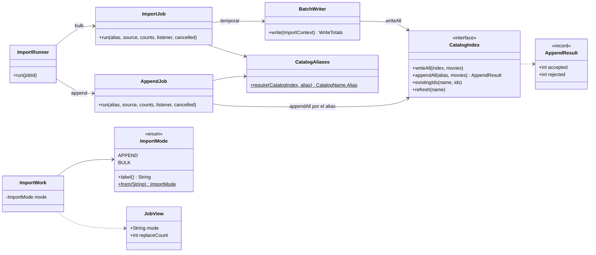
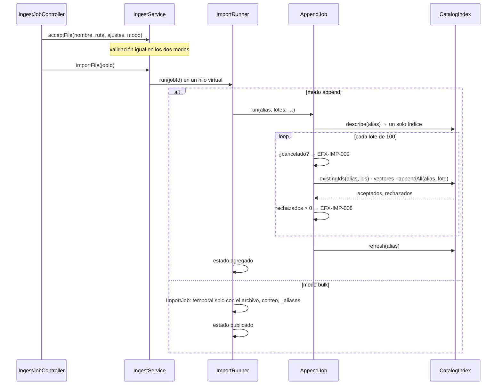

# Diseño — Fase 10: carga en modo append o bulk (Requerimiento 4)

> Resultado de la tarea 10.0. Se hace commit **antes** de escribir código de producción. Sigue
> `docs/convenciones-java.md`.

## Estado de aprobación

- **Requiere aprobación del usuario:** no. PLAN §8 pide compuerta 🔒 solo en las fases 1, 2 y 3. Las decisiones de
  fondo las tomó Adolfo el 2026-10-19 (PLAN › «Requerimiento 4») y aprobó los mockups de «Cargar datos» y «Acerca
  de» con el selector de modo ese mismo día.
- **Estado:** no requiere aprobación.
- **Aprobación:** Adolfo dio el consentimiento para arrancar el 2026-10-21 («Continua con el requerimiento 4.»),
  registrado en `progreso/INDICE.md` › «Aprobaciones del usuario».

## Propósito

La carga por archivo tiene dos modos. **Append** (por defecto) agrega las películas al índice vigente por el alias,
sin índice temporal; lo ya escrito se queda aunque la carga falle o se cancele. **Bulk** reemplaza el catálogo:
escribe solo las películas del archivo en un índice temporal y publica con `_aliases` (`add` + `remove_index`); ya no
copia el catálogo actual. El registro individual no cambia.

## Requerimientos cubiertos

| Tarea de `PLAN.md` | Referencia | Cómo la cubre este diseño |
|---|---|---|
| 10.1 | «Bulk reemplaza el catálogo con solo el archivo» | `ImportJob` deja de llamar a `reindex`: crea el temporal con el mapping, escribe los lotes, compara el conteo con las películas del archivo y publica. Rollback, `describe` y huérfanos, igual. |
| 10.2 | «Append, comportamiento esperado» | `AppendJob` nuevo: alias de un solo índice, lotes de 100 por el alias con `require_alias=true`, conteo de aceptados por ítem, `refresh` al final, `EFX-IMP-008` si un lote se rechaza y `EFX-IMP-009` si se cancela. Estado final `agregado`. |
| 10.1–10.2 | «Contrato web» y «Pasos de la pantalla» | `ImportMode` (`append`, `bulk`) viaja con el trabajo desde `JobStore.open`; `JobView` agrega `mode` y, en bulk, `replaceCount` es el conteo del catálogo; `ImportRunner` elige `ImportJob` o `AppendJob`. |
| 10.3 | «Contrato web», «Pasos» y «Mockups» | `POST /cargar/archivo` recibe `modo`; tarjeta «Modo de carga» con el aviso de bulk; pasos 4 y 5 según el modo; `JobTexts` con los textos de cada modo en español e inglés; `ingest.js` manda el modo y pinta el estado `agregado`. |
| 10.4 | «Acerca de» | `about.html` y los catálogos describen los dos modos, con los textos del mockup. |
| 10.5 | «Documentación que cambia» | `AGENTS.md`, PLAN §1, §2 y §5, `docs/diseno/3.md`, README y la verificación de fase. |

## Dudas y supuestos

1. **Valor de `modo`.** `bulk` (sin importar mayúsculas) elige bulk; cualquier otro valor, también vacío o ausente,
   es append. Append es el modo que no borra nada, así que un valor raro nunca reemplaza el catálogo.
2. **El modo es del trabajo.** Se fija al subir el archivo. Si la persona cambia el modo después de validar, la
   página vuelve a habilitar «Validar archivo» y hay que subirlo otra vez, igual que al cambiar el separador del
   CSV (T-05). Así `importar` siempre usa el modo con que se validó y la cifra de reemplazos que vio la persona.
3. **«Reemplazarán existentes»** (append) es la cifra que ya da la validación: ids del archivo que están en el
   catálogo. En bulk se reemplaza el catálogo entero: la caja dice «Catálogo actual que se reemplaza» y
   `replaceCount` lleva el conteo del alias, que la validación lee una vez para que el sondeo no consulte
   Elasticsearch cada segundo.
4. **Aviso de bulk antes de subir.** La tarjeta de modo lo muestra con el conteo del catálogo que ya trae la página
   (el mismo del pie).
5. **Bulk sin copia.** El conteo esperado es `películas del archivo − ids repetidos dentro del archivo` (la
   validación ya rechaza un `id` repetido, así que en la práctica es el número de películas del archivo).
6. **Append, cuántas quedaron.** Un lote de `_bulk` puede quedar a medias: se cuentan los ítems aceptados de su
   respuesta y la página dice ese número. Si la llamada se corta (red, timeout, 5xx), no se sabe qué entró de ese
   lote; la cifra es la de los lotes confirmados y se documenta como «al menos».
7. **Append, `refresh`.** Se hace al terminar y también, sin falla si no responde, cuando la carga para por un
   error o una cancelación, para que lo escrito ya se vea en las búsquedas.
8. **Append no limpia huérfanos** ni crea índices: no toca nada fuera del índice vigente.
9. **Estado final de append:** `agregado` (nuevo, final). `publicado` sigue siendo solo de bulk.
10. **Pasos:** bulk tiene 5 (4 «Importación en un índice temporal», 5 «Publicación»); append tiene 4 (4 «Escritura
    en el catálogo») y el paso 5 se oculta.

## Diagrama de clases

## Secuencia o flujo

## Responsabilidades

| Clase | Responsabilidad en una frase | Cambio |
|---|---|---|
| `ImportMode` | Los dos modos y su nombre en el contrato. | Nueva (enum). |
| `AppendJob` | Agrega los lotes al índice vigente por el alias y para con su código. | Nueva. |
| `CatalogAliases` | Exige que el nombre sea un alias de un solo índice. | Nueva; sale de `ImportJob.requireAlias` para que la usen los dos trabajos. |
| `ImportJob` | Escribe el archivo en un temporal y publica. | Ya no copia el catálogo. |
| `ImportRunner` | Corre el trabajo del modo y deja el estado final. | Elige el trabajo; `agregado` en append. |
| `CatalogIndex.appendAll` / `AppendResult` | Escribe un lote por el alias con `require_alias=true` y dice cuántos ítems entraron. | Nuevos (core). |
| `JobStore`, `ImportWork`, `JobView`, `JobStatus` | Guardan el modo y el estado `agregado`. | Cambian. |
| `FileIntake` | Valida y cuenta lo que se reemplaza. | En bulk lee `count(alias)` una vez en lugar de los ids. |
| `IngestJobController` | Recibe `modo`. | Cambia. |
| `JobTexts` | Textos del trabajo según el modo. | Cambia. |

## Patrones usados

Strategy ya existe para los modos de búsqueda; aquí no hace falta una interfaz: `ImportRunner` elige entre dos
`@Component` con un `switch` sobre `ImportMode`. Sin patrones nuevos.

## Errores

| Código | Cuándo ocurre | Causa probable | Acción sugerida |
|---|---|---|---|
| `EFX-IMP-008` (nuevo) | Append: Elasticsearch rechazó al menos un ítem de un lote. | Un documento del lote trae error. | Lo que ya se escribió se queda en el catálogo; la página dice cuántas películas se agregaron. Revisa el archivo y vuelve a cargar. |
| `EFX-IMP-009` (nuevo) | Append: alguien pidió cancelar entre lotes. | Alguien pidió cancelar. | Lo que ya se escribió se queda en el catálogo; la página dice cuántas películas se agregaron. |
| `EFX-ES-002`, `EFX-ES-005`, `EFX-IMP-004` | Append y bulk: el alias no existe, apunta a varios índices o es un índice concreto. | — | Las de siempre. |
| `EFX-IMP-001`, `002`, `003`, `006` | Solo bulk, como hoy. | — | Las de siempre. |

## Logging

| Nivel | Evento | Contexto incluido |
|---|---|---|
| `INFO` | Append terminado | alias, agregadas, reemplazadas |
| `INFO` | Append cancelado (`EFX-IMP-009`) | alias, agregadas |
| `ERROR` | Append detenido por un lote o por Elasticsearch | código, alias, agregadas, tipo de causa |
| `INFO` | Bulk publicado | alias, temporal, anterior y documentos (como hoy) |

## Pruebas previstas

| Prueba | Comportamiento que verifica | Tipo |
|---|---|---|
| `ImportModeTest` | `bulk`/`BULK` → bulk; `append`, vacío, `null` y otro valor → append. | unitaria |
| `ImportJobTest` (ajuste) | Bulk no llama a `reindex`; el conteo esperado es el del archivo; rollback y `describe` sin cambios. | unitaria |
| `AppendJobTest` | Escribe por el alias en lotes, cuenta reemplazos, hace `refresh`; lote con rechazos → `EFX-IMP-008` con los aceptados contados; cancelación → `EFX-IMP-009`; alias ausente, ambiguo o concreto → su código; nunca crea ni borra índices. | unitaria |
| `ImportRunnerTest` / `JobStoreTest` | El modo elige el trabajo; append termina en `agregado`; `EFX-IMP-009` deja `cancelado`. | unitaria |
| `ElasticsearchCatalogIndexTest` | `appendAll` manda `require_alias=true` y cuenta aceptados y rechazados. | unitaria |
| `IngestIT` | Bulk deja el alias solo con el archivo; append agrega al índice vigente sin crear otro y reemplaza un id existente. Sobre `elastiflix-it-<aleatorio>`. | integración |
| `IngestModeTest` (web) | `modo` llega al servicio; textos de cada modo en español e inglés; pasos 4 y 5 según el modo. | MockMvc |
| `AboutPageTest` | «Modo append (por defecto)» y «Modo bulk» en los dos idiomas. | MockMvc |
| `mode.test.js` | La tarjeta manda `modo`; el aviso de bulk aparece; cambiar el modo tras validar pide subir otra vez; `?job=` de un bulk marca bulk; el estado `agregado` deja los 4 pasos completados. | navegador |

## Alternativas descartadas

- **Append con `_reindex` desde un índice temporal:** contradice «sin índice temporal».
- **Cambiar el modo en `importar`:** la cifra de reemplazos y el aviso que vio la persona serían de otro modo.
- **Reusar `EFX-IMP-001` y `EFX-IMP-003` en append:** sus acciones dicen que el catálogo sigue igual y que el
  temporal se borra, falso en append.
- **Reusar `publicado` para append:** no hay publicación; el paso 5 no existe en ese modo.

## Supresiones de la verificación automática

Ninguna prevista.

## Cambios respecto al diseño aprobado

Se completa al cerrar la fase.
