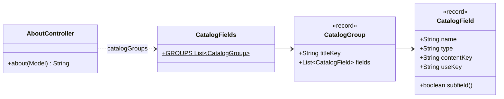

# Diseño — Fase 11: índice y catálogo completo en «Acerca de» (Requerimiento 5)

> Resultado de la tarea 11.0. Se hace commit **antes** de escribir código de producción. Sigue
> `docs/convenciones-java.md`.

## Estado de aprobación

- **Requiere aprobación del usuario:** no. PLAN §8 pide compuerta 🔒 solo en las fases 1, 2 y 3.
- **Estado:** no requiere aprobación.
- **Aprobación:** Adolfo pidió el cambio el 2026-10-21 y eligió, entre las opciones que se le dieron, el índice
  lateral fijo, el catálogo en tablas por grupo e implementar directo, sin mockups previos: los mockups
  `About.dc.html` y `About-en.dc.html` se actualizan al final para que coincidan con la página.

## Propósito

«Acerca de» es una página larga (siete secciones). Se agrega un índice para moverse por ella y la sección «El
catálogo» pasa de nueve filas a **todos** los atributos del mapping, con sus subcampos.

## Requerimientos cubiertos

| Tarea de `PLAN.md` | Cómo la cubre este diseño |
|---|---|
| 11.1 Índice | `<nav class="toc">` con un enlace por sección (los mismos títulos de cada `h1`/`h2`). En escritorio (≥ 1100 px) es una columna a la izquierda, fija al desplazarse (`position: sticky`), que marca la sección visible con `aria-current="location"`. En pantallas angostas es un `
` plegable arriba del contenido, cerrado al cargar y que se cierra al elegir una sección. Sin JavaScript sigue siendo una lista de enlaces abierta. |
| 11.2 Catálogo completo | `CatalogFields` (web) define los grupos y sus filas; la plantilla los recorre. Los grupos son los del formulario de «Cargar datos» (identificación y títulos; sinopsis y textos, con los vectores; clasificación, fecha y estado; métricas; reparto, producción y medios). Cada fila: campo, tipo del mapping, contenido y uso en la demo. Los objetos anidados (`keywords`, `belongs_to_collection`) llevan una fila por subcampo (`keywords.id`, …). |
| 11.3 | Mockups, capturas de «Acerca de», README, PLAN y verificación. |

## Dudas y supuestos

1. **Uso de cada campo.** La columna dice dónde lo usa la demo: búsqueda (Full-text, Vectorial, Híbrida), filtro,
   tarjeta de resultados y detalle. El detalle muestra todo salvo los vectores; la tarjeta, título, título original,
   sinopsis, póster, fecha, duración, géneros y votos.
2. **Una sola fuente de los campos.** Una prueba lee `elasticsearch/elastiflix-reloaded-mapping.json` y exige que
   cada propiedad y subpropiedad tenga su fila en `CatalogFields` con el mismo tipo. Si el mapping cambia, la prueba
   avisa.
3. **Textos medidos.** Las notas de `adult` y `release_date` medidas en el catálogo original de 4 322 películas se
   quedan como están (decisión D3 de la revisión 1).
4. **Títulos de los grupos.** Se reutilizan las claves `ingest.single.section.*` del formulario, para que las dos
   páginas nombren igual cada grupo.

## Diagrama de clases

## Secuencia o flujo

Sin flujo nuevo: la página se arma en el servidor y `about.js` solo marca la sección visible
(`IntersectionObserver`) y pliega el índice en pantallas angostas.

## Patrones usados

Ninguno nuevo.

## Errores y logging

Sin cambios.

## Pruebas previstas

| Prueba | Comportamiento que verifica | Tipo |
|---|---|---|
| `CatalogFieldsTest` | Cada propiedad y subpropiedad del mapping tiene su fila, con el mismo tipo; no hay filas de campos que no existen. | unitaria |
| `AboutPageTest` | El índice enlaza a las siete secciones en los dos idiomas; el catálogo trae los cinco grupos y campos como `imdb_id`, `keywords.name` y `belongs_to_collection.name`. | MockMvc |
| `MessageCatalogParityTest` (existente) | Las claves nuevas existen en español y en inglés. | unitaria |
| `about.test.js` | En escritorio el índice queda visible al bajar y marca la sección; en 375 px está plegado y un enlace lo cierra. | navegador |

## Alternativas descartadas

- **Filas escritas a mano en la plantilla:** 40 filas por idioma sin una prueba que las compare con el mapping.
- **Índice como lista arriba:** Adolfo eligió el lateral fijo.

## Supresiones de la verificación automática

Ninguna prevista.

## Cambios respecto al diseño aprobado

Se completa al cerrar la fase.
