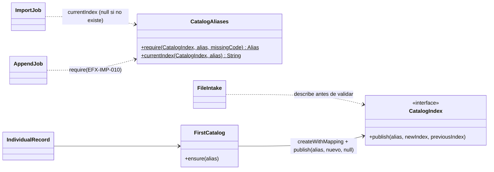

# Diseño — Fase 13: la primera carga crea el catálogo (Requerimiento 7)

> Resultado de la tarea 13.0. Se hace commit **antes** de escribir código de producción. Sigue
> `docs/convenciones-java.md`.

## Estado de aprobación

- **Requiere aprobación del usuario:** no (PLAN §8: compuerta 🔒 solo en las fases 1, 2 y 3).
- **Estado:** no requiere aprobación.
- **Aprobación:** Adolfo lo pidió el 2026-10-22 («Sí. Que bulk y el registro individual creen el catálogo (índice con
  el mapping y alias) cuando no existe, y que append quede bloqueado con un mensaje claro. Regístralo como
  requerimiento nuevo con su fase y su PR.»). **Revisa una decisión aprobada:** el diseño 1 (2026-10-18) decidió no
  crear un catálogo vacío, y el diseño 3 lo repitió para la carga. Ese criterio sigue para la migración de la tarea
  1.8; deja de valer para la carga.

## Propósito

Quien clona el repo con un proyecto Serverless vacío tiene que poder crear el catálogo desde la aplicación. Hoy no
puede: la carga individual, bulk y append fallan con `EFX-ES-007` y no crean nada (comprobado el 2026-10-22 contra un
alias `elastiflix-it-…` inexistente).

## Comportamiento

| Camino | Alias existe (un índice) | Alias no existe |
|---|---|---|
| **Bulk** | Igual que hoy: temporal solo con el archivo y `_aliases` con `add` + `remove_index`. | **Primera carga:** temporal `<alias>-<AAAAMMDD-HHMMSS>` con el mapping, lotes, conteo y `_aliases` solo con `add`. Rollback, `describe` y huérfanos con las mismas reglas («alias sin publicar» cuenta como el estado anterior). La validación dice 0 en «Catálogo actual que se reemplaza». |
| **Registro individual** | Igual que hoy: `index` por el alias con `require_alias=true`. | Valida y vectoriza; después crea `<alias>-<AAAAMMDD-HHMMSS>` con el mapping, le pone el alias y guarda la película. Si el alias no se puede poner, borra ese índice. |
| **Append** | Igual que hoy. | **Bloqueado:** el trabajo falla al empezar a validar, sin leer el archivo, con `EFX-IMP-010` («El catálogo todavía no existe · La carga en modo append agrega al catálogo y el alias no apunta a ningún índice · Carga primero un archivo en modo bulk o guarda un registro individual: los dos crean el catálogo»). |

Un alias en varios índices (`EFX-ES-005`) o un índice concreto con ese nombre (`EFX-IMP-004`) siguen rechazándose
igual en los tres caminos.

## Página

- **Aviso:** con el catálogo sin crear, «Cargar datos» muestra bajo la entrada: «El catálogo `elastiflix-reloaded`
  todavía no existe. Se crea con la primera carga: un archivo en modo bulk o un registro individual. La carga en modo
  append queda bloqueada hasta entonces.» (y su texto en inglés).
- **Tarjeta «Modo de carga»:** append aparece deshabilitado y bulk, marcado; no hay aviso de «se borra el catálogo
  actual», porque no hay catálogo.
- **Cabecera y pie:** dicen «Conectado · el catálogo todavía no existe» e «Índice: elastiflix-reloaded · todavía no
  existe», en lugar de «Sin conexión · EFX-ES-002»: Elasticsearch sí respondió.

## Diseño

- **`CatalogIndex.publish(alias, newIndex, previousIndex)`:** con `previousIndex` `null` manda solo `add` (primera
  publicación). No se agrega un método nuevo: PMD (`TooManyMethods`) ya está en el límite.
- **`CatalogAliases.currentIndex`:** devuelve el índice del alias o `null` si el nombre no existe; rechaza un alias
  ambiguo o un índice concreto como hoy. `require` recibe el código para el alias ausente (`EFX-ES-002` en bulk ya no
  se usa; `EFX-IMP-010` en append).
- **`FirstCatalog`** (nuevo, `ingest`): crea el catálogo si falta. Si `publish` no confirma, `describe` decide: alias
  en el índice nuevo → listo; alias todavía ausente y rechazo 4xx → borra el índice nuevo y relanza; lo demás →
  `EFX-IMP-006`, sin borrar.
- **`ErrorCode.APPEND_WITHOUT_CATALOG`** (`EFX-IMP-010`) en `ErrorCode` y en los dos catálogos de mensajes.
- **Web:** `PageShell.catalogMissing` (el estado trae `EFX-ES-002`); los textos de la cabecera, el pie y «Cargar
  datos» lo usan; `ingest.js` no necesita cambios: el radio deshabilitado ya no se puede marcar.

## Pruebas previstas

| Prueba | Comportamiento que verifica | Tipo |
|---|---|---|
| `ImportJobTest` | Sin alias: crea el temporal, publica solo con `add` (anterior `null`), limpia huérfanos sin índice vigente; si `_aliases` rechaza con 4xx y el alias sigue sin existir, borra el temporal. | unitaria |
| `FirstCatalogTest` | Con alias, no hace nada; sin alias, crea y publica; si publicar falla, borra el índice nuevo. | unitaria |
| `IndividualRecordTest` | Sin alias, crea el catálogo antes de guardar; un registro inválido no crea nada. | unitaria |
| `FileIntakeTest` | Bulk sin alias: «se reemplaza» 0. Append sin alias: `fallido` con `EFX-IMP-010` y el lector no se abre. | unitaria |
| `AppendJobTest` | Sin alias: `EFX-IMP-010` sin escribir. | unitaria |
| `FirstCatalogIT` | Contra Serverless, sobre `elastiflix-it-<aleatorio>` sin nada: append falla con `EFX-IMP-010`; un bulk crea el alias, un índice con el mapping del repo y las películas del archivo; un registro individual en otro alias vacío crea el catálogo y se lee. Borra lo que creó. | integración |
| `IngestPageTest` / `LayoutTest` | Con el catálogo sin crear: el aviso, append deshabilitado, bulk marcado; cabecera y pie con los textos nuevos, en los dos idiomas. | MockMvc |

## Alternativas descartadas

- **Crear el catálogo al arrancar la aplicación:** crearía un catálogo vacío sin que nadie lo pida, que es lo que el
  diseño 1 quería evitar.
- **Que append también cree el catálogo:** Adolfo pidió bloquearlo.
- **Un método `addAlias` en `CatalogIndex`:** `publish` con anterior `null` hace lo mismo sin pasar el límite de PMD.

## Cambios respecto al diseño aprobado

Se completa al cerrar la fase.
