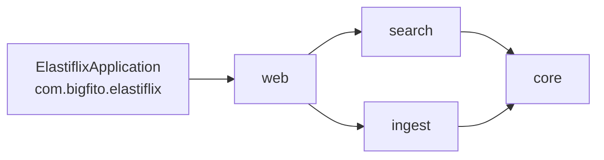

# Diseño — Fase 14: un solo módulo Maven (Requerimiento 8)

> Resultado de la tarea 14.0. Se hace commit **antes** de mover código. Sigue `docs/convenciones-java.md`.

## Estado de aprobación

- **Requiere aprobación del usuario:** no (PLAN §8: compuerta 🔒 solo en las fases 1, 2 y 3).
- **Estado:** no requiere aprobación.
- **Aprobación:** Adolfo lo pidió el 2026-10-22 («Quiero que re-organices la estructura del proyecto para que sea un
  git mono-repo, maven single-module. Los módulos que creaste que cuelguen del paquete java com.bigfito.elastiflix
  según sea necesario. Es importante que nada se rompa. De esta forma, un desarrollador junior podrá entender mejor el
  proyecto sin perderse entre los diferentes módulos.»). **Revisa una decisión aprobada:** PLAN §4 y la tarea 0.4
  definieron cuatro módulos Maven (`elastiflix-core`, `-search`, `-ingest` y `-web`).

## Propósito

Un solo `pom.xml` y un solo `src/`. Las cuatro partes siguen separadas, ahora como paquetes de
`com.bigfito.elastiflix`, y ArchUnit vigila los límites que antes ponía Maven. La aplicación, sus pruebas y sus
páginas se comportan igual: «nada se rompe» se comprueba con los mismos totales de pruebas antes y después.

## Estructura

Antes:

```
pom.xml                                  ← padre, packaging pom
elastiflix-core/{pom.xml, src/main, src/test}
elastiflix-search/{pom.xml, src/main, src/test}
elastiflix-ingest/{pom.xml, src/main, src/test}
elastiflix-web/{pom.xml, src/main, src/test, src/test/browser}
```

Después:

```
pom.xml                                  ← único POM, packaging jar
src/main/java/com/bigfito/elastiflix/
├── ElastiflixApplication.java           ← punto de entrada (antes en …/web/)
├── core/                                ← modelo, cliente ES, catálogo, mapping, embeddings
├── search/                              ← full-text, vectorial, híbrida, filtros, facetas
├── ingest/                              ← comprobación, lectores, validación, importación
└── web/                                 ← Spring MVC + Thymeleaf
src/main/resources/                      ← application.yml, plantillas, estáticos, mensajes, META-INF/spring.factories
src/test/java/com/bigfito/elastiflix/{core,search,ingest,web,architecture}/
src/test/resources/validation/           ← fixtures de validación (antes en ingest)
src/test/browser/                        ← pruebas de navegador (antes en web)
```



- **Paquetes sin cambios:** `com.bigfito.elastiflix.core`, `.search`, `.ingest` y `.web` conservan sus nombres y
  clases. Los archivos se mueven con `git mv`, así que la historia de cada clase se conserva.
- **`ElastiflixApplication` pasa al paquete raíz** `com.bigfito.elastiflix`: es la convención de Spring Boot y
  quita `scanBasePackages`. `@ConfigurationPropertiesScan` queda sin argumentos.

## POM

- `com.bigfito:elastiflix-reloaded:0.1.0-SNAPSHOT`, `packaging jar`, padre `spring-boot-starter-parent` 4.1.1.
- **Dependencias:** la unión de las cuatro: `spring-boot-starter`, `-elasticsearch`, `-validation`,
  `jackson-databind` (Jackson 3), `-webmvc`, `-thymeleaf`, `-actuator`; de prueba `spring-boot-starter-test`,
  `-webmvc-test` y `archunit-junit6`. `spring-boot-web-server` deja de declararse: lo trae `-webmvc`.
- **Plugins:** los de hoy (enforcer, Surefire sin `*IT`, Checkstyle, PMD, perfil `it` con Failsafe) más
  `spring-boot-maven-plugin`. Checkstyle y PMD leen `config/` con `${project.basedir}`; `config/` no cambia.
- **Recursos:** `src/main/resources` y `elasticsearch/elastiflix-reloaded-mapping.json`, que se sigue empaquetando
  en `elasticsearch/` del classpath.
- **Ejecutable:** `target/elastiflix-reloaded-0.1.0-SNAPSHOT.jar` (antes `elastiflix-web/target/elastiflix-web-…`).

## Pruebas

- **Sin `TestApplication`:** las tres de core, search e ingest se borran. Con un solo módulo, las clases de prueba de
  todos los paquetes comparten classpath: `ElastiflixApplication` escanea `com.bigfito.elastiflix` y recogería esas
  configuraciones de prueba en las pruebas de la web. Las IT usan `ElastiflixApplication` (`@SpringBootTest`), que
  ya es lo que usaba `SmokeIT`.
- **Sin `application.yml` de prueba:** los tres de `src/test/resources` se borran. En un solo módulo, uno de prueba
  taparía el `application.yml` de la aplicación en todas las pruebas, también las de la web. El de la aplicación ya
  tiene las mismas claves.
- **`.env`:** Maven, Surefire, Failsafe y `spring-boot:run` trabajan desde la raíz del repo, así que basta
  `optional:file:.env`. El `../.env` de respaldo se quita.
- **Rutas:** `Path.of("..", "elasticsearch", …)` pasa a `Path.of("elasticsearch", …)`.
- **Criterio de «nada se rompe»:** `./mvnw clean verify -Pit` con los mismos totales de la fase 13 (703 unitarias y
  38 de integración), 0 violaciones; las 27 pruebas de navegador; la aplicación arrancada desde el jar nuevo con
  Inicio, una búsqueda de cada modo, el detalle, «Cargar datos» y «Acerca de».

## Límites entre paquetes

Con cuatro módulos, Maven impedía que `core`, `search` o `ingest` importaran Spring MVC: no estaba en su classpath.
Ahora sí lo está, así que ArchUnit lo prohíbe. `ArchitectureTest` (que pasa a `src/test/java/…/architecture/`)
agrega a la lista de prohibición de `core`, `search` e `ingest`: `jakarta.servlet..`, `org.springframework.ui..`,
`org.springframework.http..` y `org.springframework.boot.webmvc..`. Las reglas de hoy siguen igual: las
prohibiciones entre paquetes, la web sin `co.elastic.clients` (también PMD `JM-DEP-02`), sin ciclos, controladores
solo en `web` y sin `System.out`.

## Documentación

- **Vigente, se actualiza:** README (puesta en marcha, comandos, estructura), `AGENTS.md`, `CLAUDE.md`, PLAN (§2,
  §3, §4, §7, §8 y una nota al inicio de «FASES»), `docs/arquitectura.mermaid`, `docs/convenciones-java.md`,
  `design/README.md`, `.cursor/rules/elastiflix-java.mdc`, `.gitignore` y `src/test/browser/README.md`.
- **Histórica, no se reescribe:** los diseños 0 a 13, los `progreso/` de fases y revisiones cerradas y
  `docs/revisiones/`. Sus rutas `elastiflix-<parte>/…` y sus comandos `-pl … -am` describen el repo de su momento;
  la nota de PLAN explica la equivalencia (`elastiflix-web/src/main/java/…` → `src/main/java/…`;
  `./mvnw verify -Pit -pl elastiflix-core -am` → `./mvnw verify -Pit`).
- **IntelliJ:** hay que recargar el proyecto Maven (los cuatro módulos desaparecen) y usar
  `com.bigfito.elastiflix.ElastiflixApplication` con la raíz del repo como carpeta de trabajo.

## Alternativas descartadas

- **Reorganizar los paquetes por funcionalidad:** cambiaría cientos de imports y la historia de cada clase sin
  ganar claridad; los cuatro paquetes ya cuelgan de `com.bigfito.elastiflix`.
- **Conservar las `TestApplication` con filtros de escaneo:** más configuración que explicar a un Junior; una sola
  aplicación es más simple.
- **Dejar `ElastiflixApplication` en `web`:** obliga a `scanBasePackages` y esconde el punto de entrada.

## Cambios respecto al diseño aprobado

- **`CosineSimilarity` pasa a `src/test`:** vivía en `src/main` solo porque un módulo no veía las clases de prueba
  de otro; el código de producción no la usa.
- **`ElasticsearchJsonConfigTest`** arranca un contexto sin web con `ApplicationContextRunner`; en lugar de
  `ElastiflixApplication` usa una configuración anidada `CoreOnly` (núcleo y autoconfiguración), igual que hacía la
  `TestApplication` de core.
- **Comentarios y un mensaje** que nombraban módulos dicen ahora «paquete» o «la aplicación» (por ejemplo, la acción
  de `EFX-CFG-003`).
- **Totales:** 704 unitarias, una más que la línea base: la regla nueva de ArchUnit.
