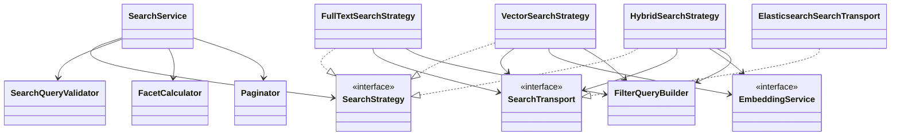
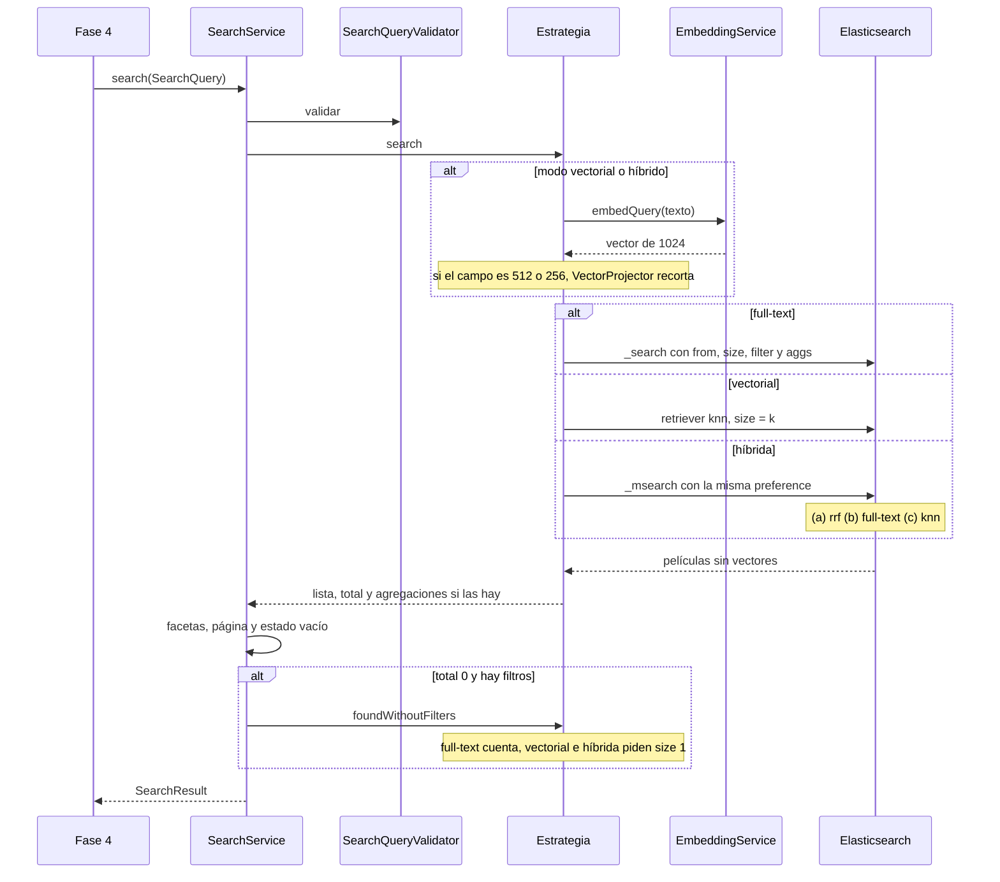

# Diseño — 2: Búsqueda

> Resultado de la tarea `2.0`. Se hace commit **antes** de escribir código de producción. Sigue
> `docs/convenciones-java.md`. El código de esta fase vive en `elastiflix-search`. El único cambio en
> `elastiflix-core` es agregar las constantes `EFX-SRCH-*` al `enum` `ErrorCode`, que ya reservó la
> excepción `SearchValidationException`.

## Estado de aprobación

- **Requiere aprobación del usuario:** sí (Fase 2, compuerta 🔒 de `PLAN.md` §8)
- **Estado:** aprobado
- **Aprobación:** Adolfo, 2026-10-18. Los seis supuestos, tal cual.

## Propósito

`elastiflix-search` ejecuta los tres modos del catálogo —full-text (BM25), vectorial (k-NN) e híbrida
(RRF)— con los mismos filtros, las facetas, la paginación y las puntuaciones que muestran los mockups.
La web no entra en esta fase: solo queda la fachada `SearchService` y sus records, para que la Fase 4
los llame sin conocer el cliente de Elasticsearch.

Las búsquedas leen el alias configurado (`elastiflix.index.alias`) y no lo modifican. El vector de la
consulta sale de `EmbeddingService.embedQuery`: `input_type=search` y prefijo `Query: `. El prefijo de
documento calibrado en la Fase 1 no se usa aquí.

## Requerimientos cubiertos

| Tarea de `PLAN.md` | Referencia | Cómo la cubre este diseño |
|---|---|---|
| 2.1 | `PLAN.md` §5 y §6 | `SearchQuery` y `SearchQueryValidator` |
| 2.2 | Filtros AND / OR | `FilterQueryBuilder` |
| 2.3 | Full-text y las 8 filas de §6 | `FullTextSearchStrategy` |
| 2.4 | Vectorial y las 3 filas de §6 | `VectorSearchStrategy` |
| 2.5 | Híbrida, `_msearch` y RRF | `HybridSearchStrategy` |
| 2.6 | Facetas | `FacetCalculator` |
| 2.7 | Paginación | `Paginator` |
| 2.8 | Fachada y estados vacíos | `SearchService` |

La tarea 2.9 (documentación de cierre) no cambia estas clases.

## Dudas y supuestos

No hay preguntas abiertas. Estos supuestos se pueden cambiar al aprobar el diseño; no bloquean la fase.

1. **La búsqueda habla con Elasticsearch desde su propio módulo.** El diseño de la Fase 1 dejó esa
   puerta abierta. `SearchTransport` es la única clase que llama al cliente. Las estrategias arman la
   petición; las pruebas unitarias comparan su JSON. La web sigue sin ver `co.elastic.clients`.
2. **Vectorial e híbrida piden `k` documentos y parten la página en la aplicación.** Hace falta la
   lista completa para las facetas y para las posiciones. Full-text sí usa `from` y `size` de
   Elasticsearch, porque sus facetas salen de agregaciones.
3. **Confirmar «sin resultados con estos filtros» no cuenta el catálogo entero.** Repite la misma
   consulta sin filtros. En full-text es un `_count`. En vectorial e híbrida es la misma búsqueda con
   `size = 1`: el k-NN no tiene un conteo distinto de la búsqueda.
4. **Una página más allá del total, pero dentro de la ventana, no es un error.** Si hay resultados y
   la página pedida se pasa, `SearchService` devuelve la página vacía con el total real. El estado
   «sin resultados» solo aparece cuando el total es 0.
5. **Las etiquetas «Todos», «Solo no adultos» y «Ver todos» las pone la Fase 4.** Esta fase devuelve
   el valor del índice (`true`/`false`, el género, el idioma, la clasificación) y su conteo. «Todos»
   significa no enviar el filtro.
6. **«Fuera de su lista» dice el `k` real.** El mockup escribe «fuera de su top 100» porque el ejemplo
   usa `k = 100`. El texto de esta fase es `fuera de su top ` seguido del `k` de la consulta.

## Diagrama de clases

`SearchService` elige la estrategia con el modo. No hay un `switch` sobre el modo repartido en varios
sitios: solo ese punto. Agregar un modo sería otra clase y otra rama ahí.

## Secuencia o flujo

No hay reintentos ni trabajo en segundo plano. Una búsqueda es una llamada, o tres dentro de un
`_msearch`. Si Elasticsearch o la inferencia fallan, la excepción de la Fase 1 sube tal cual.

## Responsabilidades

| Clase | Responsabilidad en una frase | Contrato |
|---|---|---|
| `SearchQuery` | Junta texto, modo, ajustes, filtros, página y tamaño | record |
| `FullTextSettings` | Tipo de consulta, campo y operador | record |
| `KnnSettings` | Campo del vector, `k` y `num_candidates` | record |
| `SearchFilters` | Adultos, géneros, fechas, idiomas y clasificación | record |
| `SearchQueryValidator` | Rechaza una consulta que no cumple las reglas | clase pequeña |
| `FilterQueryBuilder` | Traduce los filtros a cláusulas `filter` | clase pequeña |
| `SearchStrategy` | Ejecuta un modo y devuelve la lista cruda | interfaz |
| `FullTextSearchStrategy` | BM25 con `from`/`size` y agregaciones | estrategia |
| `VectorSearchStrategy` | k-NN sobre el campo pedido, `size = k` | estrategia |
| `HybridSearchStrategy` | `_msearch` de RRF y de los dos componentes | estrategia |
| `SearchTransport` | Ejecuta `_search`, `_msearch` y `_count` | interfaz |
| `ElasticsearchSearchTransport` | Traduce esas tres llamadas al cliente Java | gateway |
| `FacetCalculator` | Cuenta valores y el rango de fechas | clase pequeña |
| `Paginator` | Página, total de páginas y el rango «1–25 de 100» | clase pequeña |
| `ScoreJoiner` | En híbrida, junta BM25, similitud, posiciones y RRF | clase pequeña |
| `SearchService` | Elige la estrategia, mide el tiempo y arma `SearchResult` | fachada |
| `SearchResult` | Página, total, facetas, paginación, ajustes y estado vacío | record |
| `SearchHit` | Una película de la página y sus puntuaciones | record |

### Paquetes

| Paquete | Frase del `package-info` |
|---|---|
| `search.query` | Consulta, ajustes y validación. |
| `search.filter` | Filtros traducidos a cláusulas de Elasticsearch. |
| `search.strategy` | Un modo de búsqueda por clase. |
| `search.transport` | Llamadas `_search`, `_msearch` y `_count`. |
| `search.facet` | Conteos y rango de fechas. |
| `search.page` | Página y rango visible. |
| `search.result` | Lo que la fachada devuelve a la web. |

El paquete `search` ya existe. Su `package-info` no cambia de frase.

### Consulta

`SearchMode` es `FULL_TEXT`, `VECTOR` o `HYBRID`. Los nombres de JSON y de la URL (`fulltext`,
`vectorial`, `hibrida`) los traducirá la Fase 4. Esta fase no lee parámetros HTTP.

| Pieza | Campos |
|---|---|
| `FullTextSettings` | `MatchType` (`MATCH` o `MULTI_MATCH`), `TextField` (`TITLE` o `ORIGINAL_TITLE`, solo con `MATCH`), `TextOperator` (`OR` o `AND`) |
| `KnnSettings` | `VectorField` (`PLOT_256`, `PLOT_512`, `PLOT_1024`), `k`, `numCandidates` |
| `SearchFilters` | `List<Boolean> adult`, `List<String>` de géneros, idiomas y clasificaciones, `LocalDate from`, `LocalDate to` |
| `SearchQuery` | `text`, `mode`, `fullText`, `knn`, `filters`, `page` (desde 1), `pageSize` |

En full-text, `knn` es `null`. En vectorial, `fullText` es `null`. En híbrida van los dos. Un modo
sin el ajuste que necesita se rechaza con `EFX-SRCH-010`.

Listas `null` se tratan como vacías. Una lista vacía significa «sin ese filtro».

### Validación

`SearchQueryValidator` lanza `SearchValidationException`. El «qué pasó» copia el mockup cuando el
mockup tiene esa frase. El código completo va en el mensaje de la excepción, para el log y para la
página de error de la Fase 4.

El orden sigue al mockup: primero el texto, después `k`, después `num_candidates`, y al final la
página. Así una consulta con dos fallos explica la primera.

| Código | Qué pasó (texto de `ErrorCode`, sin el punto de `userMessage()`) | Cuándo |
|---|---|---|
| `EFX-SRCH-001` | Escribe qué película buscas antes de pulsar Buscar | El texto, ya recortado, está vacío |
| `EFX-SRCH-002` | k debe ser un entero mayor o igual que 1 | Modo vectorial o híbrido con `k < 1` |
| `EFX-SRCH-003` | num_candidates debe ser mayor o igual que k | `num_candidates < k` |
| `EFX-SRCH-004` | num_candidates debe ser un entero de máximo 10 000 | `num_candidates > 10000` |
| `EFX-SRCH-005` | El campo no se usa con multi-match | `MULTI_MATCH` trae un `TextField` |
| `EFX-SRCH-006` | El tamaño de página debe ser 25, 50 o 100 | `pageSize` no es uno de esos tres |
| `EFX-SRCH-007` | La fecha «Desde» no puede ser posterior a «Hasta» | Las dos fechas vienen y `from` es posterior a `to` |
| `EFX-SRCH-008` | La página se sale de las 10 000 coincidencias que se pueden recorrer | Full-text y `from >= 10000`. La petición pide `size = min(tamano, 10000 - from)` |
| `EFX-SRCH-009` | La página se sale de los k resultados de este modo | Vectorial o híbrida y `from >= k`. Una página parcial, con `from < k`, se acepta |
| `EFX-SRCH-010` | Faltan los ajustes de este modo | Full-text sin `FullTextSettings`, vectorial o híbrida sin `KnnSettings`, híbrida sin `FullTextSettings`, o `MATCH` sin campo |
| `EFX-SRCH-011` | La página debe ser un entero mayor o igual que 1 | `page < 1` |

`from` es `(page - 1) * pageSize`. En full-text se comprueba contra 10 000. En los otros modos, contra
`k`. `k = num_candidates` es válido. Una sola fecha, solo «Desde» o solo «Hasta», también es válida.

Cada regla tiene una prueba unitaria que afirma el código. El texto del mockup se afirma en las cuatro
reglas que lo tienen (`001`, `002`, `003`, `004` y `007`).

### Filtros

Entre filtros distintos, AND. Dentro de un filtro, OR, con una cláusula `terms`. Un filtro vacío no
genera cláusula.

| Filtro | Cláusula |
|---|---|
| `adult` con un valor | `term` sobre `adult` |
| `adult` con los dos | `terms` sobre `adult` |
| `genres`, `spoken_languages`, `rating` | `terms` del campo |
| `release_date` | `range` con `gte`, `lte` o los dos, en `yyyy-MM-dd` |

Esas cláusulas van en un `bool.filter`. No van en `must`: no deben cambiar la puntuación BM25.

La prueba de `FilterQueryBuilder` compara el JSON de cada filtro y el de una combinación (un género,
un idioma y un rango) con un texto esperado. El orden de las cláusulas es el de la tabla.

### Full-text

`FullTextRequestBuilder` arma un `_search` al alias:

- `from` y `size` de la página.
- `track_total_hits: true`, para que el total de las 8 filas de §6 sea exacto.
- `_source` excluye `plot_256`, `plot_512` y `plot_1024`.
- `bool.must` es un `match` del campo elegido, o un `multi_match` `best_fields` sobre `title` y
  `original_title`. El operador es `or` o `and`.
- `bool.filter` son las cláusulas de arriba, si hay alguna.
- Agregaciones `terms` de `genres`, `spoken_languages`, `rating` y `adult`, cada una con `size: 100`.
  El catálogo tiene 19 géneros, 64 idiomas, 6 clasificaciones y 2 valores de `adult`, así que 100
  alcanza. Más `min` y `max` de `release_date`.

La prueba unitaria compara ese JSON con un fixture, sin vector porque este modo no lo tiene.
`FullTextSearchIT` lee el alias real y no lo modifica. Para cada fila de §6 compara OR y AND con el
total exacto medido en el catálogo de 6 899 películas. No se afloja el criterio en el código. Si
`_count` no es 6 899, la prueba se omite con «El catálogo cambió». En el catálogo de 4 322,
`Kolejne 365 dni` daba OR 1 y AND 0; en el de 6 899 da OR 3 y AND 0. El token `365` coincide con
el título en inglés de la película `829560`, «The Next 365 Days».

### Vectorial

La estrategia vectorial pide el vector con `embedQuery` y, si el campo es `plot_512` o `plot_256`,
lo recorta con `VectorProjector`. `plot_1024` se usa tal cual. Si la inferencia falla, sube
`EmbeddingException`.

`VectorRequestBuilder` arma un retriever `knn`:

- `field`, `query_vector`, `k` y `num_candidates`.
- `filter` con las mismas cláusulas, si hay alguna.
- `size = k`. No manda `from`: la página se corta después.
- El mismo `_source` sin vectores. Sin agregaciones.

Sin filtros, la respuesta tiene exactamente `k` películas: el catálogo tiene más de `k` y `k` cabe.
Cada puntuación es la que devuelve Elasticsearch, `(1 + coseno) / 2`, y la prueba afirma que está en
`(0, 1]`.

`VectorSearchIT` usa `k = 100` y `num_candidates = 200`. Afirma la posición exacta. No se afloja el
criterio en el código. Estas posiciones son las medidas el 2026-10-18 sobre 6 899 películas:

| Consulta | Película | `plot_256` | `plot_512` | `plot_1024` |
|---|---|---|---|---|
| un barco de lujo choca con un iceberg en su viaje inaugural | `597` | 36.º | 7.º | 4.º |
| un joven náufrago comparte un bote salvavidas con un tigre de Bengala en medio del océano | `87827` | 30.º | 7.º | 4.º |
| un robot solitario que limpia la Tierra | `10681` | 1.º | 1.º | 1.º |

Si la posición no coincide, la prueba falla. Si `_count` no es 6 899, se omite.

### Híbrida

Una sola llamada `_msearch` con tres búsquedas. Las tres llevan el mismo `preference`
(`elastiflix-` y un UUID de esa petición) para que lean las mismas réplicas. Lo genera
`HybridRequestBuilder.build` en cada llamada; quien llama no lo pasa. `size = k` en las tres.
Los filtros son los mismos.

| Parte | Qué busca | Para qué |
|---|---|---|
| (a) | Retriever `rrf`: un retriever `standard` con la consulta full-text y un retriever `knn`. `rank_constant` 60, `rank_window_size = k`. El `filter` va en el `rrf` | Orden final y puntuación RRF |
| (b) | Solo la consulta full-text, con sus filtros | Puntuación BM25 y posición en esa lista |
| (c) | Solo el k-NN, con sus filtros | Similitud y posición en esa lista |

La consulta full-text de (a) y de (b) es la de `FullTextSettings`: `match` o `multi_match`, con su
operador. El vector de (a) y de (c) es el mismo, ya recortado.

`ScoreJoiner` recorre la lista (a). Para cada película busca su puesto en (b) y en (c), contando desde
1. Si no está, esa puntuación queda vacía y la posición se describe como `fuera de su top ` más el
`k`. La puntuación RRF es la de (a). La prueba de integración comprueba, para cada resultado,

`RRF = Σ 1 / (60 + posición)`

con tolerancia `1e-6` frente a la puntuación de Elasticsearch. Solo se suman las listas en las que la
película aparece.

La fila de §6 usa `match` sobre `title`, operador AND, la consulta
`toy story juguetes que cobran vida`, `k = 100` y `num_candidates = 200`. El componente léxico viene
vacío. Los `k` resultados y su orden son los del componente vectorial. El campo del vector no está
fijado en §6; la prueba usa `plot_1024`, el de más precisión, y lo anota en el nombre del caso.

### Facetas

`FacetCalculator` tiene dos entradas y la misma salida.

| Modo | De dónde salen |
|---|---|
| Full-text | Las agregaciones de la respuesta |
| Vectorial e híbrida | Las `k` películas devueltas, no solo la página |

Cuenta `genres`, `spoken_languages`, `rating` y `adult`. Orden: conteo de mayor a menor y, si empatan,
la etiqueta de la A a la Z. Un valor que el usuario ya marcó se queda en la lista aunque su conteo sea
0. El rango de fechas es el mínimo y el máximo de `release_date` en ese mismo conjunto. Si no hay
fechas, el rango es vacío.

Una película con varios géneros suma uno a cada género. Un valor vacío dentro de una lista no cuenta.
La interfaz de «Ver todos» es de la Fase 4: aquí se devuelven todos los valores, como máximo los 100
de la agregación.

### Paginación

`Paginator` recibe el total, la página y el tamaño.

| Dato | Regla |
|---|---|
| Total en full-text | `hits.total`, exacto por `track_total_hits` |
| Total en vectorial e híbrida | Cuántas películas devolvió la búsqueda, como máximo `k` |
| Páginas | `ceil(total / pageSize)`. Con total 0, cero páginas |
| Recorte | De `(page - 1) * pageSize` a ese índice más el tamaño, sin pasarse del total |
| Rango | `1–25 de 100`, con guion largo y los miles agrupados con `Thousands` (`976–1 000 de 1 234`). La Fase 4 puede anteponer «Mostrando» y cerrar con «resultados» |
| Última página | Si caben 5, el rango termina en el total, no en un múltiplo del tamaño |

Las pruebas cubren la última página parcial y un `k` que no es múltiplo del tamaño (por ejemplo
`k = 30` y tamaño 25: dos páginas, la segunda con 5).

### Fachada y estados vacíos

`SearchService.search` valida, elige la estrategia, mide el tiempo con `System.nanoTime` y devuelve
`SearchResult`. El registro `INFO` dice el modo, el total y los milisegundos. No dice el texto ni un
vector.

`SearchResult` lleva la página de `SearchHit`, el total, las facetas, la paginación, las etiquetas de
ajuste y el estado vacío. Cada `SearchHit` lleva `id`, `title`, `originalTitle`, `plot`,
`posterPath`, `releaseDate` y las puntuaciones que corresponden al modo. `SearchService` pone la
puntuación RRF en `SearchHit.rrf` solo en la híbrida; en los otros modos queda `null`. El póster lo arma la Fase 4
con la URL base.

Las etiquetas de ajuste salen de los valores de la consulta, en este orden y solo las que aplican:
`match · title`, `match · original_title` o `multi-match · best_fields`; `OR` o `AND`; `plot_256`,
`plot_512` o `plot_1024`; `k 100`; `num_candidates 200`; `RRF`.

| Estado | Cuándo | Título | Texto |
|---|---|---|---|
| Con resultados | El total es mayor que 0 | — | — |
| Sin resultados | El total es 0 y no hay filtros, o la misma consulta sin filtros también da 0 | No encontramos películas | La consulta «…» no devolvió resultados con los ajustes actuales. |
| Sin resultados con estos filtros | El total es 0, hay filtros, y sin filtros la consulta sí encuentra | Ningún resultado cumple los filtros | La búsqueda sí encontró películas, pero ninguna cumple a la vez todos los filtros aplicados. |

Los consejos son los del mockup. En full-text: probar OR, probar multi-match, y revisar la ortografía
y los apóstrofos. En los otros modos: describir la trama con otras palabras, y cambiar de modo o de
ajustes. Con filtros: desmarcar un valor y pulsar APLICAR, y ampliar el rango de fechas.

La segunda llamada, si hace falta, ocurre después de la primera y solo cuando el total filtrado es 0.
No se hace si no hay filtros.

### Errores que no son de validación

Una falla del cliente se envuelve en `ElasticsearchAccessException` con el código de
`ElasticsearchDiagnostics.codeFor`, igual que en el catálogo, y se conserva la causa: `EFX-ES-001` sin
respuesta, en un 5xx o en un 401/403 (URL o API key no válidas); `EFX-ES-007` en el resto de los 4xx. Un
ítem fallido del `_msearch` usa el estado de ese ítem (revisión 2, S-20). Un `_msearch` que no devuelve
exactamente tres partes da `EFX-ES-007` (revisión 3, T-18): Elasticsearch respondió, así que no es
`EFX-ES-001`. No se captura `Exception`. Una falla de inferencia no se traduce a
`EFX-SRCH`: sigue siendo `EFX-EMB-*`.

## Patrones usados

| Patrón | Dónde | Por qué aporta claridad aquí |
|---|---|---|
| Strategy | `FullTextSearchStrategy`, `VectorSearchStrategy`, `HybridSearchStrategy` | Cada modo arma una petición distinta. Uno nuevo no reescribe los otros. |
| Facade | `SearchService` | La Fase 4 llama a un solo método. |
| Gateway / Adapter | `ElasticsearchSearchTransport` | El resto del módulo puede probarse con un doble. El cliente queda en una clase. |

No hay Factory, Observer ni Builder propio. El builder que aparece es el del cliente de Elasticsearch.

## Errores

La causa probable y la acción sugerida completan el formato de §7. El «qué pasó» es el de la tabla de
validación.

| Código | Causa probable | Acción sugerida |
|---|---|---|
| `EFX-SRCH-001` | La caja de búsqueda llegó vacía | Escribe una consulta |
| `EFX-SRCH-002` | `k` es menor que 1 | Elige un entero a partir de 1 |
| `EFX-SRCH-003` | Hay menos candidatos que resultados pedidos | Sube `num_candidates` o baja `k` |
| `EFX-SRCH-004` | `num_candidates` pasa de 10 000 | Elige un entero entre `k` y 10 000 |
| `EFX-SRCH-005` | Llegó un campo junto con `multi_match` | Quita el campo: `multi_match` ya busca en los dos títulos |
| `EFX-SRCH-006` | El tamaño de página no es 25, 50 ni 100 | Elige uno de esos tres |
| `EFX-SRCH-007` | Desde es posterior a Hasta | Invierte las fechas o deja una sola |
| `EFX-SRCH-008` | `from` es mayor o igual que 10 000 | Vuelve a una página anterior |
| `EFX-SRCH-009` | `from` es mayor o igual que `k` | Vuelve a una página anterior o sube `k` |
| `EFX-SRCH-010` | El modo no trae sus ajustes | Completa el tipo de consulta o el vector, según el modo |
| `EFX-SRCH-011` | La página es menor que 1 | Empieza en la página 1 |

Estas constantes están en `ErrorCode`, en `elastiflix-core`. La causa y la acción de la tabla son
el texto del enum, sin adornos. No hay códigos `EFX-WEB`.

## Logging

SLF4J, mensajes en español, parametrizados. Nunca la API key, un vector, una sinopsis completa ni el
JSON crudo de la petición: el vector de la consulta va dentro.

| Nivel | Evento | Contexto incluido |
|---|---|---|
| `ERROR` | Elasticsearch no respondió o rechazó la petición | `EFX-ES-001` o `EFX-ES-007` y el alias. Sin la URL |
| `INFO` | Una búsqueda terminó | Modo, total y milisegundos |
| `DEBUG` | La consulta que se va a ejecutar | Texto de la consulta, modo, campo, operador, `k`, `num_candidates`, página y tamaño. Sin el vector |
| `TRACE` | No se usa | El JSON trae el vector. El resumen ya está en `DEBUG` |

El `DEBUG` del texto va dentro de `isDebugEnabled()`, como pide la guía.

## Pruebas previstas

| Prueba | Comportamiento que verifica | Tipo |
|---|---|---|
| `SearchQueryValidatorTest` | Una prueba por cada `EFX-SRCH-*`, con el texto del mockup cuando existe | unitaria |
| `FilterQueryBuilderTest` | El JSON de cada filtro y el de una combinación | unitaria |
| `FullTextRequestBuilderTest` | El JSON de `match`, de `multi_match`, de `from`/`size` y de las agregaciones, sin vectores | unitaria |
| `VectorRequestBuilderTest` | El JSON del retriever `knn`, con un vector corto de prueba que no se registra | unitaria |
| `HybridRequestBuilderTest` | Las tres partes del `_msearch`, el mismo `elastiflix-<uuid>` en las tres cabeceras, `rank_constant` 60 y `rank_window_size = k` | unitaria |
| `FacetCalculatorTest` | Conteos a mano, orden, un valor marcado con 0 y el rango de fechas | unitaria |
| `PaginatorTest` | Última página parcial, `k` que no es múltiplo del tamaño y un total con miles agrupados | unitaria |
| `ScoreJoinerTest` | `1 / (60 + posición)` y una película que falta en una de las dos listas | unitaria |
| `SearchServiceTest` | Los tres modos y los dos estados vacíos, con estrategias simuladas; `rrf` solo en la híbrida | unitaria |
| `FullTextSearchIT` | Las 8 filas full-text de §6, totales exactos | integración, solo lectura |
| `VectorSearchIT` | Las 3 filas vectoriales de §6 y, sin filtros, exactamente `k` resultados con similitud en `(0, 1]` | integración, solo lectura |
| `HybridSearchIT` | La fórmula RRF con tolerancia `1e-6`, y la fila híbrida de §6 | integración, solo lectura |

Las de integración usan el alias configurado y no crean ni borran índices. No hay `Thread.sleep`.

## Alternativas descartadas

| Opción | Por qué se consideró | Por qué se descartó |
|---|---|---|
| Meter `_search` en `CatalogIndex` | Así `search` no tocaría el cliente | El catálogo administra índices. Mezclarlo con BM25 y RRF hace una clase con dos razones para cambiar. |
| Agregaciones también en vectorial e híbrida | Un solo camino para las facetas | En RRF contarían películas que no están en la lista combinada. El plan las calcula sobre los resultados. |
| Pedir solo la página al k-NN | Menos datos | Las facetas y las posiciones necesitan los `k` resultados. |
| Contar todo el índice para el estado vacío | `_count` sin consulta es simple | Diría que hay películas aunque la consulta no coincida con ninguna. |
| Registrar el JSON en `TRACE` | La guía lo menciona para la búsqueda | El vector viaja dentro. Un junior puede olvidar quitarlo. `DEBUG` resume la consulta sin el vector. |
| Dejar `page < 1` y la ventana de `k` para la web | El plan nombra la ventana de 10 000 y no la de `k` | Sin esas dos reglas, la fachada aceptaría una página que Elasticsearch rechaza o que se sale de la lista. |

## Supresiones de la verificación automática

Ninguna prevista.

## Cambios respecto al diseño aprobado

- **Criterio de §6 restaurado (revisión 1, D1).** El commit `2a3aaea` dejó de afirmar los totales y
  las posiciones, y quitó la frase «No se afloja el criterio en el código» sin anotarlo aquí. La
  revisión 1 la restituye. Los valores exactos son los medidos el 2026-10-18 sobre 6 899 películas
  (PLAN §6). Si el conteo cambia, la prueba se omite.
- **Fila `Kolejne 365 dni`.** El diseño decía 0 en OR y en AND. El catálogo de 4 322 devolvía OR 1
  y AND 0. Adolfo aceptó ese resultado el 2026-10-18. La película es `829560`, «The Next 365 Days».
  El catálogo de 6 899 devuelve OR 3 y AND 0.
- **Dónde se pide el vector.** El diagrama de secuencia lo pedía `SearchService`. Lo piden
  `VectorSearchStrategy` y `HybridSearchStrategy`, dentro de `search`. Así la interfaz común no
  recibe un vector que full-text no usa. `QueryVector` sigue recortando con `VectorProjector`.
- **Lectura de agregaciones.** `AggregationFacets` traduce los buckets y las fechas. `FacetCalculator`
  ordena y conserva los valores marcados. Se separaron para no pasar el tope de complejidad de una
  clase. Las etiquetas de adulto son `true` y `false`.
- **Rango de una página vacía con total mayor que 0.** El diseño no fijaba el texto. Quedó
  `0–0 de {total}`, con guion largo. El estado «Sin resultados» solo aparece cuando el total es 0.
- **Página 2 con `k = 30` y tamaño 25.** `Paginator` calcula `26–30 de 30`. Desde la revisión 1,
  la fachada sí llega a ese caso: se rechaza solo si `from >= k`. `EFX-SRCH-009` dice que `from`
  es mayor o igual que `k`. Las páginas se cuentan con `ceil(min(total, ventana) / tamano)`.
  En full-text la ventana es 10 000 y el `size` pedido no la rebasa.
- **Revisión 3, T-18.** Un `_msearch` que no devuelve exactamente tres partes da `EFX-ES-007`
  (`HybridSearchStrategy`): Elasticsearch respondió, así que no es `EFX-ES-001`.
- **Revisión 3, cierre (T-12 y T-23).** `HybridRequestBuilder.build` ya no recibe `preference`, que siempre
  llegaba `null`: genera un `elastiflix-<uuid>` y lo comparten las tres cabeceras del `_msearch`. Se quitó
  `RankedHit.rrf()`: `SearchService` pone la puntuación RRF en `SearchHit.rrf` solo en la híbrida. El rango
  de `Paginator` agrupa los miles con `Thousands` (`core.text`): «976–1 000 de 1 234».

## Límite de esta fase

No se implementan páginas, formularios ni carga de archivos. La tarea 2.1 no empieza hasta la
aprobación de este documento.
