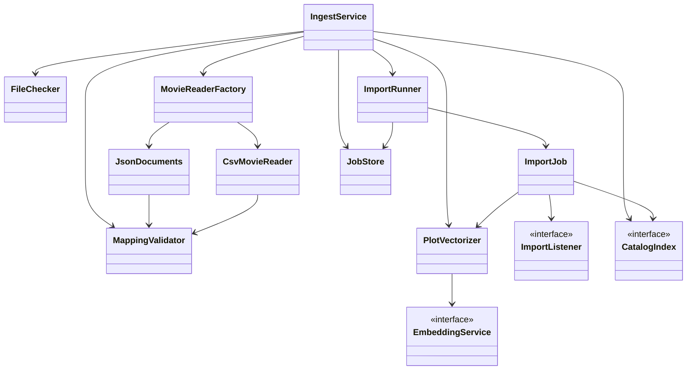
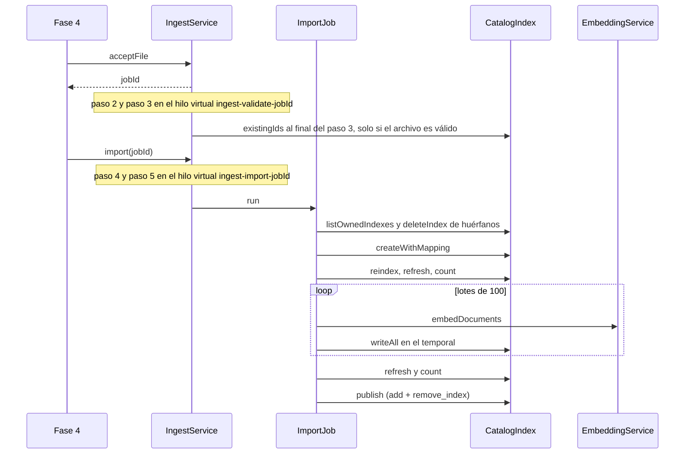
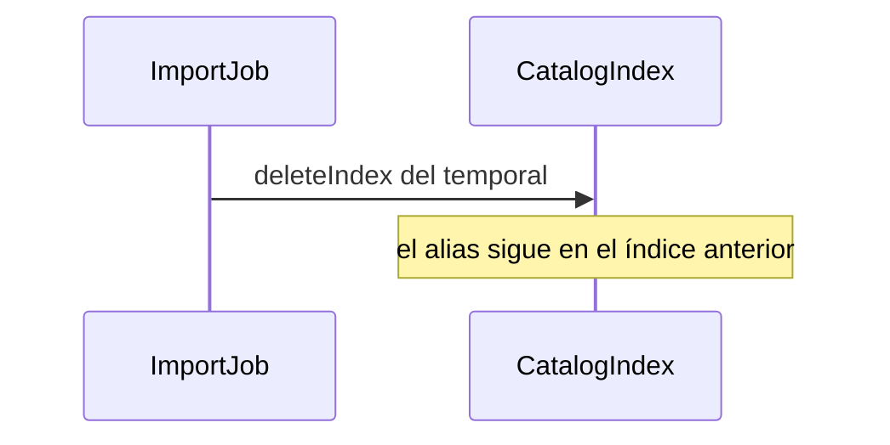
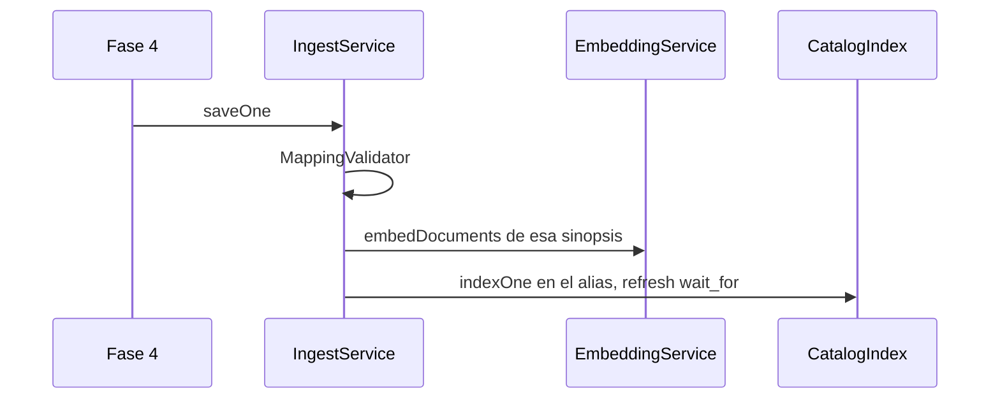

# Diseño — 3: Carga de datos

> Resultado de la tarea `3.0`. Se hace commit **antes** de escribir código de producción. Sigue
> `docs/convenciones-java.md`. El código de esta fase vive en `elastiflix-ingest`. En `elastiflix-core`
> solo se agregan métodos de escritura a `CatalogIndex` y las constantes `EFX-ING-*` y `EFX-IMP-*` a
> `ErrorCode`. Las excepciones `IngestValidationException` e `ImportException` ya existen.

> **Fase 10 (Requerimiento 4):** la carga de archivos tiene dos modos. **Append** (por defecto) escribe por el alias
> con `require_alias=true`, sin índice temporal, y lo escrito se queda si un lote se rechaza (`EFX-IMP-008`) o se
> cancela (`EFX-IMP-009`). **Bulk** sigue el flujo de este diseño, pero el temporal ya **no** copia el catálogo con
> `_reindex`: recibe solo las películas del archivo y el conteo esperado es el del archivo. Lo que aquí describe la
> copia (`_reindex`, `_tasks`, `EFX-ES-003` en la importación) quedó solo para la migración a alias de la tarea 1.8.
> Detalle en `docs/diseno/10.md`.

## Estado de aprobación

- **Requiere aprobación del usuario:** sí (Fase 3, compuerta 🔒 de `PLAN.md` §8)
- **Estado:** aprobado
- **Aprobación:** Adolfo, 2026-10-18. El diseño y sus supuestos, tal cual.

## Propósito

`elastiflix-ingest` comprueba un archivo `.json` o `.csv`, lo valida entero contra el mapping y, solo
si no hay errores, lo publica en el catálogo. La publicación es una sola llamada: el alias pasa al
índice nuevo y el índice anterior se borra.

Si algo falla antes de publicar, se borra el índice temporal y el catálogo queda como estaba. Si
`publish` no confirma, `describe` decide: un rechazo 4xx con el alias en el índice anterior borra el
temporal; el alias ya en el temporal se trata como publicado; un corte, un 5xx o un `describe` que no
se puede leer dan `EFX-IMP-006` y el temporal se deja (revisión 2, S-04).

La web no entra en esta fase. Queda la fachada `IngestService` para que la Fase 4 la llame sin conocer
el cliente de Elasticsearch. Los endpoints de `PLAN.md` §5 se implementan en la tarea 4.4.

Las decisiones del 2026-10-17 ya están cerradas y este diseño las aplica: se borra el índice anterior
al publicar; el registro individual escribe directo en el catálogo; no hay controles de concurrencia;
un CSV sin encabezado se rechaza; `plot_256`, `plot_512` y `plot_1024` se generan siempre con el
servicio de inferencia.

## Requerimientos cubiertos

| Tarea de `PLAN.md` | Referencia | Cómo la cubre este diseño |
|---|---|---|
| 3.1 | Comprobaciones de archivo y §7 | `FileChecker` |
| 3.2 | JSON de exportación, arreglo o NDJSON | `JsonDocuments` |
| 3.3 | CSV con encabezado obligatorio | `CsvMovieReader` |
| 3.4 | Validación todo o nada contra el mapping | `MappingValidator` |
| 3.5 | Vectores en tiempo de ejecución | `PlotVectorizer` |
| 3.6 | Índice temporal, lotes, swap y vuelta atrás | `ImportJob` |
| 3.7 | Registro individual directo al alias | `IngestService.saveOne` |
| 3.8 | Fachada y `IngestIT` | `IngestService` |

La tarea 3.9 (documentación de cierre) no cambia estas clases.

## Dudas y supuestos

No hay preguntas abiertas. Estos supuestos se pueden cambiar al aprobar el diseño; no bloquean la fase.
Los cinco primeros ya los decidió el usuario el 2026-10-17; se repiten para que el diseño se lea solo.

1. **El índice anterior se borra al publicar.** Una sola llamada `_aliases` hace `add` del alias al
   índice nuevo y `remove_index` del anterior. No queda copia del catálogo anterior en el clúster.
2. **El registro individual escribe directo en el catálogo**, por el alias, y reemplaza ese `id` en el
   acto. No crea índice temporal.
3. **No hay controles de concurrencia.** La demo la usa una persona. Un segundo archivo o un registro
   individual pueden cruzarse con una importación. No se agrega un candado.
4. **Un CSV sin encabezado se rechaza.** Si la casilla «La primera fila contiene los nombres de
   columna» llega desmarcada, el archivo no se lee.
5. **Los vectores del archivo no se usan.** `plot_256`, `plot_512` y `plot_1024` se generan siempre
   con `EmbeddingService` (la combinación calibrada en la tarea 1.9: `input_type=ingest` y prefijo
   vacío) y `VectorProjector`. Si el archivo los trae, se ignoran con advertencia y no se validan.
   El formulario no los captura. El mockup dice «Los vectores del archivo se usan tal cual» y muestra
   un error de dimensión en `plot_512`. Esa frase y ese error no se implementan: mandan la decisión
   del usuario y `PLAN.md`.
6. **`elastiflix-ingest` no llama al cliente de Elasticsearch.** La matriz de dependencias lo permite,
   pero el diseño de la Fase 1 dejó la escritura en `CatalogIndex`. Este módulo habla con
   `CatalogIndex` y con `EmbeddingService`. Las pruebas unitarias usan dobles. La web sigue sin ver
   `co.elastic.clients`.
7. **El nombre del archivo tiene un solo punto.** Se aceptan `elastiflix-reloaded.json` y
   `peliculas_2026.csv`. Se rechazan `peliculas.txt`, `peliculas`, `peliculas.csv.exe`,
   `peliculas.exe.csv` y `peliculas.json.csv`. Con esa regla, `my.movies.json` también se rechaza:
   tiene dos puntos. La extensión se compara sin distinguir mayúsculas.
8. **Un objeto JSON sin el campo `documents` se lee como NDJSON.** El objeto de exportación es el que
   trae `documents` (y, si viene, `document_count`). Un arreglo es un arreglo. Una película suelta es
   un NDJSON de un solo valor.
9. **El archivo se lee una sola vez y las películas validadas quedan en memoria** hasta importarse
   (decisión D2 de la revisión 1; el supuesto aprobado era leerlo dos veces en streaming). Para que el
   pico baje, los vectores se quitan al leer cada registro, los nodos crudos se sueltan al validarlos y
   el archivo local se borra al terminar la validación (revisión 2, S-06). Si el proceso muere a medias,
   el archivo local puede quedar; el índice temporal del clúster lo limpia la importación siguiente.
10. **La vectorización va dentro del paso 4 del mockup**, no como un sexto paso. El progreso incluye
    cuántos registros ya tienen vector, aunque la frase del mockup no lo diga. La frase en español la
    arma la Fase 4; esta fase entrega los conteos.
11. **Las advertencias tienen código y no detienen la carga.** `EFX-ING-020`, `021` y `022` se
    informan. No se lanzan como excepción. El CSV del informe lleva solo los errores.
12. **Hace falta un alias.** Si el nombre configurado no existe, el código es `EFX-ES-002`. Si apunta
    a varios índices, `EFX-ES-005`. Si todavía es un índice concreto, `EFX-IMP-004` y no se publica:
    `remove_index` no debe borrar el único índice. El catálogo real ya es alias desde la tarea 1.8.
    Esta fase no crea un catálogo vacío. *Nota de la fase 13 (Requerimiento 7, 2026-10-22):* ahora bulk y el
    registro individual crean el catálogo si el alias no existe, y append da `EFX-IMP-010`
    (`docs/diseno/13.md`).
13. **25 MB son 25 × 1024 × 1024 = 26 214 400 bytes**, igual que `DataSize.ofMegabytes(25)`. El tamaño se
    compara con la constante `FileChecker.MAX_FILE_SIZE`, fija y sin configuración (Requerimiento 3, fase 9;
    hasta entonces eran 150 MB en `ElastiflixProperties.Ingest.maxFileSize`). Un archivo de ese tamaño exacto
    pasa la comprobación de tamaño. Uno de un byte más, no.
14. **El paso 1 del mockup es el navegador.** Cuando el archivo llega a `IngestService`, ese paso ya
    está completado. El servicio repite las comprobaciones en el paso 2. Los endpoints HTTP quedan
    para la Fase 4. La Fase 4 traducirá `MaxUploadSizeExceededException` a `EFX-ING-003`; el YAML de
    multipart ya tiene los límites de §7.
15. **Una celda CSV vacía es «sin valor».** No avisa. Un texto que solo tiene espacios se guarda sin
    valor y avisa, salvo `id`, `title` y `plot`: esos, vacíos, son error. Un hueco dentro de una lista
    se omite y avisa. `null` en JSON es «sin valor» y no avisa.
16. **La advertencia de vectores es una por columna**, no una por fila. Si no, un archivo de 4 322
    películas produciría más de diez mil avisos iguales.
17. **Cancelar no es una caída.** El trabajo queda en `cancelado` y el log usa `EFX-IMP-003`. Si se
    cancela antes de crear el índice temporal, en el clúster no cambia nada. Si ya se publicó, cancelar
    no borra nada: el estado sigue en `publicado`.

## Operaciones en el clúster

Esta es la lista de lo que escribe o borra. La validación de un archivo no escribe. La única lectura
extra de la validación es preguntar qué `id` ya existen, para el conteo de reemplazos.

| Momento | Qué hace | Qué queda si falla |
|---|---|---|
| Al empezar la importación | Borra índices huérfanos: el nombre cumple exactamente `<alias>-<AAAAMMDD-HHMMSS>` y no es el índice que está detrás del alias. Registra cada nombre en `WARN`. No toca otro prefijo. | El alias y el índice vigente no se borran en este paso. |
| Paso 4 | Crea `<alias>-<AAAAMMDD-HHMMSS>` con el mapping del jar. | Si crear falla, no hay índice nuevo. |
| Paso 4 | `_reindex` copia el catálogo vigente, vectores incluidos. La llamada pide `wait_for_completion: false` y `exclude_vectors: false`. `ReindexTasks` lee `_tasks` en un bucle de lecturas de 20 s (`wait_for_completion: true`), con plazo total de 30 minutos. No duerme. La cancelación de la persona se consulta antes de cada lectura. | Si la tarea falla (`error`, `failures` o `timed_out`), no trae id o el plazo se agota, `EFX-ES-006`. Si el plazo se agota, se corta la conexión, la respuesta es ilegible o la persona cancela, la tarea se cancela con `_tasks/<id>/_cancel` (sin esperar en la llamada) y se confirma con hasta 3 lecturas de 20 s **antes** de borrar el temporal; si no se confirma, queda un `WARN` (revisión 3, T-01). Si el conteo copiado no coincide, `EFX-ES-003` y también se borra. El alias sigue igual. |
| Paso 4 | `bulk` en el temporal, lotes de 100, `_id` = `id`, reemplaza si el `id` ya estaba en la copia. Antes de cada lote se generan los vectores, de 16 en 16 dentro de `EmbeddingService`. | Si un ítem del lote es rechazado, si la inferencia falla o si el conteo final no cuadra, se borra solo el temporal. El alias y el índice anterior siguen. |
| Paso 5, solo si el conteo cuadra | Una sola llamada `_aliases`: `add` del alias al índice nuevo y `remove_index` del índice anterior. **Esa llamada borra el índice anterior.** No queda respaldo en Elasticsearch; el respaldo es el archivo del usuario. | Si la llamada no confirma, se lee el alias antes de borrar. Si `_aliases` respondió 4xx y el alias sigue en el anterior: `EFX-ES-004` y se borra el temporal. Ya apunta al temporal: se trata como publicado. Corte, timeout, 5xx, `describe` ilegible o alias en otro estado: `EFX-IMP-006` y el temporal se deja. |
| Cancelación | Si el temporal ya existe, se borra. No se llama a `_aliases`. | El alias y el índice anterior siguen. |
| Registro individual | Indexa ese documento **en el alias**, con `refresh=wait_for`, y reemplaza ese `_id` en el acto. | No crea temporal y no borra el índice anterior. Un fallo deja el documento anterior de ese `id` como estaba, si el index no llegó a aplicarse. |

El conteo esperado, después de los lotes y de un `refresh`, es:

`conteo de la copia + (registros del archivo − ids que ya existían)`

Un `id` que ya estaba reemplaza y no suma. Uno nuevo sí suma. La prueba de integración parte de 4
películas y carga 5, de las cuales 4 ya existían: el conteo esperado es 5.

`IngestIT` no usa estas operaciones contra `elastiflix-reloaded`. Crea un alias
`elastiflix-it-<aleatorio>`, trabaja ahí y borra ese alias y sus índices al terminar, pase o falle la
prueba.

## Diagrama de clases

`IngestService` es la única puerta. `MovieReaderFactory` elige `JsonDocuments` o `CsvMovieReader`
según la extensión. No hay interfaz `MovieReader`. El hilo de la importación avisa con un
`ImportListener` de ese trabajo: `ImportRunner` lo traduce a `JobStore.onProgress`. `JobStore` no
implementa la interfaz. Antes de escribir, el trabajo suelta su lista de películas (`release`); la
fuente del lote la usa solo durante esa llamada. Al validar, los vectores del archivo salen del nodo.

## Secuencia o flujo

El archivo se valida en un hilo virtual, para que quien llama reciba el `jobId` y pueda consultar el
estado. La importación es otra llamada, también en un hilo virtual. No se usa `@Async`. Los dos hilos se
llaman `ingest-validate-<jobId>` e `ingest-import-<jobId>` y los arranca `service/JobThreads` (revisión 3,
T-16). La pregunta `existingIds` ocurre al final del paso 3 y solo con el archivo ya válido: con
Elasticsearch caído, un archivo con errores igual muestra sus errores (revisión 3, T-17).

Si el lote, la inferencia, el conteo o la cancelación fallan después de crear el temporal:

El registro individual no pasa por `ImportJob`:

Estados del trabajo: `recibido`, `validando`, `valido`, `invalido`, `importando`, `publicado`,
`fallido`, `cancelado`. Se guardan en memoria, con un UUID. Un reinicio los olvida. El archivo local
se borra al llegar a `invalido`, `publicado`, `fallido` o `cancelado`.

| Paso del mockup | Cuándo queda completado | Cuándo queda detenido |
|---|---|---|
| 1. Comprobación en el navegador | Al guardar el archivo local. Lo hace la Fase 4; aquí ya llegó. | No lo marca este módulo. |
| 2. Subida al servidor | Extensión, tamaño y UTF-8 correctos. | `EFX-ING-001` a `004`. |
| 3. Validación contra el mapping | Cero errores. Puede haber advertencias `020` a `022`. | Cualquier `EFX-ING-005` a `015`. |
| 4. Importación en un índice temporal | Lotes escritos y conteo comprobado. | Lote rechazado, inferencia, conteo o cancelación. |
| 5. Publicación | La llamada `_aliases` respondió bien, o el alias ya apunta al temporal. | `EFX-ES-004` si `_aliases` respondió 4xx y el alias sigue en el anterior. `EFX-IMP-006` en cualquier otro fallo sin confirmación. |

El nombre del índice temporal es el de `IndexNames`: `<alias>-<AAAAMMDD-HHMMSS>` en UTC. No se usa el
texto del mockup `elastiflix-reloaded-import-[fecha]`.

## Responsabilidades

| Clase | Responsabilidad en una frase | Contrato que implementa o consume |
|---|---|---|
| `IngestService` | Recibe el archivo o el registro, abre el trabajo y expone estado, informe y cancelación | Fachada que usará la Fase 4 |
| `FileChecker` | Acepta o rechaza el nombre, el tamaño y el UTF-8 | `ElastiflixProperties.Ingest` |
| `MovieReaderFactory` | Elige `JsonDocuments` o `CsvMovieReader` | Factory de la lista cerrada |
| `JsonDocuments` | Lee exportación, arreglo o NDJSON y comprueba `document_count` | Jackson 3 |
| `CsvMovieReader` | Lee filas con separador, comillas y JSON dentro de la celda | Sin librería nueva de CSV |
| `MappingValidator` | Junta todos los errores de campos y deja pasar solo un archivo limpio | `IndexMapping`, `FieldRules` |
| `FieldRules` | Dice la forma de cada uno de los 33 campos | El mapping y el record `Movie` |
| `PlotVectorizer` | Pide `plot_1024` y deriva 512 y 256 | `EmbeddingService`, `VectorProjector` |
| `ImportJob` | Copia, escribe, comprueba, publica o borra el temporal | `CatalogIndex` |
| `ImportRunner` | Arranca la copia y, al empezar, suelta la lista de películas del trabajo | `ImportJob`, `JobStore` |
| `JobStore` | Guarda el mapa de trabajos de esta JVM. El progreso llega por el listener de ese trabajo | No implementa `ImportListener` |
| `FileIntake` | Valida el trabajo en su hilo (pasos 2 y 3) y borra el archivo local al terminar | Recibe `MappingValidator` inyectado |
| `JobThreads` | Arranca los hilos virtuales con nombre y registra una excepción que se escape | `service`, de paquete |
| `JobSteps`, `CauseType`, `ReportFigures`, `ReportOrder` | Número de paso, tipo de causa, cifras del informe y orden de sus errores | `job`, de paquete, sin API pública |

### Métodos nuevos de `CatalogIndex`

La interfaz pasa de 10 a 13 métodos, por debajo del tope de 20. Ninguno tiene más de 5 parámetros.

| Método | Qué hace |
|---|---|
| `existingIds(name, ids)` | Pregunta cuáles de esos `_id` ya están. No pide `_source`. Lotes de 500. Una lista vacía no llama al clúster. |
| `writeAll(indexName, movies)` | Un `bulk` al índice concreto. `_id` = `id`. Reemplaza. Si un ítem viene rechazado, lanza `EFX-IMP-001` y no sigue. No hace `refresh`: lo hace quien llama, una vez al final. |
| `indexOne(name, movie)` | Indexa en el alias con `refresh=wait_for`. Reemplaza ese `_id`. |

`ElasticsearchCatalogIndex` sigue siendo la única clase de este flujo que llama al cliente. El JSON
del documento lo arma `MovieJsonMapper`, en `elastiflix-core`. No existe `MovieBulk`.

### Comprobación del archivo

Orden, y se detiene en el primero:

1. Más de un punto en el nombre → `EFX-ING-002`.
2. Sin punto, o sufijo distinto de `json` y de `csv` → `EFX-ING-001`.
3. Tamaño mayor que el configurado → `EFX-ING-003`. No lee el contenido.
4. Bytes que no son UTF-8 → `EFX-ING-004`. El BOM `EF BB BF` es válido y se quita antes de leer.
5. Un archivo UTF-8 vacío supera esta comprobación y falla después, porque no trae `id`, `title` ni
   `plot`.

El YAML de `elastiflix-web` solo tiene `max-swallow-size: -1`. Desde la revisión 3 (T-13) no lleva
`max-file-size` ni `max-request-size`: `UploadMultipartConfig` (`elastiflix-web`) crea el
`MultipartConfigElement` con el archivo hasta `FileChecker.MAX_FILE_SIZE` (25 MB) y la petición hasta ese
valor más 1 MB (26 MB). Hasta la fase 9 el tope salía de `elastiflix.ingest.max-file-size`. `MultipartLimitsTest` lee el YAML y comprueba la derivación, para que un cambio futuro no
la rompa.

### Lectores

No hay una interfaz común. `MovieReaderFactory` elige el lector. La validación recorre el archivo
entero, guarda las películas aceptadas y la importación las escribe por lotes. No abre el archivo
por segunda vez. Los campos `plot_256`, `plot_512` y `plot_1024` se quitan del nodo al leerlo.

JSON, según el primer valor:

| Forma | Cómo se reconoce | Qué se lee |
|---|---|---|
| Arreglo | El primer token es `[` | Cada elemento |
| Exportación | Un objeto con el campo `documents` | Solo ese arreglo. `index`, `exported_at`, `csv_file`, `load_notes` y `mapping` se saltan. Si viene `document_count`, tiene que ser igual al largo de `documents`. |
| NDJSON | Un objeto sin `documents`, y los valores que sigan | Una película por valor. Las líneas en blanco se saltan. |

Un JSON mal formado es `EFX-ING-013`. El archivo se lee entero antes de validar, así que el informe solo
trae ese error. Con cualquiera de los dos, el archivo no se importa.

CSV, sin librería nueva:

| Regla | Detalle |
|---|---|
| Separador | Coma por defecto, o `;`, o tabulador. Lo elige quien llama. |
| Encabezado | Obligatorio. La casilla desmarcada es `EFX-ING-005` y no se leen filas. |
| Nombres | Cada columna es un campo del mapping, `_id`, o una de las tres columnas de vector. Tienen que estar `id`, `title` y `plot`. Si no, `EFX-ING-006`. |
| Columna desconocida | Por ejemplo `director`: `EFX-ING-007`. |
| Comillas | Una celda puede ocupar varias líneas. Una comilla dentro del texto se escribe dos veces, como en el CSV habitual. Un CSV mal formado es `EFX-ING-015`, no `EFX-ING-013`. |
| JSON en la celda | Listas y objetos anidados van en JSON. Un texto suelto donde hace falta una lista es error de tipo. |
| Vectores | `plot_256`, `plot_512` y `plot_1024` se aceptan en el encabezado y se ignoran con `EFX-ING-020`. |

`movies-sample.csv` trae `_id` y las tres columnas de vector. El lector de prueba tiene que obtener los
mismos valores que el JSON para las 4 películas, y entre las advertencias la de vectores ignorados. El
mismo archivo sin la primera fila se rechaza.

### Validación contra el mapping

`MappingValidator` no importa hasta haber visto todo el archivo. El informe se puede bajar como CSV
UTF-8, con encabezado y estas columnas: `registro`, `id`, `campo`, `recibido`, `esperado`. El estado
del trabajo muestra los primeros 6 errores; el CSV los trae todos. Las advertencias van en el estado,
no en el CSV. *Revisión 4 (U-25):* cada trabajo guarda como mucho 10 000 errores (`JobRetention.MAX_KEPT_ERRORS`,
`KeptReport`), así que el CSV trae como mucho esos 10 000; el total real va en `JobView.errorTotal` y la página lo
muestra. Las advertencias se guardan solo agrupadas por código y campo.

`MovieJsonMapper` no falla ante un campo desconocido. Por eso el validador mira los nombres antes de
construir el `Movie`. Los tres campos de vector se quitan antes de esa construcción.

`id`, `title` y `plot` son obligatorios y no pueden quedar en blanco. Los demás pueden faltar o venir
en `null`. `id` puede llegar como número y se guarda como texto. Si viene `_id`, tiene que ser igual a
ese texto. Un `id` repetido es error. Cuántos `id` ya están en el catálogo es un dato del estado
(`replaceCount`), no un error: esos registros reemplazan.

Forma de los 33 campos. La lista sale del mapping y del record `Movie`: el mapping dice `keyword`
tanto para `id` como para `genres`, y no alcanza para saber cuál es una lista.

| Forma | Campos | Qué se acepta |
|---|---|---|
| Texto | `title`, `original_title`, `overview`, `plot`, `poster_path` | Texto. Solo espacios: sin valor y advertencia, salvo que sea obligatorio. |
| Keyword | `id`, `imdb_id`, `original_language`, `status`, `tagline`, `homepage`, `backdrop_path`, `rating` | Texto. `id` también acepta un número, y se guarda como texto. *Revisión 4 (U-26):* `id` de hasta 512 bytes en UTF-8 y los demás `keyword` sin `ignore_above` (también cada texto de las listas `keyword`) de hasta 32 766 bytes; si no, `EFX-ING-012` (`KeywordBytes`). |
| Lista de textos | `genres`, `cast`, `production_companies`, `production_countries`, `spoken_languages` | Arreglo JSON de textos. Un hueco se omite y avisa. |
| Booleano | `adult`, `video` | `true` o `false`. `"yes"` no vale. |
| Entero | `runtime`, `vote_count` | Número entero. `12.5` no vale. |
| Decimal | `budget`, `revenue`, `popularity`, `vote_average`, `user_score` | Número. Un entero también vale. |
| Fecha | `release_date` | `yyyy-MM-dd` estricto. `16/07/1999` no vale. |
| Objeto anidado | `belongs_to_collection` | Un objeto o `null`. Subcampos: `id` (entero largo), `name`, `backdrop_path`, `poster_path`. No es una lista. |
| Lista anidada | `keywords` | Lista de objetos `{id, name}`. |
| Vector, ignorado | `plot_256`, `plot_512`, `plot_1024` | No se valida. Advertencia `EFX-ING-020`. |

Un subcampo de más, dentro de un anidado, es `EFX-ING-007`. Un subcampo que falta se guarda sin
valor: los únicos obligatorios del documento son `id`, `title` y `plot`. *Revisión 4 (U-27):* los errores y
advertencias de un subcampo llevan la ruta completa (`keywords.id`, `belongs_to_collection.title`), así que un
error del subcampo `id` de una palabra clave ya no oculta la falta del `id` del documento.

### Vectores

`PlotVectorizer` recibe películas que ya pasaron la validación, así que `plot` tiene texto.

1. Junta las sinopsis del lote.
2. `EmbeddingService.embedDocuments` las vectoriza de 16 en 16, con la combinación de documentos. No
   usa `embedQuery` ni el prefijo `Query: `.
3. El vector de 1024 se guarda en `plot_1024`.
4. `VectorProjector` recorta y renormaliza 512 y 256.

Se llama también cuando el archivo traía vectores: esos valores ya se descartaron en la lectura. Si
la inferencia lanza `EmbeddingException`, la importación se detiene con ese `EFX-EMB-*`, se borra el
temporal y no se publica. El progreso cuenta los registros vectorizados.

El registro individual usa el mismo vectorizador con una sola sinopsis.

### Importación

`ImportJob` recibe el alias, un `Clock` (en producción, UTC) y el lector ya validado. Los pasos:

1. `describe` del alias. Solo sigue si es un alias de un índice. Ahí obtiene el nombre concreto del
   índice anterior, que es el que `remove_index` va a borrar. No se le pasa el nombre del alias.
2. Limpia huérfanos con `listOwnedIndexes` y, otra vez, `IndexNames.isOwnedBy`. No borra el índice
   que está detrás del alias aunque un doble de prueba lo meta en la lista. Tampoco borra un nombre
   de otro prefijo: la prueba con el alias `elastiflix-it-x7k2` incluye
   `elastiflix-reloaded-20261020-153000` en la lista simulada y comprueba que no se llama a
   `deleteIndex` para ese nombre.
3. Crea el temporal. Si el nombre ya existe, se detiene y no lo borra: podría ser el índice vigente.
4. Copia con `reindex`, hace `refresh` y compara conteos. Si no coinciden, `EFX-ES-003` y borra el
   temporal.
5. Lee lotes de `elastiflix.ingest.batch-size` (100 por defecto). Antes de cada lote mira la
   cancelación, vectoriza y escribe. Un lote con un ítem rechazado es `EFX-IMP-001`.
6. `refresh` y compara con el conteo esperado. Si no cuadra, `EFX-IMP-002` y borra el temporal. Este
   código no es el `EFX-ES-003` de la copia.
7. Mira la cancelación una vez más. Si sigue en pie, `publish(alias, temporal, índice anterior)`.

La bandera de cancelación se mira antes de la copia, antes de cada lote y antes de publicar. No
interrumpe una llamada que ya salió hacia Elasticsearch. Al volver, borra el temporal si existe y
deja el trabajo en `cancelado`.

*Revisión 4 (U-28):*

- Durante la validación, `FileIntake` mira la cancelación entre etapas: antes de leer, entre la lectura y la
  validación, y antes de preguntar qué ids existen. No interrumpe una lectura o una validación en curso.
- Si `createWithMapping` falla con un corte, un timeout o un 5xx, el índice pudo quedar creado: se intenta
  borrar el temporal antes de lanzar. Un 4xx no creó nada y no se borra (el nombre podría ser el de otro índice).
- `OrphanCleaner`: si no puede borrar un huérfano, deja un `WARN` y la importación sigue; se reintenta en la
  importación siguiente.

Cada uno de esos pasos es un método corto o una clase pequeña (`OrphanCleaner` solo si `ImportJob`
no cabe en los umbrales). Ningún método pasa de 30 líneas.

### Registro individual

`saveOne` valida un solo registro con el mismo `MappingValidator`. Si hay errores, los devuelve y no
escribe. Si no hay, genera los tres vectores y llama a `indexOne` sobre el alias. La siguiente
búsqueda ya puede verlo, porque el refresh es `wait_for`.

Reemplaza ese `id` en el índice vigente. No toca los demás documentos y no borra el índice anterior.

### Fachada

| Método | Qué devuelve |
|---|---|
| `acceptFile(nombre, ruta, ajustes CSV)` | El `jobId`. El paso 2 y el 3 siguen en un hilo virtual. |
| `job(jobId)` | Una copia del progreso. Si el id no está, `EFX-IMP-005`. |
| `importFile(jobId)` | Arranca el paso 4 solo si el estado es `valido`. |
| `cancel(jobId)` | Pide la cancelación. |
| `errorReport(jobId)` | El CSV de errores. |
| `saveOne(película)` | El informe de ese registro, o la película ya guardada. |

`CsvSettings` lleva el separador y si el encabezado viene confirmado. Para JSON el separador no se
usa. Los ajustes llegan de la Fase 4; este módulo no lee el multipart.

## Patrones usados

| Patrón | Dónde | Por qué aporta claridad aquí |
|---|---|---|
| Factory | `MovieReaderFactory` | Quien importa no elige la clase del lector. Agregar un formato sería otro lector y otra rama ahí. |
| Facade | `IngestService` | La Fase 4 llama a una clase. No ve lectores, lotes ni el cliente. |
| Gateway / Adapter | `CatalogIndex` y `EmbeddingService` | La importación se prueba con dobles. El cliente queda en `core`, donde ya estaba. |
| Observer | `ImportListener`, uno por trabajo | `ImportRunner` avisa a `JobStore.onProgress` sin que el lote conozca la página. `JobStore` no implementa la interfaz. |

No hay Strategy ni Builder propio. El builder que aparezca al armar el `bulk` es el del cliente de
Elasticsearch, dentro de `ElasticsearchCatalogIndex`.

## Errores

La causa probable y la acción sugerida viven en `ErrorCode`, en el formato de §7. El «qué pasó» no
lleva punto final dentro del enum: el mensaje completo lo agrega `userMessage()`.

Estos códigos detienen el archivo. `IngestValidationException` se usa si hay que lanzar; el trabajo
también puede guardarlos en el informe y pasar a `invalido` sin perder los demás errores.

| Código | Qué pasó (texto de `ErrorCode`) | Cuándo |
|---|---|---|
| `EFX-ING-001` | La extensión no es .json ni .csv | No hay punto, o el sufijo es otro. `peliculas.txt` y `peliculas`. |
| `EFX-ING-002` | El archivo tiene más de una extensión | Hay más de un punto. `peliculas.csv.exe`, `peliculas.exe.csv`, `peliculas.json.csv`. |
| `EFX-ING-003` | El archivo supera el tamaño máximo | Más bytes que el límite de la carga: 25 MB + 1 byte (fase 9; antes 150 MB + 1 byte). En la web, HTTP 413. |
| `EFX-ING-004` | El archivo no es texto UTF-8 | Hay bytes que no decodifican como UTF-8. |
| `EFX-ING-005` | El CSV no confirma que la primera fila sea el encabezado | La casilla llegó desmarcada. |
| `EFX-ING-006` | La primera fila no tiene nombres de columna válidos | Faltan `id`, `title` o `plot`, hay un nombre vacío o hay un nombre repetido. |
| `EFX-ING-007` | Hay un campo que no existe en el mapping | Columna `director`, un campo JSON desconocido o un subcampo de más. |
| `EFX-ING-008` | document_count no coincide con los documentos | El objeto de exportación trae el dato y no es el largo de `documents`, o no es un entero que quepa en un `long` (por ejemplo, uno de 25 dígitos). |
| `EFX-ING-009` | Hay un id repetido | El mismo `id` aparece dos veces. |
| `EFX-ING-010` | _id no es igual a id | Vino el metadato y, ya como texto, no coincide. |
| `EFX-ING-011` | Faltan id, title o plot | Uno de los tres no viene, viene `null` o viene en blanco. |
| `EFX-ING-012` | El valor no tiene el tipo del mapping | Fecha, booleano, número, lista u objeto que no encajan. Desde la revisión 4 (U-26), también un `id` de más de 512 bytes en UTF-8 o un `keyword` sin `ignore_above` de más de 32 766 bytes (frase `IngestPhrase.TEXT_UP_TO_BYTES`). |
| `EFX-ING-013` | El JSON no se puede leer | El archivo JSON está mal formado. También lo que sigue al primer JSON. Una celda CSV con JSON mal formado se lee como texto y falla con `EFX-ING-012`. La causa de `ErrorCode` es «El archivo JSON está mal formado» (revisión 3, T-19). |
| `EFX-ING-014` | Una fila no tiene las mismas celdas que el encabezado | Faltan o sobran columnas en esa fila. |
| `EFX-ING-015` | El CSV no se puede leer | El archivo CSV está mal formado. |

Advertencias. No lanzan excepción y no impiden publicar.

| Código | Qué pasó | Cuándo |
|---|---|---|
| `EFX-ING-020` | Los vectores del archivo se ignoran: se generarán con el servicio de inferencia | Aparece `plot_256`, `plot_512` o `plot_1024`. Una advertencia por columna. |
| `EFX-ING-021` | Un valor vacío dentro de una lista se omitió | `""` o espacios dentro de una lista de textos. |
| `EFX-ING-022` | Un texto vacío se guardó sin valor | Un texto opcional que solo tiene espacios. |

Importación. `ImportException`, salvo donde la tabla dice otra excepción.

| Código | Qué pasó | Cuándo |
|---|---|---|
| `EFX-IMP-001` | Elasticsearch rechazó un documento del lote | Un ítem del `bulk` trae error. Se borra el temporal. |
| `EFX-IMP-002` | El conteo del índice nuevo no es el esperado | Después de los lotes, el conteo no cuadra. Se borra el temporal. No se publica. |
| `EFX-IMP-003` | La importación se canceló | Alguien pidió cancelar. Se borra el temporal si existe. |
| `EFX-IMP-004` | El catálogo configurado no es un alias | `describe` devuelve un índice concreto. No se crea temporal. |
| `EFX-IMP-005` | No está ese trabajo de importación | El `jobId` no está en memoria. En la web, HTTP 404 JSON. |
| `EFX-IMP-006` | No se sabe si el alias se publicó | `publish` no confirmó y no fue un 4xx con el alias en el anterior: corte, timeout, 5xx, `describe` ilegible o alias en otro índice. El temporal no se borra. |
| `EFX-IMP-007` | El trabajo de carga se interrumpió | Una excepción que no es de la demo deja el trabajo en `fallido`. No se publica. También: falla sin código en un endpoint de carga (HTTP 500 JSON, revisión 3, T-15). |

Acción sugerida de `ErrorCode` desde la revisión 3 (T-19), que ya no promete un borrado que puede fallar:

- `EFX-IMP-001`: «El catálogo anterior sigue igual. El índice temporal se borra; si quedó, bórralo a mano.
  Revisa el archivo y vuelve a importar».
- `EFX-IMP-002`: «No se publicó. El índice temporal se borra; si quedó, bórralo a mano. Vuelve a importar».
- `EFX-IMP-003`: «El catálogo anterior sigue igual. El índice temporal, si existía, se borra; si quedó,
  bórralo a mano».
- `EFX-IMP-006`: «Estado incierto: revisa el alias manualmente. El índice nuevo se dejó sin borrar».

Códigos que ya existen y esta fase reutiliza:

| Código | Cuándo, en esta fase |
|---|---|
| `EFX-ES-001` | No se pudo hablar con Elasticsearch. No se publica. |
| `EFX-ES-002` | El alias no existe. |
| `EFX-ES-003` | La copia `_reindex` no trajo los mismos documentos. Se borra el temporal. |
| `EFX-ES-004` | Tras un 4xx de `_aliases`, `describe` confirma que el alias sigue en el índice anterior. Se borra el temporal. |
| `EFX-ES-005` | El alias apunta a más de un índice. No se importa. |
| `EFX-ES-006` | La tarea de `_reindex` falló o no terminó. Se borra el temporal. No se publica. |
| `EFX-ES-007` | Elasticsearch respondió un 4xx distinto de 401/403 (esos son `EFX-ES-001`, revisión 2, S-20). No es un corte de red (`EFX-ES-001`). |
| `EFX-EMB-001` a `004` | Falló la inferencia o el vector. `EFX-EMB-004` es un lote sin un vector por texto. Se borra el temporal y no se publica. No se traducen a `EFX-IMP`. |

## Logging

SLF4J, mensajes en español, parametrizados. Nunca la API key, la URL, un vector, una sinopsis, el
JSON de una película ni el contenido del archivo.

| Nivel | Evento | Contexto incluido |
|---|---|---|
| `ERROR` | Falló la publicación, un lote o la inferencia | El código, el alias y el nombre del índice temporal. Sin documentos. |
| `WARN` | Se borra un índice huérfano | El nombre del índice. |
| `WARN` | Se ignoran columnas de vector | El código `EFX-ING-020` y el nombre de la columna. No el vector. |
| `INFO` | El archivo terminó de validarse | `jobId`, cantidad de errores y de advertencias. Sin el nombre del archivo si incluye ruta. |
| `INFO` | La importación publicó | Alias, índice nuevo, índice anterior borrado y conteo. |
| `INFO` | La importación se canceló o hizo vuelta atrás | `jobId`, código y nombre del temporal borrado. |
| `INFO` | Se guardó un registro individual | El `id` de la película. Sin el texto. |
| `DEBUG` | Empieza un lote | Número de lote y cuántos registros lleva. |

El nombre del archivo que subió la persona puede ir en `DEBUG`, solo el nombre, no la ruta temporal
ni los bytes.

## Pruebas previstas

| Prueba | Comportamiento que verifica | Tipo |
|---|---|---|
| `FileCheckerTest` | Acepta `elastiflix-reloaded.json` y `peliculas_2026.csv`. Rechaza `peliculas.txt`, `peliculas`, `peliculas.csv.exe`, `peliculas.exe.csv`, `peliculas.json.csv`, un tamaño de 25 MB + 1 byte (fase 9) y bytes que no son UTF-8. Cada rechazo con su código. El de tamaño no lee el cuerpo. | unitaria |
| `MultipartLimitsTest` | El YAML de la web tiene `max-swallow-size: -1` y ya no `max-file-size` ni `max-request-size`; `UploadMultipartConfig` da 25 MB → 26 MB, también con una `elastiflix.ingest.max-file-size` vieja en el entorno (fase 9; antes derivaba la propiedad: 150 MB → 151 MB). | unitaria, en `elastiflix-web` |
| `JsonDocumentsTest` | Las 4 películas de `movies-sample.json`, las mismas en arreglo y las mismas en NDJSON, el conteo y un JSON roto. | unitaria |
| `CsvMovieReaderTest` | `movies-sample.csv` da los mismos valores que el JSON, con la advertencia de vectores. Sin la primera fila se rechaza. Una columna `director` es `EFX-ING-007`. | unitaria |
| `MappingValidatorTest` | Variantes inválidas en `src/test/resources`: fecha, booleano, entero, anidado, `id` repetido, `_id` distinto, campo obligatorio vacío. Los fixtures válidos dan 0 errores. | unitaria |
| `PlotVectorizerTest` | Con `EmbeddingService` simulado, se llama para todos los registros, también los que traían vector. Un fallo deja la importación sin publicar. | unitaria |
| `ImportJobTest` | Éxito: el anterior se borra en la misma llamada de `publish`. Lote rechazado, conteo que no cuadra, fallo de inferencia y cancelación borran solo el temporal. La limpieza del alias `elastiflix-it-x7k2` no borra `elastiflix-reloaded-20261020-153000` ni el índice detrás del alias. | unitaria, con `CatalogIndex` simulado |
| `IngestServiceTest` | El registro individual valida, vectoriza y llama a `indexOne` una vez. Si hay errores de campos, no llama. | unitaria |
| `IngestIT` | Alias propio `elastiflix-it-<aleatorio>`. Prepara las 4 películas del fixture **con** vectores y guarda el orden de la búsqueda de Titanic. Importa un archivo **sin** vectores, con el `title` de `597` cambiado y una quinta película copiada de `10681` con `id` `990000001`. Comprueba conteo 5, título reemplazado, alias en el índice nuevo, índice anterior borrado, coseno ≥ 0.999 en `plot_1024` y ≥ 0.995 en 512 y 256, y el mismo orden relativo de las 4 originales. Luego guarda un registro y lo encuentra por `id`. Otra prueba cancela al volver de `reindex`, con un decorador de prueba, y comprueba que el alias no cambió, el anterior sigue y el temporal no existe. Borra sus índices y su alias en `finally`, pase o falle. | integración |

`IngestIT` no lee ni escribe `elastiflix-reloaded`. No hay `Thread.sleep`. Los fixtures se leen desde
`../elasticsearch/fixtures/`, igual que en `core`.

## Alternativas descartadas

| Opción | Por qué se consideró | Por qué se descartó |
|---|---|---|
| Dejar que `ingest` llame al cliente | La matriz de dependencias lo nombra | El diseño de la Fase 1 ya reservó la escritura en `CatalogIndex`. Dos puertas al clúster complican los dobles. |
| Leer el archivo en streaming dos veces (validar y después importar) | Era el diseño aprobado: no deja 150 MB de películas en memoria | La revisión 1 (decisión D2) eligió una sola pasada en memoria: menos código y un solo lector. El pico se baja quitando los vectores al leer y soltando los nodos al validar. |
| Usar los vectores del archivo si vienen | El mockup lo dice, y ahorra inferencia | El usuario decidió el 2026-10-17 que siempre se generan. El mockup queda desactualizado en esa frase. |
| Un candado entre búsqueda, registro e importación | Evitaría un conteo que no cuadra | El usuario pidió no poner controles de concurrencia. |
| Publicar con `add` y borrar el anterior después | Se podría conservar el anterior si el borrado falla | El usuario pidió una sola llamada. `remove_index` va dentro de esa llamada. |
| Crear el catálogo si el alias no existe | La primera carga podría arrancar de cero | La Fase 1 decidió no crear un catálogo vacío. Sin alias no hay copia que publicar. *La fase 13 (Requerimiento 7) la adoptó:* bulk ya no copia el catálogo (fase 10). |
| Una librería de CSV | Las comillas multilínea ya están resueltas | El POM padre no la trae. Un lector pequeño, con pruebas, se entiende mejor. |
| Una advertencia de vector por cada fila | El informe diría en qué registro venía | Con 4 322 filas el informe se llena de lo mismo. Una por columna dice qué se ignoró. |

## Supresiones de la verificación automática

Ninguna prevista.

## Cambios respecto al diseño aprobado

- Revisión 1, decisión D2 (R-12): la ingesta trabaja en memoria con una sola lectura del archivo, en
  lugar de las dos pasadas en streaming del supuesto 9. Mitigaciones: R-12 quitó los vectores en el
  validador; la revisión 2 (S-06) los quita al leer, suelta los nodos crudos al validarlos, borra el
  archivo local al terminar la validación y limita los trabajos que se guardan.

- Revisión 1, R-30: `MovieBulk` no existe. El JSON del documento lo arma `MovieJsonMapper`;
  `ElasticsearchCatalogIndex` solo lo envía.
- Revisión 1, R-03: `CsvMovieReader` entrega `ObjectNode` crudos, con `_id` y los subcampos, y
  `MovieReaderFactory` ya no los convierte a `Movie` antes del validador. Cada celda sigue el tipo de
  su columna: texto y keyword se quedan como texto; listas, nested y objetos se leen como JSON; un
  booleano solo acepta `true` o `false`; un número es `BigDecimal`. Si no se puede leer, el texto
  llega al validador y el error queda en esa fila y ese campo.
- Revisión 1, R-02: si `publish` lanza, no se borra el temporal a ciegas. `describe` decide. El alias en
  el temporal se trata como publicado. El alias en el anterior es el rechazo seguro (`EFX-ES-004`) y
  se borra el temporal. Si `describe` falla o el alias no existe, `EFX-IMP-006` y el temporal se deja.
  Un corte de red no es, por sí solo, un rechazo. Desde R-24, `call` convierte un 4xx en `EFX-ES-007` y
  el resto en `EFX-ES-001`; desde la revisión 2 (S-04), solo un 4xx confirmado por `describe` autoriza
  el borrado.
- Sincronización de documentación, 2026-10-18: el diagrama, la tabla de clases y los códigos
  nombran `JsonDocuments`, `EFX-ING-014` y `EFX-IMP-007`. `JobStore` no implementa `ImportListener`.
  La copia espera `_tasks`. `release()` suelta las películas al empezar a importar.
- No hay una interfaz `MovieReader`. `MovieReaderFactory` elige `JsonDocuments` o `CsvMovieReader`.
  La validación tiene que ver el archivo entero para ser todo o nada, así que guarda las películas
  aceptadas y la importación las escribe por lotes. No abre el archivo por segunda vez.
- `saveOne` vive en `IndividualRecord`. `IngestService` lo delega. La prueba con dobles es
  `IndividualRecordTest`. `IngestServiceTest` cubre el trabajo desconocido y una extensión mala.
- `MappingValidator` es un `@Component`, para inyectarlo en el registro individual.
- `IngestIT` espera el estado del trabajo con `LockSupport.parkNanos`. No usa `Thread.sleep`.
- El alias de esa prueba fue `elastiflix-it-bbb09e8de378`. Se borró al terminar. No se escribió en
  `elastiflix-reloaded`.
- Revisión 2, S-03: `JobView` trae también `kind`, `fileSize`, `invalidRecords`, `tempIndex`,
  `batchSize` (de `elastiflix.ingest.batch-size`) y `columns` (tabla de correspondencia del CSV).
  `fileCount` se anota al leer el archivo, así que también vale en `invalido`; `validCount` es
  `fileCount` menos los registros distintos con al menos un error (los errores del encabezado no
  cuentan). `replaceCount` es el de la validación: el avance ya no lo pisa. El nombre del temporal
  viaja en `ImportProgress.tempIndex`, con un primer aviso del paso 4 apenas se crea el índice.
  `failureMessage` es solo el «qué pasó» (`summary()`). `JobFigures.checks` ya no agrega la
  comprobación de vectores que PLAN §1 elimina.
- Revisión 2, S-03: una columna desconocida en el CSV sigue siendo un error del encabezado, pero las
  filas se leen igual sin esa columna. Así el informe cuenta las filas y trae los errores de los demás
  campos. `CsvRead` cuenta filas y celdas llenas por columna; `CsvColumnRows` arma la tabla con los
  estados «Asignada», «Se ignora», «Sin datos» y «No existe en el mapping».
- Revisión 2, S-04: `ImportJob.importInto` marca el temporal como «ya no se borra» justo antes de
  `_aliases` y borra en un `finally` solo si no se llegó a publicar (o si `_aliases` respondió 4xx y
  `describe` confirmó el índice anterior). El aviso del paso 5 y el log salen después del `try`: si
  fallan, no tocan el índice publicado. Una excepción ajena antes de publicar también borra el
  temporal. Un corte, un timeout del cliente o un 5xx de `_aliases` ya no permiten borrar: `EFX-IMP-006`.
  `publish` pide `timeout` de 10 s. La especificación pedía también `master_timeout`, pero Serverless lo
  rechaza (`status_exception`: «not permitted when running in serverless mode»), comprobado con `-Pit`. Una respuesta que no se puede leer
  (`JsonpMappingException`) cuenta como corte. `indexOne` pide `require_alias=true`.
- Revisión 2, S-06 (memoria, D2): `JsonDocuments` quita `plot_256`, `plot_512` y `plot_1024` de cada
  registro apenas lo lee y devuelve `JsonRead` con una advertencia `EFX-ING-020` por campo;
  `CsvMovieReader` no convierte las columnas de vector. `MappingValidator.validateAndRelease` pone en
  `null` cada nodo crudo de la lista al revisarlo y convierte la película al vuelo; con el primer error
  suelta las películas. `FileIntake` borra el archivo local al terminar la validación. `JobStore` se
  queda con los últimos 20 trabajos en estado final (`JobRetention.KEEP_FINISHED`) y cancela un `valido`
  sin actividad durante 30 minutos (`IDLE_VALID`). La revisión ocurre al abrir el siguiente trabajo
  (`JobStore.open`) y, desde la revisión 3 (T-17), también al consultar un trabajo (`JobStore.view`) y al
  importar (`beginImport`); no hay temporizador; nunca toca un trabajo `importando`, `recibido` o
  `validando`. `JobStore` anota la última actividad de cada trabajo (apertura y cada acceso) con el
  `Clock` inyectado; `ImportWork.cancelledFlag()` pasó a `isCancelled()`.
- Revisión 2, S-07: un entero solo se acepta si es integral y cabe en un `int`
  (`canConvertToInt`); en CSV se lee con `BigInteger`, así que `1e3` y `12.0` quedan como texto y dan
  `EFX-ING-012`. Los ids numéricos se escriben con `bigIntegerValue` (nunca `longValue`, que lanza en
  Jackson 3 si no cabe); el `id` de una palabra clave o colección tiene que caber en un `long`. Un `float`
  fuera del rango finito da `EFX-ING-012`. El CSV ya no recorta los valores: el `trim` solo decide si una
  celda está en blanco. En la web, `MovieForms.read` devuelve `MovieForm.Read` o `MovieForm.Invalid` (un
  `InvalidFormatException` de Jackson se vuelve `EFX-ING-012` con el campo del formulario).
- Revisión 2, S-08: `CsvRead` y `LoadedDocuments` llevan la fila real de cada documento (el
  encabezado es la fila 1; las filas en blanco cuentan; «fila» es un registro CSV, así que una celda
  entre comillas con saltos de línea ocupa una sola fila aunque abarque varias líneas del editor) y `MappingValidator.validateAndRelease` la usa
  como etiqueta. En JSON la lista viene vacía y se numera desde 1. Un error de ancho (`EFX-ING-014`) ya no
  descarta el archivo: las filas de ancho correcto se validan y los dos informes se unen.
- Revisión 2, S-24: cada lote produce dos avisos del paso 4: vectorizados antes de `writeAll` y escritos
  después. `ImportWork.validating()` no cambia un trabajo `cancelado`. Las pruebas de ingest usan un solo
  `@SpringBootConfiguration`, `TestApplication` (se borró `IngestTestApplication`, que repetía lo mismo).
- Revisión 3, T-01: la copia cancela la tarea de reindex también ante una respuesta ilegible; la cancelación
  no espera en `_cancel` y se confirma con hasta 3 lecturas de 20 s (ver `docs/diseno/1.md`).
- Revisión 3, T-19: la acción sugerida de `EFX-IMP-001`, `002`, `003` y `006` (y de `EFX-ES-003`, `004` y
  `006`) dice «si quedó, bórralo a mano»; la causa de `EFX-ING-013` es «El archivo JSON está mal formado».
- Revisión 3, trabajos y API de carga (carriles C y F):
  - T-13: `IngestJobController` toma el tope de `IngestLimits` (sin `@Value`) y `UploadMultipartConfig`
    deriva los topes del multipart.
  - T-15: un endpoint de trabajos que lanza una excepción sin código responde 500 JSON `EFX-IMP-007`
    (`IngestJobErrors.unexpected`), no la página HTML de `/error`; si `acceptFile` lanza, el temporal de la
    subida se borra. `UploadSizeErrors` va primero (`@Order`).
  - T-16: los hilos de la carga se llaman `ingest-validate-<jobId>` e `ingest-import-<jobId>` y los arranca
    `service/JobThreads`, que registra una excepción que se escape del hilo.
  - T-17: `existingIds` se pregunta al final del paso 3 y solo si el archivo es válido. Los trabajos vencidos
    se revisan también en `JobStore.view` y en `beginImport`. El informe de errores va en orden de fila, con
    el encabezado y los errores del archivo primero (`ReportOrder`).
  - T-24: `FileIntake` recibe el `MappingValidator` inyectado, como decía este diseño. Clases de paquete
    nuevas en `job/`: `JobSteps`, `CauseType`, `ReportFigures` y `ReportOrder`.
- Revisión 3, carril D:
  - T-12: el validador ya no avisa vectores. `EFX-ING-020` sale solo de `JsonDocuments` (una por campo) y de
    `CsvHeader` (una por columna). Si un vector llega a `MappingValidator` sin pasar por un lector, se
    descarta en silencio (`FieldRules` lo conoce como `VECTOR` y `NestedValues` no lo copia).
    `MovieDocuments.fromNode` ya no quita `_id`, vectores ni textos en blanco: `DocumentChecker` nunca los
    copia al objeto que convierte. `CsvValues.read` nunca devuelve `null`.
  - T-17: un `document_count` que no cabe en `long` es `EFX-ING-008`, no `EFX-ING-013`.
  - T-24: los nombres de los vectores salen de `VectorFields` (`NAMES` en `FieldRules` y `JsonDocuments`,
    `isVector` en `CsvHeader`); el BOM de `CsvMovieReader` se escribe `'\uFEFF'`.
- Revisión 3, cierre (T-23): `Thousands` pasó de `ingest.mapping` a `com.bigfito.elastiflix.core.text`.
- Revisión 4 (rama `revision-4-resto`, 2026-10-21):
  - U-25 (`d09cdc1`): cada trabajo guarda un `KeptReport`, con los primeros 10 000 errores
    (`JobRetention.MAX_KEPT_ERRORS`) para el CSV y las cifras del informe entero (`errorTotal`, registros con
    error y advertencias agrupadas). Antes se guardaba el informe entero: con un CSV de 150 MB y un error por fila,
    unas 200 000 incidencias por trabajo y cerca de 1 GB con los 20 trabajos retenidos; ahora el peor caso es de
    unos 50 MB. El informe descargable trae como mucho esos 10 000 errores (decisión del integrador).
  - U-26 (`9fd42e8`): `KeywordBytes` rechaza con `EFX-ING-012` un `id` de más de 512 bytes y un `keyword` sin
    `ignore_above` de más de 32 766 bytes. Las listas de textos pasaron de `NestedValues` a `TextListValues`, para
    que `NestedValues` no supere `GodClass`.
  - U-27 (`4b0275d`): rutas completas en los errores de los subcampos (`keywords.id`).
  - U-28 (`8821947`): cancelación entre etapas de la validación (`JobStore.stopIfCancelled`, antes
    `finishEarly`, que registraba un falso «0 errores»), limpieza del temporal ante un `create` dudoso y huérfanos
    que no detienen la importación.
  - U-29 (`3dd7565`): `ValidationReport.FORMULA` neutraliza también `	` y `
` (OWASP); el selector de archivos
    de «Cargar datos» ya no ofrece `.ndjson`, que el servidor rechaza con `EFX-ING-001`. Un NDJSON dentro de un
    `.json` se sigue leyendo.
  - U-31 (`731ea3f`): `ImportJobTest` cubre `_aliases` con 5xx y el alias en el anterior (`EFX-IMP-006`, sin
    borrar); `IngestServiceTest` ya no tiene la carrera con el borrado del archivo; `FieldRulesMappingTest` ata
    `FieldRules` a `IndexMapping`.
  - U-32 (`2e3c812`): el Javadoc de `IngestJobErrors` dice que una subida sin la parte `archivo`
    (`MissingServletRequestPartException`) responde el 400 HTML de Spring, no JSON; `ImportProgress`, `JobView` y
    `WriteTotals` describen lo que de verdad guardan; `ValidationIssue.recordLabel` menciona `archivo` y
    `formulario`.

## Límite de esta fase

El diseño ya está aprobado. No se agregan endpoints, pantallas ni controles de concurrencia.
