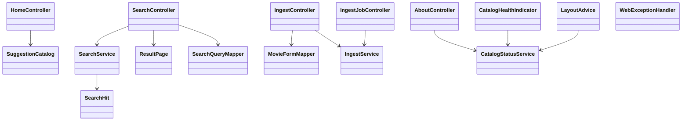
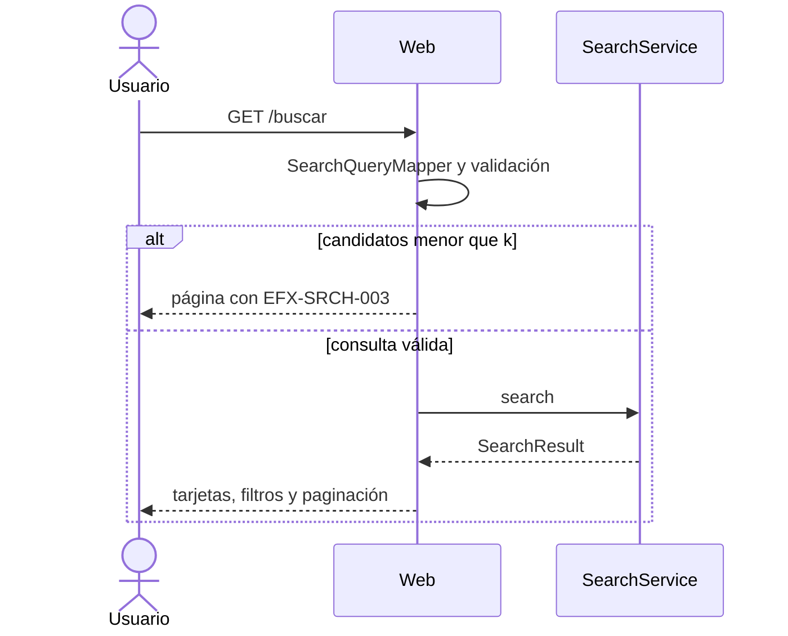
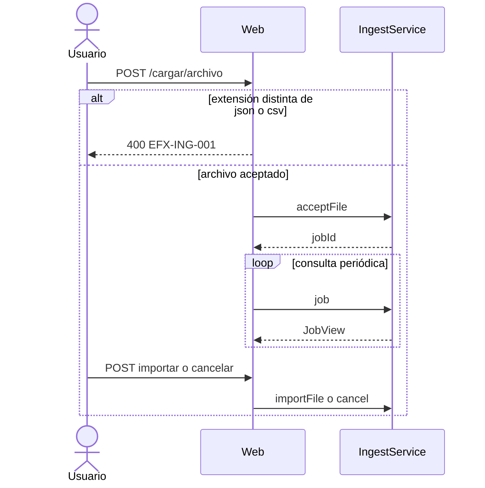

# Diseño — 4: Interfaz web

> Resultado de la tarea `4.0`. Se hace commit **antes** de escribir código de producción. Sigue
> `docs/convenciones-java.md`. El código de esta fase vive en `elastiflix-web`. El único cambio fuera
> de la web es ampliar `SearchHit` para que la tarjeta de resultados pueda mostrar duración, géneros,
> calificación y votos.

## Estado de aprobación

- **Requiere aprobación del usuario:** no (Fase 4, sin compuerta 🔒; `PLAN.md` §8)
- **Estado:** no requiere aprobación
- **Aprobación:** no aplica. El diseño se commitea y se implementa en la misma fase.

## Propósito

`elastiflix-web` sirve las cuatro páginas de los mockups con Thymeleaf y Spring MVC. Habla solo con
`CatalogStatusService`, `SearchService` e `IngestService`. No usa `co.elastic.clients`. Los pósters
salen del CDN de TMDB y la atribución va en el pie de todas las páginas y en «Acerca de» › «Créditos».

Los textos de los mockups se copian tal cual, salvo los ajustes de `PLAN.md` §1: los vectores siempre
se generan con inferencia, al publicar se borra el índice anterior, un CSV sin encabezado se rechaza y
las reglas de validación ya no piden vectores.

## Requerimientos cubiertos

| Tarea de `PLAN.md` | Referencia | Cómo la cubre este diseño |
|---|---|---|
| 4.1 | Layout, Actuator | `CatalogHealthIndicator`, fragmentos de cabecera y pie |
| 4.2 | `GET /` | `HomeController` y `SuggestionCatalog` |
| 4.3 | `GET /buscar` | `SearchController`, `SearchForm` y `SearchHit` ampliado |
| 4.4 | `GET /cargar` y §5 | `IngestController` e `IngestJobController` |
| 4.5 | `GET /acerca` | `AboutController` y el logo de TMDB |
| 4.6 | Errores | `WebExceptionHandler` |
| 4.7 | ArchUnit | se borra `archunit.properties` |
| 4.8 | Documentación | README, diseño y estado |

## Dudas y supuestos

No hay preguntas abiertas. Supuestos:

1. Las etiquetas de las sugerencias siguen fijas, como en `Main.dc.html`. Describen el catálogo de
   4 322 películas y no se recalculan.
2. Cada sugerencia es un enlace real a `/buscar` con los parámetros de su modo. El HTML incluye todos
   los conjuntos; un JavaScript mínimo muestra el que corresponde a los ajustes. Así MockMvc ve los
   `href` sin ejecutar el navegador.
3. La tarjeta necesita `runtime`, `genres`, `voteAverage`, `voteCount` y `rating`. `SearchHit` los
   gana en esta fase. `SearchService.hit` los copia de `Movie`. No cambia la consulta a Elasticsearch:
   esos campos ya vienen en `_source`.
4. `candidatos < k` se muestra en la propia página de resultados, con el código `EFX-SRCH-003` y el
   mensaje del catálogo. El `@ControllerAdvice` cubre el resto de `ElastiflixException`.
5. Un `.txt` se rechaza en el controlador, antes de crear un trabajo, con `FileChecker` y
   `EFX-ING-001`. La respuesta es JSON 400.
6. El indicador de salud se llama `elastiflixCatalog` porque el bean es
   `elastiflixCatalogHealthIndicator`. Lee `CatalogStatusService` y no escribe en el índice.
7. «Conectado · Elasticsearch Serverless» se muestra cuando `CatalogStatus.connected()` es verdadero.
   El pie usa el alias y el conteo reales, con espacio de millar (`4 322`).
8. Adultos en filtros: «Todos» (sin filtro) y «Solo no adultos» (`adult=false`), como el mockup.
9. Cambiar el tamaño de página o pulsar APLICAR pone `pagina=1` en la URL.
10. Las pruebas de la web simulan las fachadas. No escriben en `elastiflix-reloaded`. Arrancar la
    aplicación para ver las páginas solo lee el alias.

## Diagrama de clases

## Secuencia o flujo

La búsqueda y la carga de archivo tienen varios pasos. El registro individual es un redirect.

## Responsabilidades

| Clase | Responsabilidad en una frase | Contrato |
|---|---|---|
| `CatalogHealthIndicator` | Publica alias, índice y documentos en Actuator | `CatalogStatusService` |
| `LayoutAdvice` | Pone cabecera y pie en cada vista | `CatalogStatus` |
| `HomeController` | Muestra Inicio y los conjuntos de sugerencias | `GET /` |
| `SuggestionCatalog` | Arma los enlaces fijos del mockup | parámetros de §5 |
| `SearchController` | Ejecuta la búsqueda o muestra el error de validación | `SearchService` |
| `SearchForm` | Recoge los parámetros de la URL | §5 |
| `SearchQueryMapper` | Traduce la URL a `SearchQuery` | `SearchMode` |
| `ResultPage` | Prepara tarjetas, leyenda y enlaces de página | `SearchResult` |
| `IngestController` | Muestra Cargar datos y guarda un registro | `IngestService.saveOne` |
| `IngestJobController` | Sube, consulta, importa, cancela y descarga el CSV | endpoints de §5 |
| `MovieFormMapper` | Arma un `Movie` desde el formulario, sin vectores | `Movie` |
| `AboutController` | Muestra Acerca de con alias y conteo reales | `CatalogStatus` |
| `WebExceptionHandler` | Página con código `EFX-*` y un 404 con navegación | `ElastiflixException` |
| `SearchHit` | Añade duración, géneros, votos y clasificación | `Movie` |

## Plantillas y estáticos

| Plantilla | Ruta | Fragmentos |
|---|---|---|
| `fragments/chrome.html` | todas | franja, cabecera, pie con TMDB |
| `home.html` | `GET /` | caja, paneles y sugerencias |
| `results.html` | `GET /buscar` | tarjetas, filtros, vacíos, leyenda |
| `ingest.html` | `GET /cargar` | pestañas, formulario, proceso de 5 pasos |
| `about.html` | `GET /acerca` | secciones del mockup y Créditos |
| `error.html` | excepción | código y mensaje del catálogo |
| `not-found.html` | 404 | navegación a las cuatro páginas |

CSS en `static/css/elastiflix.css` con los tokens de `design/README.md` y las fuentes Bricolage
Grotesque, IBM Plex Sans e IBM Plex Mono. JavaScript mínimo en `static/js/`: mostrar el panel y el
conjunto de sugerencias, avisar «Tienes cambios sin aplicar», comprobar el archivo en el navegador y
consultar el trabajo de importación. No hay `Thread.sleep` en las pruebas: MockMvc llama a los
endpoints.

Pósters: `elastiflix.poster.base-url` + `poster_path`. Si falta la ruta, o la imagen no carga, se ve
el marcador del mockup y el `alt` es el título.

Logo de TMDB: se descarga sin modificar de
https://www.themoviedb.org/about/logos-attribution y se guarda en
`elastiflix-web/src/main/resources/static/img/tmdb/`. En Créditos es más pequeño que el logo de la demo.

## Ajustes de texto de §1

Se aplican en las plantillas y en los mockups `Ingest.dc.html` y `About.dc.html`. La frase
«Los vectores del archivo se usan tal cual» pasa a «Los vectores de la sinopsis se generan para cada
película con el servicio de inferencia de Elasticsearch.» Se quita la comprobación de vectores válidos.
Si el archivo trae columnas de vector, la advertencia la pone la carga (`EFX-ING-020`); la página la
muestra con el resto de advertencias. La fila de correspondencia de `plot_256`, `plot_512` y
`plot_1024` dice «Se ignora · se generará desde plot». El paso 5 dice que el índice anterior se borra.
Un CSV sin encabezado se rechaza. `design/README.md` deja de partir la tabla de mockups con esa nota.

## Patrones usados

| Patrón | Dónde | Por qué |
|---|---|---|
| Facade | los controladores llaman a `SearchService` e `IngestService` | la web no ve Elasticsearch |
| Adapter | `CatalogHealthIndicator` | Actuator habla el idioma de Spring y el estado el del catálogo |
| Factory | `SuggestionCatalog`, `SearchQueryMapper`, `MovieFormMapper` | arman objetos de vista o de dominio desde la petición |

No hay Strategy nuevo: los modos ya viven en `elastiflix-search`.

## Errores

No se crean códigos nuevos. La web muestra los que ya existen.

| Código | Cuándo ocurre | Qué ve la persona |
|---|---|---|
| `EFX-SRCH-001` | consulta vacía | el mensaje del catálogo, en Inicio (antes de enviar) y en Resultados |
| `EFX-SRCH-003` | `candidatos < k` | código y mensaje en Resultados |
| `EFX-ING-001` | archivo que no es `.json` ni `.csv` | JSON 400 con el código |
| otros `EFX-*` | `ElastiflixException` no capturada en la página | `error.html` |
| — | ruta desconocida | `not-found.html` con enlaces |

## Logging

| Nivel | Evento | Contexto |
|---|---|---|
| INFO | página de error | código `EFX-*`, sin la consulta completa si es muy larga |
| WARN | archivo rechazado en la subida | código y nombre del archivo, sin su contenido |
| DEBUG | no se registra el cuerpo del formulario ni vectores | — |

Las fachadas de búsqueda y carga ya registran su propio trabajo.

## Pruebas previstas

| Prueba | Comportamiento | Tipo |
|---|---|---|
| `CatalogHealthIndicatorTest` | `UP` con `alias`, `index` y `documents` | unitaria |
| `HomePageTest` | textos de Inicio y un `href` de cada modo hacia `/buscar` | MockMvc |
| `ResultsPageTest` | tres modos, dos vacíos y `EFX-SRCH-003` | MockMvc, `SearchService` simulado |
| `IngestPageTest` | validar, importar, estado, cancelar y un `.txt` con `EFX-ING-001` | MockMvc, `IngestService` simulado |
| `AboutPageTest` | secciones, tabla de precisión y Créditos | MockMvc |
| `ErrorPageTest` | `ElastiflixException` y una ruta inexistente | MockMvc |

`./mvnw verify` no abre la red. Arrancar la aplicación para mirar las páginas solo lee el alias.

## Alternativas descartadas

- Esperar aprobación del diseño. La Fase 4 no tiene compuerta; el plan pide commitear el diseño y seguir.
- Pedir a Elasticsearch los campos de la tarjeta en otra consulta. Ya vienen en la película del hit.
- Calcular las sugerencias contra el catálogo vivo. §1 las deja fijas.
- Dejar la frase de los vectores solo en la plantilla. El pendiente pide corregir también el mockup.

## Supresiones de la verificación automática

Ninguna prevista.

## Cambios respecto al diseño aprobado

- `SearchQueryMapper` valida la consulta antes de llamar a `SearchService`. Así un error como
  `candidatos < k` se ve en Resultados aunque la prueba simule la fachada.
- Una fecha que no se puede leer se trata como ausente. No se creó un código nuevo.
- Un archivo que no es `.json` ni `.csv` responde JSON 400 en el acto, antes de crear el trabajo.
- `ResultPage` del diseño se llama `ResultsPage`. `MovieFormMapper` se llama `MovieForms`.
- `PageShell` también lleva el alias, la frase del conteo y la atribución de TMDB en español.
  Acerca de los lee de ahí, así no se consulta el catálogo dos veces.
- Además de `WebExceptionHandler` hay `ErrorPageController`: el servidor reenvía `/error` cuando
  la ruta no existe. La cabecera de esas páginas se arma en el manejador, porque Spring no aplica
  el `@ModelAttribute` del layout cuando la petición ya falló.
- El logo de Créditos es el SVG «Alt short (blue)» de la página de atribución de TMDB, sin modificar.
