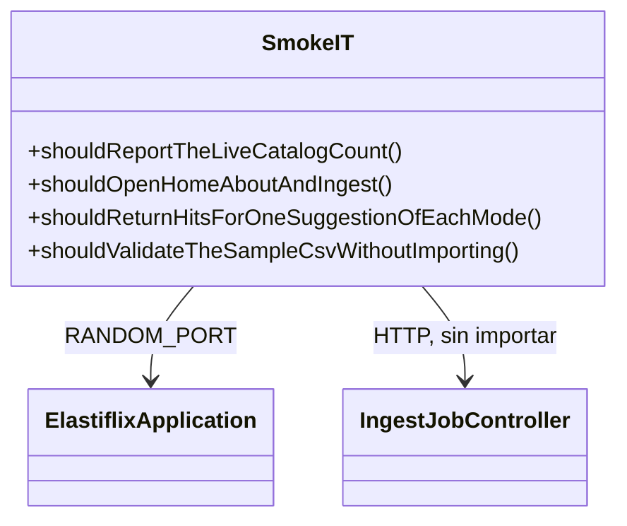
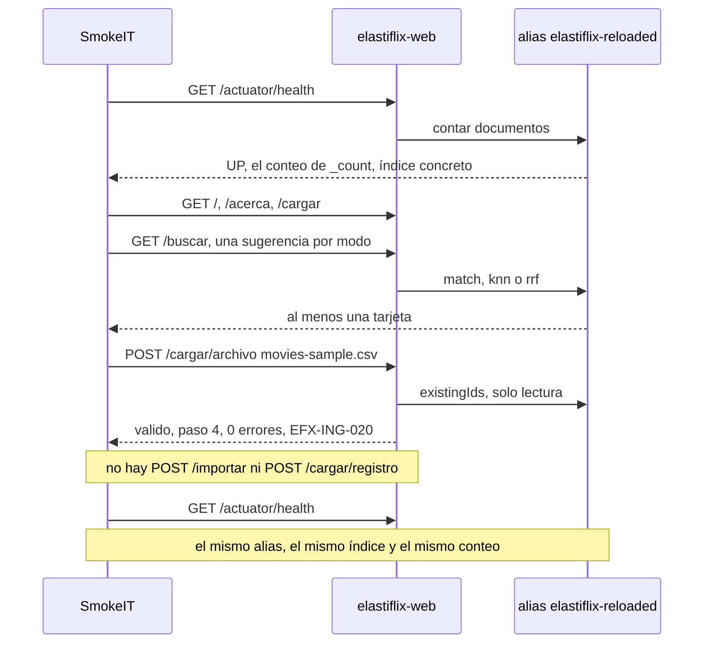

# Diseño — 5: Pruebas integrales y smoke test

> Resultado de la tarea `5.0`. Se hace commit **antes** de escribir código. Sigue
> `docs/convenciones-java.md`. Esta fase no agrega clases de producción: agrega `SmokeIT` y la tabla
> de cobertura. No cambia la interfaz aprobada en la Fase 4.

## Estado de aprobación

- **Requiere aprobación del usuario:** no (Fase 5, sin compuerta 🔒; `PLAN.md` §8)
- **Estado:** no requiere aprobación
- **Aprobación:** no aplica. El diseño se commitea y se implementa en la misma fase.

## Propósito

> Nota del 2026-10-18: el alias pasó a `elastiflix-reloaded-20261018-054429` con 6 899 documentos.
> `SmokeIT` ya no afirma 4 322. Lee `_count`, exige que sea mayor que cero y compara alias, índice
> y conteo antes y después de validar el CSV.

Demostrar, contra el clúster real, que la aplicación arranca, lee el catálogo,
sirve las tres páginas principales, responde una sugerencia de cada modo y deja un CSV de muestra
validado, con cero errores y la advertencia de vectores ignorados. El smoke **no importa** ese archivo
y **no** guarda un registro individual. No crea alias, no publica y no borra índices.

## Requerimientos cubiertos

| Tarea de `PLAN.md` | Referencia | Cómo la cubre este diseño |
|---|---|---|
| 5.1 | Smoke de punta a punta | `SmokeIT` con `RANDOM_PORT` y perfil Maven `it` |
| 5.2 | §1 y §6 | Tabla en `progreso/5.md`. Si falta una prueba, se agrega una de solo lectura |
| 5.3 | Documentación | README con la fila de la Fase 5, insignia `fases-6/7` y el comando que haya salido en verde |

## Dudas y supuestos

No hay preguntas abiertas. Supuestos:

1. **El catálogo real solo se lee.** `SmokeIT` usa el alias configurado (`elastiflix-reloaded`).
   Antes y después de la subida compara `alias`, `index` y `documents` de
   `GET /actuator/health`. Tienen que seguir iguales. El conteo es el de `_count` y es mayor que cero.
2. **La validación no escribe.** `FileIntake` pregunta `existingIds` para contar reemplazos. Esa
   lectura está permitida. El diseño de la Fase 3 ya la separó de la importación.
3. **No se llama a importar ni a guardar un registro.** El smoke no hace `POST
   /cargar/trabajos/{id}/importar` ni `POST /cargar/registro`. Esos dos caminos escriben: el primero
   publica el alias y borra el índice anterior; el segundo indexa directo en el alias. El plan dice
   «(no importa)», así que esa parada no se dispara.
4. **Un archivo válido deja el paso 4.** `SmokeIT` afirma `valido`, `step` 4, 0 errores y
   `EFX-ING-020`, y afirma que el estado no pasa a `importando` ni a `publicado`. No llama a importar.
5. **El CSV de muestra trae encabezado y tres columnas de vector.** La subida manda
   `encabezado=true` y `separador=,`. Si no, el controlador toma la casilla como desmarcada y rechaza
   el archivo. Se esperan 4 películas, 0 errores y una advertencia `EFX-ING-020` por cada una de
   `plot_256`, `plot_512` y `plot_1024`.
6. **Una sugerencia por modo, tomada de Inicio.** Full-text: `dark knight` con `match` sobre `title`
   y OR. Vectorial: la descripción del iceberg sobre `plot_1024`, `k` 100 y 200 candidatos. Híbrida:
   `toy story juguetes que cobran vida` con `match` sobre `title`, AND, `plot_256`, `k` 100 y 200
   candidatos. Esas tres están en `GET /`. «Devuelve resultados» significa HTTP 200 y al menos una
   tarjeta `class="hit"`.
7. **La espera es por condición.** La validación corre en un hilo virtual. El smoke consulta el
   trabajo hasta que el estado deja de ser `recibido` o `validando`, con un límite de 60 segundos.
   Usa `LockSupport.parkNanos`, igual que `IngestIT`. No usa `Thread.sleep`.
8. **No hace falta un alias `elastiflix-it-*` en esta fase.** Nada de lo previsto escribe. Si la
   tabla de cobertura descubriera un hueco que solo se cierra escribiendo, esa prueba usaría un alias
   propio y lo borraría al terminar. No se escribe en `elastiflix-reloaded`.
9. **`elastiflix.bootstrap.enabled` sigue en `false`.** El smoke no migra el catálogo.

## Diagrama de clases

No hay clases de producción nuevas.

## Secuencia o flujo

## Responsabilidades

| Clase | Responsabilidad en una frase | Contrato |
|---|---|---|
| `SmokeIT` | Recorre salud, páginas, una búsqueda por modo y la validación del CSV de muestra | HTTP de la aplicación ya construida |

## Patrones usados

No se agregan patrones. El smoke habla con la aplicación por HTTP, que ya usa las fachadas
`SearchService` e `IngestService`.

## Errores

No hay códigos nuevos. El smoke observa los que ya existen:

| Código | Cuándo lo vería el smoke | Qué haría la prueba |
|---|---|---|
| `EFX-ING-020` | El CSV trae columnas de vector | Tiene que aparecer, una por columna |
| `EFX-ING-001` y siguientes | El archivo no pasara la validación | La prueba falla: el fixture válido no debe producirlos |

## Logging

El smoke no escribe logs propios. No imprime la respuesta de salud ni el cuerpo de las páginas si
fallara de un modo que pudiera incluir una clave. Los logs de la aplicación siguen la guía: nombre
de archivo y códigos, sin API key, sin vectores y sin el contenido del CSV.

## Pruebas previstas

| Prueba | Comportamiento | Tipo |
|---|---|---|
| `shouldReportTheLiveCatalogCount` | `GET /actuator/health` está `UP` y `elastiflixCatalog` coincide con `_count`, mayor que cero | integración |
| `shouldOpenHomeAboutAndIngest` | `/`, `/acerca` y `/cargar` responden 200 con un texto propio de cada página | integración |
| `shouldReturnHitsForOneSuggestionOfEachMode` | Cada sugerencia está en Inicio y su `/buscar` trae al menos un resultado | integración |
| `shouldValidateTheSampleCsvWithoutImporting` | El CSV queda `valido`, paso 4, 0 errores, advertencia de vectores, y el catálogo no cambia | integración |
| Tabla de `progreso/5.md` | Cada fila de §1 y de §6 nombra la prueba que ya la cubre | revisión |

## Alternativas descartadas

- **Importar el CSV de muestra en el catálogo real.** Publicaría el alias y borraría el índice
  anterior. El plan dice que no se importa, y el usuario pidió detenerse si el smoke tuviera que
  escribir ahí. No se hace.
- **Repetir la importación sobre `elastiflix-it-*` dentro del smoke.** `IngestIT` ya importa, publica
  y borra un alias propio. Repetirlo desde HTTP no agrega cobertura y alargaría la inferencia.
- **Cambiar `JobView` para que diga «listo para empezar».** La interfaz de la Fase 4 ya está aprobada.
  El smoke comprueba el estado real (`valido`, paso 4).
- **AssertJ sobre un navegador.** El criterio de la tarea es HTTP con `@SpringBootTest`.

## Supresiones de la verificación automática

Ninguna.

## Cambios respecto al diseño aprobado

- `SmokeIT` habla por `RestClient` con el puerto aleatorio. El diseño nombraba el cliente HTTP sin
  fijar la clase. El contrato es el mismo: `RANDOM_PORT` y las rutas de la tarea 5.1.
- La revisión de cobertura encontró que 50 y 100 se rechazaban como tamaño inválido solo de forma
  indirecta. Se agregaron pruebas unitarias en `PaginatorTest`, `SearchQueryValidatorTest` y
  `ResultsPageTest`. No hay código de producción nuevo.
- No se llamó a importar ni a guardar un registro. El catálogo real no se modificó.
- Revisión 1, R-04: el smoke afirma el paso 4, no el paso 3. Un archivo válido queda «listo para empezar».
