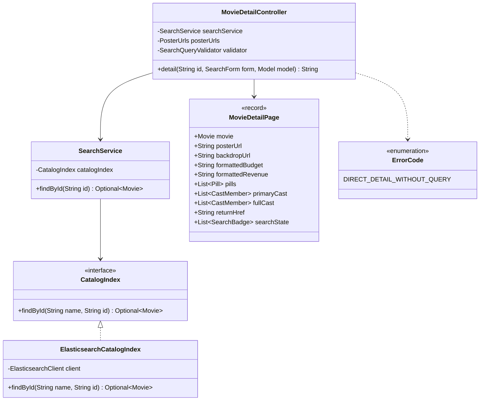
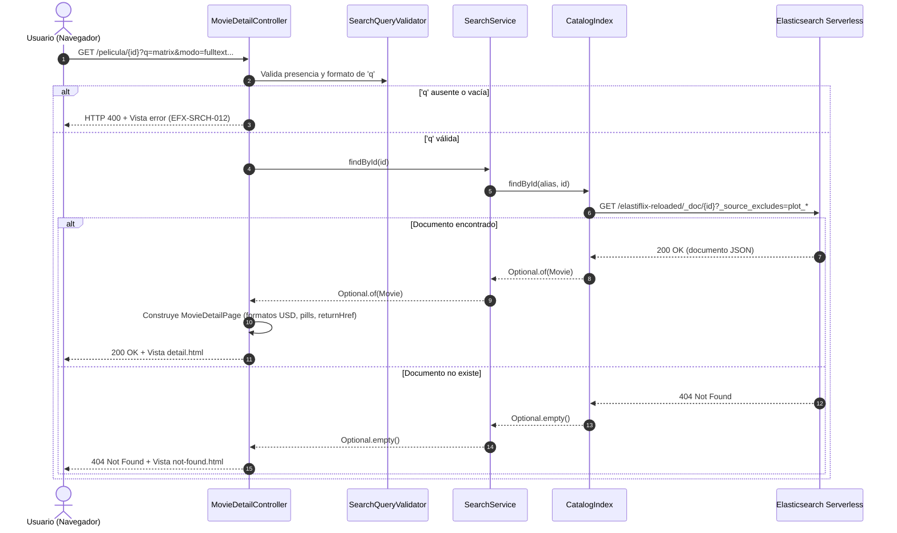

# Diseño — 7: Detalle de película (`GET /pelicula/{id}`)

> Resultado de la tarea 7.0 (Requerimiento 1). Se hace commit **antes** de escribir código de producción. Sigue `docs/convenciones-java.md`.

## Estado de aprobación

- **Requiere aprobación del usuario:** Sí (aprobación de diseño antes de codificar la fase).
- **Estado:** aprobado
- **Aprobación:** Adolfo Orozco aprobó `docs/diseno/7.md` el 2026-10-19 20:29 UTC («Apruebo el diseño de docs/diseno/7.md tal cual para proceder con la implementación de las tareas 7.1 a 7.6»).

## Propósito

Implementar la pantalla y el servicio de ficha técnica de película (`GET /pelicula/{id}`), consultando el documento por el alias activo `elastiflix-reloaded` en Elasticsearch Serverless con exclusión de los vectores pesados (`plot_256`, `plot_512`, `plot_1024`). Permite regresar a los resultados de búsqueda preservando de forma bidireccional los filtros y parámetros aplicados, y protege contra accesos directos sin contexto de consulta devolviendo un error controlado `EFX-SRCH-012`.

## Requerimientos cubiertos

| Tarea / Requerimiento | Referencia en modelo o contrato | Cómo la cubre este diseño |
|---|---|---|
| **Lectura por ID sin vectores** | `PLAN.md` Requerimiento 1, §6 | `CatalogIndex.findById(alias, id)` invoca el endpoint `GET <alias>/_doc/{id}` con `_source_excludes=plot_256,plot_512,plot_1024`. Jackson deserializa en `Movie`. |
| **Ficha completa y metadatos** | `Detail.dc.html` | El modelo de vista `MovieDetailPage` descompone los 30 campos no vectoriales en secciones: cabecera (backdrop, póster 260x390, títulos, tagline, píldoras), panel izquierdo (ficha técnica, productoras, países, idiomas hablados, finanzas en USD o «N/A», colección) y panel derecho (sinopsis, reparto con toggle a partir de 18, palabras clave). |
| **Cifras financieras (USD / N/A)** | Decisión Adolfo 2026-10-19 | Montos de `budget` y `revenue` vacíos, nulos o iguales a 0 se formatean como `N/A`. Montos positivos se formatean con separador de miles («160 000 000 USD»). |
| **Retorno a resultados preservado** | `Detail.dc.html`, `PLAN.md` §5 | El controlador recibe los parámetros de búsqueda (`SearchForm`) y genera `returnHref` con `/buscar?<query_string>#r-<id>`, más la lista de etiquetas activas (`searchState`) para la barra superior e inferior. |
| **Enlace desde Resultados** | `results.html` | Se agrega `id` y `detailHref` a `ResultCard`. El título `<h3>` en la tarjeta de resultados enlaza a `/pelicula/{id}?<query_string>`. |
| **Acceso directo sin consulta** | Decisión Adolfo 2026-10-19 | Si se invoca `GET /pelicula/{id}` sin el parámetro `q` o con una consulta vacía/inválida, se intercepta antes de llamar a Elasticsearch y se responde error controlado con `EFX-SRCH-012` y código HTTP 400. |
| **Película no encontrada (404)** | Convenciones y `PLAN.md` | Si `findById` devuelve `Optional.empty()`, el controlador responde la vista `not-found` con código HTTP 404. |

## Dudas y supuestos

- **Supuesto 1 (Código de error para acceso directo sin búsqueda):** Se crea el código `EFX-SRCH-012` en `ErrorCode` con texto: «Para ver el detalle de una película debes buscarla primero · Se accedió directamente a la ficha sin una consulta de búsqueda activa · Vuelve a la página de Inicio y realiza una búsqueda». HTTP status 400 (Bad Request).
- **Supuesto 2 (Exclusión de vectores):** El mapping define `plot_256`, `plot_512` y `plot_1024`. La exclusión en `_source_excludes` reduce drásticamente el payload de red transferido desde Elasticsearch Serverless, dejando esos campos en `null` en el record inmutable `Movie`.
- **Supuesto 3 (Reparto expandible):** Si el reparto supera 18 integrantes, se muestran inicialmente los primeros 18 y un botón interactivo («Ver todo el reparto (N)») que revela el resto mediante CSS/JS sin recargar la página.

## Diagrama de clases

## Secuencia o flujo

## Responsabilidades

| Clase | Responsabilidad | Contrato |
|---|---|---|
| `CatalogIndex` | Agrega `findById(String name, String id)` para obtener un documento por alias sin vectores. | Modifica interfaz en `elastiflix-core`. |
| `ElasticsearchCatalogIndex` | Implementa `findById` invocando la API `GetRequest` del cliente ES con filtro de exclusión de fuentes. | Implementa `CatalogIndex`. |
| `SearchService` | Fachada que delega la búsqueda de la película por ID al catálogo activo. | Servicio en `elastiflix-search`. |
| `MovieDetailController` | Valida la procedencia de búsqueda, coordina la llamada al servicio y expone el modelo `detail`. | Controlador Spring MVC en `elastiflix-web`. |
| `MovieDetailPage` | Record auxiliar que formatea datos de presentación (monedas USD, fechas, URLs TMDB, anclas de regreso). | Modelo en `elastiflix-web`. |
| `ResultCards` / `ResultCard` | Incorpora `id` y `detailHref` a la tarjeta para que el título enlace al detalle. | Modifica componentes en `elastiflix-web`. |

## Patrones usados

| Patrón | Dónde | Por qué aporta claridad |
|---|---|---|
| **Facade** | `SearchService` | La capa web solo interactúa con la fachada de búsqueda y no con el cliente directo de Elasticsearch. |
| **Gateway / Adapter** | `CatalogIndex` / `ElasticsearchCatalogIndex` | Aísla la API REST de Elasticsearch (`GetRequest`, exclusiones) del resto del dominio. |
| **View Helper / ViewModel** | `MovieDetailPage` | Evita lógica compleja de formato (números en USD, «N/A», arrays de póster) en las plantillas Thymeleaf. |

## Errores

| Código | Cuándo ocurre | Causa probable | Acción sugerida |
|---|---|---|---|
| `EFX-SRCH-012` | Se accede a `GET /pelicula/{id}` sin parámetro `q` o con `q` en blanco. | El usuario abrió el enlace directo o borró los parámetros de la URL. | Vuelve a la página de Inicio y realiza una búsqueda antes de ver el detalle. |
| `404 Not Found` | El ID solicitado no existe en el índice de Elasticsearch. | El ID fue modificado en la barra de direcciones o la película fue purgada del catálogo. | Vuelve a los resultados o busca otra película. |
| `EFX-ES-001` | El clúster de Elasticsearch Serverless no responde o hay fallo de red. | Desconexión o corte de red. | Verifica credenciales en `.env` y reintenta. |

## Logging

| Nivel | Evento | Contexto incluido |
|---|---|---|
| `DEBUG` | Acceso a detalle de película exitoso | `id`, título, tiempo de consulta |
| `WARN` | Acceso directo sin consulta de búsqueda | `id`, parámetros recibidos, código `EFX-SRCH-012` |
| `WARN` | Película no encontrada | `id` solicitado |
| `ERROR` | Fallo de comunicación con Elasticsearch al leer película | `id`, código EFX y causa raíz |
