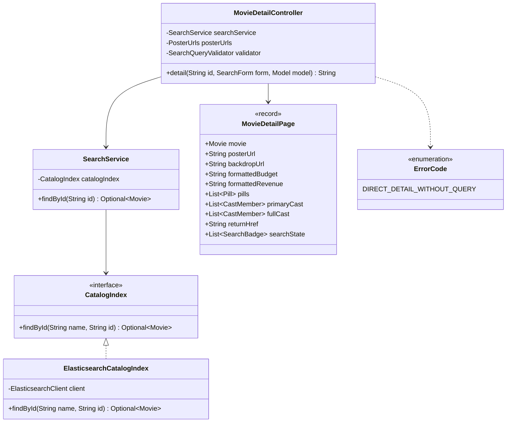
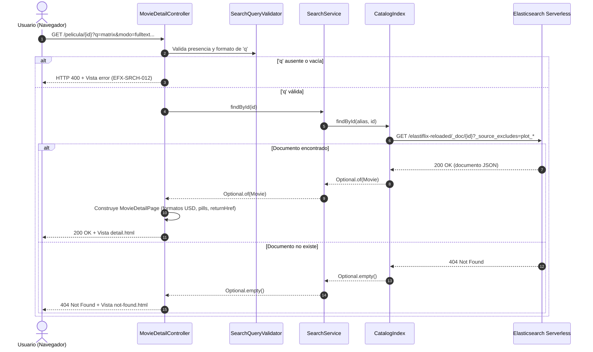

# Diseño — 7: Detalle de película (`GET /pelicula/{id}`)

> Resultado de la tarea 7.0 (Requerimiento 1). Se hace commit **antes** de escribir código de producción. Sigue `docs/convenciones-java.md`.

## Estado de aprobación

- **Requiere aprobación del usuario:** Sí (aprobación de diseño antes de codificar la fase).
- **Estado:** aprobado
- **Aprobación:** Adolfo Orozco aprobó `docs/diseno/7.md` el 2026-10-19 20:29 UTC («Apruebo el diseño de docs/diseno/7.md tal cual para proceder con la implementación de las tareas 7.1 a 7.6»).

## Propósito

Implementar la pantalla y el servicio de ficha técnica de película (`GET /pelicula/{id}`), consultando el documento por el alias activo `elastiflix-reloaded` en Elasticsearch Serverless con exclusión de los vectores pesados (`plot_256`, `plot_512`, `plot_1024`). Permite regresar a los resultados de búsqueda preservando de forma bidireccional los filtros y parámetros aplicados, y protege contra accesos directos sin contexto de consulta devolviendo un error controlado `EFX-SRCH-012`.

## Requerimientos cubiertos

| Tarea / Requerimiento | Referencia en modelo o contrato | Cómo la cubre este diseño |
|---|---|---|
| **Lectura por ID sin vectores** | `PLAN.md` Requerimiento 1, §6 | `CatalogIndex.findById(alias, id)` invoca el endpoint `GET <alias>/_doc/{id}` con `_source_excludes=plot_256,plot_512,plot_1024`. Jackson deserializa en `Movie`. |
| **Ficha completa y metadatos** | `Detail.dc.html` | El modelo de vista `MovieDetailPage` descompone los 30 campos no vectoriales en secciones: cabecera (backdrop, póster 260x390, títulos, tagline, píldoras), panel izquierdo (ficha técnica, productoras, países, idiomas hablados, finanzas en USD o «N/A», colección) y panel derecho (sinopsis, reparto con toggle a partir de 18, palabras clave). |
| **Cifras financieras (USD / N/A)** | Decisión Adolfo 2026-10-19 | Montos de `budget` y `revenue` vacíos, nulos o iguales a 0 se formatean como `N/A`. Montos positivos se formatean con separador de miles («160 000 000 USD»). |
| **Retorno a resultados preservado** | `Detail.dc.html`, `PLAN.md` §5 | El controlador recibe los parámetros de búsqueda (`SearchForm`) y genera `returnHref` con `/buscar?<query_string>#r-<id>`, más la lista de etiquetas activas (`searchState`) para la barra superior e inferior. |
| **Enlace desde Resultados** | `results.html` | Se agrega `id` y `detailHref` a `ResultCard`. El título `<h3>` en la tarjeta de resultados enlaza a `/pelicula/{id}?<query_string>`. |
| **Acceso directo sin consulta** | Decisión Adolfo 2026-10-19 | Si se invoca `GET /pelicula/{id}` sin el parámetro `q` o con una consulta vacía/inválida, se intercepta antes de llamar a Elasticsearch y se responde error controlado con `EFX-SRCH-012` y código HTTP 400. |
| **Película no encontrada (404)** | Convenciones y `PLAN.md` | Si `findById` devuelve `Optional.empty()`, el controlador responde la vista `not-found` con código HTTP 404. |

## Dudas y supuestos

- **Supuesto 1 (Código de error para acceso directo sin búsqueda):** Se crea el código `EFX-SRCH-012` en `ErrorCode`. HTTP status 400 (Bad Request). Texto vigente (revisión 4, U-07, 2026-10-21; Adolfo pidió un texto «acorde al objetivo»): «Tu búsqueda falló y la ficha de la película no se puede abrir · El enlace no trae una búsqueda válida: falta la consulta o algún ajuste no es válido · Vuelve a Inicio, busca la película y ábrela desde los resultados», y en inglés «Your search failed, so the movie details can't be opened · The link doesn't include a valid search: the query is missing or a setting is invalid · Go back to Home, search for the movie and open it from the results». El texto de este supuesto, aprobado en 7.0, no llegó al código; la fase 7 usó otro sin registrarlo.
- **Supuesto 2 (Exclusión de vectores):** El mapping define `plot_256`, `plot_512` y `plot_1024`. La exclusión en `_source_excludes` reduce drásticamente el payload de red transferido desde Elasticsearch Serverless, dejando esos campos en `null` en el record inmutable `Movie`.
- **Supuesto 3 (Reparto expandible):** Si el reparto supera 18 integrantes, se muestran inicialmente los primeros 18 y un botón interactivo («Ver todo el reparto (N)») que revela el resto mediante CSS/JS sin recargar la página.

## Diagrama de clases

## Secuencia o flujo

## Responsabilidades

| Clase | Responsabilidad | Contrato |
|---|---|---|
| `CatalogIndex` | Agrega `findById(String name, String id)` para obtener un documento por alias sin vectores. | Modifica interfaz en `elastiflix-core`. |
| `ElasticsearchCatalogIndex` | Implementa `findById` invocando la API `GetRequest` del cliente ES con filtro de exclusión de fuentes. | Implementa `CatalogIndex`. |
| `SearchService` | Fachada que delega la búsqueda de la película por ID al catálogo activo. | Servicio en `elastiflix-search`. |
| `MovieDetailController` | Valida la procedencia de búsqueda, coordina la llamada al servicio y expone el modelo `detail`. | Controlador Spring MVC en `elastiflix-web`. |
| `MovieDetailPage` | Record auxiliar que formatea datos de presentación (monedas USD, fechas, URLs TMDB, anclas de regreso). | Modelo en `elastiflix-web`. |
| `ResultCards` / `ResultCard` | Incorpora `id` y `detailHref` a la tarjeta para que el título enlace al detalle. | Modifica componentes en `elastiflix-web`. |

## Patrones usados

| Patrón | Dónde | Por qué aporta claridad |
|---|---|---|
| **Facade** | `SearchService` | La capa web solo interactúa con la fachada de búsqueda y no con el cliente directo de Elasticsearch. |
| **Gateway / Adapter** | `CatalogIndex` / `ElasticsearchCatalogIndex` | Aísla la API REST de Elasticsearch (`GetRequest`, exclusiones) del resto del dominio. |
| **View Helper / ViewModel** | `MovieDetailPage` | Evita lógica compleja de formato (números en USD, «N/A», arrays de póster) en las plantillas Thymeleaf. |

> **Desviación sin aprobar (revisión 4, U-38):** «View Helper / ViewModel» no está en la lista cerrada de patrones
> (`docs/convenciones-java.md` §4 y `AGENTS.md` › «Reglas de código», punto 4). Usar otro patrón exige justificarlo
> en el diseño y que el usuario lo apruebe. Adolfo aprobó este diseño «tal cual», pero ni la tabla ni la fase 7
> señalaron que el patrón estaba fuera de la lista, así que no hay una aprobación explícita de la desviación.
> Justificación que habría que someter: las páginas de la fase 4 ya arman sus modelos de vista en clases de
> `elastiflix-web` (`ResultsPage`, `ResultCards`) y `MovieDetailPage` sigue esa costumbre; es un `@Component` que
> convierte un `Movie` en un `record` con los textos listos para la plantilla, sin lógica de negocio. **Pendiente de
> la decisión de Adolfo.**

## Errores

| Código | Cuándo ocurre | Causa probable | Acción sugerida |
|---|---|---|---|
| `EFX-SRCH-012` | Se accede a `GET /pelicula/{id}` sin parámetro `q`, con `q` en blanco o con parámetros que `/buscar` rechazaría. | El enlace no trae una búsqueda válida: falta la consulta o algún ajuste no es válido. | Vuelve a Inicio, busca la película y ábrela desde los resultados. |
| `404 Not Found` | El ID solicitado no existe en el índice de Elasticsearch. | El ID fue modificado en la barra de direcciones o la película fue purgada del catálogo. | Vuelve a los resultados o busca otra película. |
| `EFX-ES-001` | El clúster de Elasticsearch Serverless no responde o hay fallo de red. | Desconexión o corte de red. | Verifica credenciales en `.env` y reintenta. |

## Logging

| Nivel | Evento | Contexto incluido |
|---|---|---|
| `DEBUG` | Acceso a detalle de película exitoso | `id`, título, tiempo de consulta |
| `WARN` | Acceso directo sin consulta de búsqueda | `id`, parámetros recibidos, código `EFX-SRCH-012` |
| `WARN` | Película no encontrada | `id` solicitado |
| `ERROR` | Fallo de comunicación con Elasticsearch al leer película | `id`, código EFX y causa raíz |

## Pruebas previstas

> El diseño aprobado no traía esta sección. Se completa en la revisión 4 (U-38) con las pruebas que escribió la
> fase 7; no es un plan previo a la implementación.

| Prueba | Comportamiento que verifica | Tipo |
|---|---|---|
| `ElasticsearchCatalogIndexTest` (4 de `findById`) | Pide el documento sin los tres vectores; vacío si no existe, si el `id` está en blanco o si Elasticsearch responde 404 | Unitaria |
| `SearchServiceTest` (2 de `findById`) | La fachada devuelve la película o vacío | Unitaria |
| `MovieDetailControllerTest` (5) | 400 con `EFX-SRCH-012` sin `q`, con `q` en blanco y con parámetros inválidos; 404 si no existe; 200 con la ficha | Unitaria (MockMvc) |
| `MovieDetailPageTest` (4) | USD o «N/A», campos vacíos, estado de la búsqueda y enlace de regreso, colección | Unitaria |
| `ResultsPageTest` | El título de la tarjeta enlaza al detalle con la búsqueda y la tarjeta lleva el ancla `r-<id>` | Unitaria (MockMvc) |
| `CatalogIndexIT#shouldFindMovieByIdExcludingVectors` | Lectura real por id, sin vectores, de un índice propio de la prueba que se borra al terminar | Integración (`-Pit`) |

## Alternativas descartadas

La fase 7 no registró alternativas, y no hay registro en git ni en `progreso/7.md` de cuáles se consideraron.
Se deja constancia en la revisión 4 (U-38).

## Supresiones de la verificación automática

Ninguna de Checkstyle ni de PMD. La fase 7 agregó tres `@SuppressWarnings("unchecked")` en las pruebas de
`findById` de `ElasticsearchCatalogIndexTest`, con el comentario de siempre (Mockito entrega la función del cliente
sin el tipo genérico), como las que registra `docs/diseno/1.md`. Son solo de pruebas. La fase no las registró
aquí; se registran en la revisión 4 (U-38).

## Cambios respecto al diseño aprobado

> La fase 7 no completó esta sección. La completa la revisión 4 (U-38) comparando el diseño aprobado en `ed7df57`
> con el código fusionado en `2902be7`.

| Qué cambió | Por qué |
|---|---|
| **Texto de `EFX-SRCH-012`.** El supuesto 1 aprobado decía «Para ver el detalle de una película debes buscarla primero · Se accedió directamente a la ficha sin una consulta de búsqueda activa · Vuelve a la página de Inicio y realiza una búsqueda», y la tabla «Errores» tenía otra causa y otra acción. La fase 7 escribió en `ErrorCode` «La consulta de búsqueda no es válida o está ausente · Se intentó acceder al detalle de una película sin una búsqueda previa · Realiza una búsqueda desde la página de inicio antes de consultar el detalle de una película» | La fase no lo registró. En la revisión 4 (U-07, `f70be66`) Adolfo pidió un texto «acorde al objetivo»: el vigente es el del supuesto 1, en `ErrorCode`, los dos catálogos y la tabla «Errores» |
| **Ocho clases que el diseño no prevé:** `MovieDetailView`, `MovieDetailTables`, `MovieDetailBadges`, `MovieDetailSearchChips`, `FactRow`, `DetailPill`, `GenreBadge` y `SearchStateChip` | Según `progreso/7.md`, para dar una responsabilidad a cada clase y no pasar los límites de Checkstyle y PMD (`GodClass`, `TooManyMethods`, `MethodLength`). La revisión 4 agregó `ExternalLinks` (U-03: `homepage` solo con `http` o `https`) |
| **`MovieDetailPage` no es un `record`:** es un `@Component` con `PosterUrls` que arma `MovieDetailView`, un `record` de **29 componentes** con los textos ya formateados y las listas de filas | No se registró. Las convenciones (§5) admiten hasta 35 componentes, pero dicen que solo el documento de película se acerca a ese tope |
| **El controlador** recibe `SearchQueryMapper` y crea su propio `SearchQueryValidator`; `PosterUrls` está en `MovieDetailPage`, no en el controlador. Los enlaces de ida y de regreso (`/pelicula/{id}?…` y `/buscar?…#r-<id>`) los arma `SearchLinks`, no el controlador | No se registró. La validación doble y el `null` de `validForm` son el punto U-10 de la revisión 4 |
| **Logging:** «película no encontrada» se registra en `INFO`, no en `WARN`; no hay `DEBUG` del acceso exitoso; los dos `WARN` de acceso sin búsqueda llevan el código y el `id`, sin los parámetros recibidos; el `ERROR` de Elasticsearch lo escribe `ElasticsearchCatalogIndex` (código, alias y tipo de error, sin el `id`) | No se registró. Que el `WARN` no copie los parámetros evita llevar la consulta de la persona a los logs |
| **`CatalogRequests.sources`**, un método nuevo de `elastiflix-core` que la fase agregó junto a `findById` | No se registró |
| **Un 404 de Elasticsearch** (por ejemplo, alias inexistente) se trata como «película no encontrada», como dibuja la secuencia | Es lo que dice el diseño, pero oculta errores reales: lo revisa el punto U-06 de la revisión 4 |

Los demás puntos de la revisión 4 sobre el detalle (U-04, U-05, U-06, U-08, U-09 y U-10) se registran aquí cuando
se integren.
