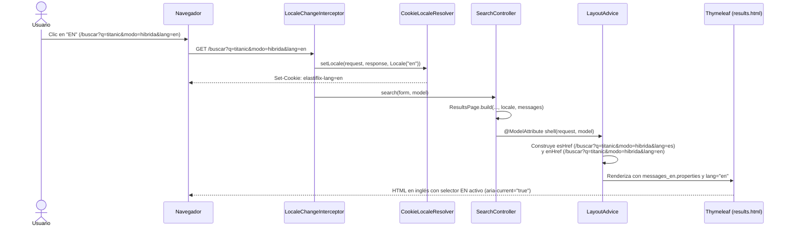

# Diseño — Fase 8: Interfaz en español e inglés (i18n)

## 1. Objetivo y alcance

Esta fase implementa el **Requerimiento 2** de `PLAN.md`: ofrecer toda la interfaz web de **Elastiflix-Movies Java** en **español (`es`)** e **inglés (`en`)**, siguiendo los mockups aprobados (`Main-en.dc.html`, `Results-en.dc.html`, `Detail-en.dc.html`, `Ingest-en.dc.html` y `About-en.dc.html`) y el glosario oficial `docs/i18n/glosario-en.md`.

### Reglas principales

1. **Idioma por defecto y resolución:**
   - El idioma inicial es siempre **español (`es`)**, ignorando la cabecera `Accept-Language` del navegador.
   - El cambio de idioma se realiza mediante el parámetro de consulta `lang` (`es` o `en`) en cualquier ruta (`GET /`, `/buscar`, `/pelicula/{id}`, `/cargar`, `/acerca`).
   - La elección se recuerda en una cookie HTTP (`elastiflix-lang`) mediante `CookieLocaleResolver` y `LocaleChangeInterceptor`.
   - Cualquier valor de `lang` distinto de `es` o `en` se ignora y conserva el idioma actual.
2. **Selector de idioma en la cabecera (`chrome.html`):**
   - Cada página incluye en `.site-header` un `<nav class="lang-switch" aria-label="Idioma|Language">` con dos enlaces (`ES` y `EN`), atributos `lang`, `hreflang`, `title` (`Español` / `English`), texto oculto accesible (`.visually-hidden`) y `aria-current="true"` en el idioma activo.
   - Ambos enlaces apuntan a la **misma ruta y conservan todos los parámetros de la URL actual**, reemplazando únicamente `lang=es` o `lang=en`.
3. **Catálogo de mensajes y cero textos fijos en plantillas o JS:**
   - Todos los textos de interfaz viven en `messages_es.properties` y `messages_en.properties` (UTF-8) en `elastiflix-web`.
   - El texto en español no cambia ni una tilde respecto a lo publicado.
   - Los cuatro scripts (`home.js`, `results.js`, `detail.js`, `ingest.js`) no contienen literales en español: leen sus textos desde atributos `data-*` renderizados por Thymeleaf o desde las respuestas JSON del servidor.
4. **Códigos `EFX-*` y logs:**
   - `ErrorCode` conserva sus textos en español para los logs (`SLF4J`).
   - La capa web resuelve `error.<CÓDIGO>.summary`, `error.<CÓDIGO>.cause` y `error.<CÓDIGO>.action` según el `Locale` activo.
5. **Formatos numéricos por idioma:**
   - Miles con espacio en español (`6 899`, `160 000 000 USD`) y con coma en inglés (`6,899`, `160,000,000 USD`).
   - Punto decimal en ambos idiomas (`0.774`, `8.4`, `107.3 MB`).
   - Fechas en formato ISO `yyyy-MM-dd` en ambos idiomas.

---

## 2. Arquitectura y componentes

### Diagrama de clases (Mermaid)

> **Revisión 4 (U-13, U-17, 2026-10-21):** este diagrama reemplaza al de la fase 8, en el que `IngestTranslator`
> comparaba frases en español copiadas de `elastiflix-ingest` y `EnglishJobTexts` duplicaba en Java los textos
> en inglés. Ahora cada frase fija de la carga vive en `IngestPhrase` (vocabulario de ingest, que sabe
> escribirla y reconocerla) y se traduce por su clave `ingest.phrase.*`; `JobTexts` arma todos sus textos desde
> `messages_*.properties` en los dos idiomas; el informe CSV se genera ya traducido con
> `ValidationReport.toErrorCsv(header, rewrite)`. `ValidationIssueTranslator`, `CsvColumnTranslator` y
> `EnglishJobTexts` se borraron.

### Diagrama de secuencia: cambio de idioma y preservación de parámetros

---

## 3. Resolución de idioma y enlaces `ES · EN`

1. **`LocaleConfig` y `SupportedLocale` (`com.bigfito.elastiflix.web.locale`):**
   - `CookieLocaleResolver` configurado con `defaultLocale = Locale.of("es")` y `cookieName = "elastiflix-lang"`.
   - Subclase o configuración de `CookieLocaleResolver` que no consulta `request.getLocale()` (`Accept-Language`) cuando no existe cookie: devuelve siempre `es`, y normaliza cualquier cookie fuera de `{es, en}` a `es`.
   - `LocaleChangeInterceptor` para el parámetro `lang`: solo aplica el cambio cuando el valor es exactamente `es` o `en` (ignorando valores inválidos como `fr` o vacíos, sin lanzar excepción y dejando el idioma actual intacto).
   - Para que todos los `@WebMvcTest` existentes y nuevos tengan disponible `UiMessages` y la configuración de idioma sin repetir `@Import` en cada test, `LayoutAdvice` (o `@ControllerAdvice` / configuración web escaneada por `@WebMvcTest`) expone los enlaces del selector e integra `UiMessages` con el `MessageSource` autoconfigurado por Spring Boot.
2. **Construcción de `esHref` y `enHref`:**
   - A partir de `HttpServletRequest.getRequestURI()` y `HttpServletRequest.getParameterMap()`, se reconstruye la query string manteniendo el orden y todos los valores de cada parámetro (incluidos filtros multivalor como `genero`, `idioma`, `clasificacion`), y fijando `lang=es` para el botón español y `lang=en` para el botón inglés.
   - En rutas de error reenviadas por el contenedor (`/error`), se toma `RequestDispatcher.ERROR_REQUEST_URI` (o `/` si no existe) para que el selector recargue la URL original en el idioma elegido.

---

## 4. Consultas de ejemplo en inglés (`SuggestionCatalog`)

De acuerdo con `PLAN.md` y `design/mockups/Main-en.dc.html`, las sugerencias de Inicio en inglés (`Locale` `en`) usan las consultas del mockup inglés y las posiciones verificadas el 2026-10-19 contra el catálogo vigente (`elastiflix-reloaded`, 6 899 películas, `k = 100`, `num_candidates = 200`):

### 4.1. Modo Full-text (`LexicalSuggestions`)
Las consultas son las mismas que en español; las etiquetas se traducen según `Main-en.dc.html`. Los conteos se
volvieron a medir el 2026-10-21 sobre 6 899 películas (revisión 4, U-24); los de abajo son los vigentes:
- `match · title`:
  - `Spirited Away` → `translated title`
  - `dark knight` → `OR: 57 results` / `AND: 5 results`
  - `love story` → `OR: 107 results` / `AND: 3 results`
- `match · original_title`:
  - `Kolejne 365 dni` → `original title · in title: 3` (OR) / `original title · in title: 0` (AND)
  - `el secreto` → `OR: 35 results` / `AND: 2 results`
  - `le fabuleux destin` → `OR: 26 results` / `AND: 1 result`
- `multi_match`:
  - `heaven cielo` → `OR: 10 results` / `AND: 0 · words in different fields`
  - `next kolejne` → `OR: 15 results` / `AND: 0 · words in different fields`
  - `parasite 기생충` → `OR: 1 result` / `AND: 0 · words in different fields`

### 4.2. Modo Vectorial (`VectorSuggestions`)
Posiciones verificadas contra el índice vigente (`k = 100`, `num_candidates = 200`):

| Consulta en inglés | Película (`id`) | `plot_256` | `plot_512` | `plot_1024` |
|---|---|---|---|---|
| `a luxury liner hits an iceberg on its maiden voyage` | Titanic (`597`) | `36th place` | `5th place` | `3rd place` |
| `a thief steals secrets by entering people's dreams` | Inception (`27205`) | `outside the top 100` | `18th place` | `11th place` |
| `a lonely robot cleaning up Earth` | WALL·E (`10681`) | `1st place` | `1st place` | `1st place` |
| `un robot solitario que limpia la Tierra` | WALL·E (`10681`) | `in Spanish · WALL·E: 1st place` | `in Spanish · WALL·E: 1st place` | `in Spanish · WALL·E: 1st place` |
| `a shipwrecked boy shares a lifeboat with a Bengal tiger in the middle of the ocean` | Life of Pi (`87827`) | `3rd place` | `1st place` | `1st place` |
| `a girl is trapped in a spirit world and works in a bathhouse to save her parents, who were turned into pigs` | Spirited Away (`129`) | `6th place` | `2nd place` | `1st place` |
| `a boy hides a small lost alien and helps him get back to his planet` | E.T. (`601`) | `7th place` | `3rd place` | `1st place` |

### 4.3. Modo Híbrido (`HybridSuggestions`)
Verificadas contra el índice vigente (`k = 100`, `num_candidates = 200`):
- Operador `OR`:
  - `dark knight joker chaos in the city` → `title + plot`
  - `titanic love story on a sinking ship` → `Titanic: 1st vector, 4th lexical`
  - `ocean's eleven casino heist` → `title + plot`
- Operador `AND`:
  - `toy story toys that come to life` → `AND: lexical 0 · vector decides`
  - `pan's labyrinth faun girl in the war` → `AND: lexical 0 · vector decides`

---

## 5. Comportamiento al cambiar de idioma en «Cargar datos» (`/cargar`)

`PLAN.md` pide definir explícitamente qué ocurre cuando la persona cambia de idioma en `/cargar` en dos situaciones:

1. **Con un trabajo de validación o importación en curso (o recién validado/terminado):**
   - `JobStore` mantiene el trabajo en memoria identificado por `jobId`.
   - Cuando `ingest.js` recibe el `jobId` tras `POST /cargar/archivo`, añade el parámetro `job=<jobId>` a los enlaces del selector de idioma (`.lang-switch a[hreflang]`) y actualiza la barra de direcciones con `history.replaceState`.
   - Al pulsar `EN` o `ES`, el navegador carga `GET /cargar?job=<jobId>&lang=en` (o `es`).
   - Al iniciar, `ingest.js` detecta el parámetro `job` en la URL, abre la pestaña de archivo y reanuda el sondeo `GET /cargar/trabajos/{jobId}` inmediatamente.
   - Como `GET /cargar/trabajos/{jobId}` y `GET /cargar/trabajos/{jobId}/informe.csv` traducen y formatean `JobView`, `JobTexts`, las columnas CSV, las comprobaciones, las advertencias y los errores según el `Locale` activo de la petición, el progreso o el resultado del trabajo se muestra enseguida en el nuevo idioma sin perder ni reiniciar el trabajo. Si el `jobId` ya no existe en el servidor (404), `ingest.js` limpia el parámetro `job` y muestra el estado inicial.
2. **Con el formulario de «Registro individual» a medio llenar:**
   - El selector de idioma ejecuta una navegación `GET /cargar?lang=en` (o `es`).
   - Un formulario a medio llenar no se ha enviado al servidor ni constituye un documento válido, por lo que no se persiste un borrador parcial en sesión; la página se recarga limpia en el idioma seleccionado.
   - Si la persona ya había enviado el formulario y fue rechazado o guardado, al volver a enviarlo en el idioma activo las incidencias o el aviso de guardado se renderizan en ese idioma.

---

## 6. Traducción de respuestas dinámicas en `elastiflix-web`

Para no acoplar `elastiflix-search` ni `elastiflix-ingest` a Spring MVC ni a `MessageSource` (manteniendo intactas las reglas de `ArchitectureTest` y las pruebas unitarias de esos módulos):
- `Thousands.of(long, Locale)` en `elastiflix-core` formatea con espacio en español y con coma en inglés (`Locale.ENGLISH`). `Thousands.of(long)` sigue delegando al formato español por compatibilidad.
- En `elastiflix-web`:
  - `ResultsPage`, `ModeCopies`, `AppliedFilters`, `FacetChoices` y `ResultCards` usan `UiMessages` y `Thousands.of(..., locale)`. `ResultCards` arma «#n» o «fuera de su top k» / «outside its top k» con el `rank` y el `k` de `ComponentScore` (revisión 4, U-16: antes comparaba la frase en español que devolvía search).
  - `MovieDetailPage`, `MovieDetailTables`, `MovieDetailBadges` y `MovieDetailSearchChips` usan `UiMessages` y `Thousands.of(..., locale)` para las etiquetas de campos, los estados (`Sí`/`No` → `Yes`/`No`), los montos en USD (`160,000,000 USD`), la duración (`148 min`) y las fichas del estado de búsqueda.
  - `IngestTranslator` y `JobTexts` ponen en el idioma de la persona los textos de `JobView` (`CsvColumnRow`, `ValidationIssue`, `WarningCount`, `checks`, `failureMessage`), los rechazos del registro individual, el 413 y el informe `/cargar/trabajos/{jobId}/informe.csv`, encabezado y celdas (revisión 4: por clave de `IngestPhrase`, no comparando frases).

---

## 7. Plan de pruebas y verificación

1. **Paridad de catálogos (`MessageCatalogParityTest`):**
   - Verifica que `messages_es.properties` y `messages_en.properties` tengan exactamente el mismo conjunto de claves, sin valores vacíos, y que existan las claves `.summary`, `.cause` y `.action` para todos los valores de `ErrorCode`.
2. **Ausencia de literales fijos en español (`TemplatesAndScriptsI18nTest`):**
   - Inspecciona todas las plantillas `src/main/resources/templates/**/*.html` y todos los scripts `src/main/resources/static/js/*.js` para verificar que los textos visibles se resuelven mediante `#{…}` o `data-*` y que ningún `.js` contiene frases fijas en español.
3. **Pruebas `MockMvc` de idioma (`LocaleSwitchTest` y pruebas por página):**
   - Sin cookie y con `Accept-Language: en-US`, la respuesta sale en español (`<html lang="es">`).
   - Con `lang=en`, responde en inglés (`<html lang="en">`) y envía la cookie `elastiflix-lang=en`.
   - Con un valor inválido (`lang=fr`), se ignora y se mantiene el idioma actual.
   - El selector `ES · EN` conserva todos los parámetros de búsqueda, filtros y paginación.
   - Todas las páginas (`/`, `/buscar`, `/pelicula/{id}`, `/cargar`, `/acerca`, `/error`, 404) y los endpoints de carga (`/cargar/trabajos/{jobId}`, `/cargar/trabajos/{jobId}/informe.csv`) responden con los textos en inglés de los mockups aprobados.
