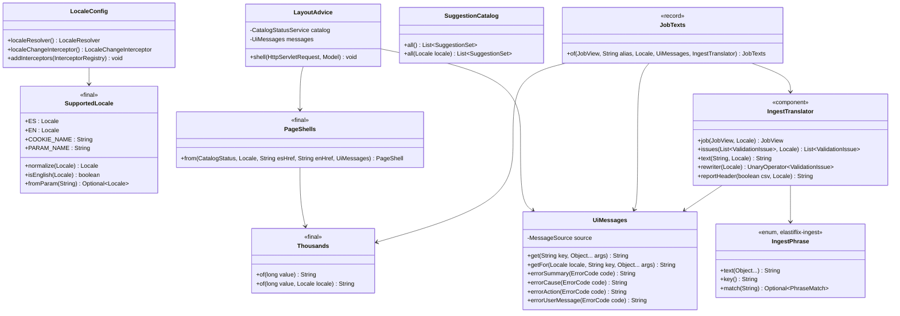
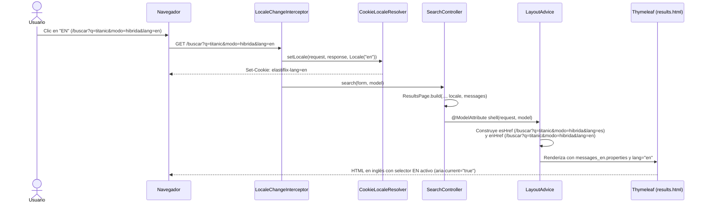

# Diseño — Fase 8: Interfaz en español e inglés (i18n)

> Resultado de la tarea 8.0 (Requerimiento 2), en el commit `788a0d8`. La fase 8 no siguió `docs/diseno/_PLANTILLA.md`:
> las secciones «Estado de aprobación» y las de la 8 en adelante se agregaron en la revisión 4 (U-38), con lo que
> registran git y `progreso/8.md`. No cambian lo que el diseño decía.

## Estado de aprobación

- **Requiere aprobación del usuario:** no. PLAN no le asigna compuerta 🔒 (§8 la pide en las fases 1, 2 y 3; la
  fase 7 la tuvo y la 8 no).
- **Estado:** no requiere aprobación.
- **Aprobación:** no hay registro de que Adolfo viera o aprobara este diseño antes de la implementación. Lo único suyo
  registrado sobre la fase es el arranque («/goal Tu objetivo es completar el Requerimiento 2.», 2026-10-19) y la
  orden de fusionar la rama (PR #24, 2026-10-20 05:14 UTC). Ver `progreso/INDICE.md` › «Aprobaciones del usuario».

## 1. Objetivo y alcance

Esta fase implementa el **Requerimiento 2** de `PLAN.md`: ofrecer toda la interfaz web de **Elastiflix-Movies Java** en **español (`es`)** e **inglés (`en`)**, siguiendo los mockups aprobados (`Main-en.dc.html`, `Results-en.dc.html`, `Detail-en.dc.html`, `Ingest-en.dc.html` y `About-en.dc.html`) y el glosario oficial `docs/i18n/glosario-en.md`.

### Reglas principales

1. **Idioma por defecto y resolución:**
   - El idioma inicial es siempre **español (`es`)**, ignorando la cabecera `Accept-Language` del navegador.
   - El cambio de idioma se realiza mediante el parámetro de consulta `lang` (`es` o `en`) en cualquier ruta (`GET /`, `/buscar`, `/pelicula/{id}`, `/cargar`, `/acerca`).
   - La elección se recuerda en una cookie HTTP (`elastiflix-lang`) mediante `CookieLocaleResolver` y `LocaleChangeInterceptor`.
   - Cualquier valor de `lang` distinto de `es` o `en` se ignora y conserva el idioma actual.
2. **Selector de idioma en la cabecera (`chrome.html`):**
   - Cada página incluye en `.site-header` un `<nav class="lang-switch" aria-label="Idioma|Language">` con dos enlaces (`ES` y `EN`), atributos `lang`, `hreflang`, `title` (`Español` / `English`), texto oculto accesible (`.visually-hidden`) y `aria-current="true"` en el idioma activo.
   - Ambos enlaces apuntan a la **misma ruta y conservan todos los parámetros de la URL actual**, reemplazando únicamente `lang=es` o `lang=en`.
3. **Catálogo de mensajes y cero textos fijos en plantillas o JS:**
   - Todos los textos de interfaz viven en `messages_es.properties` y `messages_en.properties` (UTF-8) en `elastiflix-web`.
   - El texto en español no cambia ni una tilde respecto a lo publicado.
   - Los cuatro scripts (`home.js`, `results.js`, `detail.js`, `ingest.js`) no contienen literales en español: leen sus textos desde atributos `data-*` renderizados por Thymeleaf o desde las respuestas JSON del servidor.
4. **Códigos `EFX-*` y logs:**
   - `ErrorCode` conserva sus textos en español para los logs (`SLF4J`).
   - La capa web resuelve `error.<CÓDIGO>.summary`, `error.<CÓDIGO>.cause` y `error.<CÓDIGO>.action` según el `Locale` activo.
5. **Formatos numéricos por idioma:**
   - Miles con espacio en español (`6 899`, `160 000 000 USD`) y con coma en inglés (`6,899`, `160,000,000 USD`).
   - Punto decimal en ambos idiomas (`0.774`, `8.4`, `107.3 MB`).
   - Fechas en formato ISO `yyyy-MM-dd` en ambos idiomas.

---

## 2. Arquitectura y componentes

### Diagrama de clases (Mermaid)

> **Revisión 4 (U-13, U-17, 2026-10-21):** este diagrama reemplaza al de la fase 8, en el que `IngestTranslator`
> comparaba frases en español copiadas de `elastiflix-ingest` y `EnglishJobTexts` duplicaba en Java los textos
> en inglés. Ahora cada frase fija de la carga vive en `IngestPhrase` (vocabulario de ingest, que sabe
> escribirla y reconocerla) y se traduce por su clave `ingest.phrase.*`; `JobTexts` arma todos sus textos desde
> `messages_*.properties` en los dos idiomas; el informe CSV se genera ya traducido con
> `ValidationReport.toErrorCsv(header, rewrite)`. `ValidationIssueTranslator`, `CsvColumnTranslator` y
> `EnglishJobTexts` se borraron.

### Diagrama de secuencia: cambio de idioma y preservación de parámetros

---

## 3. Resolución de idioma y enlaces `ES · EN`

1. **`LocaleConfig` y `SupportedLocale` (`com.bigfito.elastiflix.web.locale`):**
   - `CookieLocaleResolver` configurado con `defaultLocale = Locale.of("es")` y `cookieName = "elastiflix-lang"`.
   - Subclase o configuración de `CookieLocaleResolver` que no consulta `request.getLocale()` (`Accept-Language`) cuando no existe cookie: devuelve siempre `es`, y normaliza cualquier cookie fuera de `{es, en}` a `es`.
   - `LocaleChangeInterceptor` para el parámetro `lang`: solo aplica el cambio cuando el valor es exactamente `es` o `en` (ignorando valores inválidos como `fr` o vacíos, sin lanzar excepción y dejando el idioma actual intacto).
   - Para que todos los `@WebMvcTest` existentes y nuevos tengan disponible `UiMessages` y la configuración de idioma sin repetir `@Import` en cada test, `LayoutAdvice` (o `@ControllerAdvice` / configuración web escaneada por `@WebMvcTest`) expone los enlaces del selector e integra `UiMessages` con el `MessageSource` autoconfigurado por Spring Boot.
2. **Construcción de `esHref` y `enHref`:**
   - A partir de `HttpServletRequest.getRequestURI()` y `HttpServletRequest.getParameterMap()`, se reconstruye la query string manteniendo el orden y todos los valores de cada parámetro (incluidos filtros multivalor como `genero`, `idioma`, `clasificacion`), y fijando `lang=es` para el botón español y `lang=en` para el botón inglés.
   - En rutas de error reenviadas por el contenedor (`/error`), se toma `RequestDispatcher.ERROR_REQUEST_URI` (o `/` si no existe) para que el selector recargue la URL original en el idioma elegido.

> **Revisión 4 (U-08, U-19, U-23):** así quedó el código.
>
> - `LanguageSwitchLinks` toma los parámetros solo de `getQueryString()`, nunca de `getParameterMap()`, que incluye
>   el cuerpo de un `POST`. Cada segmento de la ruta se decodifica y se codifica una sola vez: `/pelicula/caf%C3%A9`
>   ya no sale como `caf%25C3%25A9`, y un `%2F` dentro de un id sigue en su segmento. Un escape mal formado lleva a
>   Inicio.
> - Si la petición no es `GET` ni `HEAD`, el selector enlaza a `/cargar` (si la ruta empieza por `/cargar/`) o a
>   `/`, sin parámetros. Así un `POST /cargar/registro` rechazado ya no enlaza a `GET /cargar/registro?…` (405)
>   con los campos del formulario en la URL.
> - En `/error`, el selector lee la ruta, el método y los parámetros de la petición original
>   (`jakarta.servlet.error.request_uri`, `.method` y `.query_string`).
> - La cookie `elastiflix-lang` es `HttpOnly` (ningún script la lee) y `SameSite=Lax`. Una cookie ilegible
>   (`elastiflix-lang=e$`) se ignora con `setRejectInvalidCookies(false)` y la página sale en español; antes daba
>   500 en todas las páginas.
> - `lang` solo acepta `es` o `en` en minúsculas: `lang=EN` y `lang=` vacío se ignoran.
> - Ya no hay `UiMessages.defaultCatalog()` ni `DEFAULT_INSTANCE`: el único `UiMessages` de la aplicación es el
>   bean de `LocaleConfig`. Como `LocaleConfig` es un `WebMvcConfigurer`, cada `@WebMvcTest` lo carga y tiene el
>   bean sin `@Import`. Una prueba sin Spring crea el suyo con `new UiMessages(UiMessages.createMessageSource())`.

---

## 4. Consultas de ejemplo en inglés (`SuggestionCatalog`)

De acuerdo con `PLAN.md` y `design/mockups/Main-en.dc.html`, las sugerencias de Inicio en inglés (`Locale` `en`) usan las consultas del mockup inglés y las posiciones verificadas el 2026-10-19 contra el catálogo vigente (`elastiflix-reloaded`, 6 899 películas, `k = 100`, `num_candidates = 200`):

### 4.1. Modo Full-text (`LexicalSuggestions`)
Las consultas son las mismas que en español; las etiquetas se traducen según `Main-en.dc.html`. Los conteos se
volvieron a medir el 2026-10-21 sobre 6 899 películas (revisión 4, U-24); los de abajo son los vigentes:
- `match · title`:
  - `Spirited Away` → `translated title`
  - `dark knight` → `OR: 57 results` / `AND: 5 results`
  - `love story` → `OR: 107 results` / `AND: 3 results`
- `match · original_title`:
  - `Kolejne 365 dni` → `original title · in title: 3` (OR) / `original title · in title: 0` (AND)
  - `el secreto` → `OR: 35 results` / `AND: 2 results`
  - `le fabuleux destin` → `OR: 26 results` / `AND: 1 result`
- `multi_match`:
  - `heaven cielo` → `OR: 10 results` / `AND: 0 · words in different fields`
  - `next kolejne` → `OR: 15 results` / `AND: 0 · words in different fields`
  - `parasite 기생충` → `OR: 1 result` / `AND: 0 · words in different fields`

### 4.2. Modo Vectorial (`VectorSuggestions`)
Posiciones verificadas contra el índice vigente (`k = 100`, `num_candidates = 200`):

| Consulta en inglés | Película (`id`) | `plot_256` | `plot_512` | `plot_1024` |
|---|---|---|---|---|
| `a luxury liner hits an iceberg on its maiden voyage` | Titanic (`597`) | `36th place` | `5th place` | `3rd place` |
| `a thief steals secrets by entering people's dreams` | Inception (`27205`) | `outside the top 100` | `18th place` | `11th place` |
| `a lonely robot cleaning up Earth` | WALL·E (`10681`) | `1st place` | `1st place` | `1st place` |
| `un robot solitario que limpia la Tierra` | WALL·E (`10681`) | `in Spanish · WALL·E: 1st place` | `in Spanish · WALL·E: 1st place` | `in Spanish · WALL·E: 1st place` |
| `a shipwrecked boy shares a lifeboat with a Bengal tiger in the middle of the ocean` | Life of Pi (`87827`) | `3rd place` | `1st place` | `1st place` |
| `a girl is trapped in a spirit world and works in a bathhouse to save her parents, who were turned into pigs` | Spirited Away (`129`) | `6th place` | `2nd place` | `1st place` |
| `a boy hides a small lost alien and helps him get back to his planet` | E.T. (`601`) | `7th place` | `3rd place` | `1st place` |

### 4.3. Modo Híbrido (`HybridSuggestions`)
Verificadas contra el índice vigente (`k = 100`, `num_candidates = 200`):
- Operador `OR`:
  - `dark knight joker chaos in the city` → `title + plot`
  - `titanic love story on a sinking ship` → `Titanic: 1st vector, 4th lexical`
  - `ocean's eleven casino heist` → `title + plot`
- Operador `AND`:
  - `toy story toys that come to life` → `AND: lexical 0 · vector decides`
  - `pan's labyrinth faun girl in the war` → `AND: lexical 0 · vector decides`

**Consulta de ejemplo de Resultados en inglés** (revisión 4, U-22): «titanic love story on a sinking ship» se midió
el 2026-10-21 sobre las 6 899 películas del catálogo vigente, en modo híbrido: Titanic queda **1.º en RRF**, 1.º en
la lista vectorial y 4.º en la léxica. El componente léxico OR devuelve **473** películas en `title`. La fase 8 no
había registrado estos valores, como pedía PLAN.

---

## 5. Comportamiento al cambiar de idioma en «Cargar datos» (`/cargar`)

`PLAN.md` pide definir explícitamente qué ocurre cuando la persona cambia de idioma en `/cargar` en dos situaciones:

1. **Con un trabajo de validación o importación en curso (o recién validado/terminado):**
   - `JobStore` mantiene el trabajo en memoria identificado por `jobId`.
   - Cuando `ingest.js` recibe el `jobId` tras `POST /cargar/archivo`, añade el parámetro `job=<jobId>` a los enlaces del selector de idioma (`.lang-switch a[hreflang]`) y actualiza la barra de direcciones con `history.replaceState`.
   - Al pulsar `EN` o `ES`, el navegador carga `GET /cargar?job=<jobId>&lang=en` (o `es`).
   - Al iniciar, `ingest.js` detecta el parámetro `job` en la URL, abre la pestaña de archivo y reanuda el sondeo `GET /cargar/trabajos/{jobId}` inmediatamente. *Revisión 4:* la pestaña (JSON o CSV) sale de `job.kind` en el primer estado (U-20); un `job` que no tiene forma de UUID se quita de la URL y de los enlaces de idioma sin usarse, y el id viaja con `encodeURIComponent` en cada ruta (U-21).
   - Como `GET /cargar/trabajos/{jobId}` y `GET /cargar/trabajos/{jobId}/informe.csv` traducen y formatean `JobView`, `JobTexts`, las columnas CSV, las comprobaciones, las advertencias y los errores según el `Locale` activo de la petición, el progreso o el resultado del trabajo se muestra enseguida en el nuevo idioma sin perder ni reiniciar el trabajo. Si el `jobId` ya no existe en el servidor (404), `ingest.js` limpia el parámetro `job` y muestra el estado inicial.
2. **Con el formulario de «Registro individual» a medio llenar:**
   - El selector de idioma ejecuta una navegación `GET /cargar?lang=en` (o `es`).
   - Un formulario a medio llenar no se ha enviado al servidor ni constituye un documento válido, por lo que no se persiste un borrador parcial en sesión; la página se recarga limpia en el idioma seleccionado.
   - Si la persona ya había enviado el formulario y fue rechazado o guardado, al volver a enviarlo en el idioma activo las incidencias o el aviso de guardado se renderizan en ese idioma.

---

## 6. Traducción de respuestas dinámicas en `elastiflix-web`

Para no acoplar `elastiflix-search` ni `elastiflix-ingest` a Spring MVC ni a `MessageSource` (manteniendo intactas las reglas de `ArchitectureTest` y las pruebas unitarias de esos módulos):
- `Thousands.of(long, Locale)` en `elastiflix-core` formatea con espacio en español y con coma en inglés (`Locale.ENGLISH`). `Thousands.of(long)` sigue delegando al formato español por compatibilidad.
- En `elastiflix-web`:
  - `ResultsPage`, `ModeCopies`, `AppliedFilters`, `FacetChoices` y `ResultCards` usan `UiMessages` y `Thousands.of(..., locale)`. `ResultCards` arma «#n» o «fuera de su top k» / «outside its top k» con el `rank` y el `k` de `ComponentScore` (revisión 4, U-16: antes comparaba la frase en español que devolvía search).
  - `MovieDetailPage`, `MovieDetailTables`, `MovieDetailBadges` y `MovieDetailSearchChips` usan `UiMessages` y `Thousands.of(..., locale)` para las etiquetas de campos, los estados (`Sí`/`No` → `Yes`/`No`), los montos en USD (`160,000,000 USD`), la duración (`148 min`) y las fichas del estado de búsqueda.
  - *Revisión 4 (U-37):* la fase 8 no tocó `FacetChoices` ni `MovieDetailBadges`; no tienen textos de la interfaz, así que no lo necesitaban.
  - `IngestTranslator` y `JobTexts` ponen en el idioma de la persona los textos de `JobView` (`CsvColumnRow`, `ValidationIssue`, `WarningCount`, `checks`, `failureMessage`), los rechazos del registro individual, el 413 y el informe `/cargar/trabajos/{jobId}/informe.csv`, encabezado y celdas (revisión 4: por clave de `IngestPhrase`, no comparando frases).
  - *Revisión 4 (U-12):* toda cifra que entra a `MessageFormat` se pasa ya escrita con `Thousands.of(n, locale)`,
    como `String`: `k` de Vectorial e Híbrida, el lote de «Acerca de» y del paso 4, los números de lote del avance y
    los conteos del reparto y de las palabras clave. `MessageFormat` agrupaba un entero con punto («k = 1.000») y el
    proyecto escribe «1 000» en español y «1,000» en inglés.

---

## 7. Plan de pruebas y verificación

1. **Paridad de catálogos (`MessageCatalogParityTest`):**
   - Verifica que `messages_es.properties` y `messages_en.properties` tengan exactamente el mismo conjunto de claves, sin valores vacíos, y que existan las claves `.summary`, `.cause` y `.action` para todos los valores de `ErrorCode`.
2. **Ausencia de literales fijos en español (`TemplatesAndScriptsI18nTest`):**
   - Inspecciona todas las plantillas `src/main/resources/templates/**/*.html` y todos los scripts `src/main/resources/static/js/*.js` para verificar que los textos visibles se resuelven mediante `#{…}` o `data-*` y que ningún `.js` contiene frases fijas en español.
3. **Pruebas `MockMvc` de idioma (`LocaleSwitchTest` y pruebas por página):**
   - Sin cookie y con `Accept-Language: en-US`, la respuesta sale en español (`<html lang="es">`).
   - Con `lang=en`, responde en inglés (`<html lang="en">`) y envía la cookie `elastiflix-lang=en`.
   - Con un valor inválido (`lang=fr`), se ignora y se mantiene el idioma actual.
   - El selector `ES · EN` conserva todos los parámetros de búsqueda, filtros y paginación.
   - Todas las páginas (`/`, `/buscar`, `/pelicula/{id}`, `/cargar`, `/acerca`, `/error`, 404) y los endpoints de carga (`/cargar/trabajos/{jobId}`, `/cargar/trabajos/{jobId}/informe.csv`) responden con los textos en inglés de los mockups aprobados.

> *Revisión 4:* `TemplatesAndScriptsI18nTest` quedó más débil que lo descrito en el punto 2: en las plantillas solo
> exigía `th:` y en el JS buscaba 19 frases (U-15 la reescribió). `-Pit` corrió solo con `-pl elastiflix-web`
> (U-02 corrió la verificación completa).

---

## 8. Requerimientos cubiertos

| Tarea de `PLAN.md` | Referencia | Cómo la cubre este diseño |
|---|---|---|
| 8.0 Diseño | Requerimiento 2 | Este documento: §2 a §7 |
| 8.1 Idioma, miles y selector | «Decisiones de Adolfo», «Selector de idioma», «Formatos por idioma» | §1 reglas 1, 2 y 5; §3 |
| 8.2 Catálogos y `UiMessages` | «Implementación esperada» | §1 reglas 3 y 4; §2 |
| 8.3 Inicio | «Consultas de ejemplo» | §4 |
| 8.4 Resultados | «Qué se traduce» | §6 |
| 8.5 Detalle | «Qué se traduce» | §6 |
| 8.6 Cargar datos | «Pendiente de definir al diseñar la fase», «Qué se traduce» | §5 y §6 |
| 8.7 Paridad, pruebas y verificación | «Criterios de aceptación» | §7 |

## 9. Dudas y supuestos

La fase no registró dudas. El diseño da por hechos, sin marcarlos como supuestos:

- **Cookie fuera de `{es, en}`:** se normaliza a `es` (§3). *Revisión 4 (U-19):* con el valor por defecto de
  `rejectInvalidCookies`, una cookie con caracteres no válidos daba 500 en lugar de normalizarse; desde
  `39c0276` se ignora (ver la nota de §3).
- **`Thousands.of(long)`** sigue formateando en español, por compatibilidad (§6).
- **Formulario de registro a medio llenar:** no se guarda; cambiar de idioma recarga la página limpia (§5).
- **Posiciones de las consultas en inglés:** se midieron el 2026-10-19 sobre 6 899 películas con `k = 100` y
  `num_candidates = 200` (§4).

## 10. Patrones usados

La fase no declaró patrones. No agregó ninguno de la lista cerrada (`docs/convenciones-java.md` §4): `LocaleConfig`
configura dos componentes de Spring (`CookieLocaleResolver` y `LocaleChangeInterceptor`) y `UiMessages` envuelve el
`MessageSource`.

- *Desviación (revisión 4, U-18):* `UiMessages.DEFAULT_INSTANCE` era un singleton manual, que las convenciones §4
  prohíben, y se usaba en producción además del bean de Spring. U-18 (`1cc176b`) lo borró junto con
  `defaultCatalog()`: `ErrorPageController`, `ErrorPages`, `AppliedFilters` y `ModeCopies` reciben el bean.
- *Revisión 4 (U-13, U-17):* `IngestPhrase` es un `enum` de `elastiflix-ingest` con las frases fijas de la carga; no
  es un patrón nuevo.

## 11. Errores

La fase no agregó códigos `EFX`. Lo que cambia es dónde se escribe el texto de los existentes:

| Situación | Comportamiento |
|---|---|
| Cualquier `EFX-*` en una página | La web lo muestra con `error.<código>.summary`, `.cause` y `.action` del idioma activo; `ErrorCode` conserva el español para los logs |
| `lang` distinto de `es` o `en` | Se ignora y se queda el idioma actual; no es un error |
| `job` de `/cargar?job=` que ya no existe | `ingest.js` quita el parámetro y muestra el estado inicial (§5) |
| `job` que no es un UUID (revisión 4, U-21) | `ingest.js` lo quita sin usarlo |
| Cookie `elastiflix-lang` ilegible (revisión 4, U-19) | Se ignora y la página sale en español; no es un error |

## 12. Logging

La fase no agregó logs. Los existentes siguen en español (PLAN, «Qué no se traduce»), y los textos de `ErrorCode`
que van a los logs no cambian con el idioma de la persona.

## 13. Alternativas descartadas

La fase 8 no registró alternativas. La revisión 4 descartó una al corregir la traducción de «Cargar datos» (U-13,
`progreso/revision-4.md` › «Decisiones»): que `ValidationIssue` llevara un código y argumentos en lugar de textos.
Se descartó porque sus textos tienen que seguir en español para los logs, el informe en español y el JSON que lee
`ingest.js`, y así el contrato JSON no cambia; en su lugar, cada frase fija vive en `IngestPhrase` y la web traduce
por su clave.

## 14. Supresiones de la verificación automática

Ninguna. La fase 8 no agregó `@SuppressWarnings` ni excluyó reglas de Checkstyle o PMD.

## 15. Cambios respecto al diseño aprobado

> El diseño no se aprobó (ver «Estado de aprobación»); esta tabla compara lo que dice con lo que se fusionó en
> `3c27c40` y con lo que cambió la revisión 4.

| Qué cambió | Por qué |
|---|---|
| **`PageShells.from`.** El diagrama fija `from(CatalogStatus, Locale, String esHref, String enHref, UiMessages)`. La fase 8 dejó `from(CatalogStatus)` y `from(CatalogStatus, HttpServletRequest)`, que arma los enlaces del selector desde la petición. Hoy es `from(CatalogStatus, HttpServletRequest, UiMessages)` (revisión 4, U-17, `0703166`) | La fase no lo registró. La revisión 4 pasó los textos del pie y de la cabecera al catálogo de mensajes |
| **Informe CSV.** El diagrama original fijaba `IngestTranslator.toErrorCsv(String spanishCsv, Locale, UiMessages)`. La fase 8 lo hizo como `toErrorCsv(String rawCsv, Locale, boolean isCsv)`, que traducía el CSV ya escrito en español. Hoy el informe sale traducido de `ValidationReport.toErrorCsv(header, rewrite)` en `elastiflix-ingest`, con `IngestTranslator.reportHeader` y `rewriter` (revisión 4, U-13, `56aeaf9`) | La fase no lo registró. Traducir el CSV ya escrito dejaba celdas en español (U-13) |
| **Traducción de la carga por vocabulario.** La fase 8 comparaba frases en español copiadas de `elastiflix-ingest` (`ValidationIssueTranslator`, `CsvColumnTranslator`) y duplicaba los textos en inglés en Java (`EnglishJobTexts`). La revisión 4 lo reemplazó por `IngestPhrase` y claves `ingest.phrase.*`, y `JobTexts` arma todo desde `messages_*.properties` (ver la nota del diagrama de clases) | Decisión 3 de Adolfo en la revisión 4: «Corrígela de fondo» (U-13, U-17) |
| **`ResultCards`, `ResultsPage` y `EmptyState`** comparaban frases en español de `elastiflix-search`. La revisión 4 (U-16, `3d1933f`) les dio datos: `EmptyState` con tipo, `ComponentScore(score, rank, k)` y `Pagination(first, last)` | Cambiar una tilde en search rompía el inglés sin que fallara una prueba |
| **Etiquetas de Inicio y textos de la cabecera** escritos en Java con `if (isEnglish)`. La revisión 4 (U-17, `0703166`) los pasó a `home.suggest.*` y `layout.catalog.*` | PLAN pide los textos en `messages_*.properties` |
| **§6 nombra `FacetChoices` y `MovieDetailBadges`**, que la fase no tocó | No tienen textos de la interfaz (revisión 4, U-37) |
| **Textos fijos en `ingest.html` e `ingest.js`**, contra la regla 3 de §1 | Los quitaron U-14 y U-15 en la revisión 4 (`a26826e`) |
| **Conteos léxicos de §4.1** | Se volvieron a medir el 2026-10-21 (revisión 4, U-24) |
| **Selector y cookie (§3).** El selector usa `getQueryString()` en lugar de `getParameterMap()`, codifica la ruta una sola vez por segmento, enlaza a `/cargar` o `/` después de un método que no es `GET` ni `HEAD` y en `/error` lee también el método y los parámetros originales. La cookie es `HttpOnly` y `SameSite=Lax`, y una ilegible se ignora (ver la nota de §3) | Revisión 4, U-08 (`9f99135`) y U-19 (`39c0276`): el selector volvía a codificar la ruta, copiaba los campos de un `POST` a la URL y una cookie inválida daba 500 |
| **`UiMessages` sin singleton.** El diagrama de §2 todavía muestra `errorUserMessage(code)`, que se borró por no tener uso; también se borraron `DEFAULT_INSTANCE` y `defaultCatalog()` | Revisión 4, U-18 (`1cc176b`): convenciones §4 |
| **Cifras ya escritas con `Thousands`** antes de entrar a `MessageFormat` (§6) | Revisión 4, U-12 (`f497d1b`, `ff2d916`, `77083e1`): salía «1.000» en español |
| **Textos en inglés del mockup.** `error.EFX-SRCH-001.summary` y `home.query.error` dicen «Type the movie you're looking for before you press Search»; `error.EFX-ES-001.summary`, «Couldn't connect to Elasticsearch»; `detail.fact.id`, «Id»; `detail.cast.showMore`, «See the full cast ({0})». Se borraron las claves sin uso `results.query.error`, `results.adjust.mode.*` y `detail.poster.defaultAlt`. «Créditos» abre con la frase de TMDB del mockup (`about.credits.intro`) y marca con `lang` cada aviso | Revisión 4, U-22 (`d8ea314`, `45865dc`) y U-18 |
| **`detail.chip.pageFormat`** es «{0} · {1} por página», sin el total de páginas que pide el mockup | El detalle no conoce el total sin agregar un parámetro a PLAN §5 (decisión del integrador, 2026-10-21; ver `docs/diseno/7.md`) |
| **Reanudar `?job=` (§5).** La pestaña sigue `job.kind` (un CSV ya no abre «Import .json»), y `ingest.js` solo acepta un UUID y codifica el id en cada ruta de `fetch` | Revisión 4, U-20 (`c7389c7`) y U-21 (`6d0c7c3`) |
