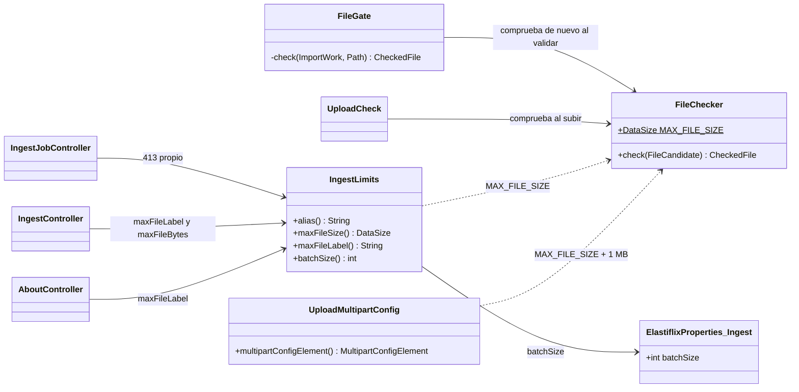
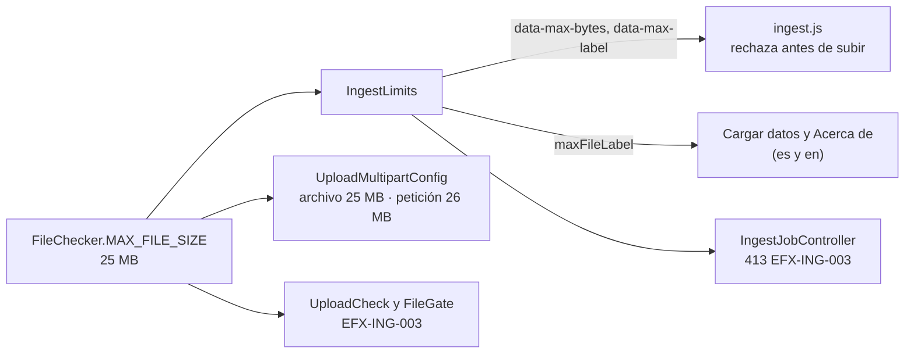

# Diseño — Fase 9: archivos de carga de hasta 25 MB (Requerimiento 3)

> Resultado de la tarea 9.0. Se hace commit **antes** de escribir código de producción. Sigue
> `docs/convenciones-java.md`.

## Estado de aprobación

- **Requiere aprobación del usuario:** no. PLAN §8 pide compuerta 🔒 solo en las fases 1, 2 y 3. Las decisiones
  de fondo ya las tomó Adolfo el 2026-10-19 (PLAN › «Requerimiento 3»): 25 MB fijos y sin configuración.
- **Estado:** no requiere aprobación.
- **Aprobación:** Adolfo dio el consentimiento para arrancar el 2026-10-21 («Continua con el requerimiento 3.»),
  registrado en `progreso/INDICE.md` › «Aprobaciones del usuario».

## Propósito

El tamaño máximo de un archivo `.json` o `.csv` de «Cargar datos» baja de 150 MB a **25 MB** y deja de ser
configurable. Una sola constante del código da el tope del navegador, el del servidor, el del multipart y los textos
de las páginas en los dos idiomas. Todo lo demás de la carga queda igual: extensión, sin dobles extensiones, UTF-8,
encabezado obligatorio en CSV, validación todo o nada, vectores con inferencia y publicación atómica.

## Requerimientos cubiertos

| Tarea de `PLAN.md` | Referencia | Cómo la cubre este diseño |
|---|---|---|
| 9.1 | PLAN › «Requerimiento 3» › «Decisión de Adolfo» y «Servidor» | `FileChecker.MAX_FILE_SIZE` (25 MB). `FileChecker.check` ya no recibe el tope. Se quitan `ElastiflixProperties.Ingest.maxFileSize`, `elastiflix.ingest.max-file-size` y `ELASTIFLIX_INGEST_MAX_FILE_SIZE`. `IngestLimits`, `UploadMultipartConfig` y `FileGate` leen la constante. |
| 9.2 | «Navegador» y «Pruebas» | `ingest.js` toma el tope solo de `data-max-bytes` y `data-max-label`, sin los 150 MB de reserva. Prueba de navegador nueva: 25 MB pasa y 25 MB + 1 byte se rechaza con el texto en español y en inglés. |
| 9.3 | «Textos» y «Documentación» | Las páginas ya leen `maxFileLabel`: no hay textos que cambiar en `messages_*.properties`. Se actualizan `AGENTS.md`, README, PLAN §1, §7, §8 y variables, `docs/diseno/1.md`, `3.md` y `4.md`, y `docs/convenciones-java.md`. |

## Dudas y supuestos

1. **25 MB son 25 × 1024 × 1024 = 26 214 400 bytes**, igual que `DataSize.ofMegabytes(25)` y que los 150 MB de
   antes (150 × 1024 × 1024). El archivo de ese tamaño exacto se acepta; uno de 26 214 401 bytes, no.
2. **La constante vive en `elastiflix-ingest`** (`FileChecker.MAX_FILE_SIZE`): es la regla del dominio que aplica
   `FileChecker`, y la web ya depende de `ingest`. `elastiflix-core` no la necesita, así que no va en
   `ElastiflixProperties`.
3. **`ELASTIFLIX_INGEST_MAX_FILE_SIZE` en un `.env` viejo se ignora en silencio.** Spring no falla por una
   propiedad que nadie lee. Las pruebas lo comprueban: con `ELASTIFLIX_INGEST_MAX_FILE_SIZE=200MB` en el entorno,
   la página dice 25 MB y el servidor rechaza 25 MB + 1 byte. El README avisa que la variable ya no existe.
4. **El lote sigue configurable** (`ELASTIFLIX_INGEST_BATCH_SIZE`); el requerimiento solo toca el tamaño.
5. **El texto del rechazo en el navegador no cambia de forma:** «El archivo pesa X MB y el máximo permitido es 25
   MB.». Con 25 MB + 1 byte, `X` sale «25.0», porque la página redondea a un decimal; el mensaje sigue siendo
   cierto (el archivo sí supera el tope). Se acepta así y no se agrega un tercer formato de tamaño.
6. **Los mockups ya dicen 25 MB** (`Ingest*.dc.html`, `About*.dc.html`); esta fase no los toca.

## Diagrama de clases

## Secuencia o flujo

El flujo de la carga no cambia; solo el origen del tope. Dónde se compara:

## Responsabilidades

| Clase | Responsabilidad en una frase | Cambio |
|---|---|---|
| `FileChecker` | Repite en el servidor extensión, tamaño y UTF-8. | Declara `MAX_FILE_SIZE` y `check(candidate)` deja de recibir el tope. |
| `ElastiflixProperties.Ingest` | Lote de escritura de la carga. | Pierde `maxFileSize`; queda `Ingest(int batchSize)`. |
| `FileGate` | Repite la comprobación al validar el trabajo. | Llama a `check(candidate)`. |
| `IngestLimits` | Alias, tope y lote como los muestra «Cargar datos». | `maxFileSize()` devuelve la constante. |
| `UploadMultipartConfig` | Topes del multipart de Tomcat. | Archivo = constante; petición = constante + 1 MB. Ya no recibe `IngestLimits`. |
| `UploadCheck`, `IngestJobController`, `IngestController`, `AboutController` | Sin cambios de forma: siguen leyendo `IngestLimits`. | — |
| `ingest.js` | Comprobación en el navegador. | Sin los 150 MB de reserva: el tope llega solo de la página. |

## Patrones usados

Ninguno nuevo.

## Errores

| Código | Cuándo ocurre | Causa probable | Acción sugerida |
|---|---|---|---|
| `EFX-ING-003` | El archivo pesa más de 25 MB (26 214 401 bytes o más). En la web, HTTP 413. | Archivo demasiado grande. | Partir el archivo en partes de hasta 25 MB (el requerimiento 4 agregará el modo append para cargarlas). |

El texto del código no cambia: «El archivo supera el tamaño máximo», sin cifra.

## Logging

Sin cambios.

## Pruebas previstas

| Prueba | Comportamiento que verifica | Tipo |
|---|---|---|
| `FileCheckerTest` | La constante vale 26 214 400 bytes; 25 MB exactos pasan a la comprobación de UTF-8; 25 MB + 1 byte da `EFX-ING-003` sin leer el contenido. | unitaria (ingest) |
| `ElastiflixPropertiesTest` | `Ingest` solo trae el lote (100 por defecto). | unitaria (core) |
| `MultipartLimitsTest` | Archivo 25 MB y petición 26 MB, también con `elastiflix.ingest.max-file-size=200MB` en el entorno; el YAML ya no tiene `max-file-size`. | unitaria (web) |
| `IngestUploadLimitTest` (antes `IngestConfiguredLimitsTest`) | Con `ELASTIFLIX_INGEST_MAX_FILE_SIZE=200MB` y lote 50 en el entorno: la página dice «Máximo 25 MB», `data-max-bytes="26214400"` y lotes de 50; 25 MB pasa y 25 MB + 1 byte responde 413 `EFX-ING-003`. | unitaria (MockMvc) |
| `IngestJobErrorTest` | El 413 con un archivo que dice pesar 25 MB + 1 byte (ya no con un tope de 32 B por propiedad). | unitaria (MockMvc) |
| `IngestPageTest`, `AboutPageTest`, `AboutLimitsTest` | Los textos dicen 25 MB en español y en inglés, y nunca 150 MB ni 200 MB. | unitaria (MockMvc) |
| `size.test.js` | En el navegador, 25 MB exactos habilitan «Validar archivo»; 25 MB + 1 byte muestran «El archivo pesa 25.0 MB y el máximo permitido es 25 MB.» y, con `lang=en`, su texto en inglés. | navegador (Playwright) |
| App real | Con el jar: `curl` de un JSON de 25 MB → 200 con `jobId`; de 25 MB + 1 byte → 413 `EFX-ING-003`. | manual, en la verificación de fase |

## Alternativas descartadas

- **Dejar la propiedad con 25 MB por defecto:** Adolfo decidió «fijo, no configurable».
- **Constante en `ElastiflixProperties` (core):** el tope es una regla de la carga, no configuración del núcleo.
- **Mantener la reserva de `ingest.js` con 25 MB:** sería una segunda copia del número. Sin `data-max-bytes`, el
  navegador deja pasar y el servidor rechaza igual.

## Supresiones de la verificación automática

Ninguna.

## Cambios respecto al diseño aprobado

Se completa al cerrar la fase.
